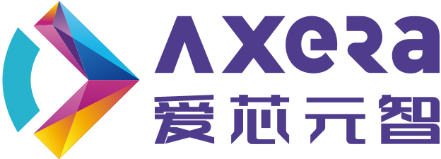
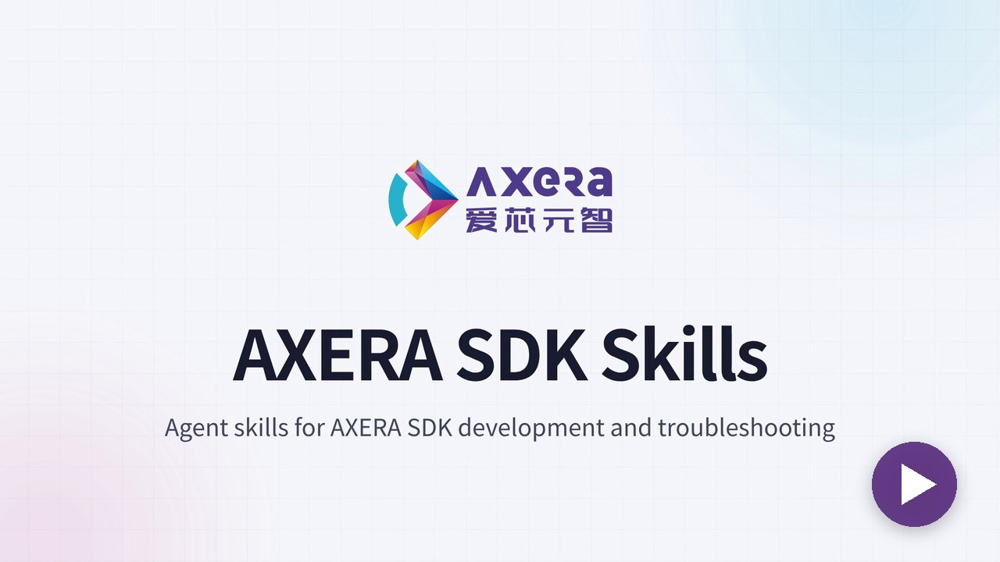
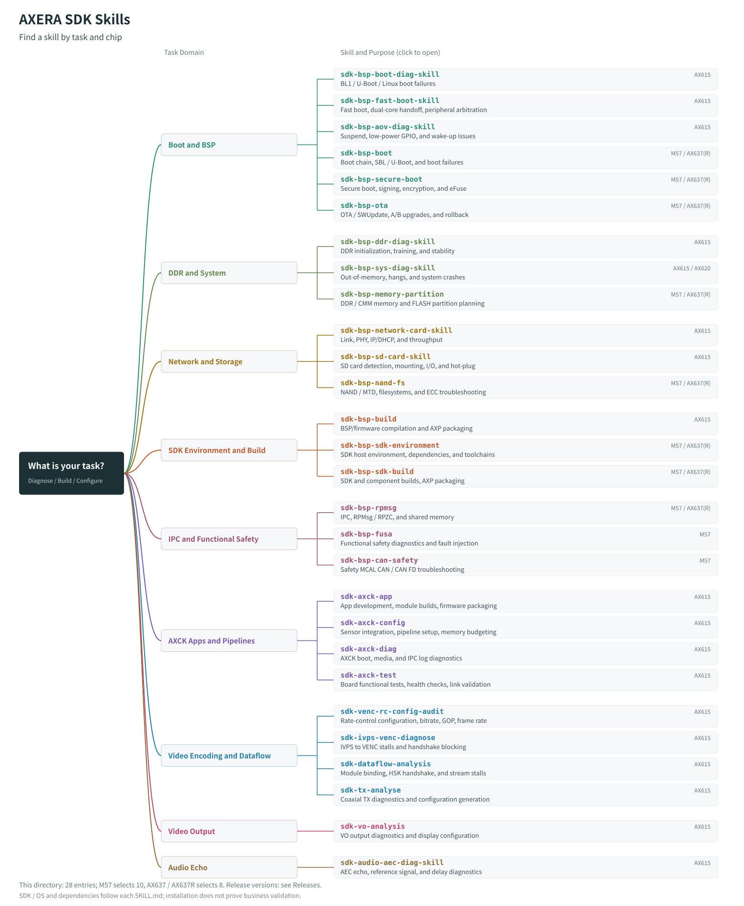

<p align="center"><a href="README.md">简体中文</a> | <strong>English</strong></p>

<p align="center">
  <a href="https://www.axera-tech.com"></a>
</p>

<h1 align="center">AXERA SDK Skills</h1>

<p align="center"><strong>Agent skills for AXERA SDK development and troubleshooting.</strong></p>

<p align="center">Equip your agent with SDK knowledge, diagnostic procedures, and tools.<br />From boot logs to video pipelines, turn field evidence into actionable analysis and verification steps.</p>

<p align="center"><a href="#skills">Explore Skills</a> · <a href="#start">Quick Start</a> · <a href="#usage">Usage</a> · <a href="#develop">Contributing</a></p>

<p align="center">
  <video src="docs/assets/axera-sdk-skills-intro.en.mp4" poster="docs/assets/axera-sdk-skills-intro-poster.en.jpg" width="720" controls preload="metadata">
    <a href="docs/assets/axera-sdk-skills-intro.en.mp4"></a>
    47-second introduction video. If it does not play, <a href="docs/assets/axera-sdk-skills-intro.en.mp4">open the video file</a>.
  </video>
</p>

https://github.com/user-attachments/assets/c2d84b71-7032-4a40-9a88-9bf10bb4cd69

---

## What Is an SDK Skill?

A skill is a task-specific capability package that an agent can load. It includes a `SKILL.md` file, reference material, and optional scripts defining **when to use it, required inputs, analysis steps, and expected deliverables**.

Describe your problem in natural language and provide the chip model, SDK version, and relevant files. The agent follows the skill to check inputs, analyze evidence, and suggest next steps. When evidence is missing, it should request additional information rather than guess a root cause.

<a id="skills"></a>
## Explore Skills

Choose a skill based on the problem you are working on.

[](docs/assets/skills-mindmap-paired.en.svg)

[View the full-size SVG](docs/assets/skills-mindmap-paired.en.svg) for skill names, purposes, and chip support. Open it separately to follow skill-name links to the corresponding `SKILL.md`.

The local baseline contains 28 standalone skill entry points. Public availability is determined by the official Release. Check each `SKILL.md` for required inputs, supported chips and SDKs, dependencies, and operational limits.

<a id="start"></a>
## Quick Start

### 1. Get the Skills

Clone this repository directly or download the source archive (`Source code (zip)` / `Source code (tar.gz)`) from **Releases**. Extract or check out the repository on Linux / WSL and enter the root directory containing `install.sh`. See [installation and maintenance details](INSTALLATION.md) (Chinese).

### 2. Install into Your Project

Requires Bash and Python 3.10+. Adjust the chip and target directory for your environment:

```bash
bash install.sh --chip AX615D \
  --target "/absolute/path/to/your-project/.agents/skills"
```

| Agent | Project Skill Directory (`--target`) |
|---|---|
| Codex | `<project-root>/.agents/skills` |
| Claude Code | `<project-root>/.claude/skills` |
| OpenCode | `<project-root>/.opencode/skills` |

If your agent runs on a remote server or inside a container, install the skills there. The chip filter does not imply that every installed skill supports that chip; check the individual skill's scope.

### Install BSP Skills for M57 / AX637

Select the required target chip:

```bash
# M57: ten BSP skills
bash install.sh --chip M57 --target "/absolute/path/to/your-project/.agents/skills"

# AX637 / AX637R: eight BSP skills; excludes M57-only FuSa and Safety CAN
bash install.sh --chip AX637R --target "/absolute/path/to/your-project/.agents/skills"
```

`AX637` and `AX637R` share an installation family. Each skill retains its platform routing and references; confirm the actual SDK and OS before running platform-specific procedures.

Use the repository names `sdk-bsp-fusa`, `sdk-bsp-nand-fs`, and `sdk-bsp-memory-partition` for FuSa, NAND/filesystem, and memory/partition tasks.

### Ask Your Agent to Install

In an agent with terminal and file access, send one of these prompts with the link to an available release:

**AX615 family (AX615D example)**

```text
Install the skills for AX615D into the current agent, verify the release assets, and confirm they can load.
Release: <link to a specific release>
```

**M57**

```text
Install the skills for M57 into the current agent, verify the release assets, and confirm they can load.
Release: <link to a specific release>
```

Ask the agent to report the installation directory and the actual loaded `SKILL.md` path. Preserve existing content and stop on conflicts.

### 3. Start a Task

Start a new session or refresh the skill list, then ask your agent:

```text
Use sdk-bsp-boot-diag-skill to investigate a boot hang.
Chip/board: <model>; SDK: <version>; serial log: <path>.
Report the actual SKILL.md path, then check compatibility and input completeness.
Identify the failure stage, cite relevant log lines, and suggest verification steps.
Request missing evidence when needed. Do not modify the project or operate the board yet.
```

<a id="usage"></a>
## Use Skills in Your Workflow

Describe the task, input files, and permitted actions in natural language. The following prompts illustrate usage; they are not measured test results.

### Review Video Bitrate Configuration

```text
Use sdk-venc-rc-config-audit to investigate bitrate exceeding the target.
Chip: <model>; SDK: <version>; inputs: <VENC proc and rate-control configuration paths>.
Separate direct evidence from inference. Suggest configuration changes and a retest plan.
```

### Operational Boundaries

- **Check compatibility first.** Prepare the SDK, toolchain, and board required by the task. Installation success is not proof of successful field validation.
- **Confirm permissions.** Agree on the scope before modifying projects, flashing firmware, rebooting, or reserving boards.
- **Keep verification records.** Save the release version, sanitized inputs, and actual outputs for reproducibility and feedback.

<a id="develop"></a>
## Development and Contributions

Start with a clear `SKILL.md`, then add scripts, references, and evaluation cases as needed:

```text
your-skill/
├── SKILL.md       # Use cases, required inputs, procedure, and output contract
├── scripts/       # Optional reusable tools
├── references/    # Optional domain references
└── evals/         # Test cases following the project's evaluation conventions
```

Report real-world issues through **Issues** and improve skills or tests through **Pull Requests**. Include the skill name, release version, agent, chip/SDK, reproduction steps, and sanitized evidence. See [CONTRIBUTING.md](CONTRIBUTING.md) for contribution guidance.

**Do not upload customer-confidential material, unpublished source code, credentials, or personal information.** Confirm that all content and assets are authorized for public distribution.

## License

See [LICENSE](LICENSE). SDKs, toolchains, and hardware documentation remain subject to their respective licenses.

---

<p align="center"><strong>AXERA SDK Skills</strong><br />Domain knowledge for agents. Practical support for SDK developers.<br /><a href="https://www.axera-tech.com">AXERA</a></p>
