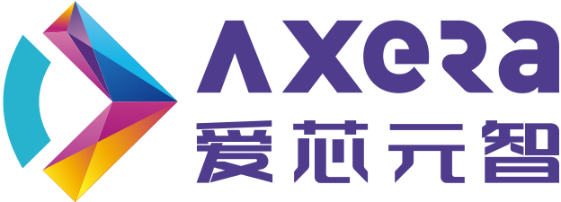
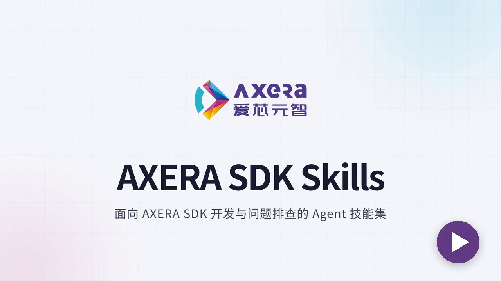
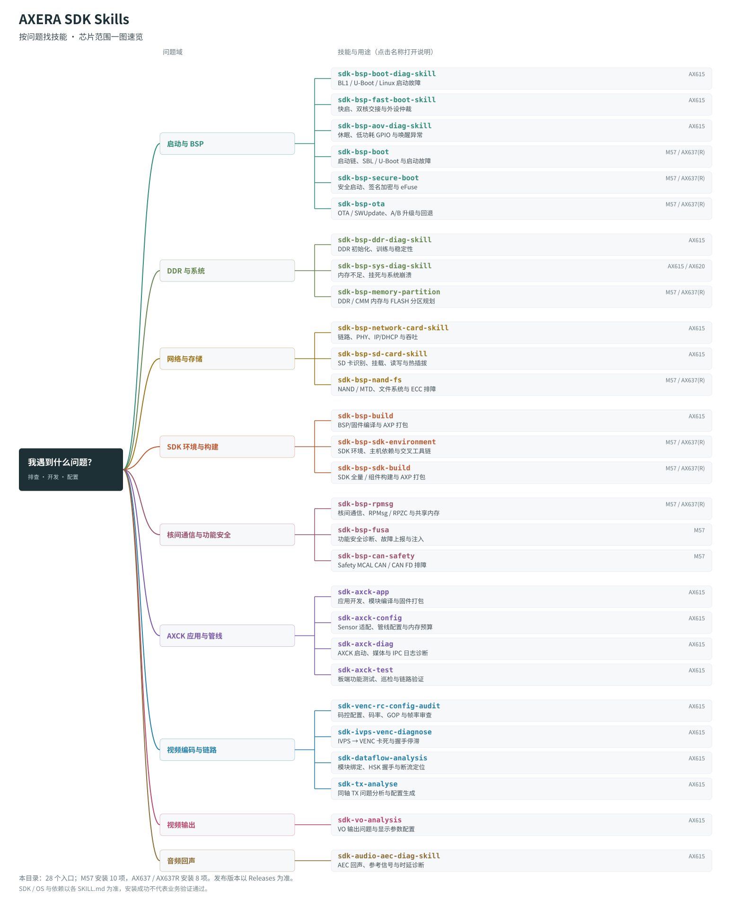

<p align="center"><strong>简体中文</strong> | <a href="README.en.md">English</a></p>

<p align="center">
  <a href="https://www.axera-tech.com"></a>
</p>

<h1 align="center">AXERA SDK Skills</h1>

<p align="center"><strong>面向 AXERA SDK 开发与问题排查的 Agent 技能集。</strong></p>

<p align="center">把 SDK 领域知识、诊断流程和工具交给 Agent。<br />从启动日志到视频链路，从配置检查到构建验证，让分析有依据，让验证有步骤。</p>

<p align="center"><a href="#skills">探索技能</a> · <a href="#start">快速开始</a> · <a href="#usage">如何使用</a> · <a href="#develop">开发与贡献</a></p>

<p align="center">
  <video src="docs/assets/axera-sdk-skills-intro.mp4" poster="docs/assets/axera-sdk-skills-intro-poster.jpg" width="720" controls preload="metadata">
    <a href="docs/assets/axera-sdk-skills-intro.mp4"></a>
  </video>
  <br /><sub>47 秒介绍视频；若浏览器无法播放，可<a href="docs/assets/axera-sdk-skills-intro.mp4">直接打开视频文件</a>。</sub>
</p>

---

## 什么是 SDK Skill？

Skill 是 Agent 可以加载的任务能力包，由 `SKILL.md`、参考资料及可选脚本组成。它告诉 Agent：**什么时候使用、需要哪些输入、如何分析、交付什么结果**。

你用自然语言描述问题，提供芯片型号、SDK 版本和现场材料；Agent 按对应技能检查信息、分析证据，并给出判断与复测建议。材料不足时，应明确提出补采要求，而不是猜测根因。

<a id="skills"></a>
## 探索技能

按当前任务选择技能，无需先了解全部目录。

[](docs/assets/skills-mindmap-paired.svg)

[查看清晰原图](docs/assets/skills-mindmap-paired.svg)，放大阅读技能名称、用途与芯片支持；单独打开 SVG 后可点击技能名称查看对应 `SKILL.md`。

具体输入、支持的芯片和 SDK、依赖及操作边界，以各技能的 `SKILL.md` 为准。本地目录共 28 个独立技能入口。公开收录范围以正式 Release 为准。

<a id="start"></a>
## 快速开始

### 1. 获取技能包

可直接克隆本仓库，或从 **Releases** 下载所需版本的源码归档（`Source code (zip)` / `Source code (tar.gz)`）。在 Linux / WSL 中解压或检出后，进入包含 `install.sh` 的仓库根目录。完整安装与维护说明见 [INSTALLATION.md](INSTALLATION.md)。

### 2. 安装到项目

准备 Bash 和 Python 3.10+，按实际芯片及 Agent 目录调整参数：

```bash
bash install.sh --chip AX615D \
  --target "/absolute/path/to/your-project/.agents/skills"
```

| Agent | 项目级技能目录（`--target`） |
|---|---|
| Codex | `<项目根目录>/.agents/skills` |
| Claude Code | `<项目根目录>/.claude/skills` |
| OpenCode | `<项目根目录>/.opencode/skills` |

Agent 在远程服务器或容器中运行时，应将技能安装到对应环境。芯片筛选参数不代表所有技能都支持该芯片，仍需检查具体技能的适用范围。

### 按 M57 / AX637 安装 BSP 技能

可将安装命令的芯片参数改为目标平台：

```bash
# M57：10 项 BSP 技能，覆盖范围按各技能区分 Linux / QNX / Safety MCAL
bash install.sh --chip M57 --target "/absolute/path/to/your-project/.agents/skills"

# AX637 / AX637R：8 项 BSP 技能，不包含 M57 专属的 FuSa 和 Safety CAN
bash install.sh --chip AX637R --target "/absolute/path/to/your-project/.agents/skills"
```

`AX637` 与 `AX637R` 使用同一安装族。安装器按芯片选择完整技能；技能内的 `routing.yaml` 和平台资料继续区分实际 SDK 与操作系统，平台不明时先确认环境。

FuSa、NAND/文件系统、内存分区统一使用仓库名调用：`sdk-bsp-fusa`、`sdk-bsp-nand-fs`、`sdk-bsp-memory-partition`。

### 让 Agent 代为安装

在具备终端和文件操作权限的 Agent 中，复制对应提示，将 Release 替换为实际已发布版本的链接：

**AX615 系列（以 AX615D 为例）**

```text
帮我安装 AX615D 对应的 skills 到当前 Agent，校验附件并确认能加载。
Release：<指定版本的 Release 链接>
```

**M57**

```text
帮我安装 M57 对应的 skills 到当前 Agent，校验附件并确认能加载。
Release：<指定版本的 Release 链接>
```

完成后让 Agent 报告安装目录和实际加载的 `SKILL.md` 路径；遇到已有内容冲突时保留原内容并停止。

### 3. 开始一个任务

启动新会话或刷新技能列表，直接告诉 Agent：

```text
使用 sdk-bsp-boot-diag-skill 分析启动卡住的问题。
芯片/板型：<填写>；SDK：<版本>；串口日志：<路径>。
先报告实际加载的 SKILL.md 路径，再检查适用范围和材料完整性。
请定位失败阶段、引用关键日志，并给出下一步验证建议。
材料不足时说明需要补采什么，暂不修改工程或操作板卡。
```

<a id="usage"></a>
## 在日常工作中使用

不必记忆复杂命令，描述任务、材料和允许执行的范围即可。以下为调用示例，并非实测结果展示。

### 检查视频码率配置

```text
使用 sdk-venc-rc-config-audit 检查码率高于目标的问题。
芯片：<填写>；SDK：<版本>；材料：<VENC proc 和码控配置路径>。
区分直接证据与推断，说明需要调整的配置及复测方法。
```

### 使用边界

- **先确认支持范围**：SDK、工具链和板卡按实际任务准备；安装成功不等于现场验证通过。
- **操作前确认权限**：修改工程、烧写、重启或占用板卡前，明确允许执行的范围。
- **保留验证记录**：保存发布版本、脱敏输入和实际输出，便于复现和反馈。

<a id="develop"></a>
## 开发与贡献

一个技能从清晰的 `SKILL.md` 开始，按需补充脚本、参考资料和评测用例：

```text
your-skill/
├── SKILL.md       # 使用场景、输入要求、执行步骤和输出约定
├── scripts/       # 可选：可复用工具
├── references/    # 可选：领域资料
└── evals/         # 按项目评测规范组织测试用例
```

欢迎提交 **Issues** 反馈真实场景中的问题，通过 **Pull Requests** 改进技能和测试。反馈时请附上技能名称、发布版本、Agent、芯片/SDK、复现步骤及脱敏证据。贡献流程见 [CONTRIBUTING.md](CONTRIBUTING.md)。

**请勿上传客户专属资料、未公开源码、访问凭据或个人信息。** 对外贡献前须确认内容及素材的公开授权。

## License

许可证见 [LICENSE](LICENSE)。SDK、工具链和硬件资料遵循各自授权条款。

---

<p align="center"><strong>AXERA SDK Skills</strong><br />为 SDK 开发者整理经验，让 Agent 协助解决实际问题。<br /><a href="https://www.axera-tech.com">AXERA 爱芯元智</a></p>
