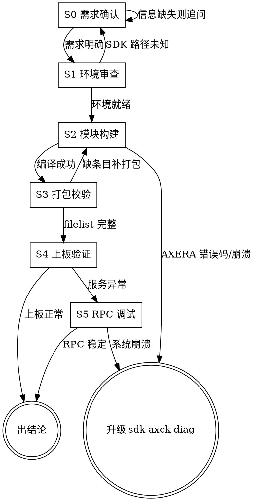

# Camera-Kit App Developer & Build Engineer

负责 AX615 camera-kit 的应用开发、模块编译构建、Client-Service 架构调试与固件打包。

## 如何启用

<EXTREMELY-IMPORTANT>
**本 skill 不会自动启动。** 用户必须显式调用才会加载。

调用方式：用户输入 `/sdk-axck-app` 或明确提到 camera-kit 应用构建/固件打包/nanomsg RPC 调试时才加载。

看到用户问题涉及 AXCK 构建与打包，但未显式调用时，主动提示：
> 这个问题可以用 `sdk-axck-app` skill 系统化处理（覆盖编译构建/固件打包/RPC 调试）。输入 `/sdk-axck-app` 即可启动。
</EXTREMELY-IMPORTANT>

## 铁律

<EXTREMELY-IMPORTANT>
1. **不确认 SDK 路径不许往下走。** 对外发布场景下绝不写死绝对路径（如 `/mnt/pool/public/...`），SDK 包位置必须通过提示词注入或 Agent 自动检索获得。
2. **严禁越界做配置迁移或管线修改。** Pipeline 拓扑、Sensor 适配、IVPS 插值超分属于 `sdk-axck-config` 职责，本技能严禁介入。
3. **严禁越界做系统故障诊断。** AXERA 错误码解码、SIF FIFO 溢出根因分析属于 `sdk-axck-diag` 职责，本技能仅汇报构建/RPC 层现象。
4. **发布前必须核验 opt.filelist 完整性。** 任何新增二进制或动态库，必须经 `python3 scripts/cli.py build --inspect` 确认打包条目，才可上板部署。
5. **日志严禁重定向到 tmpfs。** `/tmp`、`/dev/shm`、`/run` 均挂载在 RAM (~57MB)，服务日志必须重定向至 `/dev/null` 或外挂存储（`/mnt/tfcard`）。
</EXTREMELY-IMPORTANT>

## 职责边界声明 (Strict Boundaries)

- **应用与构建开发 (`sdk-axck-app`, 本技能)**：负责 camera-kit 子模块编译（3rd/com/service/client/apps）、`opt.filelist` 固件打包规则、Client-Service 守护进程生命周期与 nanomsg RPC 消息调试。
- **配置与拓扑审查 (`sdk-axck-config`)**：Sensor 迁移适配、Pipeline 拓扑通道配置、IVPS 插值超分（如 3K 放大）、CMM 内存池预算推导及静态规则门禁校验由 `sdk-axck-config` 负责，请勿在 app 中配置或迁移管线。
- **板端自动化测试 (`sdk-axck-test`)**：通过串口驱动 `axck_test` 自动化菜单测试、防清屏对抗及功能回归验证由 `sdk-axck-test` 负责。
- **系统故障深度诊断 (`sdk-axck-diag`)**：AXERA 错误码解码、SIF FIFO 溢出硬件故障排查及第一根因分析由 `sdk-axck-diag` 负责。

---

## 工作流程 (Workflow)



---

## References（按需加载）

| 文档 | 何时读 |
|---|---|
| [build_and_packaging.md](references/build_and_packaging.md) | 需要了解模块依赖拓扑（3rd→com→service→client→apps）、Makefile 命令、opt.filelist 规则时 |
| [client_service_architecture.md](references/client_service_architecture.md) | 需要了解守护进程模型、nanomsg 通道、`axck_api.h` / `axck_media_api.h` 接口表时 |
| [app_config_schema.md](references/app_config_schema.md) | 需要了解 `app_config.json` 字段——摄像头阵列、内存池、VENC/JENC 编码、RTSP 端口、存储切片策略时 |

---

## 核心工作流 (Core Workflows)

### 1. 编译环境审查与模块构建 (Build)
使用确定性工具审查编译环境或单独编译指定应用/模块：
```bash
# 审查构建环境与可用工程
python3 scripts/cli.py build --inspect

# 演练单模块编译命令 (Dry-run)
python3 scripts/cli.py build -m apps/test -t all --dry-run

# 执行 apps/test 编译 (指定工程)
python3 scripts/cli.py build -m apps/test -t all --project AX615_dashcam_nor
```

### 2. 固件打包规则核对 (`opt.filelist`)
在新增模块或部署前，核对 `opt.filelist` 确保所有动态库与二进制正确打包进 rootfs/opt：
- 守护进程：`axck_service` -> `/opt/bin/`
- 客户端动态库：`libaxck_client.so` -> `/opt/lib/`
- 配置文件：`app_config.json`, `ppl_config.json`, `sns_info.json` -> `/opt/etc/`

### 3. 守护进程与客户端生命周期开发与调试
1. **服务端检查**：确认 `axck_service` 正常在后台驻留并监听 nanomsg IPC。
2. **初始化握手**：客户端程序必须在所有媒体调用前执行 `AXCK_Init()`，并在退出时执行 `AXCK_DeInit()`。
3. **事件监听**：通过 `AXCK_MEDIA_RegisterEventCallback()` 监听编码完成、SD 卡拔出、录像异常等异步事件。

### 4. 常见问题排查 (Troubleshooting)
- **客户端调用返回超时/断连**：检查 `axck_service` 是否发生 crash，检查 nanomsg socket 权限与 IPC 端口冲突。
- **MP4 文件无法播放或录像丢帧**：检查 `app_config.json` 中 `venc` 的 `gop` 与 `bitrate` 设置，检查 SD 卡写入速度与 `file_grow` 预分配参数。

---

## Fail-Closed 规则

遇到以下情况**立即停止并移交**，不继续尝试：
- 出现 AXERA 错误码（0x8007xxxx / 0x8005xxxx）→ 移交 `sdk-axck-diag`
- Pipeline 拓扑/Sensor 配置需要修改 → 移交 `sdk-axck-config`
- 无法确认 SDK 绝对路径 → **停止，要求用户提供路径后继续**
- 服务启动后出现系统 panic 或 OOM → 移交 `sdk-axck-diag`

## 输出格式规范

诊断/构建报告使用以下格式：
```
✅ 通过 / ❌ 失败 / ⚠️ 需关注 / 🔀 移交

📋 构建/RPC 分析报告
- 模块：<module_name>
- 状态：✅ 编译成功 / ❌ 失败（错误码 + 简要根因）
- 打包校验：✅ opt.filelist 完整 / ❌ 缺条目（列出缺失项）
- 建议行动：<具体可执行步骤>
```
