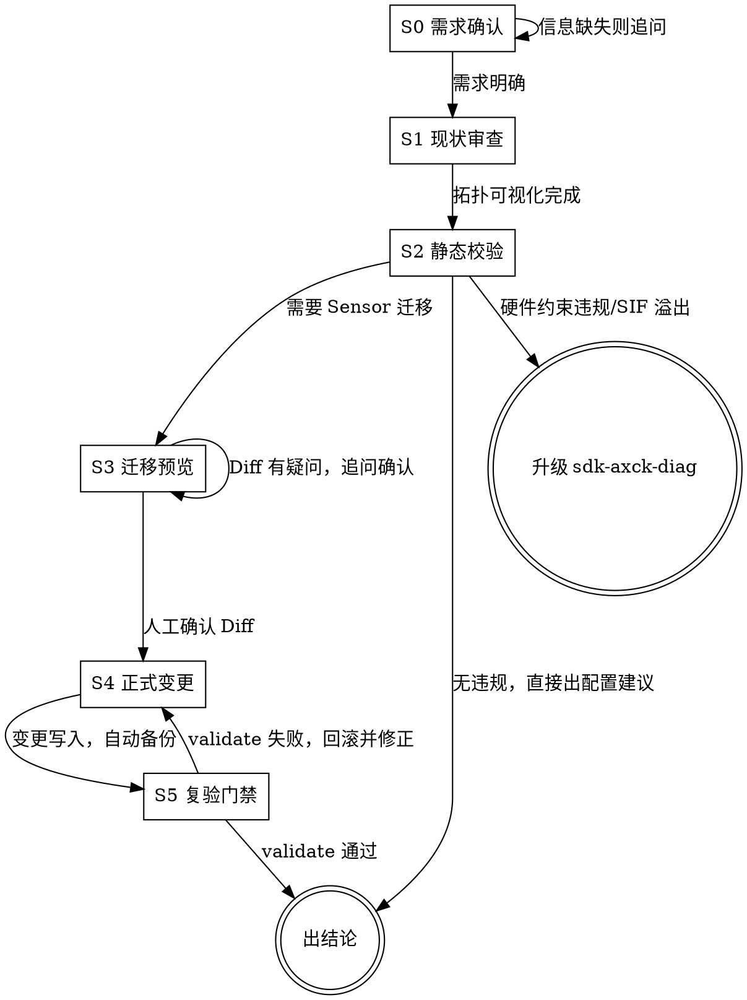

# Camera-Kit Pipeline Engineer

负责 AX615 camera-kit 的 Sensor 适配、Pipeline 拓扑构建、图像插值超分与静态验证。

## 如何启用

<EXTREMELY-IMPORTANT>
**本 skill 不会自动启动。** 用户必须显式调用才会加载。

调用方式：用户输入 `/sdk-axck-config` 或明确提到 Sensor 迁移/管线配置/IVPS 插值/CMM 内存池时才加载。

看到用户问题涉及 Pipeline 拓扑或 Sensor 适配，但未显式调用时，主动提示：
> 这个问题可以用 `sdk-axck-config` skill 系统化处理（覆盖 Sensor 迁移/管线拓扑/插值超分/静态校验）。输入 `/sdk-axck-config` 即可启动。
</EXTREMELY-IMPORTANT>

## 铁律

<EXTREMELY-IMPORTANT>
1. **不执行 --dry-run 预览不许正式迁移。** Sensor 迁移必须先 `--dry-run` 查看 Unified Diff 并人工确认，才可执行正式迁移；自动备份后立即执行 validate 门禁。
2. **SIF 吞吐限制是硬约束，不可绕过。** AX615 SIF 主频 367MHz，每周期 2 pixel，最小行时间 $t_{line} \ge \frac{Width}{367 \times 2} \mu s$。任何超出此限制的 Sensor 配置均不可部署。
3. **MIPI YUV Dev ID 不可凭经验指定。** 辅摄 MIPI YUV 格式（如 XS9950 AHD）的 `dev_id` 必须查阅 `hardware_contracts.md` 中的引脚分配表，严禁凭直觉设置。
4. **VENC 与 JENC 通道号必须全局唯一。** 修改任意编码通道前，必须先审查 `ppl_config.json` 与 `app_config.json` 中已分配的全部 `enc_chnl`，确认无重叠。
5. **插值放大输出宽度必须 16 字节对齐。** IVPS 插值目标宽度若不满足 16 字节对齐，驱动将静默截断，导致画面错位。
6. **不确认配置目录路径不许操作。** 对外发布场景中 config 路径通过提示词注入或 Agent 检索获得，严禁写死绝对路径。
</EXTREMELY-IMPORTANT>

## 职责边界声明 (Strict Boundaries)

- **配置与拓扑审查 (`sdk-axck-config`, 本技能)**：Sensor 迁移适配与硬件电气契约、Pipeline 拓扑通道构建、IVPS 缩放插值超分（如低清 Sensor 插值 3K/4K 分辨率）、CMM 内存池预算推导及静态门禁校验。
- **应用构建与固件打包 (`sdk-axck-app`)**：camera-kit 子模块编译（3rd/com/service/client/apps）、`opt.filelist` 打包规则、Client-Service RPC 接口开发归属于 `sdk-axck-app`。
- **板端自动化测试 (`sdk-axck-test`)**：通过串口驱动 `axck_test` 自动化菜单测试、防清屏对抗及功能回归验证归属于 `sdk-axck-test`。
- **系统故障深度诊断 (`sdk-axck-diag`)**：AXERA 错误码解码、SIF FIFO 溢出硬件故障排查及第一根因分析归属于 `sdk-axck-diag`。

---

## 工作流程 (Workflow)



---

## References（按需加载）

| 文档 | 何时读 |
|---|---|
| [hardware_contracts.md](references/hardware_contracts.md) | 需要查阅 I2C 设备地址、复位 GPIO、MIPI Lane 分配、MCLK 频率等硬件电气约束时 |
| [sensor_matrix.md](references/sensor_matrix.md) | 需要确认支持的 Sensor 型号与 SettingIndex（SC431HAI, SC465SL, OS04D10, XS9950, MIS20S1 等）时 |
| [sensor_settings_guide.md](references/sensor_settings_guide.md) | 需要查阅 Sensor SDR/HDR 模式编号与参数时 |
| [pipeline_rules.md](references/pipeline_rules.md) | 需要了解 IVPS 级联模式、vin_ivps_mode 约束、VENC/JENC 通道隔离与对齐要求时 |
| [sdk_design_constraints.md](references/sdk_design_constraints.md) | 需要推导 CMM 内存池（FBC 跨度步进/压缩比/帧缓冲池深度）时 |
| [interpolation_guide.md](references/interpolation_guide.md) | 需要配置插值超分（如 OS04D10 2560x1440 → 2880x1620）时，含低内存切片缓冲实测数据 |
| [migration_guide.md](references/migration_guide.md) | 执行 Sensor 迁移实战步骤时 |

---

## 确定性操作流程 (Deterministic Workflow)

所有的修改必须遵循 **"检查 -> 预览 -> 变更 -> 验证"** 闭环，杜绝手工盲改与幻觉推导。

### 1. 现状审查与拓扑可视化 (Inspect)
在进行任何配置变更前，先执行审查（会自动标识插值放大通道 [Scale Up WxH]）：
```bash
python3 scripts/cli.py inspect -c <config_dir>
# 输出 JSON 格式：
python3 scripts/cli.py inspect -c <config_dir> --json
```

### 2. 静态规则校验 (Validate)
验证当前配置或目标配置是否符合 AX615 硬件与多媒体子系统约束（包含 SIF 行时间、VENC 通道冲突、IVPS 缩放引擎与 CMM Pool 匹配校验）：
```bash
python3 scripts/cli.py validate -c <config_dir>
# 若是双摄项目或指定传感器变体：
python3 scripts/cli.py validate -c <config_dir> --dual --sensor-suffix <variant_name>
```

### 3. Sensor 迁移与拓扑更新 (Migrate)
迁移或切换 Sensor 时，必须先执行 `--dry-run` 查看 Unified Diff：
```bash
# 步骤 A：演练预览
python3 scripts/cli.py migrate -c <config_dir> -s <SENSOR_NAME> --cam-pos 0 --dry-run

# 步骤 B：确认差异无误后正式应用（自动创建带时间戳的备份）
python3 scripts/cli.py migrate -c <config_dir> -s <SENSOR_NAME> --cam-pos 0

# 步骤 C：执行复验门禁
python3 scripts/cli.py validate -c <config_dir>
```

### 4. 主码流插值超分配置 (Interpolation)
当需要从原生分辨率插值放大（例如 2560x1440 -> 2880x1620）：
1. 保持 `sns_info.json` 与 `app_config.json` 中的 `pool.private` 接收 Sensor 原生 RAW 分辨率。
2. 修改 `ppl_config.json` 中 IVPS Group 0 Chn 0 的输出宽高至目标插值尺寸，确认 engine 为 `scl`。
3. 修改 `ppl_config.json` 中 `cache[0].vout` 尺寸与 IVPS 保持一致。
4. 修改 `app_config.json` 中的 `pool.common[0]` (主视频缓冲) 与 `pool.common[1]` (SW_LOW_MEM 切片缓冲宽度) 同步扩展至目标尺寸。
5. 执行 `python3 scripts/cli.py validate -c <config_dir>` 确认无 Pool Mismatch 报错。

### 5. 安全回滚 (Rollback)
若上板异常或需要撤销变更：
```bash
python3 scripts/cli.py migrate -c <config_dir> --rollback <backup_timestamp>
```

---

## 关键架构硬约束 (Hard Constraints)

1. **AX615 SIF 吞吐限制**：AX615 SIF 主频为 367MHz，每周期吞吐 2 pixel。最小行时间 (min line time) 必须满足：$t_{line} \ge \frac{Width}{367 \times 2} \mu s$。
2. **MIPI YUV Dev ID 映射**：若辅摄为 MIPI YUV 格式（如 XS9950 AHD），其 `dev_id` 必须根据 AX615 硬件引脚分配固定（通常 rear 映射到 dev 1）。
3. **VENC / JENC 编码通道隔离**：VENC 与 JENC 共享底层编码器资源，Thumb JENC 通道号切勿与主码流、子码流 VENC 通道重叠。
4. **IVPS 插值缩放引擎约束**：当输出分辨率大于输入分辨率时，IVPS 通道必须显式使用 `scl` 或 `vpp` 引擎，目标宽度必须 16 字节对齐。
5. **CMM Pool 深度与对齐保证**：在线模式 (Online Mode) 至少需要 3 块缓冲，离线模式 (Offline Mode) 结合前后处理至少需要 4~6 块缓冲，`pool.common` 必须严格包含与视频流分辨率完全吻合的条目及匹配宽度的 SW_LOW_MEM 切片缓冲池。

---

## Fail-Closed 规则

遇到以下情况**立即停止并移交**，不继续尝试：
- Sensor 上板后出现 SIF FIFO overflow → 移交 `sdk-axck-diag`
- 出现 AXERA 错误码（0x8007xxxx / 0x8005xxxx）→ 移交 `sdk-axck-diag`
- validate 三轮仍无法通过，且根因不明 → 停止操作，整理现场，移交 `sdk-axck-diag`
- 不确认 config 目录路径 → **停止，要求用户提供路径**

## 输出格式规范

```
✅ 通过 / ❌ 失败 / ⚠️ 需关注 / 🔀 移交

📋 管线配置分析报告
- 配置目录：<config_dir>
- Sensor 组合：Cam0 <model> + Cam1 <model>
- 静态校验：✅ 通过 / ❌ 失败（违规项列表）
- CMM Pool：✅ 对齐 / ❌ Mismatch（具体数值）
- 建议行动：<具体可执行步骤>
```
