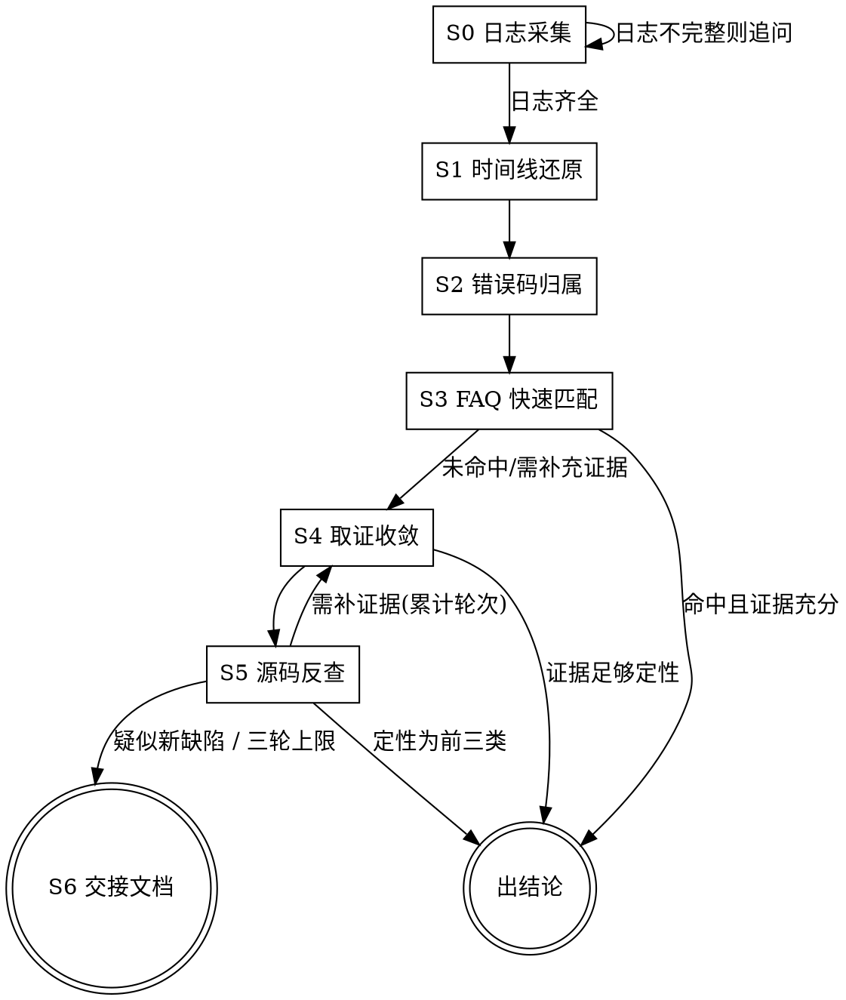

# Camera-Kit Doctor Diagnostic Engine

负责 AX615 camera-kit 的系统崩溃、上板黑屏、内存耗尽、SIF FIFO 溢出及 IPC 通信异常诊断。

## 如何启用

<EXTREMELY-IMPORTANT>
**本 skill 不会自动启动。** 用户必须显式调用才会加载。

调用方式：用户输入 `/sdk-axck-diag` 或明确提到系统崩溃/AXERA 错误码/SIF FIFO 溢出/内存耗尽根因分析时才加载。

看到用户问题涉及硬件故障诊断，但未显式调用时，主动提示：
> 这个问题可以用 `sdk-axck-diag` skill 系统化诊断（覆盖错误码解码/SIF FIFO 溢出/内存泄漏根因定位）。输入 `/sdk-axck-diag` 即可启动。
</EXTREMELY-IMPORTANT>

## 铁律

<EXTREMELY-IMPORTANT>
1. **定位首个原始根因，不从最后一条日志看起。** `cyclework/cyclecheck`、FCU handler timeout、heartbeat timeout 大多是下游连锁报错，必须回溯到报错行**之前**的日志才能找到真正根因。
2. **错误码必须先做模块归属，再套解码表。** 同一个错误号在 AX_VIN、AX_IVPS、AX_VENC 下语义完全不同，不做归属直接套 FAQ 会得出错误结论。先读 `error_code_dictionary.md` 中的归属定位规则。
3. **结论必须有出处。** 每条根因结论必须标注来源——日志行号、`文件:行号`（源码）、或 `/proc` 节点数据。无出处的推测必须标注「待验证」。
4. **不编造源码路径。** 引用 `camera-kit/src/...` 文件时，必须实际查阅文件确认存在，不可凭记忆推断路径。
5. **三轮取证未出结论，产出交接文档。** 取证-代码反查循环最多三轮，第三轮结束仍无确定结论，无条件产出「最小可交接诊断文档」并停止。
</EXTREMELY-IMPORTANT>

## 职责边界声明 (Strict Boundaries)

- **系统故障深度诊断 (`sdk-axck-diag`, 本技能)**：
  - **核心任务**：故障分析、崩溃溯源与根因定位。
  - **深入源码分析（必须查阅）**：**允许且必须深入查阅 C/C++ 源码（`camera-kit/src/...`、头文件与底层驱动）**、追踪函数调用栈与状态机转换、解码 AXERA 错误码（0x80070216, 0x80050004 等）、分析 SIF/FIFO 溢出与内存泄露，定位根本原因并给出代码/配置修复建议。
- **板端自动化测试 (`sdk-axck-test`)**：
  - **核心任务**：黑盒/灰盒驱动自动化测试、断言软硬件门限（`/proc/ax_proc/ivps`、`/proc/ax_proc/venc`、TF 卡出图出流）、输出清晰测试通过/失败矩阵报告。
  - **严禁越界看代码**：遇到测试失败或接口异常时，仅负责保留最小完整现场并判定用例 FAIL，**严禁**深入 C 源码去通读、反编译或逆向追踪业务实现。
- **配置与拓扑审查 (`sdk-axck-config`)**：Sensor 适配迁移、Pipeline 拓扑通道配置、IVPS 插值超分及静态规则门禁校验归属于 `sdk-axck-config`。
- **应用构建与开发 (`sdk-axck-app`)**：模块构建（3rd/com/service/client/apps）、固件打包 (`opt.filelist`) 与 Client-Service RPC 接口开发归属于 `sdk-axck-app`。

---

## 工作流程 (Workflow)



S4↔S5 循环**最多三轮**。S0–S3 不计轮次。第三轮结束仍无确定结论，无条件进 S6。

---

## References（按需加载）

| 文档 | 何时读 |
|---|---|
| [error_code_dictionary.md](references/error_code_dictionary.md) | 出现 AXERA 错误码（0x8007xxxx / 0x8005xxxx 等）时，先做模块归属，再查解码表 |
| [hardware_failure_signatures.md](references/hardware_failure_signatures.md) | 出现 I2C ACK 失败、SIF 溢出、MIPI 时钟锁定失败、DSI 传输超时等硬件级日志特征时 |

---

## 诊断排查工作流 (Diagnostic Workflow)

遵循 **"采集 -> 过滤 -> 解码 -> 根因定位"** 原则。

### 1. 本地日志分析
```bash
# 分析离线日志或串口抓取文件
python3 scripts/cli.py doctor -f <log_path>

# 输出结构化 JSON
python3 scripts/cli.py doctor -f <log_path> --json
```

### 2. 标准输入流式分析
```bash
# 从控制台或 pipeline 输出中管道分析
dmesg | python3 scripts/cli.py doctor
cat /var/log/messages | python3 scripts/cli.py doctor
```

### 3. 对接真机平台日志
当在真机或远程板卡平台调试时，可直接拉取平台环境日志并管道输入：
```bash
# 结合平台日志工具或 socat 输出
socat - TCP:<board_ip>:<port> | python3 scripts/cli.py doctor
```

---

## 典型故障排查对照 (Quick Reference)

1. **`SIF FIFO overflow`**:
   - 现象：画面撕裂或直接卡死报错。
   - 根因：AX615 SIF 吞吐限制（367MHz, 2 pix/cycle）。
   - 修复：检查 Sensor HTS 参数与 `settingindex`，确保行时间不小于理论下限。
2. **`0x80070216 (AX_ERR_VENC_EXIST)`**:
   - 现象：启动编码器失败。
   - 根因：VENC 与 JENC 通道号重复分配冲突。
   - 修复：检查 `ppl_config.json` 与 `app_config.json` 中的 `enc_chnl` 映射。
3. **`0x80050004 (AX_ERR_POOL_NOBUF)`**:
   - 现象：流启动数秒后死锁或内存耗尽。
   - 根因：CMM 缓冲池 `block_count` 不足或应用层拿到 Frame 未及时释放 (Release)。
   - 修复：增加 `app_config.json` 的 pool 深度或排查应用端泄露。

---

## Fail-Closed 规则

遇到以下情况**立即停止并声明限制**：
- 日志不完整（缺少报错行上下文）→ 停止，追问日志前后各 20~50 行
- 引用源码路径无法确认文件存在 → 标注「待验证」，不下结论
- 取证-反查循环超过三轮仍无定论 → 产出 S6 交接文档并停止
- 涉及配置拓扑修复建议 → 给出方向后移交 `sdk-axck-config` 执行

## 输出格式规范

```
✅ 已定性 / ❌ 未定性（需补证据）/ ⚠️ 疑似新缺陷 / 🔀 移交

📋 诊断报告
- 芯片/SDK 版本：<版本信息，未知标注「待确认」>
- 首个原始根因：<日志行号或文件:行号>
- 错误码归属：<模块> → <含义>
- 影响范围：<功能/通道>
- 修复建议：<具体可执行步骤>
- 结论类型：设计预期 / 配置使用方法 / 已修故障 / 疑似新缺陷
```
