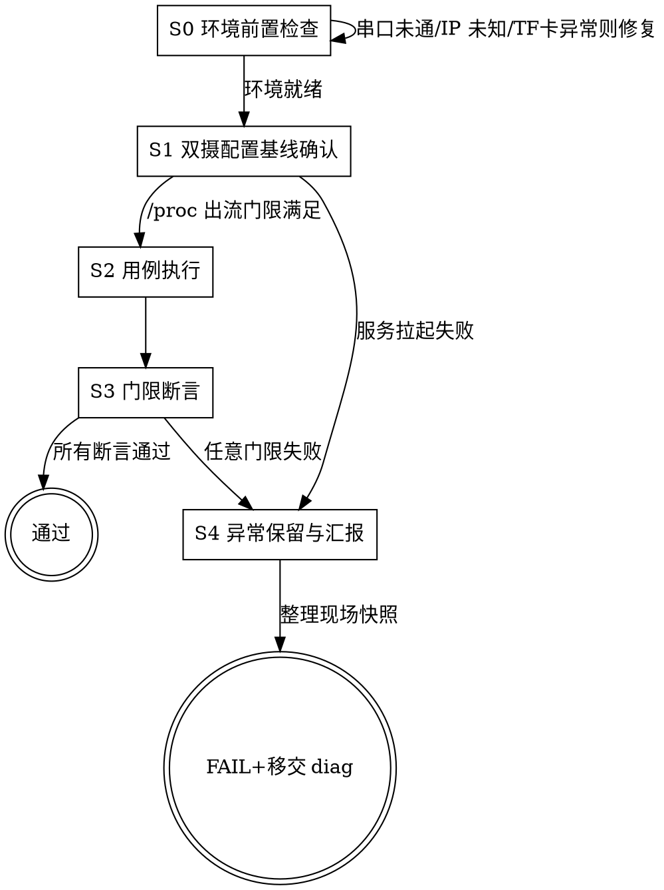

# SDK-AXCK-TEST: camera-kit 自动化测试套件

本技能专职负责 **AX615 / AXERA camera-kit 的板端自动化功能验证、服务守护进程测试与全链路硬件验证**。
提供双驱动引擎：**新一代 HTTP RPC 驱动**（面向 CI/自动化流水线与高频压测）与 **经典 UART 菜单驱动**（面向交互式现场排查与底层调试）。
基于完全自包含设计，符合 `psenger/ai-agent-skills` 规范。

## 如何启用

<EXTREMELY-IMPORTANT>
**本 skill 不会自动启动。** 用户必须显式调用才会加载。

调用方式：用户输入 `/sdk-axck-test` 或明确提到 camera-kit 板端测试/功能验证/HTTP RPC 驱动/UART 菜单驱动时才加载。

看到用户问题涉及 AXCK 板端测试，但未显式调用时，主动提示：
> 这个问题可以用 `sdk-axck-test` skill 系统化处理（覆盖自动化测试/硬件门限断言/AOV 浸泡验证）。输入 `/sdk-axck-test` 即可启动。
</EXTREMELY-IMPORTANT>

## 铁律

<EXTREMELY-IMPORTANT>
1. **每次重启后必须重新确认 IP，严禁假设 IP 不变。** 单板冷热重启后，以太网 IP 可能变化，必须第一步在串口控制台执行 `ifconfig eth0` 获取实时 IP 后，再配置 `--host <board_ip>`。
2. **严禁硬编码个人共享路径或实验网 IP。** SKILL.md 与测试脚本中绝对禁止出现 内部共享目录、实验网私有 IP 等个人或实验室专用路径/地址。所有板端 IP 使用 `<board_ip>` 占位符，NFS 路径通过参数传入。
3. **严禁深入 C 源码做根因分析。** 测试用例失败时，必须立即抓取最小完整现场（串口 dmesg、进程状态、/proc 快照、失败 HTTP 响应码），直接判定 FAIL 并转交 `sdk-axck-diag`。严禁通读 `camera-kit/src/...` 源码。
4. **日志严禁重定向到 tmpfs。** `/tmp`、`/dev/shm` 均挂载在 RAM (~57MB)，`axck_service` 必须以 `> /dev/null 2>&1 &` 启动，严禁写 `/tmp/axck.log`。
5. **AOV 期间网络完全断开，严禁发 HTTP 请求停止 AOV。** 进入 AOV 后以太网 PHY 掉电，必须预先在 `app_config.json` 配置确定的 `sleep_count`，等待自动退出。
6. **TF 卡必须为可写 FAT32，且有百 G 级可用空间。** 测试前必须确认 `df -h /mnt/tfcard` 有足够剩余，文件系统无只读或 cluster chain 错误。
7. **前台有程序运行时，禁止直接执行 reboot。** 必须先发送 Ctrl+Z（0x1A）挂起进入 Shell 提示符，确认看到 `/ #` 后再执行 `/sbin/reboot`。
</EXTREMELY-IMPORTANT>

## 一、职责边界与双驱动引擎架构

### 1. 严格职责边界声明 (Strict Boundaries: Test vs Diag)
- **`sdk-axck-test` 专职边界（本技能）**：
  - **核心任务**：黑盒/灰盒驱动自动化测试、断言软硬件门限（`/proc/ax_proc/ivps`、`/proc/ax_proc/venc`、TF 卡出图出流）、输出清晰测试通过/失败矩阵报告。
  - **严禁越界看源码**：测试用例失败或接口不通时，**严禁深入 C 源码（`camera-kit/src/...`）通读、反编译或逆向追踪实现**。必须立即抓取并保留最小完整现场（串口 dmesg、进程状态、/proc 节点快照、失败 HTTP 响应码），直接判定用例 FAIL 并汇报。
- **`sdk-axck-diag` 专职边界（故障分析与根因定位）**：
  - 遇到测试失败、系统崩溃、内存泄漏或通道冲突时，由 `sdk-axck-diag` 接管。**`sdk-axck-diag` 允许且必须深入查阅 C/C++ 源码**，追踪函数调用栈与状态机转换，解码 AXERA 错误码并定位根本原因。

---

## 工作流程 (Workflow)



---

## References（按需加载）

| 文档 | 何时读 |
|---|---|
| [test_matrix.md](references/test_matrix.md) | 需要查阅具体用例 ID（P01~P08/A01~A29/S01~S03/ST01）的输入参数、断言门限和预期结果时 |
| [menu_tree.md](references/menu_tree.md) | 使用 UART 菜单驱动模式时，需要查阅 `axck_test` 多级菜单树与选项编号时 |
| [board_pitfalls.md](references/board_pitfalls.md) | 遇到串口异常、重启失败、僵尸进程、AOV 网络断开、清屏对抗等板端环境问题时 |

---

## 二、标准化测试基线流程 (Standardized Baseline Workflow)

为避免每次测试重新思考、摸索探索不同命令或引入新变量，本技能严格定义**确定性双摄全量测试基线流程**：

### 阶段 1：前置环境基线检查 (Preflight Baseline)
1. **串口连通与 IP 实时确认**：
   - 每次设备冷热重启后，**必须第一步在串口控制台执行 `ifconfig eth0` 获取实时 IP**（严禁假设 IP 不变）。
2. **TF 卡标准化格式化与挂载**：
   - 确保卸载后重新格式化为 FAT32，并挂载至 `/mnt/tfcard`：
     ```sh
     umount /mnt/tfcard 2>/dev/null || true
     mkfs.vfat -F 32 /dev/mmcblk0
     mount -t vfat /dev/mmcblk0 /mnt/tfcard
     ```
   - 检查 `df -h /mnt/tfcard`，确保存在百 G 级可用空间，且文件系统状态正常（无只读、无 cluster chain 报错）。
3. **极端内存受限防范 (RAM ~57MB)**：
   - 检查 `free` 确保可用内存充足。
   - 确认进程日志**绝对不重定向到 `/tmp`**，服务必须以重定向至 `/dev/null` 方式拉起。

### 阶段 2：双摄配置基线确认 (Dual-Cam Config Baseline)
1. **配置文件就绪**：
   - `/opt/bin/res/config/sns_info.json`：双摄定义（Cam0 OS04D10 + Cam1 XS9950）。
   - `/opt/bin/res/config/ppl_config.json`：管道与编码器定义（OS04D10 2560x1440/960x540 + XS9950 1920x1080/960x540）。
   - `/opt/bin/res/config/app_config.json`：预设 AOV 休眠次数 `sleep_count`（如 25 或 35），避免 AOV 期间网络断开无法停止。
   - `/opt/bin/res/config/dtcf_config.json`：配置 `CamId: 0 -> F` 与 `CamId: 1 -> R`。
2. **拉起服务与硬件出流门限断言**：
   - 执行：`killall -9 axck_service axck_test 2>/dev/null; cd /opt/bin && ./axck_service -l 3 -t 1 > /dev/null 2>&1 &`
   - 检查 `/proc/ax_proc/ivps`：Grp 0 (2560x1440 @ 25fps), Grp 1 (1920x1080 @ 25fps)。
   - 检查 `/proc/ax_proc/venc`：Chn 0 (2560x1440 H265), Chn 1 (960x540 H264), Chn 2 (1920x1080 H264), Chn 3 (960x540 H264)，帧率均为 25fps。

### 阶段 3：标准自动化用例执行基线 (Standardized Execution)
1. **双摄抓拍门限校验**：
   - 触发抓拍（HTTP 或菜单）：
   - 断言：`/mnt/tfcard/Photo/F/PH*F.jpg` 与 `/mnt/tfcard/Photo/R/PH*R.jpg` 均成功生成且大小 > 30KB。
2. **双摄长录像门限校验（保证至少 2 个完整切片）**：
   - 启动录像并浸泡足够时长（例如每段 3 分钟，共等待 2 个完整切片落盘）。
   - 断言：`/mnt/tfcard/Normal/F/` 与 `/mnt/tfcard/Normal/R/` 均至少包含两个连续且非 0 字节的完整 MP4 录像文件（如 20MB）。
3. **双摄 AOV 低功耗录像门限校验**：
   - 触发 AOV 模式（预先配置 `sleep_count`）。
   - 监控串口：捕获 `PM: suspend entry (deep)` 与休眠唤醒序列，等待设定的 `sleep_count` 自动执行完毕并唤醒退出。
   - 断言：板端网络自动恢复，且 `/mnt/tfcard/AOV/F/` 与 `/mnt/tfcard/AOV/R/` 均成功生成至少 1 个完整 AOV MP4 切片（20MB）。

### 阶段 4：异常即时保留与汇报 (Exception Triage & Reporting)
- 若任意门限失败（如 TF 卡报错、HTTP 报错、出图失败）：
  1. 立即抓取现场快照：`dmesg | tail -n 50`、`ps | grep axck`、`/proc/ax_proc/` 状态。
  2. 严禁深入源码探索！直接在测试报告中判定 FAIL，并清晰陈述门限失败依据，转交 `sdk-axck-diag` 进行源码与根因诊断。

---

## 三、前置准备与板端避坑检查
在执行测试之前，必须确保板端环境处于清洁可测状态：
1. **进程复位**：杀停残留的 `axck_test` 或 `axck_service`，释放硬件 CMM 和 VENC 通道。
   ```sh
   killall -9 axck_test axck_service 2>/dev/null || true
   ```
2. **CGI HTTP 服务开启与端口配置**：
   - 编译时确认在 `build/projects/<PROJECT>/project.mak` 中开启 `AXCK_CGI_SUPPORT := yes`。
   - 检查板端 `/opt/bin/res/config/app_config.json` 中配置：
     ```json
     "cgi": { "enable": 1, "base_dir": "web", "port": 8080 }
     ```
   - 启动板端服务：`/opt/bin/axck_service -v 0 -p 0 &`，`netstat -tuln` 确认 8080 端口处于 LISTEN 状态。
3. **多摄/双摄 DTCF 目录与数据库隔离**：
   - 双摄环境下须确保 `/opt/bin/res/config/dtcf_config.json` 包含 `CamId: 0` (`MainFolder: "F"`) 与 `CamId: 1` (`MainFolder: "R"`) 映射。
   - 若切换工程提示 `project not match`，执行清理并调用 `storage.mount()` 触发自愈重建：
     ```sh
     rm -f /mnt/tfcard/file.db*
     ```
4. **AOV 低功耗休眠双通道协同机制**：
   - AOV 模式下网络协议栈会周期性随 CPU/PHY 休眠挂起。
   - 业务控制采用 HTTP 指数退避重试（Backoff Retry）下发 `aov_ctrl?cmd=stop` 退出。
   - 带外监控通过串口/Telnet 监听内核 `PM: suspend entry/exit` 与 PHY `Link is Up` 事件。
   - AOV 录像切片（1fps）需保证足够的浸泡周期（如 60s 以上）以触发首个 20MB MP4 分片封包落盘。
5. **前台运行时的设备重启规程**：
   - **严禁在前台有程序运行时直接执行 `reboot`**，避免因终端阻塞或未同步导致重启失败。
   - 正确规程：先通过串口发送 `Ctrl+Z`（`0x1A`）或中断挂起进入 Linux Shell 交互提示符（`/ #`），确认看到 Shell 提示符后再执行 `/sbin/reboot`。
6. **网络与 NFS 协议驱动加载序**：若需同步测试捕获的图片或录像回 NAS，必须按序加载驱动并挂载：
   ```sh
   net_load.sh
   nfs_load.sh
   mkdir -p /tmp/test_archive && mount -t nfs -o nolock,soft,timeo=30,tcp <NFS_SERVER>:<REMOTE_PATH> /tmp/test_archive
   ```

---

## 四、命令行使用指南 (`axck-test`)

测试套件内置确定性 CLI 工具 `scripts/cli.py`：

### 1. HTTP RPC 驱动模式（推荐）

#### (1) 执行单个原子领域用例 (`single-case`)
```bash
# 查询硬件设备综合状态
python3 scripts/cli.py single-case --host <BOARD_IP> --port 8080 --case device.get_status

# 检查 TF 卡存储状态与容量
python3 scripts/cli.py single-case --host <BOARD_IP> --port 8080 --case storage.get_status

# 拍照抓拍
python3 scripts/cli.py single-case --host <BOARD_IP> --port 8080 --case media.take_photo

# 启动录像 / 停止录像
python3 scripts/cli.py single-case --host <BOARD_IP> --port 8080 --case media.start_record
python3 scripts/cli.py single-case --host <BOARD_IP> --port 8080 --case media.stop_record
```

#### (2) 执行全链路场景流水线 (`run-scenario`)
```bash
# 执行冒烟流水线（设备自检 -> 存储自检 -> 启动录像 -> 抓拍 -> 停止录像）
python3 scripts/cli.py run-scenario --host <BOARD_IP> --port 8080 --scenario smoke

# 执行连拍流水线
python3 scripts/cli.py run-scenario --host <BOARD_IP> --port 8080 --scenario burst-capture

# 执行持续录像浸泡流水线
python3 scripts/cli.py run-scenario --host <BOARD_IP> --port 8080 --scenario continuous-record
```

#### (3) 执行全量 54 项端到端自动化回归套件 (`run-full`)
```bash
# 执行全量 54 项测试（硬件探针 P01~P08 + 原子 API A01~A29 + 场景流水线 S01~S03 + 并发压测 ST01）
# 自动在终端实时打印结构化测试卡片，并生成 JSON / JUnit XML / HTML 看板报告
python3 scripts/cli.py run-full --host <BOARD_IP> --port 8080

# 指定测试报告导出目录 (供 Jenkins / GitLab CI 归档)
python3 scripts/cli.py run-full --host <BOARD_IP> --port 8080 --export-dir /path/to/ci-artifacts
```

#### (4) 一键式端到端自动化 CI 流水线 (`run-pipeline`)
```bash
# 一键执行全生命周期自动化 CI 流水线：
# 1. 端口与服务前置探活 (HTTP 80 + Telnet 23)
# 2. 全量 54 项软硬件门限自动化回归 (P01~P08 / A01~A29 / S01~S03 / ST01)
# 3. 低功耗休眠唤醒 AOV 专项浸泡与自动退出自愈压测
# 4. 自动导出 full_ci_report.json / full_ci_report.xml (JUnit) / full_ci_report.html (交互式深色看板)
python3 scripts/cli.py run-pipeline --host <BOARD_IP> --port 80 --telnet-port 23 --aov-soak 15

# 指定报告导出路径
python3 scripts/cli.py run-pipeline --host <BOARD_IP> --port 80 --export-dir /tmp/ci_reports
```

#### (5) 执行并发压测与时延浸泡 (`stress`)
```bash
# 对状态查询进行 100 次并发测试，输出 QPS 与 P50/P90/P95/P99 耗时分位数
python3 scripts/cli.py stress --host <BOARD_IP> --port 8080 --case device.get_status --total 100 --concurrency 5
```

---

### 2. UART 菜单驱动模式（经典）

```bash
# 查看支持的串口测试套件
python3 scripts/cli.py list-suites

# 硬件带外巡检：单步读取当前板端真实的 IVPS 与 VENC 硬件管线配置
python3 scripts/cli.py inspect-proc

# 运行全部串口测试（service + media + system），集成 Telnet 带外门限与实时结构化会话打印
python3 scripts/cli.py run --suite all --report full_report.json

# 仅测试 media 子系统（含动态分辨率切换与 /proc 校验）
python3 scripts/cli.py run --suite media

# 仅独立测试 axck_service 后台守护进程
python3 scripts/cli.py run --suite service
```

---

## 五、双驱动引擎详细架构

### 1. HTTP RPC Driver（推荐首选，自动化/CI/高频压测）
直接面向板端 `axck_service` 内置的 HTTP (thttpd/CGI) 服务，单步网络请求时延低至 **30ms ~ 80ms**，提供强类型机器可读 JSON 数据与确定性业务状态码：
- **L0 传输核心 (`core/http_client.py`)**：统一 HTTP 通信封装，支持 HTTP/1.0 安全穿透、指数退避动态重试、毫秒级调用耗时监控与统一 `AxckResponse` 建模。
- **L1 领域原子 API (`core/domain_apis.py`)**：面向对象高层封装：
  - `MediaApi`：启动/停止普通录像、紧急录像、拍照抓拍、预览通道切换。
  - `AudioApi`：输入麦克风静音/解静音、输出音频播放音量设置/查询、指定音频播放/停止。
  - `StreamApi`：视频流开关、镜像翻转（Mirror/Flip）、实时帧率动态配置（FPS）、主辅码流分辨率切换（Resolution）、VENC 编码格式切换（H.264/H.265）、分片录像时间设置。
  - `RtspApi`：板端内置 RTSP 串流服务启停（监听 8554 端口）。
  - `StorageApi`：TF 卡挂载状态、总容量/剩余容量实时查询、文件系统格式化（Format）、卸载/重挂载。
  - `DtcfApi`：数据库连接检查、文件总数统计、分片分页检索。
  - `DeviceApi`：硬件各子系统（前后摄/TF卡/ACC/4G/网络等）综合状态查询。
  - `AovApi`：低功耗 AOV 模式起停与状态控制。
- **L2 场景流水线 (`core/scenario.py`)**：支持 Fluent DSL 流式定义测试管线（`.step()`、`.repeat()`），自动串联执行并生成结构化用例报告。
- **L3 压力与浸泡引擎 (`core/stress_runner.py`)**：支持多线程并发压测、QPS 统计与 P50/P90/P95/P99 时延分位数统计。

### 2. UART Menu Driver（经典交互式排查）
通过串口终端模拟终端输入驱动板端 `axck_test` 多级菜单：
- **多模式测试套件覆盖**：
  - **`service`**：独立测试后台守护进程 `axck_service`，验证守护拉起、RPC 初始化、硬件管道建立、稳态出流以及通过 SIGINT 优雅注销释放硬件。
  - **`media`**：自动化覆盖码流开关、实时 FPS、分辨率多级动态切换、JENC 抓拍、MP4 录像、音频静音与媒体状态。
  - **`system`**：驱动 Storage、DTCF 及 Device 硬件状态查询。
- **带外 Telnet 并发硬件巡检（Out-of-band Telnet Inspector）**：
  - 串口自动探测板端 IP，并发建立 Telnet 带外信道，实时读取 `/proc/ax_proc/ivps`、`/proc/ax_proc/venc`、进程 PID 及 `dmesg` 告警。
- **真实硬件级 `/proc` 确认门限**：
  - 分辨率切换测试不仅仅校验 CLI 回显，更通过 Telnet 实时断言 `/proc/ax_proc/ivps` 对应通道（如 `(0,0)`）以及 `/proc/ax_proc/venc` 对应通道（如 `Chn 0`）物理几何尺寸严格对齐（2560x1440 / 1920x1080 / 1280x720），并断言出流帧率 `out_fps >= 10.0`。
- **规范化即时用例输出（CaseReporter）**：
  - 实时逐条打印输入参数、响应回显、确认门限（Gates）、判定结果与耗时。

---

## Fail-Closed 规则

遇到以下情况**立即停止并移交**，不继续尝试：
- 出现 AXERA 错误码（0x8007xxxx / 0x8005xxxx）→ 移交 `sdk-axck-diag`
- 服务拉起后系统 panic 或 OOM → 移交 `sdk-axck-diag`
- 串口无响应 → 停止，检查物理连接，确认电源正常
- TF 卡文件系统只读或错误 → 停止，执行 format 后重试，失败则汇报环境异常
- AOV 期间尝试 HTTP 操作 → **立即停止，严禁继续发请求，等待 sleep_count 自动退出**

## 输出格式规范

```
✅ 通过 / ❌ FAIL / ⚠️ 需关注 / 🔀 移交 sdk-axck-diag

📋 测试执行报告
总计：XX 项 | ✅ 通过：XX | ❌ 失败：XX | ⏱️ 总耗时：XXs

| 用例 ID | 名称 | 状态 | 门限 | 耗时 |
|---------|------|------|------|------|
| P01 | 设备状态查询 | ✅ | HTTP 200 + JSON 完整 | 45ms |
| A03 | 拍照抓拍 | ❌ | 文件未生成 | - |

失败用例现场快照：
- dmesg 最后 20 行：<内容>
- /proc/ax_proc/ivps：<内容>
- HTTP 响应码：<404 / 500 / timeout>
```
