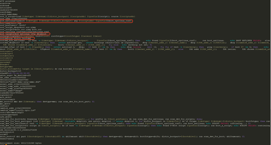
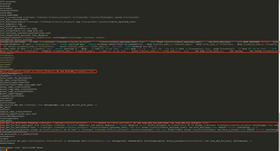
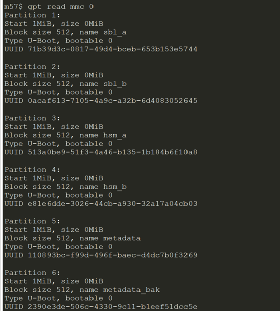
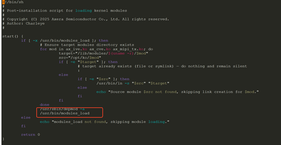
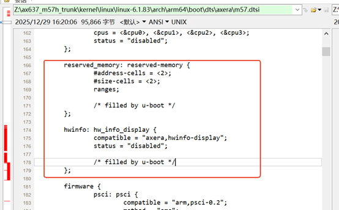

# 637-input-reference

> AX637 boot 类常见问题与技术方案说明

<table>
  <thead>
    <tr>
      <th>No</th>
      <th>模块</th>
      <th>问题描述</th>
      <th>技术方案与设计说明</th>
    </tr>
  </thead>
  <tbody>
    <tr>
      <td>1</td>
      <td>Boot</td>
      <td>内核启动复杂化 当前637采用的是distroboot方式，支持多种启动方式，实现麻烦，搞复杂了，对安防客户而言，只需采用传统的boot启动方式即可，直接从ext4读出Image.axgzip和dtb文件，然后执行booti命令就可以加载启动内核了。 </td>
      <td>不建议修改平台默认引导机制：传统直接引导方式兼容性较弱，仅支持 mmc/ext4/非AB/非安全启动单一场景；而在实际安防与边缘 SDK 场景中，mtd/mmc、ubi/ext4、AB 分区、安全启动等组合均可能出现，当前的 distro_bootcmd 能够统一满足且具备更好的扩展性。 平台维持兼容性设计，已在《00 - AX SDK 使用说明》新增 8.4 章节，详细介绍 SDK 默认引导流程、关键环境变量，并给出 nand/emmc、非AB/AB、默认启动/SecureBoot 等不同场景下的简化命令，供客户按需选取。</td>
    </tr>
    <tr>
      <td>2</td>
      <td>Boot</td>
      <td>环境变量内容过长 正因为采用distro boot启动方式，在Uboot环境中增加了很多shell脚本的环境变量，而安防客户在产线烧录过程中，一旦出现烧录过或他们客户在使用过程中，这么长的环境变量非常容易被破坏，这样系统就无法启动，所以去掉distro boot方式后，也需关闭distro相关环境下变量： </td>
      <td>同 No.1 方案：如业务需要精简环境变量，可参考《00 - AX SDK 使用说明》8.4 章节配置裁剪。</td>
    </tr>
    <tr>
      <td>3</td>
      <td>Boot</td>
      <td>分区获取信息方式需修改 当前sdk从gpt中获取分区信息的，而安防客户是希望将分区表设置在bootargs环境变量中，这也是安防业界常用做法，并且兼容之前650、620q等芯片。 </td>
      <td>已做兼容支持，支持通过 bootargs 传递分区信息。</td>
    </tr>
    <tr>
      <td>4</td>
      <td>Boot</td>
      <td>客户设备在linux系统启动过程中出现报错问题 我们sdk是按照标准linux服务器方式，使用了depmod来创建各个驱动模块的依赖关系来modules_load加载驱动，而安防客户的设备一般不会采用这种复杂繁琐的方式，而是直接根据依赖关系，使用inmod各个驱动。而且depmod使用场景要求可读可行文件系统才行，采用只读文件系统就会报错。 </td>
      <td>设计机制说明：S00modprobe_pos 使用 insmod 实现基础加载，S33modprobe_post 使用 modprobe 实现。引入 S33 是为了对无依赖关系的 ko 模块进行并行加载以提升启动速度。 关于只读文件系统（RoFileSystem）报错：已做兼容修复，在最新版本中 depmod 已配置为 <code>/usr/sbin/depmod -b /tmp -o /tmp</code>，不会向只读根文件系统写入，避免报错。</td>
    </tr>
    <tr>
      <td>5</td>
      <td>Boot</td>
      <td>内核reserve_memory、hwinfo dts配置 内核reserve_memory、hwinfo dts节点配置是在uboot中实现的，是非常用方式，安防客户也是第一次遇到这个方式，修改配置测试很也不方便，之前650等芯片都是在dts文件中配置: </td>
      <td>平台设计背景说明： 1. linux reserved_memory 节点：默认在各 DTS 中均有静态定义；U-Boot 在引导时会动态追加 3 个节点（atf_reserved、optee_reserved、bootlog_reserved），具体由 build plat config 开关以及 U-Boot defconfig 中的地址统一控制。 2. linux hw_info_display 节点：由 U-Boot 填充（包含 version/board-id/chip-name/bootlog-record/boot-device/boot-slot/cmm-size/cmm-start 等）。采用 U-Boot 动态填充启动信息的方式相比在 DTS 中静态写死具有更好的兼容性与灵活性。文档已提供各 reserved 内存预留清单及开关配置说明。</td>
    </tr>
    <tr>
      <td>6</td>
      <td>Boot</td>
      <td>调试串口波特率不是安防客户常用波特率 637的调试串口波特率比较特殊，是921600，不是安防客户常见常用的波特率115200，客户都是要求修改的，所以导致需要支持客户时一一修改SBL、RT-THREAD、SPL、UBOOT、LINUX等模块来调整波特率，修改地方不少。</td>
      <td>已做场景区分兼容处理：安防/边缘场景默认使用 115200，车载场景默认使用 921600。</td>
    </tr>
    <tr>
      <td>7</td>
      <td>Boot</td>
      <td>AX637_R1.26.1601(AX637_SDK_V1.11.0_P2) SDK uboot不支持usb fastboot</td>
      <td>驱动方案已支持，后续版本评估合入主线分支。</td>
    </tr>
  </tbody>
</table>
