# 00 - AX SDK 使用说明

> Source: `00 - AX SDK 使用说明.docx`. This draft is generated by `scripts/convert_docx_to_markdown.py` under the final Wiki conversion rules.

## 1. 准备工作

<a id="_编译工具链"></a>

### 1.1 编译工具链

由于本SDK支持arm64架构，使用支持arm64架构的gcc version 9.2.1 20191025 (GNU Toolchain for the A-profile Architecture 9.2-2019.12 (arm-9.10))，请您自行至ARM官方网站下载并安装该版本工具链。

官方网站的地址：

https://developer.arm.com/-/media/files/downloads/gnu-a/9.2-2019.12/binrel/gcc-arm-9.2-2019.12-x86_64-aarch64-none-linux-gnu.tar.xz

由于SDK里面包含MCU的代码，因此也需要部署MCU的交叉编译工具链，使用支持ARM32架构的gcc-linaro-7.5.0-2019.12，请您自行至如下网址下载。

官方网站的地址：

http://releases.linaro.org/components/toolchain/binaries/7.5-2019.12/arm-linux-gnueabi/gcc-linaro-7.5.0-2019.12-x86_64_arm-linux-gnueabi.tar.xz   

#### 1.1.1 配置安装环境（可选）

对于一台新的Linux服务器或笔记本电脑，在安装工具链之前，必须需要您配置SDK和工具链的使用环境。

操作步骤

现以一台新ubuntu笔记本电脑为例说明环境配置过程：

测试笔记本电脑Ubuntu的版本号是：**<span style="color:#000000">ubuntu-20.04.6</span>**

1. 请您以root用户登录需要配置安装环境的主机。

2. 在任意目录下依次进行如下操作安装依赖包：

3. 执行sudo apt-get install make命令；

4. 执行sudo apt-get install libc6:i386命令后输入y；

5. 执行sudo apt-get install lib32stdc++6命令后输入y；

6. 执行sudo apt-get install zlib1g-dev命令后输入y；

7. 执行sudo apt-get install libncurses5-dev命令后输入y；

8. 执行sudo apt-get install ncurses-term命令；

9. 执行sudo apt-get install libncursesw5-dev命令；

10. 执行sudo apt-get install g++命令后输入y；

11. 执行sudo apt-get install e2fsprogs命令后输入y；

12. 执行sudo apt-get install mtd-utils命令后输入y;

13. 执行sudo apt-get install texinfo命令后输入y；

14. 执行sudo apt-get install texlive命令后输入y；

15. 执行sudo apt-get install gawk命令后输入y；

16. 执行sudo apt-get install libssl-dev命令后输入y；

17. 执行sudo apt-get install openssl命令后输入y；

18. 执行sudo apt-get install bc命令后输入y；

19. 执行sudo apt-get install bison命令后输入y；

20. 执行sudo apt-get install flex命令后输入y；

21. 执行sudo dpkg-reconfigure dash命令后选择“No”；

22. 执行sudo apt-get install gcc libgcc1 gdb命令；

23. 执行sudo apt-get install build-essential命令；

24. 执行sudo apt-get install lib32z1命令；

25. 执行sudo apt-get install u-boot-tools命令；

注意：

为了确保低版本的Ubuntu系统可以正常安装所有依赖包，您需要执行上述最后一条命令，否则编译时会遇到找不到共享库libz.so.1的错误。为确保uBoot编译能够通过，请您务必执行上述最后一条命令。

26. 执行sudo apt install device-tree-compiler命令安装dtc；

27. 执行sudo apt install python3-pyelftools命令；

28. 执行sudo python3 -m pip install --upgrade pip命令；

29. 执行sudo <span style="color:#172B4D">python3 -m pip install openpyxl</span>命令；

30. 执行sudo pip3 install lxml命令；

31. 执行sudo pip3 install lz4命令；

32. 执行sudo pip3 install pycryptodome命令；

33. 执行sudo pip3 install rsa命令；

34. 执行sudo pip3 install sympy命令；

#### 1.1.2 安装工具链

操作步骤

1. 请您以root用户登录需要安装工具链的环境。

35. 在任意目录下依次执行如下命令安装工具链：

36. arm64架构工具链

```bash
sudo mkdir /usr/local/ARM-toolchain
cd /usr/local/ARM-toolchain
```

<a id="OLE_LINK7"></a>

```bash
tar -vxf gcc-arm-9.2-2019.12-x86_64-aarch64-none-linux-gnu.tar.xz
rm gcc-arm-9.2-2019.12-x86_64-aarch64-none-linux-gnu.tar.xz
vi /etc/profile
export PATH="/usr/local/ARM-toolchain/gcc-arm-9.2-2019.12-x86_64-aarch64-none-linux-gnu/bin:$PATH"
```

source /etc/profile

37. 工具链安装完成后，执行aarch64-none-linux-gnu-gcc -v命令，查看arm64架构工具链是否按照成功，如果工具链安装成功，系统将显示如下工具链的版本号：

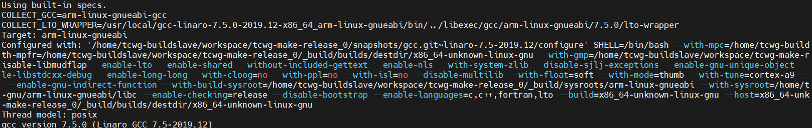

38. arm32架构工具链

```bash
cd /usr/local/ARM-toolchain
tar -vxf gcc-linaro-7.5.0-2019.12-x86_64_arm-linux-gnueabi.tar
rm gcc-linaro-7.5.0-2019.12-x86_64_arm-linux-gnueabi.tar
vi /etc/profile
export PATH="/usr/local/ARM-toolchain/gcc-linaro-7.5.0-2019.12-x86_64_arm-linux-gnueabi/bin:$PATH"
```

source /etc/profile

39. 工具链安装完成后，执行arm-linux-gnueabi-gcc -v命令，查看arm32架构工具链是否按照成功，如果工具链安装成功，系统将显示如下工具链的版本号：


<a id="_Linux内核代码"></a>

### 1.2 Linux内核代码

我们将为您提供以下两种方法用于准备Linux内核代码。

#### 1.2.1 方法一

<a id="OLE_LINK5"></a>

<a id="OLE_LINK6"></a>

在Axera_M57_SDK_Vx.x.x目录下（参考[<span style="color:#0000FF">2.1 解压缩SDK</span>](#_%E8%A7%A3%E5%8E%8B%E7%BC%A9SDK%E5%8C%85)），执行./sdk_unpack.sh命令。此时，程序将自动从网址源上拉取linux-6.1.83.tar.gz内核源码并自动打Axera kernel patch。拉取代码使用的网址源在sdk_unpack.sh脚本中已配置好。前提是该PC能够正常访问互联网。

#### 1.2.2 方法二

<a id="OLE_LINK8"></a>

<a id="OLE_LINK9"></a>

如果sdk_unpack.sh脚本中提供的Linux下载网址已经过期或者失效，需要您自行寻找合适可下载的网址。

如执行

wget -t 5 [https://mirror.tuna.tsinghua.edu.cn/`kernel/v6.x/linux-6.1.83.tar.gz`](https://mirror.tuna.tsinghua.edu.cn/kernel/v6.x/linux-6.1.83.tar.gz)

命令来获取linux-6.1.83内核。

将该代码包的路径作为sdk_unpack.sh脚本的输入参数。

如执行./sdk_unpack.sh –k ~/linux-6.1.83.tar.gz命令，这样您也能够获取到Linux代码。

### 1.3 U-Boot源码

#### 1.3.1 方法一

在Axera_M57_SDK_Vx.x.x目录下（参考[<span style="color:#0000FF">2.1 解压缩SDK</span>](#_%E8%A7%A3%E5%8E%8B%E7%BC%A9SDK%E5%8C%85)），执行./sdk_unpack.sh命令。此时，程序将自动从网址源上拉取u-boot-2022.10.tar.bz2的源码并自动打Axera u-boot-2022.10.patch。拉取代码使用的网址源在sdk_unpack.sh脚本中已配置好。前提是该PC能够正常访问互联网。

#### 1.3.2 方法二

如果sdk_unpack.sh脚本中提供的U-Boot下载网址已经过期或者失效，需要您自行寻找合适可下载的网址。比如：

执行wget -t 5 [https://ftp.denx.de/pub/u-`boot/u-boot-2022.10.tar.bz2`](https://ftp.denx.de/pub/u-boot/u-boot-2022.10.tar.bz2)命令

来获取u-boot-2022.10.tar.bz2。

将该代码包的路径作为sdk_unpack.sh脚本的输入参数。

如执行./sdk_unpack.sh –u ~/u-boot-2022.10.tar.bz2命令，这样您也能够获取到u-boot-2022.10代码。

### 1.4 ATF源码

#### 1.4.1 方法一

在Axera_M57_SDK_Vx.x.x目录下（参考[<span style="color:#0000FF">2.1 解压缩SDK</span>](#_%E8%A7%A3%E5%8E%8B%E7%BC%A9SDK%E5%8C%85)），执行./sdk_unpack.sh命令。此时，程序将自动从网址源上拉取arm-trusted-firmware-2.8.0的源码并自动打Axera arm-trusted-firmware-2.8.0.patch。拉取代码使用的网址源在sdk_unpack.sh脚本中已配置好。前提是该PC能够正常访问互联网。

#### 1.4.2 方法二

如果sdk_unpack.sh脚本中提供的ATF下载网址已经过期或者失效，需要您自行寻找合适可下载的网址。如执行wget -t 5 

[https://github.com/ARM-software/arm-trusted-firmware/archive/refs/tags/v2.8.0.zip](https://github.com/ARM-software/arm-trusted-firmware/archive/refs/tags/v2.8.0.zip)

命令来获取v2.8.0.zip。

将该代码包的路径作为sdk_unpack.sh脚本的输入参数。

如执行./sdk_unpack.sh –a ~/v2.8.0.zip命令，这样您也能够获取到arm-trusted-firmware-2.8.0代码。

### 1.5 OPTEE源码

#### 1.5.1 方法一

在Axera_M57_SDK_Vx.x.x目录下（参考[<span style="color:#0000FF">2.1 解压缩SDK</span>](#_%E8%A7%A3%E5%8E%8B%E7%BC%A9SDK%E5%8C%85)），执行./sdk_unpack.sh命令。此时，程序将自动从网址源上拉取optee_os-3.21.0的源码并自动打Axera optee_os-3.21.0.patch。拉取代码使用的网址源在sdk_unpack.sh脚本中已配置好。前提是该PC能够正常访问互联网。

#### 1.5.2 方法二

如果sdk_unpack.sh脚本中提供的OPTEE下载网址已经过期或者失效，需要您自行寻找合适可下载的网址。比如：

执行wget -t 5 [https://github.com/OP-TEE/optee_os/archive/refs/tags/3.21.0.zip](https://github.com/OP-TEE/optee_os/archive/refs/tags/3.21.0.zip)命令来获取3.21.0.zip。

将该代码包的路径作为sdk_unpack.sh脚本的输入参数。

如执行./sdk_unpack.sh –O ~/3.21.0.zip命令，这样您也能够获取到optee_os-3.21.0代码。

## 2. 安装SDK

<a id="_解压缩SDK包"></a>

### 2.1 解压缩SDK包

操作步骤

1. 请您以root用户登录部署使用SDK的必须环境。参考<span style="color:#00B0F0">1.1.1 配置安装环境</span>

40. 进入SDK包所在目录，执行tar -xvf Axera_M57_SDK_Vx.x.x.tgz命令解压该压缩包。

41. 解压后，您将得到Axera_M57_SDK_Vx.x.x目录。

<a id="_展开SDK包内容"></a>

### 2.2 展开SDK包内容

操作步骤

1. 请您进入解压后的M57_SDK_Vx.x.x目录。

42. 执行./sdk_unpack.sh命令展开SDK包中的内容。

- 说明：

- 执行./sdk_unpack.sh命令时，您可以带一个路径参数，用于指定linux内核源码、uboot、atf和optee等tar包的位置。您也可以不指定该路径，解压脚本后将自动拉取Kernel，U-Boot, ATF和OPTEE代码。

- sdk_clean.sh脚本用于清理展开后的SDK包中的内容。sdk_clean.sh脚本是sdk_unpack.sh脚本的逆向操作，执行该脚本后所有通过sdk_unpack.sh脚本生成的文件及目录均会被清除，**<span style="color:#FF0000">如果有私有数据请提前备份，谨慎使用</span>****！**

<a id="_介绍SDK包内容"></a>

### 2.3 介绍SDK包内容

展开SDK包后的目录如下图所示：

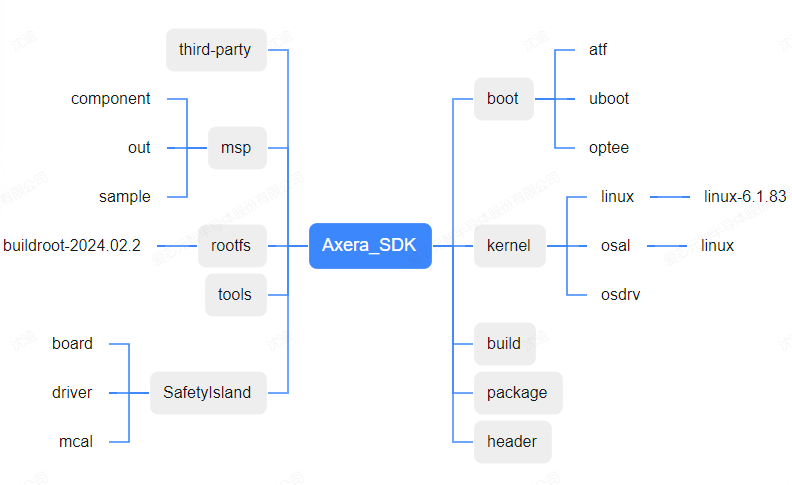

- **说明**

- `msp/out`目录下生成的应用程序都是基于arm64 glibc编译的；

## 3. 编译版本

<a id="_准备工作"></a>

### 3.1 编译步骤

- 请确保您已经成功编译工具链。更多内容，请参考[编译工具链](#_%E7%BC%96%E8%AF%91%E5%B7%A5%E5%85%B7%E9%93%BE)。

- 编译前，请确认您需要使用的工程。

操作步骤

1. 请您以root用户登录需要编译版本的环境。

43. 进入Axera_M57_SDK_Vx.x.x/build目录。

44. 执行make plist，查看当前支持的所有工程列表，例如：

================Platform List================ 

```bash
make PLAT=demo_nor_emmc
make PLAT=demo_nor_nand
make PLAT=evb
make PLAT=demo_only_nand
```

平台的命名方式为：BOARDNAME_FLASHTYPE。

其中BOARDNAME包含：demo和evb；FLASHTYPE包含nor_emmc、nor_nand和only_nand，其中nor_nand表示Safety Nor + Main Nand的启动设备组合，一部分镜像放在Safety Nor上，一部分镜像放在Main Nand上，nor_emmc同理表示Safety Nor + Main eMMC；only_nand表示只有Main Nand可用，也就是Safety和Mian的镜像都放在Main Nand上；

45. 执行make PLAT=demo_nor_nand clean all install axp命令。该命令用于实现全版本的编译并完成axp打包。

46. 编译成功后，将在build目录下生成out目录。

47. 进入out目录后，您将看到demo_nor_nand目录和axera_demo_nor_nand_Vx.x.x.axp包。在build/out/demo_nor_nand/images目录中，您将看到如下图所示的编译生成的各个文件：

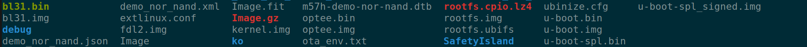

axera_demo_nor_nand_Vx.x.x.axp包则是将上图中的fdl1、fdl2、bl31、optee、u-boot、kernel等文件统一打包，方便您使用AXDL下载工具进行烧录。

- 说明：

关于如何使用`AX_DL`工具下载Demo板，请您参考《AXDL工具使用指南》文档获取相关内容。

<a id="_工程支持"></a>

<a id="_OSAL编译"></a>

### 3.2 平台支持

SDK支持的单板平台，可以在解压并展开SDK后，进入SDK工作目录下的build子目录，执行make plist命令来查看。如：

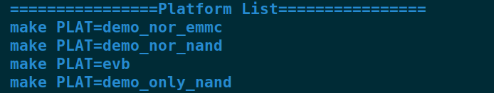

列出的即为该SDK所支持的所有单板平台，单板平台命名规则为：

BOARDNAME_FLASHTYPE

其中BOARDNAME包含：demo和evb；FLASHTYPE包含nor_emmc、nor_nand和only_nand，其中nor_nand表示Safety Nor + Main Nand的启动设备组合，一部分镜像放在Safety Nor上，一部分镜像放在Main Nand上，nor_emmc同理表示Safety Nor + Main eMMC；only_nand表示只有Main Nand可用，也就是Safety和Mian的镜像都放在Main Nand上；

请根据实际情况选择合适的平台进行编译，可生成该平台对应的axp包，如：make PLAT=demo_nor_nand all install axp, 会在build/out目录下生成对应的axp包。

### 3.3 ATF编译

ATF编译后生成可用于下载的文件为bl31.img，可以单独编译，例如编译demo_nor_nand工程，步骤如下：

1. 进入Axera_M57_SDK_Vx.x.x/`boot/atf`目录。

48. 执行make PLAT=demo_nor_nand clean all install命令。

49. 编译成功后，将在build目录下生成out/demo_nor_nand目录。

50. 进入build/out/demo_nor_nand目录后， 您将看到bl31.img

### 3.4 OPTEE编译

OPTEE是针对有trustzone需求使用且可选择的，编译后生成可用于下载的文件为optee.img，可以单独编译，步骤如下：

1. 进入Axera_M57_SDK_Vx.x.x/`boot/optee`目录。

51. 执行make PLAT=demo_nor_nand clean all install命令。

52. 编译成功后，将在build目录下生成out/demo_nor_nand目录。

53. 进入build/out/demo_nor_nand目录后，您将看到optee.img

注意：

如果不需要optee，可以在build/platforms/demo_nor_nand/config.mk中配置SUPPORT_OPTEE := FLASE，在build目录编译时所有optee源代码都不会被编译，optee.img也不会打包到AXP中。

### 3.5 U-Boot编译

uboot编译后生成可用于下载的文件为u-boot.img，config文件位于boot/uboot/u-boot-2022.10/configs目录，如m57-demo-nor-nand_defconfig是demo_nor_nand平台的配置文件。

uboot可以单独进行编译，例如编译demo_nor_nand，步骤如下：

1. Axera_M57_SDK_Vx.x.x/`boot/uboot`目录。

<a id="OLE_LINK10"></a>

<a id="OLE_LINK11"></a>

54. 执行make PLAT=demo_nor_nand clean all install命令。

55. 编译成功后，将在build目录下生成out/demo_nor_nand目录。

56. 进入build/out/demo_nor_nand目录后， 您将看到uboot.img

### 3.6 Linux Kernel编译

kernel编译后生成可用于下载的文件为kernel.img以demo_nor_nand平台为例，它对应的defconfig文件为m57-tiny_defconfig, 该文件位于kernel/linux/linux-6.1.83/arch/arm64/configs目录。dts文件位于kernel/linux/linux-6.1.83/arch/arm64/`boot/dts/axera/`。

kernel可以单独编译，例如编译demo_nor_nand平台，步骤如下：

1. 进入Axera_M57_SDK_Vx.x.x/`kernel/linux`目录。

57. 执行make PLAT=demo_nor_nand clean all install命令。

58. 编译成功后，将在build目录下生成out/demo_nor_nand目录。

59. 进入build/out/demo_nor_nand目录后， 您将看到kernel.img

### 3.7 Rootfs编译

rootfs文件位于SDK中rootfs目录，该目录下包含的文件如下：

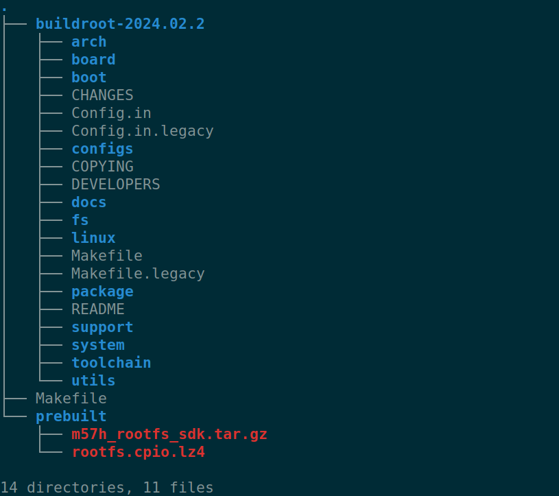

prebuilt目录下的文件是提前使用buildroot编译出来，存放在这里的，由于buildroot每次编译很费时间，为了减少build时间，每次build时只使用提前编译好的rootfs.cpio.lz4文件，其他仓库里面编译出的二进制程序是通过build/scripts/package_rootfs.sh脚本复制进入根文件系统, 具体实现原理可以参考脚本。m57_rootfs_sdk.tar.gz文件也是buildroot生成的，用于二次开发，如果您开发的程序需要链接开源三方库，那就可以使用这个包进行编译链接。

rootfs也可以单独构建，例如编译demo_nor_nand平台，步骤如下：

1. 进入Axera_M57_SDK_Vx.x.x/rootfs目录。

60. 执行make PLAT=demo_nor_nand clean rootfs all install命令。

61. 编译成功后，将在build目录下生成out/demo_nor_nand目录。

62. 进入build/out/demo_nor_nand目录后， 您将看到rootfs.img

## 4. 分配Memory和存储空间

### 4.1 内存空间概述

在SDK中，系统配置的默认DDR空间范围为1 GiB，其地址分配如下图所示：

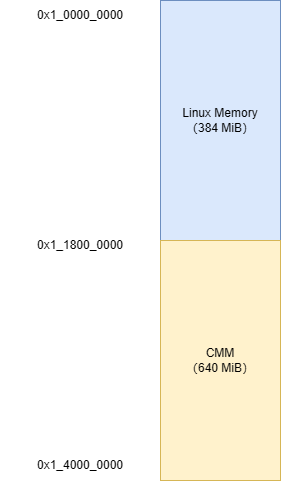

根据上图所示，SDK的内存空间分为两段空间：

- Linux使用的最大内存空间大小是384 MiB。

- 作为大段物理连续内存管理的CMM（Contiguous Memory Model）的空间，共640MiB。

- 说明：

这里仅以1 GiB DDR空间分布供参考，实际情况可能存在差异，请以实际情况为准。

<a id="_内存空间分配的调整"></a>

启动过程中，会把镜像和数据存放到DDR中。运行过程中，也会预留一部分内存空间给ATF、OPTEE等固件专用，因此Linux Memory空间里面还需要进一步细分：

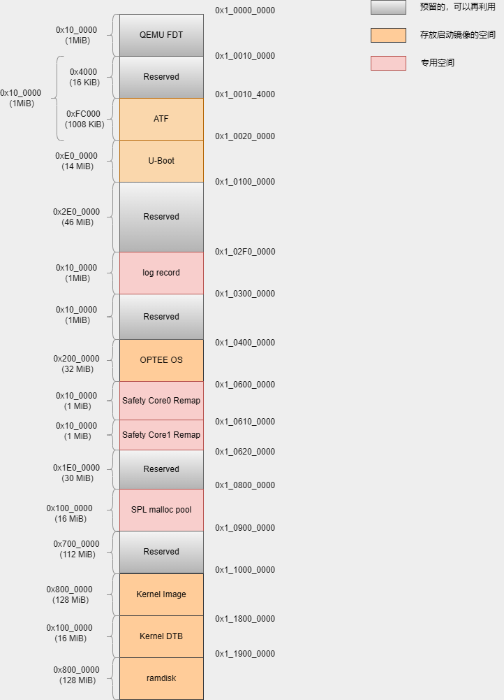

### 4.2 内存空间大小调整

如果您想调整上述Linux内存和CMM内存空间的大小，请参考下面的详细介绍。

#### 4.2.1 静态配置

以demo_nor_nand平台为例，修改build/platforms/axera/demo_nor_nand/config.mk文件SYSTEM_MEMORY_SZ和LINUX_MEMORY_SZ两个配置选项：

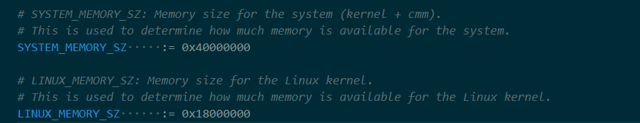

SYSTEM_MEMORY_SZ指定的是Linux memory和CMM memory大小的总和

LINUX_MEMORY_SZ指定的是Linux memory的大小

两者相减就是CMM memory的大小

<span style="color:#EE0000">注意：</span>如果config.mk没有这两个配置选项，请自行添加。

#### 4.2.2 动态调整

以demo_nor_nand平台为例，运行到uboot命令行下， 执行下面命令来调整SYSTEM_MEMORY_SZ和LINUX_MEMORY_SZ：

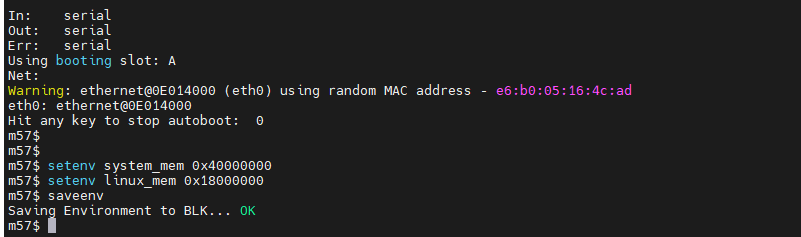

注意：请根据自己业务的具体情况配置的内存大小。

#### 4.2.3 Inline ECC内存配置

Inline ECC 开启跟随fusa开关，普通版本默认关闭Inline ECC，fusa版本默认开启Inline ECC。

有两段空间开启了Inline ECC，第一段是linux内核空间，不可进行配置修改，第二段是CMM ECC空间，需要跟随DDR大小进行适配修改。

**SDK代码的ECC配置为1G DDR，按照4.2.1修改DDR大小后需要同步修改ECC配置**。修改方式为

SafetyIsland/driver/ddr/ddrmc_init.h的INLINE_ECC_BLOCK_1_START 为 DDR大小 - 128M的值。下图是将1G修改为2G的例子。

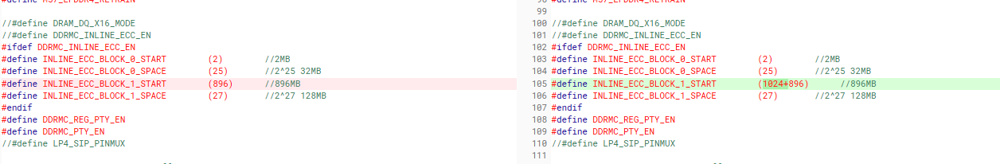

<span style="color:#FF0000">警告：</span>DDR大小-128M/8 ~ DDR大小 这段空间是ECC code存储区域，非DDR硬件和软件不允许使用。

#### 4.2.4 验证内存配置

以demo_nor_nand平台为例，在linux执行相关的命令查看。

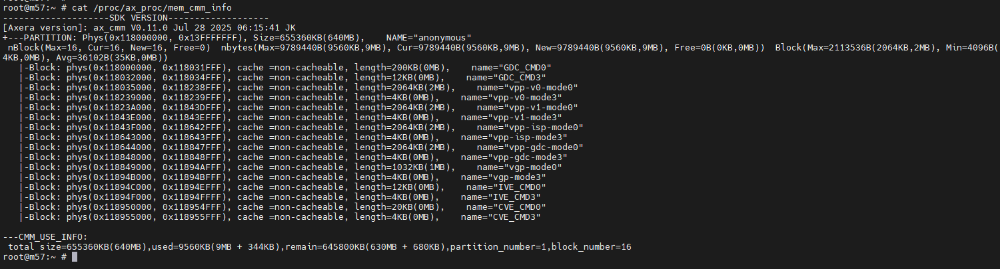

查看cmm内存配置是否符合预期。

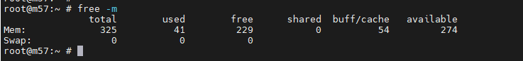

查看linux kernel可用的内存大小。

### 4.3 FLASH存储空间的分配

M57 DEMO板的存储设备是NOR+NAND，以demo_nor_nand board中AB分区的NOR+NAND空间为例，分配如下图所示：

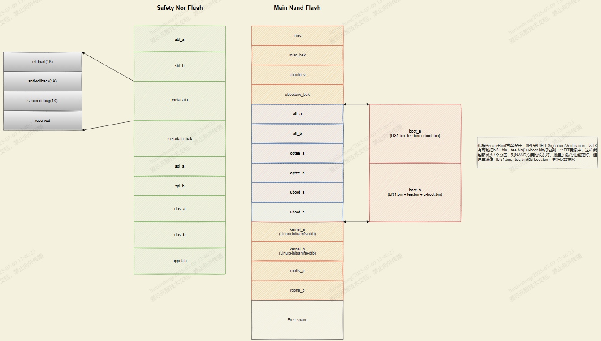

NOR和NAND上的分区是从0偏移地址紧密外后排布的：

并且分区排布的顺序在代码中固化，唯一需要确认的是每个分区的对应的size大小。

这个从build/platforms/axera/demo_nor_nand/partitions.json文件中获取。

### 4.4 调整分区大小

若只需要修改分区的大小只需要修改下图4-6文件中，对应的size即可，无需额外修改文件，其余脚本会自动适配。如下：

进入build/platforms/axera/demo_nor_nand/partitions.json配置文件，调整配置文件中的各分区对应的Size即可。

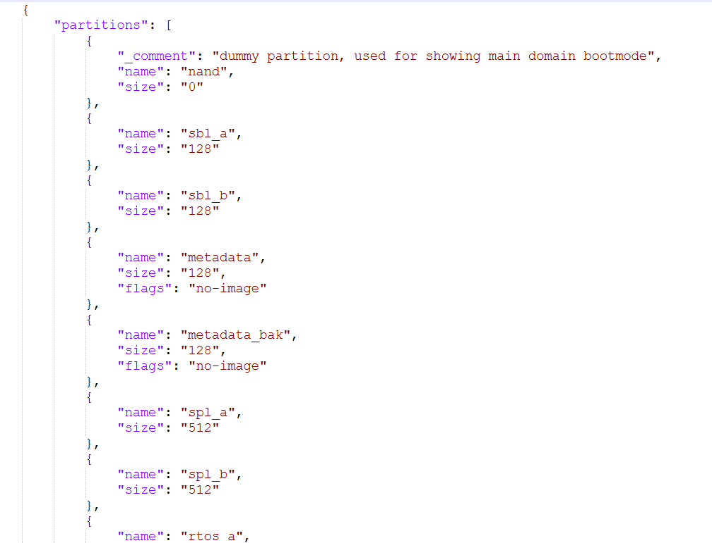

该文件中的配置经过脚本解析，组成mtdparts格式字符串。通过axdl工具将该信息写入metadata分区。uboot启动后会从该分区读取分区信息。

保存在Safety Nor/Nand上的mtdparts格式：

<span style="color:#FF00FF">nand*1#</span><span style="color:#FF0000">0x40000(sbl_a),0x40000(sbl_b),0x80000(spl_a),0x80000(spl_b),0x80000(atf_a),0x80000(atf_b),0x80000(optee_a),0x80000(optee_b),0x200000(uboot_a),0x200000(uboot_b),0x1400000(kernel_a)</span><span style="color:#FF00FF">bootable</span><span style="color:#FF0000">,0x1400000(kernel_b)</span><span style="color:#FF00FF">bootable</span>

除了紫色是我们自定义字段，这些自定义字段不允许传递给后一级（RTOS、Linux），其他都是符合标准Linux kernel里面的定义。

partitions.json配置文件分区size单位是KB。需要注意size应保证是erase size的整数倍。如NOR上所有分区大小应4k（GD25F64）的整数倍，NAND上所有分区大小应256K（W35N04JW）的整数倍。

### 4.5 新建或删除分区

暂不支持创建和删除分区，以免影响设备启动。

## 5. 根文件系统

### 5.1 根文件系统简介

根文件系统（root Filesystem）是内核启动时挂载（mount）的第一个文件系统，如果系统不能从指定设备上挂载根文件系统，会导致系统启动出错。系统启动成功之后可以自动或手动挂载其他文件系统。很明显，一个系统中是可以同时存在不同的文件系统的。

根文件系统的“根”说明该文件系统是加载其他文件系统的“根”，否则其他的文件系统无法进行挂载。根文件系统被挂载在根目录“/”之下，在根目录下就存在该文件系统的各个目录和文件，比如/bin、/sbin、/mnt等，然后可以将其他文件系统挂载在/mnt目录下。

根文件系统包含系统启动时所必须的目录和关键性文件，以及挂载其他文件系统所必须的文件。如下图所示：

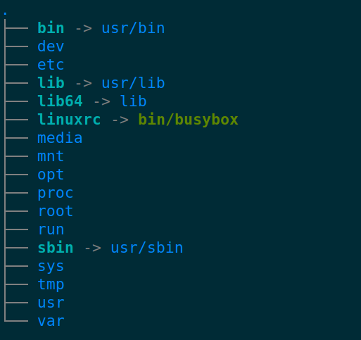

因此，内核必须要和根文件系统相互配合才能工作，只有内核本身是无法工作的。

### 5.2 利用Buildroot制作根文件系统

Buildroot 是一个强大且灵活的自动化构建工具，专门用于创建定制的嵌入式 Linux 系统。它通过一个基于 Kconfig（类似 Linux 内核的配置系统）的 `make menuconfig` 界面，允许开发者精确选择目标硬件架构（如 ARM、ARM64、x86）、交叉编译工具链（可由 Buildroot 构建或使用外部预编译版本）、C 库（如 glibc, uClibc-ng, musl）、Linux 内核版本及配置、引导加载程序（如 U-Boot）以及根文件系统中所需的各种用户空间软件包和库（从基础的 BusyBox 工具集到复杂的应用程序如 GStreamer 或 Python）。

配置完成后，执行 `make` 命令，Buildroot 会自动下载所有选定组件的源代码，编译交叉工具链，然后用此工具链编译内核、引导加载程序和所有用户软件包，最后将它们组装成一个完整的根文件系统镜像。支持多种镜像格式，如 `tar` 包、`ext2/3/4` 分区镜像、`cpio` (常用于 initramfs)、`squashfs` 等。Buildroot 还提供了如文件系统覆盖 (overlay) 和构建后脚本等机制，方便开发者进行深度定制，例如添加自定义文件、修改配置或执行特定设置。最终，Buildroot 提供了一个可复现的、高效的、高度可定制的方法来为嵌入式设备生成完整的、可启动的 Linux 系统。

#### 5.2.1 获取Buildroot源码

获取Buildroot的源码的方式又两种：通过官方网站获取，或者直接利用Axera SDK中发布的Buildroot。

通过官方网站获取Buildroot源码

您可以登录Buildroot官网（https://buildroot.org/）获取Buildroot的源代码。源代码如buildroot-2024.02.tar.gz。

通过SDK获取Buildroot源码

在Axera发布的SDK包中，已经包含了一份Buildroot源码。该源码的基于官方buildroot-2024.02.2版本的基础上，增加了Axera自定义内容。

#### 5.2.2 基于SDK的Buildroot编译

准备工作

- 请您确保已经成功获取Buildroot源码。更多内容，请参考5.2.1获取Buildroot源码。

操作步骤

1. 请您进入Axera_M57_SDK_Vx.x.x/rootfs目录，以编译demo_nor_nand平台为例。

2. 执行make PLAT=demo_nor_nand menuconfig命令进行配置

3. 执行make PLAT=demo_nor_nand savedefconfig命令保存配置到defconfig

4. 执行make PLAT=demo_nor_nand rootfs命令进入buildroot的编译，等待编译完成，产物rootfs.cpio.lz4和m57_rootfs_sdk.tar.gz会被复制到prebuilt目录下，编译的中间产物都在build/out/demo_nor_nand/objs/buildroot/目录下

5. 执行make PLAT=demo_nor_nand rootfs_clean命令清除buildroot的构建

注意！

步骤2中，客户需要提前修改buildroot配置文件中的默认下载源（rootfs/buildroot-2024.02.2/configs/m57h_defconfig），将其指向客户可访问的镜像源。

```c
BR2_PRIMARY_SITE="http://<mirror-host>/buildroot"
```

### 5.3 文件系统简介

#### 5.3.1 SquashFS

SquashFS是专门为一般的只读文件系统的使用而设计，它可应用于数据备份，或是系统资源紧张的电脑上使用。最初版本的SquashFS采用gzip的数据压缩。版本2.6.34之后的Linux内核增加了对LZMA和LZO压缩算法的支持，版本2.6.38的内核增加了对LZMA2的支持，该算法同时也是xz使用的压缩算法。

版本2.6.35之后的内核包含的SquashFS增加了扩展文件属性支持。

#### 5.3.2 EXT4

EXT4的全称是Fourth extended filesystem，是Linux系统下的日志文件系统，是EXT3文件系统的后继版本。

#### 5.3.3 UBIFS

无序区块映像文件系统（Unsorted Block Image File System，UBIFS）是一种用于固态硬盘存储设备的文件系统，UBIFS最早在2006年由IBM与Nokia的工程师Thomas Gleixner，Artem Bityutskiy所设计，专门为了解决MTD（Memory Technology Device）设备所遇到的瓶颈。由于Nand闪存容量的暴涨，YAFFS等皆无法再去控制Nand闪存的空间。UBIFS透过子系统UBI处理与MTD设备之间的动作。与JFFS2一样，UBIFS建构于MTD设备之上，因而与一般的块设备不兼容。

UBIFS在设计与性能上均较YAFFS2、JFFS2更适合大容量的NAND FLASH。例如，UBIFS支持write-back，其写入的资料会被缓存，直到有必要写入时才写到闪存，大大地降低分散小区块数量并提高I/O效率。UBIFS文件系统目录存储在闪存上，UBIFS挂载时不需要扫描整个闪存的资料来重新创建文件目录。

<a id="_Pinmux配置"></a>

## 6. 日志系统

### 6.1 日志系统简介

日志系统是记录操作系统、驱动、应用所产生的Log的一套服务程序。这套服务程序主要由syslogd、klogd、axsyslogd以及axklogd组成。klogd记录Linux内核原生的内核Log，syslogd根据/etc/syslog.conf的配置来记录系统Log，syslogd和klogd是busybox自带的一组log服务程序，通过/etc/init.d/S01syslogd和/etc/init.d/S02klogd服务来启动，自动保存log。而axsyslogd和axklogd是本SDK开发的一组记录SDK自研实现的非开源驱动log和 应用程序log的服务程序，应用程序log直接由axsyslogd记录，而axklogd记录驱动的log并转发给axsyslogd，所有log最终由axsyslogd统一写入到同一个log文件中。

！注意：

SDK中的日志总体包含两个部分：

- Linux系统原生日志，包含Linux 内核原生日志及基础应用程序日志；

- SDK自研驱动日志及SDK自研应用、动态库、静态库产生的日志。

本章着重介绍SDK自研驱动日志及SDK应用、动态库、静态库产生的日志的控制、抓取以及查看等。

- 本章中提到的user log，如未特别表明，均指SDK自研应用、动态库、静态库等用户态程序所产生的日志。

- 本章中提到的kernel log，如未特别表明，均指SDK自研驱动程序所产生的日志。

- 本章中提到的SDK Log，如未特别表明，均指user log + kernel log。

### 6.2 syslogd和klogd

syslogd和klogd是busybox自带的一组log服务程序，通过/etc/init.d/S01syslogd和/etc/init.d/S02klogd服务来启动，自动将Linux系统原生log保存到文件。klogd主要功能是获取Linux原生内核log并转发给syslogd进行存储，而syslogd除了接受来自klogd的log外，还接收使用了syslog接口的应用程序输出的log（比如ftp、crond等用户进程），统一保存到log文件中，log文件的存储路径可以通过/etc/syslog.conf来配置。SDK中/etc/syslog.conf文件的默认配置如下：

auth.*          /var/log/auth.log

authpriv.*      /var/log/authpriv.log

cron.*          /var/log/cron.log

daemon.*        /var/log/daemon.log

ftp.*           /var/log/ftp.log

lpr.*           /var/log/lpr.log

mail.*          /var/log/mail.log

mark.*          /var/log/mark.log

news.*          /var/log/news.log

security.*      /var/log/security.log

syslog.*        /var/log/syslog.log

kern.*          /opt/data/AXSyslog/`kernel/kernel.log`

user.*          /opt/data/AXSyslog/`kernel/user.log`

uucp.*          /var/log/uucp.log

local0.*        /var/log/local0.log

local1.*        /var/log/local1.log

local2.*        /var/log/local2.log

local3.*        /var/log/local3.log

local4.*        /var/log/local4.log

local5.*        /var/log/local5.log

local6.*        /var/log/local6.log

local7.*        /var/log/local7.log

*.emerg         *

Linux内核原生log被保存到了/opt/data/AXSyslog/kernel路径下，如果你需要变更路径可根据实际需求更改user.*和kern.*对应的路径。需特别说明的是user.*配置的实际是linux内核原生log的输出，这个行为是由busybox的实现决定的，不同版本的busybox的行为可能会略有差异（SDK中使用的busybox 版本是busybox-1.35.0）。

### 6.3 axsyslogd和axklogd

axsyslogd和axklogd是本SDK开发的一组记录本SDK自研驱动log(kernel log)和应用log(user log)的服务程序，axklogd记录kernel log并转发给axsyslogd进行存储，而axsyslogd除了接收来自axklogd转发的log外，还会记录调用了`AX_SYS_Log` API的应用程序(包括动态库、静态库等)log，这两部分log被axsyslogd一起写入到同一个log文件中进行存储。axsyslogd和axklogd是一套类似syslogd和klogd的log服务程序，被统一集成到axbox中，该套log服务程序涉及到的主要文件如下表所示：

<table>
  <thead>
    <tr>
      <th><strong>文件</strong></th>
      <th><strong>说明</strong></th>
    </tr>
  </thead>
  <tbody>
    <tr>
      <td>/etc/ax_syslog.conf</td>
      <td>axsyslogd配置文件</td>
    </tr>
    <tr>
      <td>/etc/init.d/S01axsyslogd</td>
      <td>axsyslogd启动脚本</td>
    </tr>
    <tr>
      <td>/etc/init.d/S02axklogd</td>
      <td>axklogd启动脚本</td>
    </tr>
    <tr>
      <td>/sbin/axsyslogd</td>
      <td>保存SDK自研程序的log到文件系统，依赖ax_syslog.conf配置</td>
    </tr>
    <tr>
      <td>/sbin/axklogd</td>
      <td>将SDK自研驱动程序的kernel log转发到axsyslogd</td>
    </tr>
    <tr>
      <td>/bin/axdmesg</td>
      <td>实时查看SDK的kernel log输出，功能类似dmesg</td>
    </tr>
    <tr>
      <td>/bin/axbox</td>
      <td>类似busybox的一个工具箱，包了axsyslogd、axklogd、axdmesg等工具</td>
    </tr>
  </tbody>
</table>

<a id="_axsyslogd"></a>

#### 6.3.1 axsyslogd

axsyslogd是本SDK自研开发的一个log服务程序，其主要职责有两个：

- 将user log和kernel log统一写入log文件；

- 根据ax_syslog.conf配置文件，将各模块的log等级信息控制写入共享内存，以控制user log和kernel log的输出。

axsyslogd对应由一个配置文件ax_syslog.conf，其默认路径是/etc/ax_syslog.conf，但该文件的位置是可配置的，配置方法是修改工程对应的dts文件，以m57-demo工程为例，其dts文件为:

<a id="OLE_LINK2"></a>

<a id="OLE_LINK3"></a>

linux-6.1.83/arch/arm64/`boot/dts/axera/m57-demo.dts`

其配置内容为：

	axera_logctl {

```c
compatible = "axera,logctl";
config = "/etc/ax_syslog.conf";
logstate = /bits/ 8 <1 1>;
loglevel = /bits/ 8 <4 4>;
};
```

如果您有变更ax_syslog.conf文件位置的需求，可在对应的dts文件中去修改config的配置，关于axera_logctl更详细的配置说明请参考[配置dts](#_%E9%85%8D%E7%BD%AEdts)章节，ax_syslog.conf文件内容的说明请参考[配置ax_syslog.conf](#_%E9%85%8D%E7%BD%AEax_syslog.conf)章节。

#### 6.3.2 axklogd

axklogd主要的功能是读取本SDK自研驱动程序的kernel log并转发到axsyslogd进程进行存储。需要注意的是，如果重启了axsyslogd进程，axklogd进程也必须重启，且必须保持axsyslogd先启动、axklogd后启动的顺序，否则axklogd无法将log转发给axsyslogd，从而造成log丢失。

<a id="_日志系统的部署"></a>

### 6.4 日志系统的部署

日志系统的部署，主要包括两个部分：

- 系统原生log的部署，即syslogd及klogd的部署；

- 本SDK自研log系统的部署，即axsyslogd及axklogd的部署。

#### 6.4.1 系统原生日志的部署

Linux系统原生日志主要通过syslogd和klogd进行维护。syslogd和klogd是busybox自带的一组log服务程序，它们分别通过/etc/init.d/S01syslogd和/etc/init.d/S02klogd服务来启动。

这组日志服务程序设计到的主要资源文件如下表所示。

##### 资源文件列表

<table>
  <tbody>
    <tr>
      <th><strong>文件</strong></th>
      <th><strong>说明</strong></th>
    </tr>
    <tr>
      <td>/bin/busybox</td>
      <td>busybox文件</td>
    </tr>
    <tr>
      <td>/sbin/syslogd</td>
      <td>syslog服务程序，实现syslog、klog的保存</td>
    </tr>
    <tr>
      <td>/sbin/klogd</td>
      <td>klog服务程序，实现linux原生kernel log的读取并转发给/sbin/syslogd进行存储</td>
    </tr>
    <tr>
      <td>/etc/init.d/S01syslogd</td>
      <td>syslogd启动、停止脚本</td>
    </tr>
    <tr>
      <td>/etc/init.d/S02klogd</td>
      <td>klogd启动、停止脚本，必须在syslogd启动后才能启动该脚本，如果syslogd重启过，klogd也必须重启。</td>
    </tr>
    <tr>
      <td>/etc/syslog.conf</td>
      <td>syslogd配置文件</td>
    </tr>
  </tbody>
</table>

##### 资源部署

默认情况下，busybox、syslogd、klogd、S01syslogd、S02klogd这些文件都是按照上表的路径部署的，如果您有路径的定制化需求，只需将busybox、syslogd、klogd加入到PATH环境变量可查询到的路径即可，而S01syslogd、S02klogd通过/etc/init.d/rcS来开机自启动即可。

###### 修改log保存路径

/etc/syslog.conf文件需做特别说明：

user.*          /opt/data/AXSyslog/`kernel/user.log`

该配置项指定了linux原生kernel log的输出路径，您可以修改配置项来更改Log保存路径，同时需要将/etc/init.d/S01syslogd文件中的：

if [ ! -d "<span style="color:#FF0000">/opt/data/AXSyslog/kernel</span>" ]; then

    mkdir -p <span style="color:#FF0000">/opt/data/AXSyslog/kernel</span>

fi

修改为您希望的log存储路径。

###### 修改log保存大小

```c
SYSLOGD_ARGS="-s 5120 -b 99 -S"
```

“-s 5120”配置项指定了user.log单个文件的大小为5MB，“-b 99”指定了最多可保存99个log文件，当log文件超过99个时，log文件将被循环覆盖。

###### 修改syslog.conf文件路径

/etc/syslog.conf是busybox系统内部指定的配置文件路径，如果有修改该路径的需求，有两种方式：

方式1）：修改/etc/init.d/S01syslogd脚本

将：

```c
SYSLOGD_ARGS="-s 5120 -b 99 -S"
```

修改为：

```c
SYSLOGD_ARGS="-f /mydir/syslog.conf -s 5120 -b 99 -S"
```

通过-f指定配置文件路径，/mydir/syslog.conf为新的配置文件路径(请根据实际情况修改)。

方式2）：修改busybox源码

修改sysklogd/syslogd.c的parse_syslogdcfg函数：

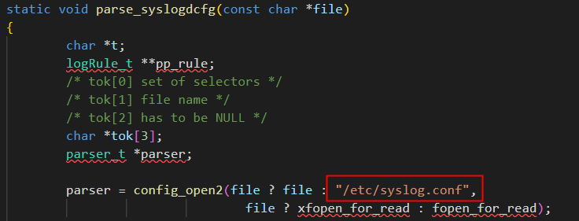

将默认的/etc/syslog.conf文件路径改为您希望的路径，这样在不使用-f参数的情况下，会默认通过该路径来读取配置。

#### 6.4.2 SDK自研日志系统的部署

本SDK自研日志系统对日志的管理工作主要由axsyslogd和axklogd完成。axsyslogd和axklogd是本SDK开发的一组记录自研实现的kernel log（非开源ko）和user log（应用程序、动态库、静态库等）的服务程序，axklogd记录kernel log，而axsyslogd记录user log，这两部分log被统一写入到同一个log文件中。这组日志服务程序设计到的主要资源文件如下表所示。

##### 资源文件列表

<table>
  <thead>
    <tr>
      <th><strong>文件</strong></th>
      <th><strong>说明</strong></th>
    </tr>
  </thead>
  <tbody>
    <tr>
      <td>/bin/axbox</td>
      <td>busybox文件</td>
    </tr>
    <tr>
      <td>/sbin/axsyslogd</td>
      <td>syslog服务程序，实现syslog、klog的保存</td>
    </tr>
    <tr>
      <td>/sbin/axklogd</td>
      <td>axklog服务程序，实现ax_printk接口的kernel log的读取并转发给/sbin/axsyslogd进行存储</td>
    </tr>
    <tr>
      <td>/etc/init.d/S01axsyslogd</td>
      <td>axsyslogd启动、停止脚本</td>
    </tr>
    <tr>
      <td>/etc/init.d/S02axklogd</td>
      <td>axklogd启动、停止脚本，必须在axsyslogd启动后才能启动该脚本，如果axsyslogd重启过，axklogd也必须重启。</td>
    </tr>
    <tr>
      <td>/etc/ax_syslog.conf</td>
      <td>axsyslogd配置文件</td>
    </tr>
    <tr>
      <td>/bin/axdmesg</td>
      <td>功能与demesg类似，可通过该指令查看最新的ax_printk接口输出的kernel log.</td>
    </tr>
    <tr>
      <td>m57-demo.dts</td>
      <td>这里是以m57-demo工程为例，其dts配置文件路径是：linux-6.1.83/arch/arm64/boot/dts/axera/m57-demo.dts，其axera_logctl相关配置，配置了user log、kernel log的默认等级，以及ax_syslog.conf的存放路径等内容。</td>
    </tr>
  </tbody>
</table>

##### 资源部署

axbox、axsyslogd、axklogd和axdmesg只需存放到PATH可搜寻到的路径即可，axsyslogd和axklogd需要通过/etc/init.d/rcS来加入开机启动：

/etc/init.d/S01axsyslogd start

/etc/init.d/S02axklogd start

<a id="_配置dts"></a>

###### 配置dts

M57 SDK中，每个工程都有对应的dts配置文件，以m57-demo工程为例，其dts配置文件路径是：

linux-6.1.83/arch/arm64/`boot/dts/axera/m57-demo.dts`

其中axera_logctl的配置如下：

axera_logctl {

```c
compatible = "axera,logctl";
config = "/etc/ax_syslog.conf";
logstate = /bits/ 8 <1 1>;
loglevel = /bits/ 8 <4 4>;
};
```

其中，config配置的是ax_syslog.conf配置文件路径，您可以修改为您需要的路径，比如：/etc/init.d/my_syslog.conf，这样axsyslogd会自动去读取/etc/init.d/my_syslog.conf文件的配置信息<span style="color:#000000">。</span>

logstate的配置中“/bits/ 8”表示该配置项8 bit位宽，保持不变即可。<1 1>分别代表user log和kernel log的默认状态，1表示默认开启log,0表示默认关闭log，这在开机阶段还未加载ax_syslog.conf配置时有效，在加载ax_syslog.conf配置后将会被ax_syslog.conf中的配置覆盖。

loglevel中 <4 4>分别代表user log和kernel log的默认log等级，这在开机阶段还未加载ax_syslog.conf配置时有效，在加载ax_syslog.conf配置后将会被ax_syslog.conf中的配置覆盖。

<a id="_配置ax_syslog.conf"></a>

###### 配置ax_syslog.conf

ax_syslog.conf配置文件默认内容如下：

```bash
第一部分功能：Log保存配置
```

```c
AX_SYSLOG_enable = 1          #开启axsyslog, 1:开启, 0:关闭。
AX_SYSLOG_path = /opt/data    #log保存路径。
AX_SYSLOG_percent = 90        #磁盘空间使用百分比，1)使用时超过该值，Log开始循环覆盖; 2)启动时超过该值, Log可能被丢弃。
AX_SYSLOG_strategy = 0        #磁盘空间受限后，新log是覆盖旧log，还是丢弃。0:覆盖, 1:丢弃。
AX_SYSLOG_filesizemax = 5     #单个Log文件大小,单位:MB。
AX_SYSLOG_volume = 30          #所有log占用的总磁盘空间,单位:MB。
AX_SYSLOG_minimalspace = 16   #当磁盘使用百分比超过AX_SYSLOG_percent时，如果磁盘剩余值大于该值，仍然可保存log。
```

```bash
第二部分功能：Log等级配置
```

#模块Log等级设置

```c
ulog_state  = on
ulog_target = file
klog_state  = on
```

#module id level(user) level(kernel)

ISP     1        4         4

CE      2        4         4

EFUSE   5        4         4

NPU     6        4         4

VENC    7        4         4

JENC    9        4         4

SYS     11       4         4

IVPS    13       4         4

```c
...
```

该文件配置包含两部分功能：

###### log存储配置

log存储配置，说明如下：

1. `AX_SYSLOG_enable`  1：保存log，0：不保存log（log仍然可能在输出，只是未存储）；

2. `AX_SYSLOG_path`    log存储路径，不支持ramfs分区。例如，通过mount -t ramfs /dev/xxx /log/dir得到的/log/dir无法将Log保存下来，原因是这种方式得到的分区无法获取分区大小，请避免使用该方式得到的分区，如果需要使用ram分区来保存Log，推荐使用tmpfs分区；

3. `AX_SYSLOG_percent`为避免磁盘被写log写满，通过该配置值，控制Log的输出量，当磁盘占用空间超过该值时，log系统会进行循环覆盖或停止保存log（由`AX_SYSLOG_strategy`决定）。

4. `AX_SYSLOG_strategy`  log存储策略，磁盘空间受限后，新log是覆盖旧log，还是丢弃。0:覆盖, 1:丢弃。

5. `AX_SYSLOG_filesizemax` 单个log文件的大小，请务必保证至少可以保存两个log文件，即`AX_SYSLOG_filesizemax`*2 <= `AX_SYSLOG_volume`；

6. `AX_SYSLOG_volume` 存储log的总大小，当存储的log文件大小超过该值时，开始循环覆盖或者丢弃log（由`AX_SYSLOG_strategy`决定）；

7. `AX_SYSLOG_minimalspace` log系统会尽可能多的保存Log，以2GB的总空间为例，`AX_SYSLOG_percent` = 80，`AX_SYSLOG_minimalspace` = 256的配置，当磁盘写到1638.4MB时，剩余的可用空间为409.6MB，这个值大于`AX_SYSLOG_minimalspace`，所以Log会继续保存，直到可以空间小于256MB，Log开始循环覆盖。相反，如果总空间为1GB，`AX_SYSLOG_percent` = 80，`AX_SYSLOG_minimalspace` = 256的配置，那么当可用空间小于`AX_SYSLOG_minimalspace`时，Log仍然会保存到磁盘的80%，然后开始循环覆盖。请根据你的实际磁盘空间来配置这两项值。

###### log等级配置

log等级配置，包含user log和kernel log等级的配置说明如下：

#模块Log等级设置

```c
ulog_state  = on
ulog_target = file
klog_state  = on
```

ulog_state：配置user log的输出与否，可选配置：on/off，on: 输出Log，off: 关闭Log。

ulog_target：配置user log的输出目的地，可选配置：file/console/null, file: Log保存到文件，console：Log输出到终端，null:Log被丢弃，相当于配置了ulog_state=off。

klog_state：配置kernel log的输出与否，可选配置：on/off，on: 输出Log，off: 关闭Log。

各模块Log等级配置：

#module id level(user) level(kernel)

ISP     1        4         4

CE      2        4         4

```c
...
第一列：module是模块名称，最大长度11字符(超过将会被截断)，可自定义命名;
```

第二列：是模块id，模块的唯一标识，取值范围：0~255，其中0~127为SDK内部使用id, 128~255共客户自定义使用；

第三列：level(user)是模块对应的user log输出等级，可配置的等级为0-7，值越小，等级越高，0-7对应的Log等级如下：

| 值 | 等级 |
| --- | --- |
| 0 | EMERGENCY |
| 1 | ALERT |
| 2 | CRITICAL |
| 3 | ERROR |
| 4 | WARN |
| 5 | NOTICE |
| 6 | INFO |
| 7 | DEBUG |

第四列：level(kernel) 是模块对应的kernel log输出等级，可配置的等级为0-7，值越小，等级越高，0-7对应的log等级与user log一致。

#### 6.4.3 只读文件系统的日志部署

SDK Log存储的位置，根据配置/etc/ax_syslog.conf文件：

```c
AX_SYSLOG_path = /opt/data
```

配置可知位于/opt/data/ASyslog/syslog目录，log文件是以“日期_时间.log”形式命名的，如：2023-05-11_15-22-26.log。Log文件的大小根据配置：

```c
AX_SYSLOG_filesizemax = 5
```

SDK中提供的默认值是5MB，当log文件超过5MB时，会建立一个新的文件。当总的日志文件大小达到配置：

```c
AX_SYSLOG_volume = 30
```

时，将会循环覆盖，删除最早创建的log文件，并创建新的log文件，如此循环。

##### user log输出说明

user log输出的格式如下：

<span style="color:#FF6600"><mark>系统时间</mark></span><mark>Axera: [内核时间]</mark> <span style="color:#FFCC00"><mark>[模块名]</mark></span><span style="color:#FF00FF"><mark>[log类型]</mark></span><span style="color:#0000FF"><mark>[进程id][线程id]</mark></span> <span style="color:#172B4D"><mark>Log内容</mark></span>

其中：

系统时间：log输出时的系统时间

[内核Log时间] 从开机开始计算的内核时间

[CPU] M57 CPU为2核，取值区间为C0-C1

[log类型]

M: eMergency

A: Alert

C: Critical

E: Error

W: Warning

N: Notic

I: Information

D: Debug

[进程id] 输出Log所属进程ID

[模块名] 输出Log所属模块

示例Log如下：

<span style="color:#FF6600">2023-05-09 19:43:36</span> <span style="color:#808000">AXera: [ 6783.744241]</span> <span style="color:#FFCC00">[`AX_VDEC`]</span><span style="color:#FF00FF">[W]</span><span style="color:#0000FF">[1570]</span> [tid:1613, &emsp;AxVdDot10][`AX_DecPicInfo_Print`][711] all pp disabled! 265
	<span style="color:#FF6600">2023-05-09 19:43:36</span> <span style="color:#808000">AXera: [ 6783.744262]</span> <span style="color:#FFCC00">[`AX_VDEC`]</span><span style="color:#FF00FF">[W]</span><span style="color:#0000FF">[1570]</span> [tid:1618, &emsp;AxVdDewt11][`AX_VsiDecProcess`][1769] VdGrp=11, 1 DEC_STRM_PROCESSED

##### kernel log输出说明

通过ax_printk输出的Log格式如下：

<span style="color:#FF6600">系统时间</span> kernel: [内核时间] <span style="color:#008000">[CPU]</span><span style="color:#FFCC00">[模块名]</span><span style="color:#FF00FF">[log类型]</span><span style="color:#0000FF">[线程id]</span> <span style="color:#172B4D">Log内容</span>

其中：

系统时间：log输出时的系统时间

[内核Log时间] 从开机开始计算的内核时间

[CPU] M57 CPU为2核，取值区间为C0-C1

[log类型]

M: eMergency

A: Alert

C: Critical

E: Error

W: Warning

N: Notic

I: Information

D: Debug

[线程id] 输出Log所属线程ID

[模块名] 输出Log所属模块

示例Log如下：

<span style="color:#FF6600">2023-05-09 19:43:36</span> <span style="color:#808000">kernel: [ 6783.908171]</span> <span style="color:#008000">[C0]</span><span style="color:#FFCC00">[VO]</span><span style="color:#FF00FF">[E]</span><span style="color:#0000FF">[1570]</span> [__draw_chn_disable:176] &emsp;layer0-chn58 status(0x81) invalid
	<span style="color:#FF6600">2023-05-09 19:43:36</span> <span style="color:#808000">kernel: [ 6784.059040]</span> <span style="color:#008000">[C0]</span><span style="color:#FFCC00">[ivps]</span><span style="color:#FF00FF">[E]</span><span style="color:#0000FF">[1570]</span> [axvpp_wq_destroy:1436] error &emsp;result:0x7ff

根据以上user log和kernel log的输出说明可知，我们保持了user log与kernel log时间的一致，包括系统时间的一致，以及内核时间的一致(这里的内核时间，是指从开机开始计算的时间)，这对对比分析user log与kernel log非常有帮助。

<a id="_集成自定义模块Log到日志系统"></a>

### 6.5 集成自定义模块Log到日志系统

<a id="_集成应用程序Log"></a>

#### 6.5.1 集成应用程序Log

要集成应用程序Log到SDK自研日志系统，主要涉及到4部分内容：

1. .h头文件引用，主要包括：ax_global_type.h、ax_sys_api.h和ax_sys_log.h；

2. ax_syslog.conf配置文件，添加对应的配置；

3. API调用，主要包括：`AX_SYS_Init`()、`AX_SYS_Deinit`()和`AX_SYS_LogPrint_Ex`()；

4. 库文件引用: libax_sys.so或libax_sys.a。

为更好说明如何集成应用程序Log到我们的日志系统，下面举例演示。

步骤1：在ax_global_type.h文件的`AX_MOD_ID_E`枚举中添加自定义模块ID；ax_global_type.h文件位于SDK的msp/out/include目录，其`AX_MOD_ID_E`枚举包含了所有模块ID的定义：

```c
typedef enum
{
AX_ID_MIN     = 0x00,
AX_ID_ISP      = 0x01,
AX_ID_CE       = 0x02,
```

	......

    /* for customer*/

```c
AX_ID_CUST_MIN = 0x80, /* 128 */
AX_ID_MAX      = 0xFF  /* 255 */
} AX_MOD_ID_E;
```

`AX_ID_CUST_MIN`之前的ID是供SDK内部使用的，`AX_ID_CUST_MIN`及之后是供客户客制化使用的，所以增加模块的时候，请在`AX_ID_CUST_MIN`之后增加，避免与SDK产生冲突。

步骤2：在ax_syslog.conf文件中添加配置；

步骤3：在源文件中调用`AX_SYS` API；

API的调用共涉及到3个：`AX_SYS_Init`()、`AX_SYS_Deinit`()、`AX_SYS_LogPrint_Ex`()。其中`AX_SYS_Init`()和`AX_SYS_Deinit`()是系统初始化和去初始化，`AX_SYS_LogPrint_Ex`()是Log输出API。

步骤4：在Make file中指定libax_sys库路径。

libax_sys.so/libax_sys.a位于SDK的msp\out\$(ARCH)_$(LIBC)\lib目录，步骤2中引用的`AX_SYS` API都位于libax_sys库中。

demo程序代码如下：

```c
ax_global_type.h文件，新增AX_ID_CUST1、AX_ID_CUST2、AX_ID_CUST3共3个ID，其ID值从128开始递增：
typedef enum
{
AX_ID_MIN      = 0x00,
AX_ID_ISP      = 0x01,
AX_ID_CE       = 0x02,
```

	......

    /* for customer*/

```c
AX_ID_CUST_MIN = 0x80, /* 128 */
AX_ID_CUST1 = AX_ID_CUST_MIN,
AX_ID_CUST2,
AX_ID_CUST3,
AX_ID_MAX      = 0xFF  /* 255 */
} AX_MOD_ID_E;
```

ax_syslog.conf文件：

#module id level(user) <span style="color:#172B4D">level</span>(kernel)

ISP     1        4         4

CE      2        4         4

```c
...
```

CUST1  128      4         4

CUST2  129      4         4

CUST3  130      4         4

注意：

module列字符长度不能超过11字节，超出将被截断。

sample_ulog.c文件：

```c
#include <stdio.h>
#include <stdlib.h>
#include <string.h>
#include <signal.h>
#include <errno.h>
#include <unistd.h>
#include <pthread.h>
#include "ax_sys_log.h"
#include "ax_sys_api.h"
int id_list[] = {
AX_ID_CUST1,
AX_ID_CUST2,
AX_ID_CUST3,
};
char* tag_list[] = {
```

    "CUST1",

    "CUST2",

    "CUST3",

};

int level_list[] = {

    SYS_LOG_EMERGENCY,

    SYS_LOG_ALERT,

    SYS_LOG_CRITICAL,

    SYS_LOG_ERROR,

    SYS_LOG_WARN,

    SYS_LOG_NOTICE,

    SYS_LOG_INFO,

    SYS_LOG_DEBUG,

};

static int gLoopExit = 0;

static `AX_VOID` __sigint(int iSigNo)

```c
{
printf("Catch signal %d\n", iSigNo);
gLoopExit = 1;
return ;
}
```

int main(int argc, char **argv)

```c
{
int ret = 0;
int i;
int cnt = sizeof(id_list)/sizeof(id_list[0]);
int level;
signal(SIGINT, __sigint);
// init
ret = AX_SYS_Init();
if (AX_SUCCESS != ret) {
printf("AX_SYS_Init failed! Error Code:0x%X\n", ret);
return -1;
}
while(gLoopExit==0){
for (level=SYS_LOG_DEBUG; level>=SYS_LOG_EMERGENCY; level--){
for (i=0; i< cnt; i++){
AX_SYS_LogPrint_Ex(level, tag_list[i], id_list[i], "This log's id: %d leve:%d\n", id_list[i], level);
if (gLoopExit) break;
}
if (gLoopExit) break;
usleep(1000000);
}
}
//deinit
ret = AX_SYS_Deinit();
if (AX_SUCCESS != ret) {
printf("AX_SYS_Deinit failed! Error Code:0x%X\n", ret);
return -1;
}
return 0;
}
```

Makefile文件：

CUR_PATH        := $(shell pwd)

HOME_PATH       := $(abspath $(CUR_PATH)/../../..)

include $(HOME_PATH)/build/color.mk

include $(HOME_PATH)/build/config.mak

PRJ_OUT_HOME        := $(HOME_PATH)/build/out/$(PROJECT)

OBJ_OUT_PATH        := $(PRJ_OUT_HOME)/objs

MSP_OUT_PATH        := $(HOME_PATH)/`msp/out`

SRC_PATH            := $(CUR_PATH)

COMMON_PATH         := $(CUR_PATH)/../common

LIB_PATH            := $(MSP_OUT_PATH)/lib

SRC_RELATIVE_PATH   := $(subst $(HOME_PATH)/,,$(SRC_PATH))

TARGET_OUT_PATH     := $(OBJ_OUT_PATH)/$(SRC_RELATIVE_PATH)

ROOTFS_TARGET_PATH  := $(MSP_OUT_PATH)

HEADER_EXT          := $(HOME_PATH)/header/external

OUT_PATH            := $(HOME_PATH)/`msp/out`

```bash
output
```

MOD_NAME                := sample_ulog

OUTPUT                  := .obj

```bash
source
```

```c
SRCS                    := $(wildcard $(SRC_PATH)/*.c)
```

CINCLUDE                += -I$(SRC_PATH) \

                           -I$(OUT_PATH)/include \

                           -I$(BASE_PATH)/sys \

                           -I$(COMMON_PATH)/include \

                           -I$(HEADER_EXT)

OBJS                    := $(addprefix $(OUTPUT)/,$(notdir $(patsubst %.c,%.o,$(SRCS))))

DEPS                    := $(OBJS:%.o=%.d)

```bash
exec
```

TARGET                  := $(MOD_NAME)

```bash
build flags
```

```c
ifeq ($(debug),yes)
```

CFLAGS                  += -Wall -O0 -ggdb3

```c
else
```

CFLAGS                  += -Wall -O2

endif

```bash
dependency
```

CLIB                    += -L$(OUT_PATH)/lib

CLIB                    += -lax_sys

```bash
CLIB                  += -lm -lpthread
install
```

INSTALL_BIN     := $(TARGET)

```bash
link
```

```c
LINK = $(CC)
```

include $(HOME_PATH)/build/rules.mak

编译后生成sample_ulog可执行程序，运行后的Log输出：

2023-05-12 13:52:05 AXera: [62574.756935] [CUST1][W][5130] This log's id: 128 leve:4

2023-05-12 13:52:05 AXera: [62574.756995] [CUST2][W][5130] This log's id: 129 leve:4

2023-05-12 13:52:05 AXera: [62574.757014] [CUST3][W][5130] This log's id: 130 leve:4

2023-05-12 13:52:06 AXera: [62575.757934] [CUST1][E][5130] This log's id: 128 leve:3

2023-05-12 13:52:06 AXera: [62575.757977] [CUST2][E][5130] This log's id: 129 leve:3

2023-05-12 13:52:06 AXera: [62575.757995] [CUST3][E][5130] This log's id: 130 leve:3

2023-05-12 13:52:07 AXera: [62576.758932] [CUST1][C][5130] This log's id: 128 leve:2

2023-05-12 13:52:07 AXera: [62576.758972] [CUST2][C][5130] This log's id: 129 leve:2

2023-05-12 13:52:07 AXera: [62576.758989] [CUST3][C][5130] This log's id: 130 leve:2

2023-05-12 13:52:08 AXera: [62577.759942] [CUST1][A][5130] This log's id: 128 leve:1

2023-05-12 13:52:08 AXera: [62577.759998] [CUST2][A][5130] This log's id: 129 leve:1

2023-05-12 13:52:08 AXera: [62577.760017] [CUST3][A][5130] This log's id: 130 leve:1

2023-05-12 13:52:09 AXera: [62578.760941] [CUST1][M][5130] This log's id: 128 leve:0

2023-05-12 13:52:09 AXera: [62578.760996] [CUST2][M][5130] This log's id: 129 leve:0

2023-05-12 13:52:09 AXera: [62578.761013] [CUST3][M][5130] This log's id: 130 leve:0

<a id="OLE_LINK4"></a>

```bash
cat /proc/ax_proc/logctl查看当前Log等级配置：
```

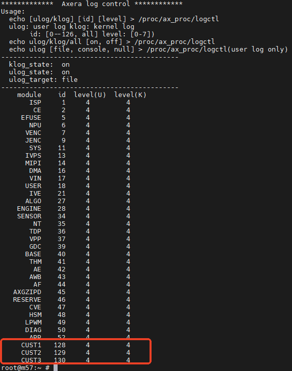

至此，应用程序Log的集成完成。

#### 6.5.2 集成驱动程序Log

要集成驱动程序Log到SDK自研日志系统，则相对更加简单，只需要三个步骤：

1. 在ax_global_type.h的`AX_MOD_ID_E`中添加自定义模块ID；

2. ax_syslog.conf配置文件，添加对应的配置；

3. 在驱动程序中调用ax_printk API打印Log。

为更好说明如何集成驱动程序Log到我们的日志系统，下面举例演示。

1. 在ax_global_type.h文件的`AX_MOD_ID_E`枚举中添加自定义模块ID，方式同[集成应用程序Log](#_%E9%9B%86%E6%88%90%E5%BA%94%E7%94%A8%E7%A8%8B%E5%BA%8FLog)介绍的一样，如果应用程序已经添加过对应的模块，则不用重复添加；

2. 在驱动程序源码中调用ax_printk接口输出Log。

为更好说明如何集成驱动程序Log到我们的日志系统，下面举例演示。

demo程序代码(文件路径：kernel\osdrv\klog)如下：

ax_global_type.h文件，新增`AX_ID_CUST1`、`AX_ID_CUST2`、`AX_ID_CUST3`共3个ID，操作同[集成应用程序Log](#_%E9%9B%86%E6%88%90%E5%BA%94%E7%94%A8%E7%A8%8B%E5%BA%8FLog)中介绍的一样，如果应用程序已经添加过对应的模块，则不用重复添加。

Makefile文件

MKFILE_PATH        := $(abspath $(lastword $(MAKEFILE_LIST)))

HOME_PATH          := $(abspath $(dir $(MKFILE_PATH))../../..)

BUILD_PATH         := $(HOME_PATH)/build

ROOTFS_PATH        := $(HOME_PATH)/rootfs

include $(BUILD_PATH)/config.mak

OBJ_OUT_DIR        := $(BUILD_PATH)/out/$(PROJECT)/objs

KSRC               := $(abspath $(dir $(MKFILE_PATH)))

SRC_RELATIVE_PATH  := $(subst $(HOME_PATH)/,,$(KSRC))

KBUILD_DIR         := $(OBJ_OUT_DIR)/$(SRC_RELATIVE_PATH)

KBUILD_MAKEFILE    := $(KBUILD_DIR)/Makefile

MSP_OUT_PATH       := $(HOME_PATH)/`msp/out`

EXTRA_CFLAGS += -I$(MSP_OUT_PATH)/include/

KDIR ?= $(HOME_PATH)/`kernel/linux/`$(KERNEL_DIR)

MODULE_NAME := test_klog

SRCS := testklog.c

$(MODULE_NAME)-objs := $(SRCS:%.c=%.o)

obj-m := $(MODULE_NAME).o

clean-objs := $(SRCS:%.c=%.o)

clean-objs += $(join $(dir $(SRCS)), $(patsubst %.c, .%.o.cmd, $(notdir $(SRCS))))

include $(BUILD_PATH)/krules.mak

testklog.c文件

```c
#include <linux/module.h>
#include <linux/proc_fs.h>
#include <linux/seq_file.h>
#include <linux/slab.h>
#include <linux/delay.h>
#include "ax_global_type.h"
#define TEST_KLOG_PROC_NAME        "ax_proc/test_klog"
int id_list[] = {
AX_ID_CUST1,
AX_ID_CUST2,
AX_ID_CUST3,
};
char* tag_list[] = {
```

    "CUST1",

    "CUST2",

    "CUST3",

};

static int test_klog(void)

```c
{
int ret = 0;
int i,level;
int cnt = sizeof(id_list)/sizeof(id_list[0]);
for (level=SYS_LOG_DEBUG; level>=SYS_LOG_EMERGENCY; level--){
for(i=0; i < cnt; i++){
ax_printk(id_list[i], tag_list[i], level, "This log's id:%d, level:%d", id_list[i], level);
}
}
return ret;
}
```

static ssize_t logctl_proc_write(struct file *file, const char *buffer, size_t count, loff_t *f_pos)

```c
{
char *tmp = kzalloc((count + 1), GFP_KERNEL);
char cmd[64];
int ret;
if (!tmp)
return -ENOMEM;
if (copy_from_user(tmp, buffer, count)) {
pr_err("@%s copy_from_user failed!!!\n", __FUNCTION__);
kfree(tmp);
return -EFAULT;
}
ret = sscanf(tmp, "%s", cmd);
if (0 == strcmp(cmd, "test")){
test_klog();
}
kfree(tmp);
tmp = NULL;
return count;
}
```

static int axlogctl_proc_show(struct seq_file *p, void *v)

```c
{
return 0;
}
```

static int logctl_proc_open(struct inode *inode, struct file *file)

```c
{
return single_open(file, axlogctl_proc_show, NULL);
}
static const struct proc_ops proc_axlogctl_operations = {
```

	.proc_flags = PROC_ENTRY_PERMANENT,

	.proc_open  = logctl_proc_open,

	.proc_read  = seq_read,

	.proc_write = logctl_proc_write,

	.proc_release = single_release,

};

static int __init test_klog_proc_init(void)

```c
{
proc_create(TEST_KLOG_PROC_NAME, S_IRUSR, NULL, &proc_axlogctl_operations);
return 0;
}
```

static void __exit test_klog_proc_exit(void)

```c
{
remove_proc_entry(TEST_KLOG_PROC_NAME, NULL);
}
module_init(test_klog_proc_init);
module_exit(test_klog_proc_exit);
MODULE_AUTHOR("axera");
MODULE_LICENSE("GPL");
```

编译后生成test_klog.ko驱动程序，insmod后会生成/proc/ax_proc/test_klog节点，执行:

```bash
echo test > /proc/ax_proc/test_klog
```

即可看到/opt/data/AXSyslog/syslog目录下的Log文件中查看到Log输出：

2023-05-12 14:26:32 kernel: [   61.314683] [C0][CUST1][W][538] This log's id:128, level:4

2023-05-12 14:26:32 kernel: [   61.314693] [C0][CUST2][W][538] This log's id:129, level:4

2023-05-12 14:26:32 kernel: [   61.314695] [C0][CUST3][W][538] This log's id:130, level:4

2023-05-12 14:26:32 kernel: [   61.314696] [C0][CUST1][E][538] This log's id:128, level:3

2023-05-12 14:26:32 kernel: [   61.314698] [C0][CUST2][E][538] This log's id:129, level:3

2023-05-12 14:26:32 kernel: [   61.314700] [C0][CUST3][E][538] This log's id:130, level:3

2023-05-12 14:26:32 kernel: [   61.314702] [C0][CUST1][C][538] This log's id:128, level:2

2023-05-12 14:26:32 kernel: [   61.314703] [C0][CUST2][C][538] This log's id:129, level:2

2023-05-12 14:26:32 kernel: [   61.314705] [C0][CUST3][C][538] This log's id:130, level:2

2023-05-12 14:26:32 kernel: [   61.314707] [C0][CUST1][A][538] This log's id:128, level:1

2023-05-12 14:26:32 kernel: [   61.314708] [C0][CUST2][A][538] This log's id:129, level:1

2023-05-12 14:26:32 kernel: [   61.314710] [C0][CUST3][A][538] This log's id:130, level:1

2023-05-12 14:26:32 kernel: [   61.314711] [C0][CUST1][M][538] This log's id:128, level:0

2023-05-12 14:26:32 kernel: [   61.314713] [C0][CUST2][M][538] This log's id:129, level:0

2023-05-15 14:26:32 kernel: [   61.314715] [C0][CUST3][M][538] This log's id:130, level:0

至此，驱动程序Log的集成完成。

<a id="_动态修改Log等级"></a>

### 6.6 动态修改Log等级

#### 6.6.1 动态修改Linux内核原生Log等级

对于Linux原生内核log，即通过printk输出的log，可以通过/proc/sys/`kernel/printk`节点来动态控制输出到串口的linux log等级。默认情况下，Linux原生内核Log的等级配置为4(warning)，这可以通过cat `/proc/sys/``kernel/printk`来查看：

```bash
cat /proc/sys/kernel/printk
```

```text
4       4       1       7
```

如果要修改输出到终端的Log等级，比如修改到等级7，可以通过下面指令来实现：

```bash
echo 7 > /proc/sys/kernel/printk
```

关于printk log等级设置的更多用法，可参考内核文档linux-6.1.83/Documentation/core-api/printk-basics.rst。

#### 6.6.2 SDK自研日志系统log等级控制流程

本SDK自研日志系统Log等级控制的基本流程如下图所, 配置文件ax_syslog.conf文件包含了log等级配置基本信息。

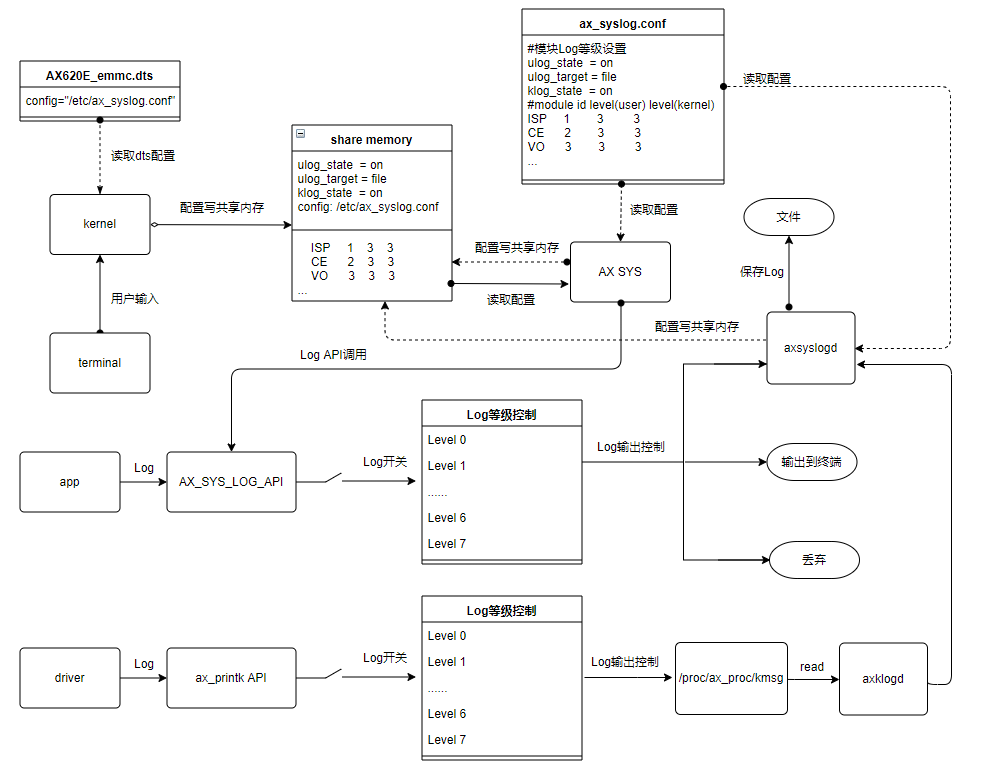

#### 6.6.3 动态修改user log等级

我们的log系统支持按模块进行log等级修改，每个模块都有自己对应的ID，比如ISP、VO和NPU他们对应的模块ID分别是１、３、６。确定模块对应的ID值的方式有两种：

      1. 通过cat /etc/ax_syslog.conf文件查看；

      2. 通过cat `/proc/ax_proc/logctl`节点查看。

在ax_syslog.conf配置文件中，我们有一段这样的配置：

#模块Log等级设置

```c
ulog_state  = on
ulog_target = file
klog_state  = on
```

#module id level(user) level(kernel)

ISP     1        4         4

CE      2        4         4

....

以ISP模块为例，其id为1，user log等级为4，这表示ISP模块user log等级为0-4的Log能够被输出，而等级为5-7的Log将被忽略。如果您需要修改模块的默认等级，可以在ax_syslog.conf配置文件修改并保存。

为了方便对user log等级控制，我们提供了根据模块id来控制log等级的指令。指令格式如下：

```bash
echo ulog [id] [level] > /proc/ax_proc/logctl
```

其中ulog表示控制user log等级，id为模块ID，比如ISP的模块ID为1，level为控制log输出的等级，而/proc/ax_proc/logctl为控制log等级的设备节点。为更好地展示如何控制user log的等级，我们举例说明。

示例1：把ISP模块的user log输出等级设置为7，可通过指令：

```bash
echo ulog 1 7 > /proc/ax_proc/logctl
```

来实现，修改后可通过:

```bash
cat /proc/ax_proc/logctl
```

查看设置是否生效：

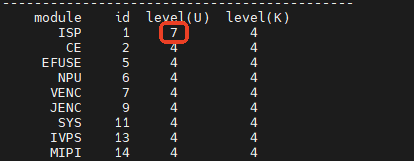

user log等级设置为7后，所有等级的ISP user log输出均可看到。

示例2： 将所有模块的user log等级修改为2

```bash
echo ulog all 2 > /proc/ax_proc/logctl
```

查看修改结果：

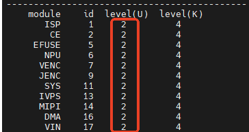

示例3：关闭/打开user log输出

```bash
echo ulog off > /proc/ax_proc/logctl
```

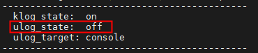

这种情况下，user log将不再输出（不只是log不保存到文件，在应用程序中log的就已经不输出了）。

打开user log输出：

```bash
echo ulog on > /proc/ax_proc/logctl
```

示例4：切换user log输出到console终端

```bash
echo ulog console > /proc/ax_proc/logctl
```

如果要切换输出到文件，可通过指令

```bash
echo ulog file> /proc/ax_proc/logctl
```

来实现。

#### 6.6.4 动态修改kernel log等级

kernel log等级的控制与user log等级的控制方式基本一致，只需将命令中的ulog改成klog，最大的差异在于user log能够控制输出到console终端，但kernel log只能输出到日志文件。

以下举例演示如何控制kernel log的输出。

示例1：把ISP模块的log输出等级设置为7，可通过指令：

```bash
echo klog 1 7 > /proc/ax_proc/logctl
```

来实现，修改后可通过:

```bash
cat /proc/ax_proc/logctl
```

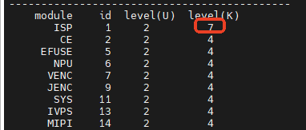

示例2：将所有模块的kernel log等级修改为3

```bash
echo klog all 3 > /proc/ax_proc/logctl
```

查看修改结果：

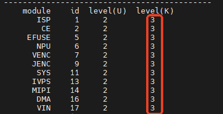

示例3：关闭/打开kernel log输出

```bash
echo klog off > /proc/ax_proc/logctl
```

查看结果

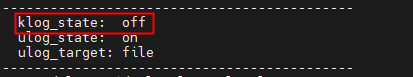

关闭 kernel log后将不会有任何kernel log输出。

重新打开kernel log可以执行

```bash
echo klog on > /proc/ax_proc/logctl
```

<a id="_SPI_NOR_Flash"></a>

## 7. SPI NAND Flash 开发指南

### 7.1 SPI NAND Flash开发指南

M57主域是使用的是nandflash颗粒，下文仅介绍主域nandflash的一些适配修改。目前demo板使用的是winbond W35N04JW的spi nand flash。

#### 7.1.1 Romcode下yaml配置

用户新增颗粒时，需要查看一下yaml文件在build/scripts/flash_config目录下是否有对应颗粒的yaml配置，如果没有需要新增，需新增一个yaml配置文件，可参考当前目录下example.yaml中有对各参数的详细介绍进行配置。

如新增一个GD5F的nand颗粒，如下：

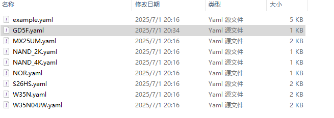

同时需要修改config.mk。指定该yaml文件，以demo_only_nand为例，修改build/platforms/axera/demo_only_nand下config.mk。如下图：

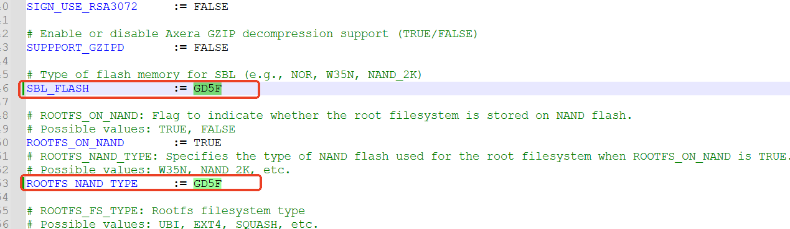

该yaml配置参数会打包镜像中，romcode会低速读取并解析该参数，然后配置进高速加载启动镜像。如果SBL镜像放在nor上，这里的yaml配置应是nor颗粒的配置。

#### 7.1.2 uboot下dts配置

在uboot/u-boot-2022.10/arch/arm/dts/m57-demo-nor-nand.dts有对nandflash的一些配置信息。

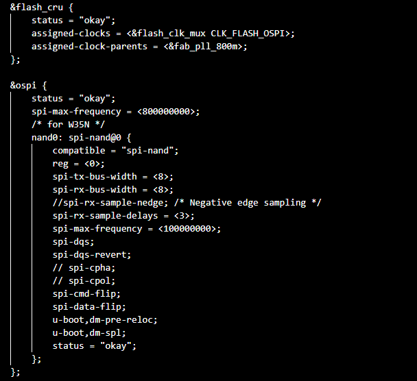

- 通过对flash_cru节点引用，可以修改ospi控制器的输入的时钟源。最终给到flash端的时钟是通过该时钟分频的到。目前ospi有800M,600M,400M,24M四个频点设置。图中给出的是800M的时钟频点。

- 目前nand采用的是8线ddr模式，所以spi-tx-bus-width 和 spi-rx-bus-width都为8。如果使用单线sdr模式，只需要将该值都改成1即可。

- uboot下flash最终频率设置通过nand0节点下spi-max-frequency设置，比如当前设置的50M。需要注意flash频率必须小于等于频点的1/4。即分频系数必须大于等于4。并且只支持偶数分频。

#### 7.1.3 uboot下添加颗粒描述信息

在uboot/u-boot-2022.10/drivers/mtd/nand/spi/winbond.c中有对颗粒的信息描述：

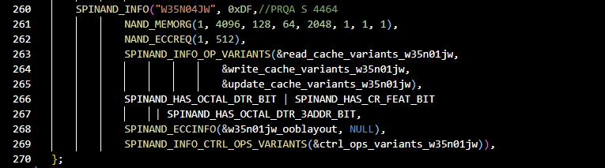


在winbond_spinand_table数组中增加了W35N04JW颗粒的描述，包括颗粒的id信息，pagesize，oobsize等信息。因为一些指令和W35N01JW是一致的，所以采用了W35N01JW已经定义好的指令宏等信息。这里需要注意的是W35N04JW 有三个指令存在差异：

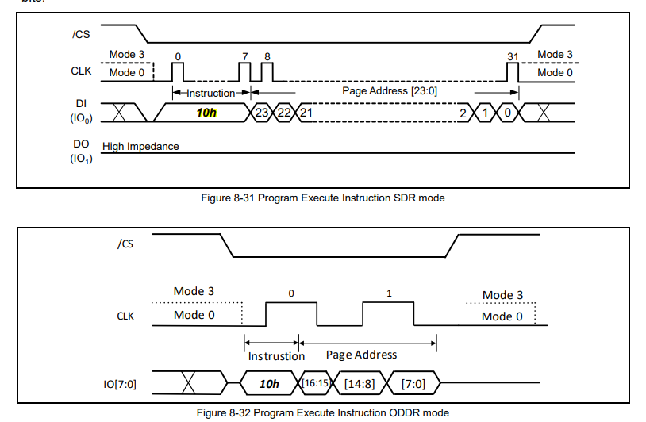


这三个指令，在8线ddr模式下需要使用第一个周期的下边沿发送die地址，所以软件中做了一些处理，上面增加了SPINAND_HAS_OCTAL_DTR_3ADDR_BIT。同时在uboot/u-boot-2022.10/drivers/mtd/nand/spi/core.c中增加了如下处理：

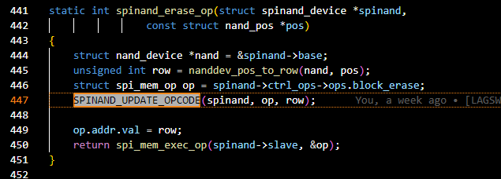


#### 7.1.4 uboot命令行读写测试

参考uboot标准读写指令，选择nandflash未使用的区域0x1d000000。进行擦写读测试，内存地址可使用0x100000000；0x100010000。擦除需要block对齐，读写page size对齐。

擦除指令：

mtd erase nand0 0x1d000000 0x40000

写指令：

mtd write nand0 0x100000000 0x1d000000 0x1000

读指令：

mtd read nand0 0x100010000 0x1d000000 0x1000

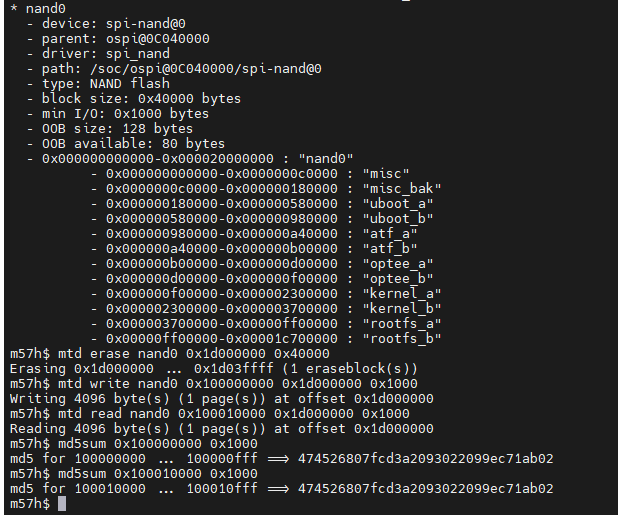

#### 7.1.5 kernel下dts配置

在kernel/linux/linux-6.1.83/arch/arm64/`boot/dts/axera/m57-demo-nor-nand.dts`有对nandflash的一些配置信息

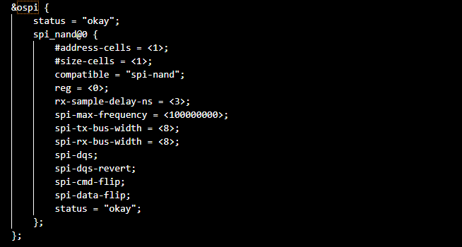


Kernel下采样点设置有两种方式，一种是rx-sample-delays，是直接使用该值设置对应寄存器，一种是rx-sample-delay-ns,设置的是延迟采样的时间，单位是ns。内部会通过转换，再写入寄存器。其他注意事项同uboot章节。

#### 7.1.6 kernel下添加颗粒描述信息

在kernel/linux/linux-6.1.83/drivers/mtd/nand/spi/winbond.c中有对颗粒的信息描述：

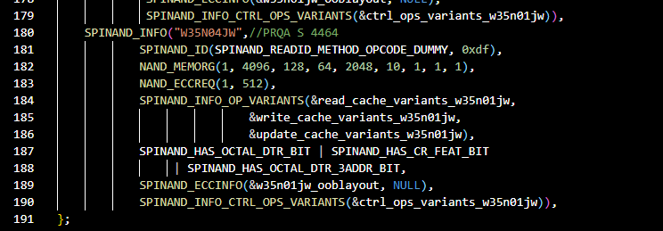


注意事项同uboot章节。

#### 7.1.7 kernel下nandflash读写测试

首先确认设备节点存在：

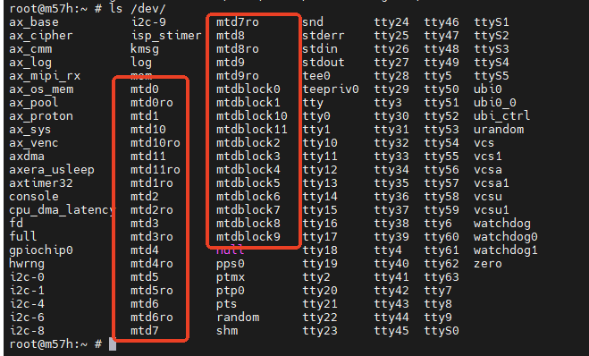

直接使用nandtest即可进行读写测试

nandtest -o 起始地址 -l 测试长度 设备节点

起始地址为设备节点的起始地址。这里从0偏移开始，长度是256k。

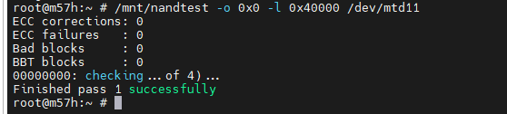

或者采用单独指令操作：

擦除指令：

flash_erase 设备节点 起始地址 擦除块数量（0表示全部擦除）

写指令：

nandwrite -s 起始地址 -p 设备节点 写入的文件名

nanddump -s 起始地址 -l 读取的长度 -f 读入的文件名 设备节点

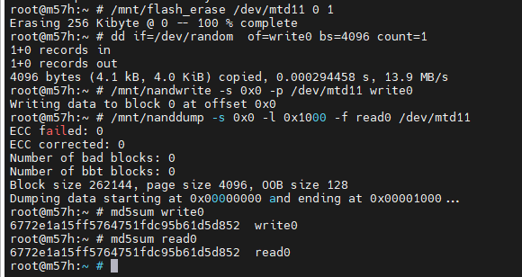

## 8. U-Boot移植应用开发指南

<a id="_概述"></a>

### 8.1 概述

Linux的启动需要有bootloader来引导，M57系列单板的bootloader可选使用U-Boot，当选用的外围芯片信号与参考设计不同时，需要修改U-Boot的相关配置文件。

#### 8.1.1 M57启动流程介绍

M57芯片整体启动流程如下：

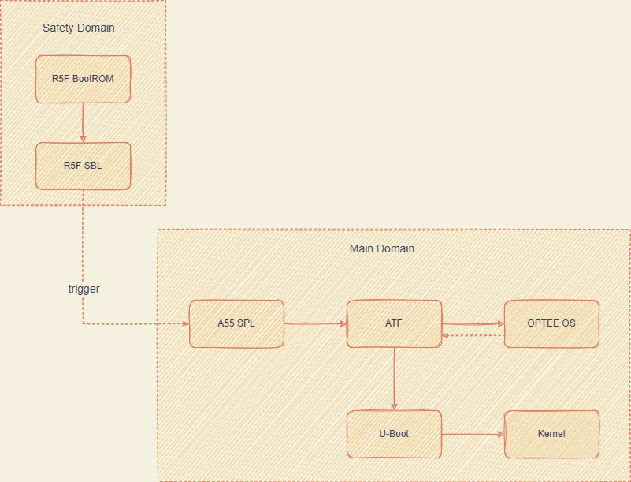

如上图，在芯片上电POR（Power On Reset）后，R5F BootROM首先负责完成Safety域基础的初始化，包含不限于power、clock和OCM等硬件的初始化。然后将R5F SBL固件从Nor/Hyper/Nand flash或者eMMC中加载到Safety域的OCM，并解密验签保证SBL镜像的完整性和合法性。最后将R5F CPU的控制权递交给SBL。

R5F SBL开始运行后，首先负责初始化和配置Main域侧的硬件，包含但不限于Power、clock和OCM等硬件的初始化，然后将A55 SPL固件从Nor/Nand Flash或者eMMC中加载到Main域OCM上，并验证和校验SPL镜像的合法性和完整性，最后触发A55 CPU开始执行SPL。

SPL开始运行后，首先配置必要的硬件进入工作状态，包含不限于power、clk、reset和pinctrl等设置。然后将BL31、OP-TEE和U-Boot镜像加载到DDR。最后将A55 CPU控制权交给BL31。

BL31运行后，首先完成EL3 vector table、MMU、PSCI和GIC等初始化，然后初始化SPD的上下文环境，为OP-TEE的运行做准备。最后通过ERET指令跳转到OP-TEE OS。

OP-TEE开始运行，首先完成EL1 secure vector table、UART、MMU、GIC和thread context等初始化。然后执行SMC指令返回到BL31，接着BL31为跳转到BL33做准备。最后BL31执行ERET指令将CPU控制权交给U-Boot。

进入U-Boot运行阶段，首先完成EL2 context、C runtime environment、UART等初始化。然后完成eMMC、Flash等驱动的执行，以及env变量的加载。最后从eMMC/flash里面加载Kernel和dtb等镜像，并验签校验，保证镜像的合法性和完整性，将CPU控制权递交给Kernel。

进入Kernel之后，挂载rootfs，开始完成OS相关的各种初始化和应用程序的启动，超出了本节的范围，不再详细的描述。本节主要介绍在M57单板上如何移植、烧写U-Boot以及相关debug方法。

#### 8.1.2 U-Boot目录结构

`boot/uboot`目录结构如下：

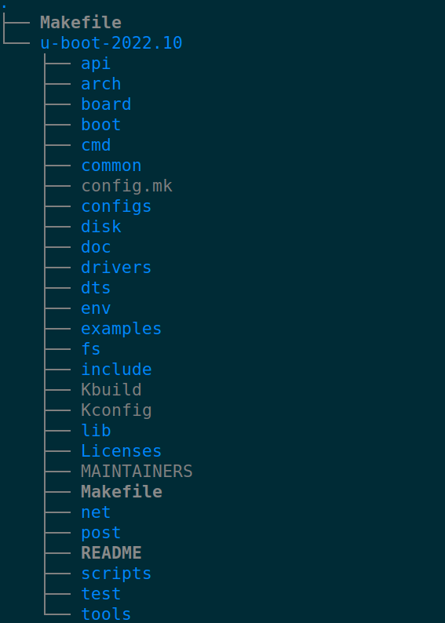

其中Makefile是Axera为平台编译添加的U-Boot顶层Makefile。平台完整编译时，根据该Makefile配置进行U-Boot的编译和打包工作。

u-boot-2022.10为Axera对开源U-Boot修改后的代码，主要的目录和文件如下所示，详细可以参考该目录下的README文件。

u-boot-2022.10主要目录文件

<table>
  <thead>
    <tr>
      <th><strong>目录名</strong></th>
      <th><strong>描述</strong></th>
    </tr>
  </thead>
  <tbody>
    <tr>
      <td>api/</td>
      <td>与硬件无关的API</td>
    </tr>
    <tr>
      <td>arch/</td>
      <td>与架构体系相关的code</td>
    </tr>
    <tr>
      <td>board/</td>
      <td>各种单板的相关的定制代码</td>
    </tr>
    <tr>
      <td>cmd/</td>
      <td>命令相关代码</td>
    </tr>
    <tr>
      <td>common/</td>
      <td>通用代码</td>
    </tr>
    <tr>
      <td>configs/</td>
      <td>配置文件</td>
    </tr>
    <tr>
      <td>disk/</td>
      <td>磁盘分区相关代码</td>
    </tr>
    <tr>
      <td>doc/</td>
      <td>文档</td>
    </tr>
    <tr>
      <td>drivers/</td>
      <td>设备驱动代码</td>
    </tr>
    <tr>
      <td>dts/</td>
      <td>设备树Kconfig和Makefile</td>
    </tr>
    <tr>
      <td>env/</td>
      <td>Env环境变量相关代码</td>
    </tr>
    <tr>
      <td>examples/</td>
      <td>示例代码</td>
    </tr>
    <tr>
      <td>fs/</td>
      <td>文件系统实现代码</td>
    </tr>
    <tr>
      <td>include/</td>
      <td>头文件</td>
    </tr>
    <tr>
      <td>lib/</td>
      <td>库文件</td>
    </tr>
    <tr>
      <td>Licenses/</td>
      <td>许可证相关文件</td>
    </tr>
    <tr>
      <td>Makefile</td>
      <td>主Makefile文件</td>
    </tr>
    <tr>
      <td>net/</td>
      <td>网络实现代码</td>
    </tr>
    <tr>
      <td>README</td>
      <td>readme帮助文件</td>
    </tr>
    <tr>
      <td>scripts/</td>
      <td>脚本文件</td>
    </tr>
    <tr>
      <td>test/</td>
      <td>测试代码</td>
    </tr>
    <tr>
      <td>tools/</td>
      <td>工具文件夹</td>
    </tr>
    <tr>
      <td>.config</td>
      <td>配置文件，编译后生成</td>
    </tr>
  </tbody>
</table>

<a id="_移植U-Boot"></a>

### 8.2 移植U-Boot

上一节介绍了U-Boot的启动流程，以及U-Boot的主要代码目录、文件，本节主要介绍基于M57芯片如何在U-Boot中添加新board级配置，或者不添加新board级配置而是直接修改原有参考board的配置。

#### 8.2.1 新建board

如果不想基于demo_nor_nand参考板的配置进行修改，则需要新建自己的board配置，下面介绍如何完全新建new_test单板配置。下面的小结中的操作除非特别说明，默认操作的根节点为u-boot-2022.10。

##### 添加board图形配置选项

在Kconfig中添加新建board的选项，以便于图形化配置，修改arch/arm/mach-axera/m57/Kconfig（一般同系列产品的不同board都会添加到此处）。

## if AXERA_LUA

## …………………………………………………………

## config TARGET_LUA_NEW_TEST              <--- 新增选项

## bool "M57 SoC New Test board"

## select LUA_SOC

## help

## M57 New Test is a demonstration board for Axera M57 SoC,

## with full function and physical connectors support like MIPI,

## JTAG, MAC, SD card, CAN, QSPI, USB-to-serial...

## source "board/axera/new_test/m57/Kconfig"   <--- 关联board级配置选项

## ………………………………………………………………………

## endif

### 添加board默认配置文件

在configs目录下创建默认配置文件，复制m57-new-test_defconfig。

```bash
cd configs
cp m57-demo-nor-nand_defconfig m57-new-test_defconfig
```

然后根据实际的硬件设计对其中的部分CONFIG内容进行修改，常见的修改点：

```c
CONFIG_SPL_DM_SPI=y
CONFIG_DEFAULT_DEVICE_TREE="m57-demo-nor-nand"  <----- 修改为“m57-new-test”
CONFIG_SPL_TEXT_BASE=0x14001000
CONFIG_SYS_PROMPT="m57$ "
CONFIG_LUA_FDT_LOAD_NAME="m57-demo-nor-nand.dtb" <--修改为“m57-new-test.dtb”
CONFIG_TARGET_LUA_DEMO=y   <---- 修改为CONFIG_TARGET_LUA_NEW_TEST=y
```

- 说明：

```c
CONFIG_SYS_TEST_BASE
```

为代码段地址。

```c
CONFIG_DEFAULT_DEVICE_TREE
```

指定dts文件的名字，编译uboot的时候会同时编译dts，编译系统据此到arch/arm/dts目录寻找同名带.dts后缀的文件，生成.dtb文件。

```c
CONFIG_CONS_INDEX
```

debug使用的串口号，需要根据硬件设计确认使用的串口号。

```c
CONFIG_TARGET_NEW_TEST=y
```

名字可以自定义，但是需要与新增的board config项同名。

#### 添加dts文件

在arch/arm/dts目录下创建新board的dts文件，直接复制后再进行修改：

```bash
cd arch/arm/dts
cp m57-demo-nor-nand.dts m57-new-test.dts
```

对新创建的m57-new-test.dts进行修改，可以根据具体board的硬件设计，添加或者删除部分设备描述。

- 说明：

m57-new-test名字需要与defconfig中`CONFIG_DEFAULT_DEVICE_TREE`的值匹配一致。

##### 添加board对应的板级文件夹

U-Boot中每个board都有一个对应的文件夹存放板级文件，该目录中可以放诸如board的pin配置文件等，直接复制后再进行修改：

```bash
cd board/axera
cp -r demo new_test
```

对test_board目录里的文件再做相关修改。

###### 修改文件名

将copy过来的文件下的文件重新命名：

```bash
cd new_test/m57
```

## mv demo.c new-test.c

### 修改Makefile

文件重新命名后，Makefile也要做同步修改：

board/axera/new_test/Makefile修改

## obj-$(`CONFIG_TARGET_LUA_DEMO`) += m57/      <---- `CONFIG_TARGET_LUA_NEW_TEST`

m57/Makefile修改

## obj-y += demo.o       <--- new-test.o

### 修改Kconfig

Kconfig也需要同步修改：

## if TARGET_LUA_DEMO    <------ 修改为TARGET_LUA_NEW_TEST

## config SYS_BOARD

## default "demo"  <---- 修改为“new_test”, 与board/axera/new_test的目录名称要对齐

## endif

### 配置Pinmux

Pinmux主要是配置pin的function select、上下拉、驱动能力等配置，操作步骤如下所示：

使用pinmux配置表格，在表格中进行选择配置，之后点击“Export”按钮，在表格目录下会生成.h头文件。

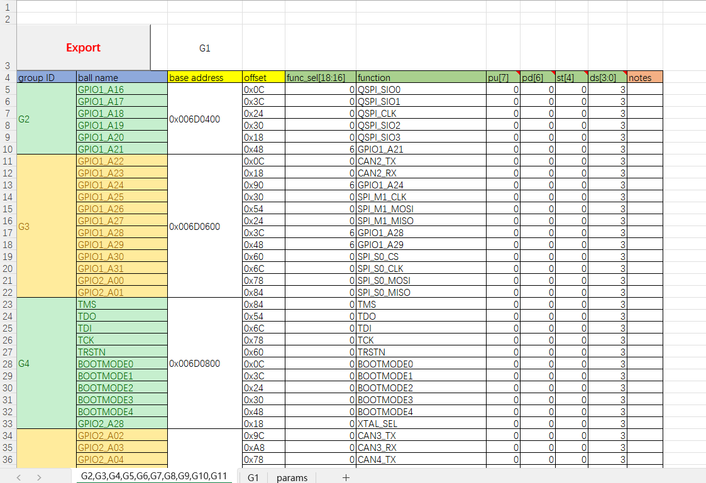

Pinmux配置表格

将产生的头文件添加到uboot下的板级目录中。<br>/`boot/uboot/u-boot2022.10/board/axera/new_test/pinmux.h`

- 说明：

- 添加的pinmux.h头文件会被boot/uboot/u-boot-2022.10/drivers/`soc/axera/pinmux.c`包含，在SPL执行期间生效pinmux配置。

- Pin配置是与硬件board设计强相关的，需要与硬件确认好。

#### 配置Memory大小

单板的memory配置可能不尽相同，需要根据硬件设计或者软件的使用，配置memory的使用大小，修改boot/uboot/u-boot-2022.10/arch/arm/dts/m57-demo-nor-nand.dts文件里面的memory节点：


前者为内存地址的起始地址，后者为大小，四个cells组成两个64位。

- 说明：

1. 注意uboot是运行在ddr上的，ddr的起始地址是0x100000000。

2. 如果用户想要修改uboot的运行地址，编译uboot代码是配置了位置无关代码选项(PIC),理论上uboot可以加载到任何DDR地址上运行，可以通过修改SPL加载uboot的存放地址；

##### 添加board对应的头文件

在include/configs/m57.h文件下添加新board的启动方式：

## #ifdef `CONFIG_TARGET_LUA_VIRT`

```c
#define BOOT_TARGET_DEVICES(func)   \
BOOT_TARGET_BLK_EXTLINUX(func)
```

## #elif defined(`CONFIG_TARGET_LUA_FPGA`)

```c
#define BOOT_TARGET_DEVICES(func)   \
```

## BOOT_TARGET_FPGA(func)      \

## BOOT_TARGET_TFTP(func)      \

```c
BOOT_TARGET_MEM(func)
```

## #elif defined(`CONFIG_TARGET_LUA_DEMO`)

```c
#define BOOT_TARGET_DEVICES(func)         \
```

## BOOT_TARGET_BLK_EXTLINUX(func)    \

```c
BOOT_TARGET_TFTP(func)
```

## #elif defined(`CONFIG_TARGET_LUA_MEW_TEST`)         <----- 新添加的启动方式

```c
#define BOOT_TARGET_DEVICES(func)         \
```

## BOOT_TARGET_BLK_EXTLINUX(func)    \

```c
BOOT_TARGET_TFTP(func)
```

## #elif defined(`CONFIG_TARGET_LUA_EVB`)

```c
#define BOOT_TARGET_DEVICES(func)        \
```

## BOOT_TARGET_BLK_EXTLINUX(func)   \

```c
BOOT_TARGET_TFTP(func)
```

## #else

```c
#define BOOT_TARGET_DEVICES(func)   \
```

## BOOT_TARGET_MMC(func)       \

## BOOT_TARGET_MMC1(func)      \

## BOOT_TARGET_DHCP(func)      \

```c
BOOT_TARGET_MEM(func)
```

## #endif

### 编译修改

前面已经完成了新board的创建工作，已经可以直接进行编译u-boot.bin和u-boot.img，ARM64的情况下在u-boot-2022.10目录下执行如下命令：

```bash
make CROSS_COMPILE=aarch64-none-linux-gnu- m57-new-test_defconfig
make CROSS_COMPILE=aarch64-none-linux-gnu- -j4
```

#### 8.2.2 M57 Demo board修改

U-Boot中很多文件夹和文件几乎不用关注，基于M57 Demo board（demo_nor_nand）直接修改的话，相对于完全新建board的话则要简单快捷。

##### 修改文件

如<span style="color:#0000FF">8.2.1</span>节新建board中涉及的相关文件，比方说直接修改demo board文件，主要可能修改的几个目录、文件如下：

1. configs/ m57-demo-nor-nand_defconfig主要定义以`CONFIG_XXX`相关的功能特性开关。

- 说明：

<a id="OLE_LINK1"></a>

<a id="OLE_LINK12"></a>

- U-Boot中的`CONFIG_LUA_SAFETY_INIT`=y默认打开，目的是为了获取启动过程中必要的从safety域传递过来的设备信息，原则上主域（A核）操作自己域内的设备，safety域（R核）操作自己域内的设备，所以在对应工程的dts中`CONFIG_LUA_SAFETY_INIT`宏控范围内如果要添加safety设备时要特别注意，非必要不再新增，防止出现主域和safety域同时访问safety设备造成冲突（比如safety域配置后主域又做了修改）。

- DTS中的`CONFIG_LUA_SAFETY_INIT`

#if defined(`CONFIG_LUA_SAFETY_INIT`)

&safety_glb {

```c
status = "okay";
};
&safety_glb_aon {
status = "okay";
};
&safety_top_glb {
status = "okay";
};
&fcu {
status = "okay";
};
&safety_bondopt {
status = "okay";
};
&efuse {
status = "okay";
};
&cipher {
status = "okay";
};
&axgzipd {
status = "okay";
};
&serial0 {
status = "okay";
};
&can6 {
status = "okay";
};
&dma_per2 {
status = "okay";
};
```

#endif

2. arch/arm/mach-axera/m57

arch目录下有很多CPU架构的目录，我们使用的是arm系列，arch/arm目录又有许多mach-xx的目录，这些是不同厂商的多种系列cpu有关文件目录，只需要关注mach-axera/m57目录中的文件。

3. arch/arm/dts/m57-demo-nor-nand.dts、m57.dtsi

U-Boot目前也支持dts，与Kernel几乎对齐，该目录为board对应的dts文件。

4. board/axera/demo/m57

不同board的外围器件、管脚配置可能不同，board相关的代码目录。

5. include/configs/ m57.h

board的配置文件（自定义的板级启动加载方法，环境变量配置）。

##### 编译

在boot/uboot目录，操作如下：

```bash
make PLAT=demo_nor_nand all
```

该命令其实包含了2个操作：

```bash
make CROSS_COMPILE=aarch64-none-linux-gnu- m57-demo-nor-nand_defconfig
make CROSS_COMPILE=aarch64-none-linux-gnu- -j4
```

编译成功后，会在build/out/demo_nor_nand/objs/`boot/uboot/u-boot-2022.10`目录下生成u-boot.bin和u-boot.img等文件。

再次执行：

```bash
make PLAT=demo_nor_nand install
```

该install命令的主要操作是拷贝u-boot.bin和u-boot.img到build/out/demo_nor_nand/images目录下

<a id="_烧写U-Boot"></a>

### 8.3 烧写U-Boot

上一节已经生成了uboot.img，本节介绍如何将u-boot镜像烧写入存储中。

#### 8.3.1 AXDL烧写uboot.img

AXDL是运行在Windows平台上的桌面应用程序，主要用于FLASH分区、镜像下载等功能。对于板子第一次烧写，需要使用该工具进行烧写，之后的烧写可以使用多种手段。烧写步骤如下：

AXDL工具栏点击加载按钮


，选择.axp镜像包文件。

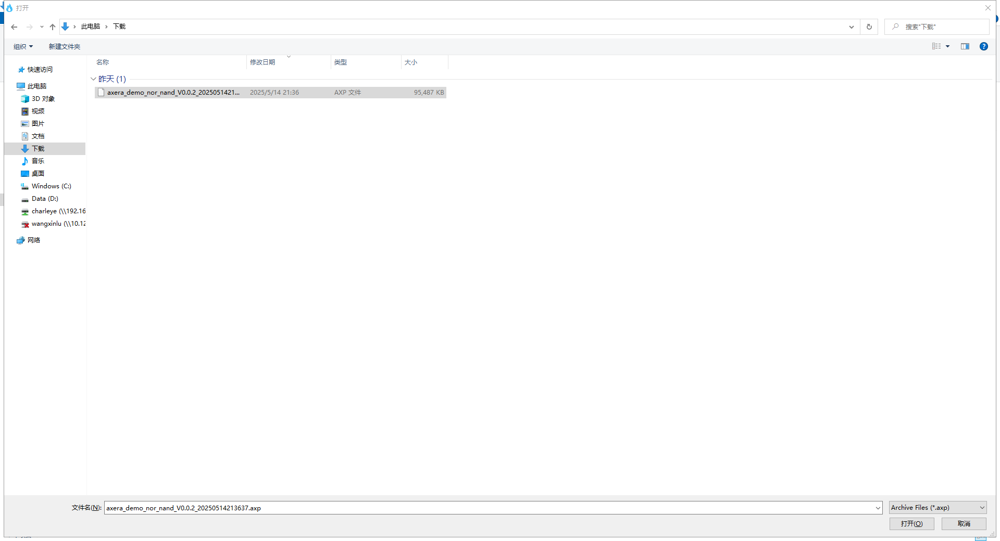

选择.axp镜像包

工具栏点击“设置”按钮


，在“Settings”页面AXDL已将axp镜像包的镜像文件释放到本地temp目录并进行配置。鼠标双击或右键单击镜像文件激活文件选择框选择要烧写的u-boot.img，其他的镜像可不勾选。

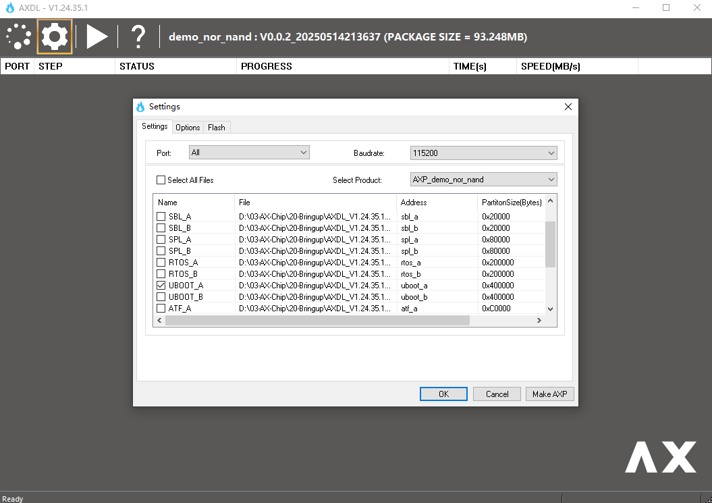

替换u-boot.img镜像

点击“OK”确认设置，在工具栏点击“开始”按钮


启动下载。此时给板子上电，下载工具将自动与单板握手交互，开始下载。

- 说明：

如果只是单独debug U-boot，则只需要在工具中勾选UBOOT_A即可，UBOOT_B为uboot的B分区。一般默认都是从A槽启动的，除非明确切换到B槽启动。

#### 8.3.2 AXDL repartiton

AXDL repartiton是下载工具中的一个option，如下图所示，该选项有个特殊功能，就是重写分区表：

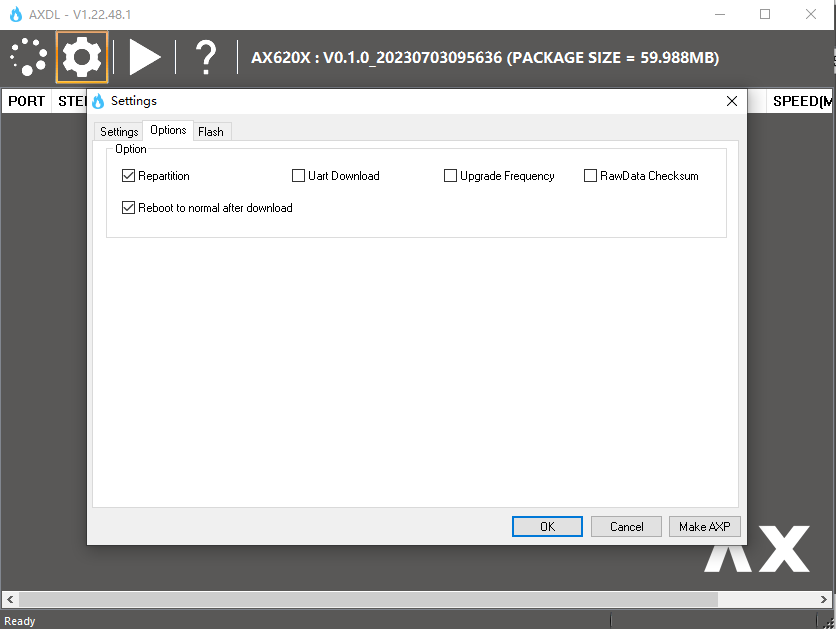

Repartition option

目前不支持不勾选该选项，因为FDL会把分区表发送给FDL2，写入到metadata分区，U-Boot启动时会从该分区读取mtdparts。

AXP包中demo_nor_nand.xml里面描述的分区信息， demo_nor_nand.xml是通过convert.py脚本从build/platforms/axera/demo_nor_nand/partitions.json转换而来的，通过修改partitons.json文件，就可以修改xml里面的分区表，xml里面分区表信息如下图所示：

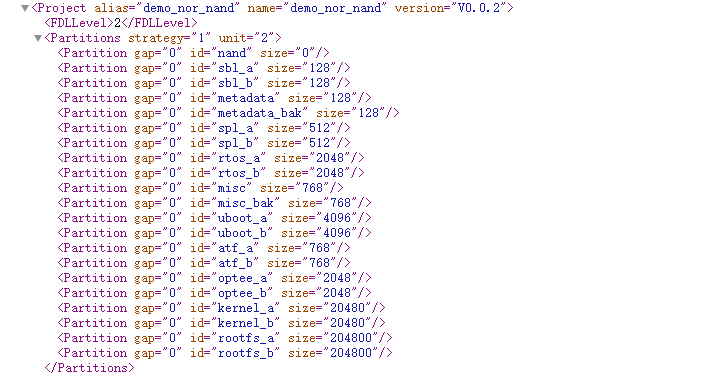

demo_nor_nand.xml分区表信息

build/platforms/axera/demo_nor_nand/partitions.json内容如下所示：

## [

```c
{
```

## "partitions": [

```c
{
```

## "_comment": "dummy partition, used for showing main domain bootmode",

## "name": "nand",

## "size": "0"

## },

```c
{
```

## "name": "sbl_a",

## "size": "128"

## },

```c
{
```

## "name": "sbl_b",

## "size": "128"

## },

```c
{
```

## "name": "metadata",

## "size": "128",

## "flags": "no-image"

## },

```c
{
```

## "name": "metadata_bak",

## "size": "128",

## "flags": "no-image"

## },

```c
{
```

## "name": "spl_a",

## "size": "512"

## },

```c
{
```

## "name": "spl_b",

## "size": "512"

## },

```c
{
```

## "name": "rtos_a",

## "size": "2048"

## },

```c
{
```

## "name": "rtos_b",

## "size": "2048"

## },

```c
{
```

## "name": "misc",

## "size": "768",

## "flags": "no-image"

## },

```c
{
```

## "name": "misc_bak",

## "size": "768",

## "flags": "no-image"

## },

```c
{
```

## "name": "uboot_a",

## "size": "4096"

## },

```c
{
```

## "name": "uboot_b",

## "size": "4096"

## },

```c
{
```

## "name": "atf_a",

## "size": "768"

## },

```c
{
```

## "name": "atf_b",

## "size": "768"

## },

```c
{
```

## "name": "optee_a",

## "size": "2048"

## },

```c
{
```

## "name": "optee_b",

## "size": "2048"

## },

```c
{
```

## "name": "kernel_a",

## "size": "20480"

## },

```c
{
```

## "name": "kernel_b",

## "size": "20480"

## },

```c
{
```

## "name": "rootfs_a",

## "size": "204800"

## },

```c
{
```

## "name": "rootfs_b",

## "size": "204800"

```c
}
```

## ]

## },

```c
{
```

## "unit": "1K"

```c
}
```

## ]

- 注意：

- 不建议修改sbl、spl、uboot，atf、optee分区大小；

- 不推荐取消repartition。只有需要单独下载某些img，且知道分区没有改变的时候，才可以取消repartition。

<a id="_U-Boot_Debug方法"></a>

### 8.4 U-Boot Debug方法

U-Boot的debug方法，最简单的debug手段就是直接使用串口，代码中加入需要跟踪的打印语句，然后根据串口打印的log来判断code执行的流程，出问题时候的状态信息等。但如果有条件的情况下，JTAG工具一般都具备单步跟踪、断点等功能，使用JTAG工具来debug会比较方便，提高调试效率。

本章将简单介绍下使用Lauterbach的TRACE32来进行U-Boot的调试。

#### 8.4.1 TRACE32设备工具简介

Lauterbach的TRACE32设备如下图所示：

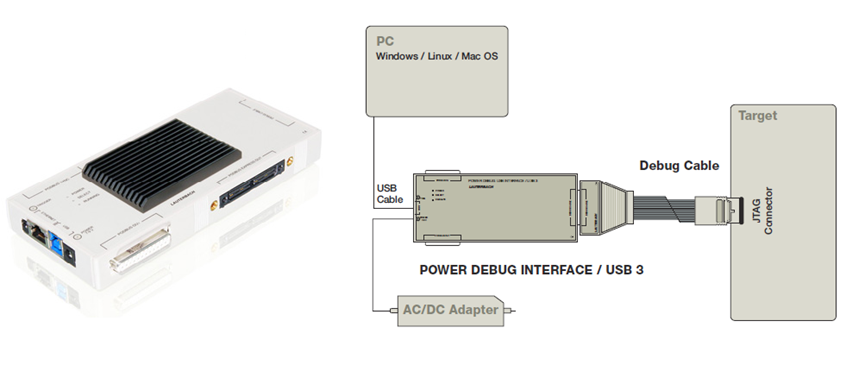

设备和连接示意图

上图左半部分为调试盒子硬件实物，右侧为debug时的连接示意图，运行TRACE32 debug程序的电脑端通过USB线与盒子连接，盒子通过cable连接target单板。通过电脑上的Debug程序就可以进行code的debug，程序界面如下图，程序的安装等细节请参考Lauterbach的文档。

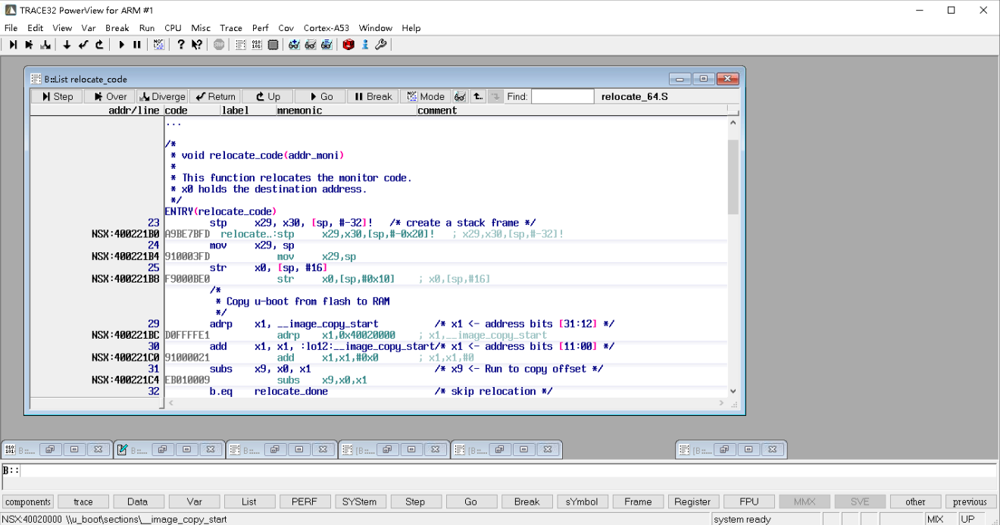

TRACE32软件界面

#### 8.4.2 使用TRACE32调试U-Boot程序

调试步骤如下所示：

1. 单板strappin配置进入USB下载模式。

2. M57项目U-Boot代码运行在ddr中。因此trace连接上单板后，可以加载debug的u-boot.bin到0x100200000地址，加载符号表，并且设置断点到U-Boot的第一条指令地址，即可开始进行代码调试debug，如[图8-10](#%E5%9B%BE810) ~ <span style="color:#0000FF">图8-13</span>所示。

- 说明：

- u-boot bin镜像路径：`boot/uboot/u-boot-2022.10/u-boot.bin`。

- u-boot符号表路径：`boot/uboot/u-boot-2022.10/u-boot`。

- M57系列的trace32脚M57_base.cmm，内容如后文所示。

- 注意method选择为Onchip类型。

- U-Boot会对代码进行relocate，会与编译链接地址不一致，因此在relocate前的代码跟踪可以在[图812](#%E5%9B%BE812)加载符号表之后，搜索全局变量gd。而relocate后，代码被搬到ddr的高端地址运行，因此需要通过<span style="color:#0000FF">图8-13</span>到<span style="color:#0000FF">图8-14</span>获取relocate偏移，然后重新加载符号表。<span style="color:#0000FF">图8-14</span>中reloc_off即为relocate的偏移量，relocate后需要method选择为Onchip类型，否则break不住。

M57_base.cmm内容：

## RESet

```c
SYStem.RESET
```

## SYStem.CPU CortexA55

## SYStem.CONFIG CoreNumber 1.

## CORE.NUMber 1.

## SYStem.CONFIG DEBUGACCESSPORT 0.

## SYStem.CONFIG APBACCESSPORT 0.

## SYStem.CONFIG MEMORYACCESSPORT 1.

## ; SYStem.CONFIG AHBACCESSPORT 0.

## SYStem.CONFIG AXIACCESSPORT 1.

## SYStem.CONFIG.DEBUGPORTTYPE SWD

## SYStem.Option PWRREQ ON

## SYStem.CONFIG COREDEBUG Base DAP:0x84124000

## SYStem.CONFIG CTI       Base DAP:0x84134000

```text
; SYStem.CONFIG COREDEBUG Base DAP:0x80024000 ;DAP:0x80005000 DAP:0x80006000 DAP:0x80007000 0x80024000 DAP:0x80025000 DAP:0x80026000 DAP:0x80027000
```

```c
; SYStem.CONFIG CTI       Base DAP:0x80034000 ;DAP:0x80015000 DAP:0x80016000 DAP:0x80017000 0x80034000 DAP:0x80035000 DAP:0x80036000 DAP:0x80037000 DAP:0x80002000
; SYStem.CONFIG BMC       Base DAP:0x8100C000 DAP:0x8000D000 DAP:0x8000E000 DAP:0x8000F000 0x8002C000 DAP:0x8002D000 DAP:0x8002E000 DAP:0x8002F000
; SYStem.CONFIG ETM       Base DAP:0x8101C000 DAP:0x8001D000 DAP:0x8001E000 DAP:0x8001F000 0x8003C000 DAP:0x8003D000 DAP:0x8003E000 DAP:0x8003F000
; SYStem.CONFIG ELA       Base DAP:0x81008000 DAP:0x80009000 DAP:0x8000A000 DAP:0x8000B000 0x80028000 DAP:0x80029000 DAP:0x8002A000 DAP:0x8002B000 DAP:0x80001000
; SYStem.CONFIG AMU       Base DAP:0x81018000 DAP:0x80019000 DAP:0x8001A000 DAP:0x8001B000 0x80038000 DAP:0x80039000 DAP:0x8003A000 DAP:0x8003B000
; GIC configure
```

## SYStem.CONFIG GICD Type GIC400

## SYStem.CONFIG GICD Base  AD:0x08001000

## SYStem.CONFIG GICC Base  AD:0x08002000

## SYStem.CONFIG GICH Base  AD:0x08004000

## SYStem.CONFIG GICV Base  AD:0x08006000

## SYStem.JtagClock 4MHz

## SYStem.Mode Up

## SYStem.Mode Attach

## IF STATE.RUN()

```c
Break.direct
```

## ENDDO

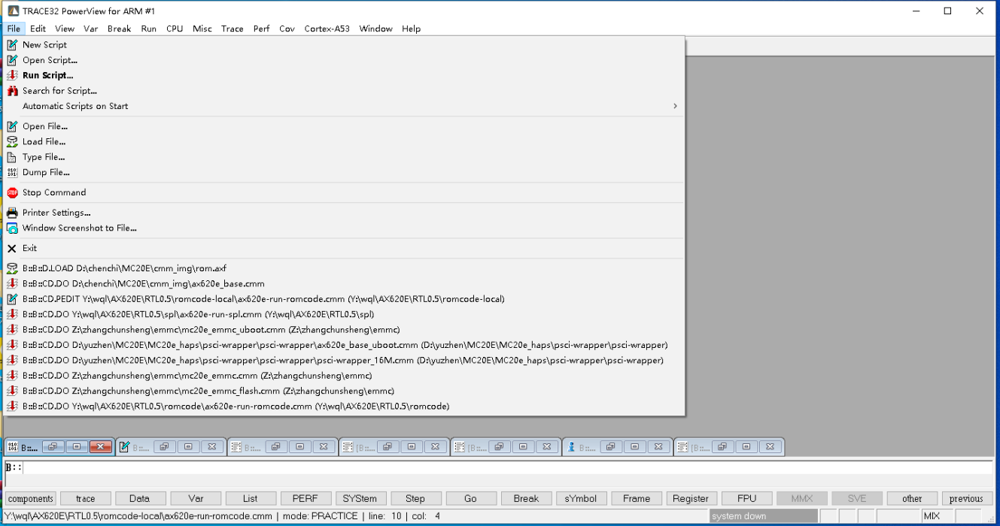

<a id="图810"></a>

运行cmm脚本连接单板

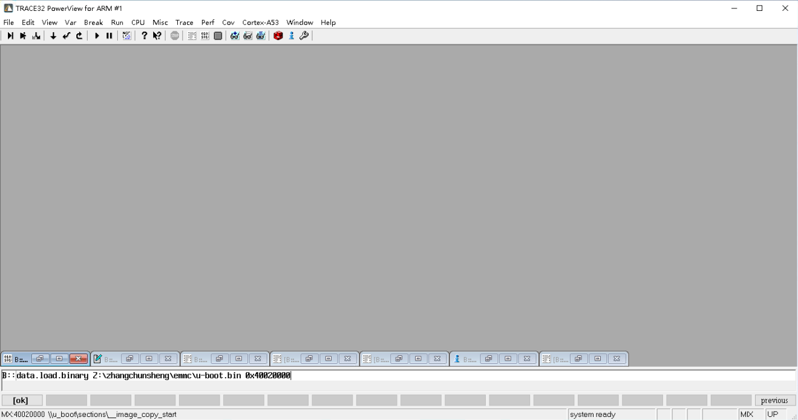

加载u-boot.bin到运行地址

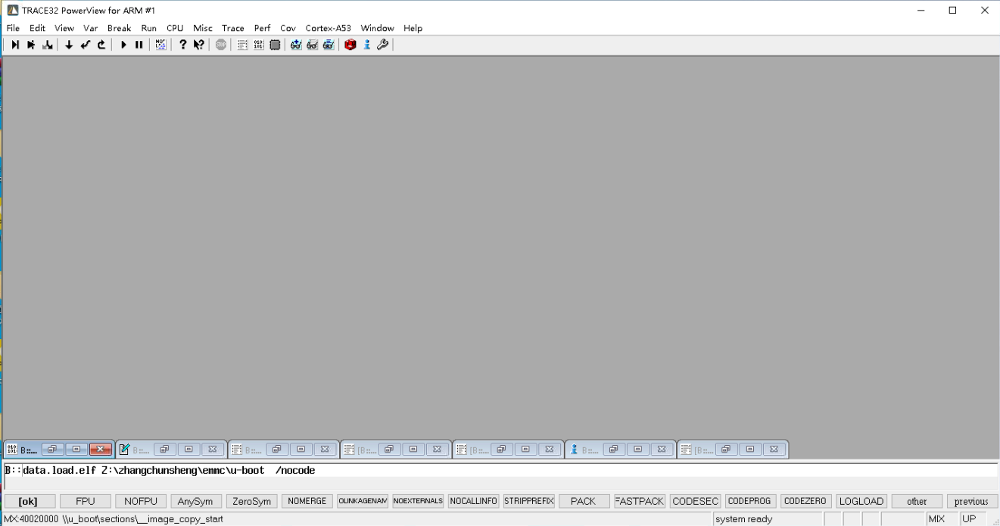

<a id="图812"></a>

加载u-boot符号表

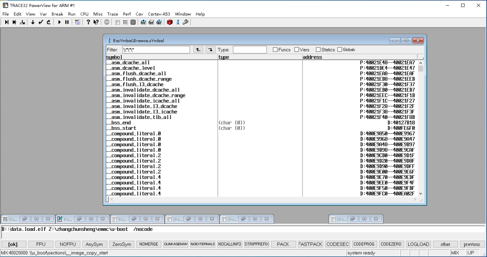

<a id="图813"></a>

查看函数列表

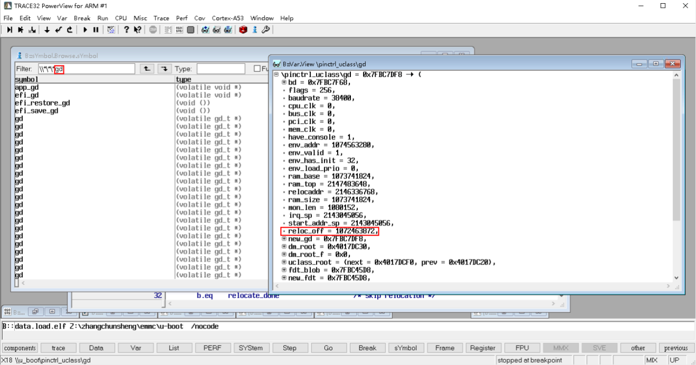

获取relocate偏移


重新加载relocate符号表

可参考如下uboot_debug.cmm的加载过程：

```c
do M57_base.cmm
```

```text
&uboot_addr= 0x100200000
&image_path="<sdk-build-out>\objs\boot\uboot\u-boot-2022.10"
data.load.binary &image_path\u-boot.bin &uboot_addr
register.set pc &uboot_addr
symbol.SourcePATH.Translate "<sdk-root>/boot/uboot/u-boot-2022.10" "<sdk-root>\boot\uboot\u-boot-2022.10"
data.load.elf &image_path\u-boot  /nocode
register.set pc &uboot_addr
data.load.elf <sdk-build-out>\objs\boot\uboot\u-boot-2022.10\u-boot 0x3fec8000  /nocode
```

```c
;go
```

<a id="_附录"></a>

### 8.5 附录

#### 8.5.1 网络支持

##### 固定IP配置

M57默认使用随机生成的MAC地址，通过dhcp动态获取IP地址，若需要固定MAC以及IP地址可以通过以下两种方法配置实现。

**方法1** 启动过程按任意键进入uboot命令行，使用setenv命令设置MAC地址，并保存环境变量到分区，保存后只要在通过AXDL工具升级时不勾选全擦除选项就不会丢失环境变量信息。


复位启动到内核下，可以看到网卡的MAC地址会自动使用保存到环境变量里的MAC地址，重启不丢失。


若调试可以接入办公网络等带有dhcp服务器的网络环境，则板子会自动使用此固定的MAC地址申请分配IP，由于MAC地址固定，因此dhcp服务器会分配同一个IP给板子，达到IP固定效果。

**方法2** 若开发环境不支持dhcp自动获取IP，可以在MAC地址通过方法1中的配置方法固定后，启动到内核下手动修改/etc/init.d/S45ifplugd文件内容，如下图加上想固定使用的IP地址即可。


重启可以看到IP每次均会固定使用此脚本配置IP地址


**补充说明:** 若开发环境存在dhcp服务器，但是不想通过dhcp获取分配IP，则需要修改buildroot配置重新编译buildroot升级rootfs分区，若不想重新编译，可以使用rm /usr/sbin/udhcpc简单暴力的删除板子上的udhcpc程序即可。

修改配置则需在rootfs目录下执行make PLAT=demo_nor_nand menuconfig，删除图中配置选项，make PLAT=demo_nor_nand savedefconfig保存配置，重新执行make PLAT=demo_nor_nand rootfs all install编译生成rootfs.img文件。


##### 基础功能

M57参考board的U-Boot中支持网络功能，有些U-Boot的场景可以使用网络功能。

举例使用网络给u-boot传输镜像，步骤如下所示：

1. 在本地或者Linux服务器端建立tftp server和DHCP server，具体可参考网上案例（例如tftpd64）。

2. 在u-boot启动过程中按键，进入cmd模式。

3. 输入DHCP分配IP地址。

4. 在板子cmd命令行输入tftpboot 0x40200000 <server-ip>:xxx.bin命令，其中，<server-ip>为服务器端IP地址，请根据具体的Server IP修改。

如上，通过单板连入网络，将server端bin文件传输到开发板内存地址x40200000。

提供两个安装包，供参考使用；

Windows dhcp server软件下载官网：[http://www.dhcpserver.de/cms/](http://www.dhcpserver.de/cms/)

Windows tftp server软件包:


##### 扩展功能——TFTP网络升级

###### 实现原理

1. SDK新增开机tftp_ota启动模式场景，循环处理2、3完成所有升级镜像的写入

2. 通过tftpboot命令将Linux服务器端布置正确的升级镜像文件通过网络传输到板端内存

3. 将内存数据写入镜像文件对应的flash分区(支持的flash有emmc、nand、nor)

###### 使用步骤

**步骤1**  将需要升级的镜像文件上传到Linux服务器

升级文件选择：

对于emmc project编译sdk包, 从路径/build/out/AX6xx_xxx/images/sd_update_pack目录下获取。

**步骤2**  在uboot或内核console设置env配置要升级的文件

1. SDK env支持情况：

uboot console可直接使用uboot原生env命令；

kernel console可使用fw_printenv查看全部env变量，fw_setenv写单项env变量

2. 配置env以进行tftp升级：

setenv ota_server_ip server服务器IP地址（必须存在）

setenv ota_server_path server服务器路径（可以不存在，直接使用server服务器根目录）

setenv ota_repartition true（分区有变更时需要配置，全包升级建议配置）

setenv ota_xml [xml后缀的文件名]

setenv ota_[partname] [镜像文件名]（单个或多个）

setenv ota_ready true

**步骤3**  重启下次开机uboot根据env配置自动进行tftp升级软件镜像，或者直接执行升级命令axera_ota进行升级。

## Eg:

## setenv ota_server_ip <ota-server-ip>

## setenv ota_xml M57.xml

## setenv ota_spl spl.bin

## setenv ota_uboot uboot.bin

## setenv ota_uboot_b uboot_b.bin

## setenv ota_atf atf.img

## setenv ota_dtb dtb.img

## setenv ota_optee optee.img

## setenv ota_kernel kernel.img

## setenv ota_rootfs rootfs.img

## setenv ota_param param.img

## setenv ota_opt opt.img

## setenv ota_soc soc.omg

## setenv ota_repartition enable

## saveenv

## axera_ota

### 重要说明

升级过程出现中断的情况：

（1）不支持掉电

如果正好在升级u-boot分区对应的bin文件时未完成掉电，则无法再次启动，必须通过其它方式刷机（如AXDL工具升级）；

如果升级其它文件时掉电升级失败，且客户u-boot方案默认设计没有关闭bootdelay，则还可以继续通过串口进入u-boot console重新配置env进行升级

（2）升级过程中断网

升级过程中断网导致失败，不会影响eMMC数据的写入，如客户u-boot方案默认设计没有关闭bootdelay，则还可以继续通过串口进入u-boot console重新配置env进行升级

- 注意事项：

- 请确保XML文件中的分区信息与uboot代码中的分区信息定义保持一致，否则升级后可能无法启动；

- ota升级设置中若使能了ota_repartition选项，在升级过程中会使用xml中的分区信息进行烧录，建议设置使能；

#### 8.5.2 支持修改partition大小

以demo_nor_nand平台为例支持的分区分布如下：

768K(spl),512K(ddrinit),256K(atf),256K(atf_b),1536K(uboot),1536K(uboot_b),1024K(env),1024K(optee),1024K(optee_b),6144K(logo),6144K(logo_b),1024K(dtb),1024K(dtb_b),65536K(kernel),65536K(kernel_b),2097152K(rootfs),5120K(param),1048576K(soc),4330752K(opt)

所有镜像大小是按照以上大小制作的，有些想要修改分区大小，比如想要将opt分区修改成2048M，我们提供了一种方法不用修改代码重新编译下载包。

具体操作步骤如下：

1. 修改5.2章节中提到的M57_emmc_arm64_k419.xml中分区的size。


分区大小修改

2. 将要下载的opt.ext4镜像进行解包；

## sudo mount -t ext4 -o loop opt.ext4 opt/

3. 之后再使用tools/mkext4fs/make_ext4fs重新打包成2G大小的镜像；

## ./tools/mkext4fs/make_ext4fs -l 2048M $(BUILD_PATH) /opt.ext4  ./opt

4. 配置AXDL下载工具中optition,将repartition选项勾上，然后使用AXDL工具下载新打包的opt.img；


下载工具配置

### 8.5.3 回读分区数据

M57参考board的U-Boot支持回读分区数据功能，目前仅支持eMMC/ NAND分区数据回读。

具体步骤如下：

AXDL烧录工具加载AXP包。


AXDL烧录工具截图

1. 左键单击“问号”选项，在中间弹出窗口界面单击右键，弹出image镜像临时路径。


查询XML分区表路径


打开XML分区表路径

2. 在…\AXDL_Vx.xx.xx.x\Bin\Temp\xxxxxxx路径下打开查看xxx.XML文件。


XML分区表内容

文件内容表示当前AXP版本对应的分区表信息，id="XXX"表示分区名，size="XXX"表示分区容量，单位默认为Mbytes。

3. AXDL烧录工具单击“Setting”，选择“Flash > Read Flash”选项，勾选“Active Read”，在窗口中根据XML内容信息填写，说明如下：

1. Address列填写XML中id项对应的内容即分区名，如id="kernel"对应的Address列填写kernel。

2. Size列填写XML中size项对应的内容单位为Bytes，如kernel分区size="65536"，分区大小为64M = 65536 x 1024 = 67108864= 0x4000000。

3. File列填写期望将回读的每个对应分区数据保存在PC的具体文件路径及文件名。


AXDL烧录工具设置


配置回读分区

4. 单击“OK”，开始正常烧录版本，在下载完所有image后会继续回读分区镜像数据到<span style="color:#0000FF">步骤3</span>中设定的PC路径保存分区数据文件。

<a id="_应用与内核Debug使用说明"></a>

#### 8.5.4 SDCard升级

以demo_nor_nand为例，获取sdcard升级镜像包，命名格式如下：

axera_demo_nor_nand_sdcard_Vxx.xx.xx .zip

**操作步骤如下：**

1. 格式化sdcard，然后给sdcard划分一个vfat/fat32分区（比如使用guiformat工具），不要用Windows自带的格式化工具格式成exFAT格式

2. 将zip压缩包解压到分区根目录，不要把镜像解压到某个子目录下

3. 弹出sdcard，插入板侧sdcard槽

4. 复位，让板子进入下载模式，通过UART1可以看到升级过程，等待sdcard升级完成

**<span style="color:#EE0000">注意：格式化前备份sdcard里面重要数据！</span>**

## 9. Clock使用说明

<a id="_CPU"></a>

本章节主要描述在U-Boot和Linux下各模块时钟信息的获取，以及如何在U-Boot下修改模块的时钟频率。

<a id="_DDR"></a>

<a id="_FLASH"></a>

<a id="_AUDIO"></a>

<a id="_sclk_i2s"></a>

<a id="_EMAC"></a>

### 9.1 U-Boot下查看时钟信息

进入uboot的命令行，使用clk dump命令可以查看各个时钟的频率：

## Rate            Name                       Index

## ---------------------------------------------------------

## 'fake_32k' output clocks information:

## 32 KHz        fake_32k                       0

## ---------------------------------------------------------

## 'main_xtal_24m' output clocks information:

## 24 MHz        main_xtal_24m                  0

## ---------------------------------------------------------

## 'main_pll@18001000' output clocks information:

## 2400 MHz        fab_pll_2400m                  0

## 1398 MHz        cpu_pll_1296m                  1

## 996 MHz        npu_pll_996m                   2

## 2700 MHz        apll_2700m                     3

## 1500 MHz        epll_1500m                     4

## ---------------------------------------------------------

## 'fab_pll_1200m' output clocks information:

## 1200 MHz        fab_pll_1200m                  0

## ---------------------------------------------------------

## 'fab_pll_800m' output clocks information:

## 800 MHz        fab_pll_800m                   0

## ---------------------------------------------------------

## 'fab_pll_600m' output clocks information:

## 600 MHz        fab_pll_600m                   0

## ---------------------------------------------------------

## 'fab_pll_480m' output clocks information:

## 480 MHz        fab_pll_480m                   0

## ---------------------------------------------------------

## 'fab_pll_400m' output clocks information:

## 400 MHz        fab_pll_400m                   0

## ---------------------------------------------------------

## 'fab_pll_300m' output clocks information:

## 300 MHz        fab_pll_300m                   0

## ---------------------------------------------------------

## 'fab_pll_200m' output clocks information:

## 200 MHz        fab_pll_200m                   0

## ---------------------------------------------------------

## 'fab_pll_150m' output clocks information:

## 150 MHz        fab_pll_150m                   0

## ---------------------------------------------------------

## 'fab_pll_120m' output clocks information:

## 120 MHz        fab_pll_120m                   0

## ---------------------------------------------------------

## 'fab_pll_100m' output clocks information:

## 100 MHz        fab_pll_100m                   0

## ---------------------------------------------------------

## 'fab_pll_80m' output clocks information:

## 80 MHz        fab_pll_80m                    0

## ---------------------------------------------------------

## 'fab_pll_60m' output clocks information:

## 60 MHz        fab_pll_60m                    0

## ---------------------------------------------------------

## 'fab_pll_40m' output clocks information:

## 40 MHz        fab_pll_40m                    0

## ---------------------------------------------------------

## 'fab_pll_30m' output clocks information:

## 30 MHz        fab_pll_30m                    0

## ---------------------------------------------------------

## 'fab_pll_24m' output clocks information:

## 24 MHz        fab_pll_24m                    0

## ---------------------------------------------------------

## 'fab_pll_20m' output clocks information:

## 20 MHz        fab_pll_20m                    0

## ---------------------------------------------------------

## 'fab_pll_12m' output clocks information:

## 12 MHz        fab_pll_12m                    0

## ---------------------------------------------------------

## 'fab_pll_8m' output clocks information:

## 8 MHz        fab_pll_8m                     0

## ---------------------------------------------------------

## 'cpu_pll_81m' output clocks information:

## 87375 KHz        cpu_pll_81m                    0

## ---------------------------------------------------------

## 'cpu_pll_29p45m' output clocks information:

## 31772 KHz        cpu_pll_29p45m                 0

## ---------------------------------------------------------

## 'npu_pll_24p9m' output clocks information:

## 24900 KHz        npu_pll_24p9m                  0

## ---------------------------------------------------------

## 'apll_1350m' output clocks information:

## 1350 MHz        apll_1350m                     0

## ---------------------------------------------------------

## 'apll_900m' output clocks information:

## 900 MHz        apll_900m                      0

## ---------------------------------------------------------

## 'apll_675m' output clocks information:

## 675 MHz        apll_675m                      0

## ---------------------------------------------------------

## 'apll_337p5m' output clocks information:

## 337500 KHz        apll_337p5m                    0

## ---------------------------------------------------------

## 'apll_270m' output clocks information:

## 270 MHz        apll_270m                      0

## ---------------------------------------------------------

## 'apll_225m' output clocks information:

## 225 MHz        apll_225m                      0

## ---------------------------------------------------------

## 'apll_180m' output clocks information:

## 180 MHz        apll_180m                      0

## ---------------------------------------------------------

## 'apll_54m' output clocks information:

## 54 MHz        apll_54m                       0

## ---------------------------------------------------------

## 'apll_45m' output clocks information:

## 45 MHz        apll_45m                       0

## ---------------------------------------------------------

## 'apll_36m' output clocks information:

## 36 MHz        apll_36m                       0

## ---------------------------------------------------------

## 'apll_27m' output clocks information:

## 27 MHz        apll_27m                       0

## ---------------------------------------------------------

## 'epll_500m' output clocks information:

## 500 MHz        epll_500m                      0

## ---------------------------------------------------------

## 'epll_250m' output clocks information:

## 250 MHz        epll_250m                      0

## ---------------------------------------------------------

## 'epll_150m' output clocks information:

## 150 MHz        epll_150m                      0

## ---------------------------------------------------------

## 'epll_125m' output clocks information:

## 125 MHz        epll_125m                      0

## ---------------------------------------------------------

## 'epll_50m' output clocks information:

## 50 MHz        epll_50m                       0

## ---------------------------------------------------------

## 'epll_25m' output clocks information:

## 25 MHz        epll_25m                       0

## ---------------------------------------------------------

## 'epll_5m' output clocks information:

## 5 MHz        epll_5m                        0

## ---------------------------------------------------------

## 'clk_comm_24m' output clocks information:

## 24 MHz        clk_comm_24m                   0

## ---------------------------------------------------------

## 'clk_flash_24m' output clocks information:

## 24 MHz        clk_flash_24m                  0

## ---------------------------------------------------------

## 'clk_periph_emac_ptp_div2' output clocks information:

## 50 MHz        clk_periph_emac_ptp_div2       0

## ---------------------------------------------------------

## 'tclk_sen_timestamp1' output clocks information:

## 24 MHz        tclk_sen_timestamp1            0

## ---------------------------------------------------------

## 'clk_periph_24m' output clocks information:

## 24 MHz        clk_periph_24m                 0

## ---------------------------------------------------------

## 'clk_cpu_24m' output clocks information:

## 24 MHz        clk_cpu_24m                    0

## ---------------------------------------------------------

## 'clk_sen_24m' output clocks information:

## 24 MHz        clk_sen_24m                    0

## ---------------------------------------------------------

## 'cpu_clk_mux' output clocks information:

## 1398 MHz        clk_cpu0_mux                   0

## 1398 MHz        clk_cpu1_mux                   1

## 1398 MHz        clk_cpu2_mux                   2

## 1398 MHz        clk_cpu3_mux                   3

## 800 MHz        clk_dsu_mux                    4

## 400 MHz        clk_dsu_periph_mux             5

## ---------------------------------------------------------

## 'cpu_clk_gate' output clocks information:

## 1398 MHz        clk_cpu_core0                  0

## 1398 MHz        clk_cpu_core1                  1

## 1398 MHz        clk_cpu_core2                  2

## 1398 MHz        clk_cpu_core3                  3

## 800 MHz        sclk_dsu                       4

## 24 MHz        clk_cpu_dbg                    5

## 24 MHz        atgicclk_cpu                   6

## 0 MHz        clk_cpu_rosc                   7

## ---------------------------------------------------------

## 'npu_clk_mux' output clocks information:

## 24 MHz        clk_nn_fab_mux                 0

## 800 MHz        clk_nn_ocm_mux                 1

## 24 MHz        clk_nn_glb_mux                 2

## ---------------------------------------------------------

## 'common_clk_mux' output clocks information:

## 500 MHz        aclk_top0_mux                  0

## 24 MHz        aclk_top1_mux                  1

## 500 MHz        aclk_top2_mux                  2

## 100 MHz        pclk_top_mux                   3

## 24 MHz        clk_comm_tmr_mux               4

## 24 MHz        clk_comm_wwdt_mux              5

## ---------------------------------------------------------

## 'common_clk_mux_gate' output clocks information:

## 24 MHz        clk_comm_tmr                   0

## 24 MHz        clk_comm_wwdt                  1

## ---------------------------------------------------------

## 'common_clk_gate' output clocks information:

## ---------------------------------------------------------

## 'flash_clk_mux' output clocks information:

## 300 MHz        clk_flash_glb_mux              0

## 800 MHz        clk_flash_ospi_mux             1

## 150 MHz        clk_flash_ospi_mux             2

## 24 MHz        clk_flash_ser_mux              3

## ---------------------------------------------------------

## 'flash_clk_mux_gate' output clocks information:

## 800 MHz        clk_flash_ospi                 0

## 150 MHz        clk_flash_sdm                  1

## 0 MHz        clk_flash_ser                  2

## ---------------------------------------------------------

## 'flash_clk_gate' output clocks information:

## 300 MHz        hclk_flash_ospi                0

## 300 MHz        pclk_flash_dma_per0            1

## 300 MHz        aclk_flash_dma_per0            2

## 150 MHz        sdmclk_sd                      3

## 300 MHz        clk_sd                         4

## 150 MHz        sdmclk_emmc                    5

## 300 MHz        clk_emmc                       6

## 0 MHz        pclk_flash_spi_m7              7

## 0 MHz        clk_flash_spi_m7               8

## 0 MHz        pclk_flash_i2c9                9

## 0 MHz        clk_flash_i2c9                10

## 300 MHz        pclk_flash_gpio6              11

## 24 MHz        clk_flash_gpio6               12

## 300 MHz        pclk_flash_pinmux             13

## 0 MHz        pclk_flash_dbgmnr             14

## 0 MHz        aclk_flash_dbgmnr             15

## 24 MHz        clk_flash_lpc                 16

## 0 MHz        clk_flash_bw_lmt_24m          17

## 0 MHz        aclk_flash_bw_lmt             18

## 0 MHz        clk_flash_tlb                 19

## 0 MHz        pclk_flash_iso                20

## 0 MHz        clk_flash_iso_24m             21

## ---------------------------------------------------------

## 'periph_clk_div' output clocks information:

## 36 MHz        sclk_i2s_m_div                 0

## 27 MHz        clk_i2s_ref_div                1

## ---------------------------------------------------------

## 'periph_clk_mux' output clocks information:

## 300 MHz        clk_periph_glb_mux             0

## 36 MHz        sclk_i2s_m_mux                 1

## 32 KHz        clk_periph_gpio_mux            2

## 24 MHz        clk_periph_ser_mux             3

## 24 MHz        pclk_usb_phy_bus_mux           4

## 5 MHz        clk_main_rgmii_tx_mux          5

## 20 MHz        clk_main_can_pe_mux            6

## 24 MHz        clk_main_ephy_ref_mux          7

## 27 MHz        clk_i2s_ref_mux                8

## ---------------------------------------------------------

## 'periph_clk_mux_gate' output clocks information:

## 0 MHz        sclk_i2s_m                     0

## 32 KHz        clk_periph_gpio                1

## 24 MHz        clk_periph_ser                 2

## 24 MHz        utmi_refclk                    3

## 2500 KHz        clk_main_rgmii_tx              4

## 0 KHz        clk_main_rmii_phy              5

## 0 KHz        clk_main_can_pe                6

## 0 KHz        clk_main_ephy_ref              7

## 50 MHz        clk_periph_emac_ptp            8

## 0 MHz        clk_i2s_ref                    9

## ---------------------------------------------------------

## 'periph_clk_gate@0' output clocks information:

## 0 MHz        pclk_periph_spi_s              0

## 0 MHz        clk_periph_spi_s               1

## 300 MHz        pclk_periph_gpio4              2

## 300 MHz        pclk_periph_gpio5              3

## 32 KHz        clk_periph_gpio4               4

## 32 KHz        clk_periph_gpio5               5

## 0 KHz        pclk_i2s_m                     6

## 0 KHz        pclk_i2s_s                     7

## 300 MHz        pclk_periph_pinreg             8

## 300 MHz        pclk_periph_uart1              9

## 300 MHz        pclk_periph_uart2             10

## 300 MHz        pclk_periph_uart3             11

## 300 MHz        pclk_periph_uart4             12

## 300 MHz        pclk_periph_uart5             13

## 24 MHz        clk_periph_uart1              14

## 24 MHz        clk_periph_uart2              15

## 24 MHz        clk_periph_uart3              16

## 24 MHz        clk_periph_uart4              17

## 24 MHz        clk_periph_uart5              18

## 0 MHz        pclk_periph_i2c4              19

## 0 MHz        pclk_periph_i2c5              20

## 0 MHz        pclk_periph_i2c7              21

## 0 MHz        pclk_periph_i2c8              22

## 0 MHz        clk_periph_i2c4               23

## 0 MHz        clk_periph_i2c5               24

## 0 MHz        clk_periph_i2c7               25

## 0 MHz        clk_periph_i2c8               26

## 0 MHz        pclk_periph_spi_m5            27

## 0 MHz        clk_periph_spi_m5             28

## 24 MHz        pclk_usb_phy                  29

## 300 MHz        aclk_usb_ctrl                 30

## 0 MHz        pclk_periph_crc_engine        31

## ---------------------------------------------------------

## 'periph_clk_gate@1' output clocks information:

## 0 MHz        clk_periph_crc_engine          0

## 0 MHz        pclk_periph_ax_dma_per         1

## 0 MHz        clk_periph_ax_dma_per          2

## 0 MHz        pclk_periph_ax_dma             3

## 0 MHz        clk_periph_ax_dma              4

## 0 MHz        pclk_can0                      5

## 0 MHz        pclk_can1                      6

## 0 MHz        clk_can0_core                  7

## 0 MHz        clk_can1_core                  8

## 0 MHz        time_stamp_clk_can0            9

## 0 MHz        time_stamp_clk_can1           10

## 24 MHz        clk_periph_lpc                11

## 300 MHz        aclk_main_emac                12

## 0 MHz        clk_periph_dma_bw_lmt_24m     13

## 0 MHz        aclk_periph_dma_bw_lmt        14

## 0 MHz        pclk_periph_dma_bw_lmt        15

## 0 MHz        pclk_periph_dma_per_dbgmnr    16

## 0 MHz        aclk_periph_dma_per_dbgmnr    17

## 0 MHz        clk_periph_tlb                18

## 0 MHz        pclk_periph_iso               19

## 0 MHz        clk_periph_iso_24m            20

### 9.2 Linux下查看时钟频率

进入Linux命令行，执行下面的命令：

## mount -t debugfs none /sys/`kernel/debug/`

```bash
cat /sys/kernel/debug/clk/clk_summary
```

可以得到clock tree的详细信息


## 10. SDK OS Memory统计

### 10.1 概要说明

#### 10.1.1 需求背景

在进行稳定性问题分析时，内存泄漏问题分析比较困难，在发生内存泄漏的时难以确认哪个模块或者哪个进程发生了内存泄漏。如果在内存使用的时候进行统计某个模块分配的系统内存空间大小和次数等，以及内存需求的计算，当出现内存问题的时候就会方便进行优化。

SDK提供了OS Memory的统计功能，可以分模块统计每个模块申请的系统内存大小以及申请内存的次数，简称OS_MEM。

- **注意：**必须使用OS_MEM提供的内存申请API，OS_MEM才会进行统计相关信息。

#### 10.1.2 支持的功能

- 同时支持应用态和内核态的内存统计；

- 能同时统计每个模块对应申请的内存大小和申请次数；

- 针对内核的分配，大小计算支持aligned操作，aligned策略和linux版本保持一致；

- 支持名字为common的ID，方便给osal等一些不属于具体模块的内存申请；

- 支持多种统计策略，在小内存的软件中，只统计申请的次数，不记录每次申请的ID和大小；对于大内存统计更加详细，该开关可以通过/proc节点来配置，默认是小内存，减少统计的内存消耗和时间开销；

- 提供显示某个模块内核态内存的大小和mod_id/sub_id的详细信息。

#### 10.1.3 不支持的功能

- 不支持单个模块内核或者用户态申请的内存大于4GB，但是支持内核态和用户态申请的内存总和大于4GB；

- 不支持没有调用OS_MEM接口的内存统计，例如C++的new/delete、系统的文件cache。

#### 10.1.4 统计策略

policy：引入统计策略是为了os_mem可以应用于不同的场景，目前支持0-2共3个policy；

- 0：OS_MEM分配内存可以支持多进程，统计只能统计多进程的次数，不支持统计多进程申请内存的大小；

- 1：OS_MEM可以统计每个模块分配内存的次数，每个模块每次分配的内存大小。在计算最大分配次数和分配内存大小的时候，只统计当前正在运行的所有进程的历史最大分配次数和分配大小，不包括已经关闭的进程的内存分配；

- 2：OS_MEM可以统计每个模块分配内存的次数，每个模块每次分配的内存大小。在计算最大分配次数和分配内存大小的时候，统计从开机到当前所有进程的最大分配次数和分配大小，包括已经关闭的进程的内存分配；

policy可以通过文件节点来配置，默认使用0 plicy（CPU loading影响最小，内存占用最小），如果要统计详细信息，可以在所有模块的ko load之前通过echo 节点进行配置；

方法如下：

```bash
echo 0 > /proc/ax_proc/os_mem/policy   # 设置policy为0
echo 1 > /proc/ax_proc/os_mem/policy  # 设置policy为1
echo 2 > /proc/ax_proc/os_mem/policy  # 设置policy为2
```

#### 10.1.5 PROC文件节点的说明

<table>
  <thead>
    <tr>
      <th>文件节点</th>
      <th>作用说明</th>
    </tr>
  </thead>
  <tbody>
    <tr>
      <td>/proc/ax_proc/os_mem/max_display</td>
      <td>该节点用来配置每个mod_id可以被查看的详细信息的最大个数</td>
    </tr>
    <tr>
      <td>/proc/ax_proc/os_mem/policy</td>
      <td>用来控制统计的policy</td>
    </tr>
    <tr>
      <td>/proc/ax_proc/os_mem/stat</td>
      <td>用来显示统计信息</td>
    </tr>
    <tr>
      <td>/proc/ax_proc/os_mem/ctrl</td>
      <td>用来清除user层的历史内存统计，主要给policy为2时使用</td>
    </tr>
  </tbody>
</table>

### 10.2 使用说明

#### 10.2.1 内存次数统计使用

OS_MEM默认的policy是0，只统计内存申请的次数，可以通过/proc/ax_proc/os_mem/stat文件节点来得到每个模块申请次数(查看结果类似下图)：

```bash
cat /proc/ax_proc/os_mem/stat
```


#### 10.2.2 统计每个模块申请的内存大小和次数

如果需要统计每个模块申请的内存大小和次数，policy需要设置为1和2。同时需要在ko加载前执行下面命令，这样才能统计到所有的KO申请的内存。如果需要自动运行配置，可以将下面的命令加到/usr/bin/load_modules.sh文件开始的地方。

```bash
echo 1 > /proc/ax_proc/os_mem/policy
```

或者

```bash
echo 2 > /proc/ax_proc/os_mem/policy
```

上述配置生效后，通过10.2.1章节命令可以查看到统计的每个模块申请的内存大小和次数。

#### 10.2.3 查看模块的内核内存详细信息

如果需要查看某个模块的单个信息，需要执行下面的命令：

```bash
echo mod_id > /proc/ax_proc/os_mem/stat
```

其中mod_id对应/proc/ax_proc/os_mem/stat 信息中第二列mod_id的数字。例如要查看JENC每次分配的内存大小和ID，可以执行下面命令：

```bash
echo 9 > /proc/ax_proc/os_mem/stat
```


#### 10.2.4 设置模块内核分配的次数显示限制

通过 10.2.3 的方法默认只显示512个，如果只想显示10次，可以通过下面的命令来限制显示的次数。

## #echo 10 > `/proc/ax_proc/os_mem/max_display`

  1. 注意事项

### 10.3.1 单模块模式和ALL模式切换

在通过下面命令切换到单模块模式后。

## #echo mod_id > `/proc/ax_proc/os_mem/stat`

如果想再次查看所有模块的内存统计，需要执行下面命令切换到ALL模式。

## #echo 255 > `/proc/ax_proc/os_mem/stat`

### 10.3.2 Policy设置时机

为了使统计准确，policy的设置时机做了限制：

      - 开机后，设置一次policy后不能再次设置；

      - 开机后，执行`AX_SYS_Init`后不能再次设置。

#### 10.3.3 Policy选择

在Debug时下可以使用policy 1/2，方便分析每个模块的内存大小和次数。量产产品建议使用policy 0模式，消耗的内存最小。

## 11. OTA升级使用说明

本章节主要介绍OTA升级功能的使用方法，以便用户在开发过程中了解升级的过程及注意事项。

### 11.1 概要说明

因为车载应用对系统可用性要求极高， OTA使用 A/B 系统方案，不支持 recovery 方案，爱芯 OTA

支持功能：

- RSA签名校验，默认使用和安全启动相同的密钥

- HASH校验

- 分区校验，分区不一致时阻止升级

- 软件版本校验

- 压缩

- 分区升级

- 文件升级

- 差分升级

- AB升级

- 升级失败回滚

- 镜像回读校验

- 升级前后执行用户自定义脚本

- 掉电安全

- 本地升级

- 网络升级

#### 11.1.1 AB 系统方案

AB 系统方案，是将原有的系统，增加一份。即flash 上总共有AB 两套系统。两套系统互相升级。OTA 时，若当前运行的是A 系统，则升级B 系统，更新完成后，设置标志，重启切换到B系统。OTA 时，若当前运行的是B 系统，则升级A 系统，升级完成后，设置标志，重启切换到A 系统。

若更新失败，正在运行的系统没有被破坏，系统还能正常运行。若更新完成，切换到新的系统，但更新的系统不可运行，RomCode 配合WDT切换回原来的系统。若更新完成，切换到新的系统，但更新的系统未通过测试，RomCode 配合OTA检查切换回原来的系统。

因为AB更新过程是在完整系统中进行的，更新期间可正常提供服务，用户无感知。最终做一次重启即可(开启同步需要两次)。系统的可用性高，停机时间短。

当前启动阶段的安卓AB管理有几个注意点，请留意：

1. 对于nor_emmc/only_emmc板级当前安卓AB管理还是在SPL，后续会保持一致也前移到SBL。

2. 对于nor_nand/only_nand板级，misc/misc_bak整个分区给SDK安卓AB管理使用。
对于其他板级，misc/misc_bak分区前256K给SDK安卓AB管理使用，用户自己若需要使用misc/misc_bak请从偏移256K开始使用。

#### 11.1.2 编译

在build目录下执行make PLAT=xxx all install axp生成axp文件，然后执行make PLAT=xxxx swu生成ota包，这一步会使用的axp的编译产物和信息。编译成功后会在build/ out/下生成 swu扩展名的升级包。

### 11.2 定制swupdate

### 11.3 定制升级包

build/scripts/ota/config/xxxx/sw-description-source文件描述了升级内容和动作，默认所有分区都进行完整升级，用户可修改此文件进行定制化升级。语法和行为源自开源swupdate，swupdate 将每个升级目标定义为一个工件，每个工件可以自由定义升级内容和类型，filename 是写入目标的文件，device是写入的目标。定制升级包后需要重新编译swu升级包。详细说明和用法见[swupdate 在线文档](https://sbabic.github.io/swupdate/swupdate.html)。默认 sw-description-source 如下：

```c
software =
{
version = "@@VERSION@@";
reboot = false;
hardware-compatibility: [ "1.0" ];
stable : {
A : {
```

## images: (

```c
{
filename = "sbl_signed.img";
device = "/dev/link/ota_sbl_a";
type = "raw";
compressed = "zlib";
#readback = "1";
properties: {
rdiffbase = ["/dev/link/ota_sbl_b"];
};
},
{
filename = "Mcal_Demo_signed.img";
device = "/dev/link/ota_rtos_a";
type = "raw";
compressed = "zlib";
#readback = "1";
properties: {
rdiffbase = ["/dev/link/ota_rtos_b"];
};
},
{
filename = "u-boot-spl_signed.img";
device = "/dev/link/ota_spl_a";
type = "raw";
#type = "rdiff_image";
compressed = "zlib";
#readback = "1";
properties: {
rdiffbase = ["/dev/link/ota_spl_b"];
};
},
{
filename = "u-boot.img";
device = "/dev/link/ota_uboot_a";
type = "raw";
compressed = "zlib";
#readback = "1";
properties: {
rdiffbase = ["/dev/link/ota_uboot_b"];
};
},
{
filename = "bl31.img";
device = "/dev/link/ota_atf_a";
type = "raw";
compressed = "zlib";
#readback = "1";
properties: {
rdiffbase = ["/dev/link/ota_atf_b"];
};
},
{
filename = "optee.img";
device = "/dev/link/ota_optee_a";
type = "raw";
compressed = "zlib";
#readback = "1";
properties: {
rdiffbase = ["/dev/link/ota_optee_b"];
};
},
{
filename = "kernel.img";
device = "/dev/link/ota_kernel_a";
type = "raw";
compressed = "zlib";
#readback = "1";
properties: {
rdiffbase = ["/dev/link/ota_kernel_b"];
};
},
{
filename = "rootfs.img";
device = "/dev/link/ota_rootfs_a";
type = "raw";
compressed = "zlib";
#readback = "1";
},
);
```

## scripts: (

```c
{
type = "erase";
properties: {
list = ["/dev/mmcblk0p4", "/dev/mmcblk0p6"];
skip = "1";
}
},
```

```bash
mkdir /whitelist_test;touch /whitelist_test/1 /whitelist_test/2 /whitelist_test/3 /whitelist_test/4
```

```c
{
type = "whitelist";
properties: {
path = "/whitelist_test";
list = ["/whitelist_test/1", "/whitelist_test/3"];
skip = "1";
}
},
```

```bash
mkdir /blacklist_test;touch /blacklist_test/1 /blacklist_test/2 /blacklist_test/3 /blacklist_test/4
```

```c
{
type = "blacklist";
properties: {
path = "/blacklist_test";
list = ["/blacklist_test/2", "/blacklist_test/4"];
skip = "1";
}
},
{
filename = "custom_ota.sh";
type = "shellscript";
},
{
filename = "ota.sh";
type = "lua";
},
);
};
B : {
```

## images: (

```c
{
filename = "sbl_signed.img";
device = "/dev/link/ota_sbl_b";
type = "raw";
compressed = "zlib";
#readback = "1";
properties: {
rdiffbase = ["/dev/link/ota_sbl_a"];
};
},
{
filename = "Mcal_Demo_signed.img";
device = "/dev/link/ota_rtos_b";
type = "raw";
compressed = "zlib";
#readback = "1";
properties: {
rdiffbase = ["/dev/link/ota_rtos_a"];
};
},
{
filename = "u-boot-spl_signed.img";
device = "/dev/link/ota_spl_b";
type = "raw";
#type = "rdiff_image";
compressed = "zlib";
#readback = "1";
properties: {
rdiffbase = ["/dev/link/ota_spl_a"];
};
},
{
filename = "u-boot.img";
device = "/dev/link/ota_uboot_b";
type = "raw";
compressed = "zlib";
#readback = "1";
properties: {
rdiffbase = ["/dev/link/ota_uboot_a"];
};
},
{
filename = "bl31.img";
device = "/dev/link/ota_atf_b";
type = "raw";
compressed = "zlib";
#readback = "1";
properties: {
rdiffbase = ["/dev/link/ota_atf_a"];
};
},
{
filename = "optee.img";
device = "/dev/link/ota_optee_b";
type = "raw";
compressed = "zlib";
#readback = "1";
properties: {
rdiffbase = ["/dev/link/ota_optee_a"];
};
},
{
filename = "kernel.img";
device = "/dev/link/ota_kernel_b";
type = "raw";
compressed = "zlib";
#readback = "1";
properties: {
rdiffbase = ["/dev/link/ota_kernel_a"];
};
},
{
filename = "rootfs.img";
device = "/dev/link/ota_rootfs_b";
type = "raw";
compressed = "zlib";
#readback = "1";
},
);
```

## scripts: (

```c
{
type = "erase";
properties: {
list = ["/dev/mmcblk0p4", "/dev/mmcblk0p6"];
skip = "1";
}
},
```

```bash
mkdir /whitelist_test;touch /whitelist_test/1 /whitelist_test/2 /whitelist_test/3 /whitelist_test/4
```

```c
{
type = "whitelist";
properties: {
path = "/whitelist_test";
list = ["/whitelist_test/1", "/whitelist_test/3"];
skip = "1";
}
},
```

```bash
mkdir /blacklist_test;touch /blacklist_test/1 /blacklist_test/2 /blacklist_test/3 /blacklist_test/4
```

```c
{
type = "blacklist";
properties: {
path = "/blacklist_test";
list = ["/blacklist_test/2", "/blacklist_test/4"];
skip = "1";
}
},
{
filename = "custom_ota.sh";
type = "shellscript";
},
{
filename = "ota.sh";
type = "lua";
},
);
};
};
}
```

### 11.3.1 AB升级

OTA默认开启AB升级，sw-description-source文件中分为两个大块，A块描述升级SLOT A内容，B块描述升级SLOT B内容，每次OTA只会使用其中一个块。用户修改sw-description-source文件时应该同步修改A和B。

#### 11.3.2 分区升级

sw-description-source默认升级所有系统分区，用户可以自行删减和添加分区来满足不同的升级需求。

#### 11.3.3 压缩

在升级工件描述节点添加compressed = "zlib";可以开启压缩功能，能够减小升级包大小，但会增加升级时间。

```c
{
filename = "sbl_signed.img";
device = "/dev/link/ota_sbl_a";
type = "raw";
compressed = "zlib";
},
```

#### 11.3.4 回读校验

在升级工件描述节点添加readback = "1";可以开启写入镜像后回读镜像校验写入镜像是否发生数据错误，但会增加升级时间。

```c
{
filename = "sbl_signed.img";
device = "/dev/link/ota_sbl_a";
type = "raw";
compressed = "zlib";
readback = "1";
},
```

#### 11.3.5 文件升级

把升级工件描述节点修改 type 为 rawfile，并添加path属性，可以将文件升级到path指定的路径。

```c
{
filename = "u-boot-spl_signed.img";
path = "/tmp/u-boot-spl_signed.img";
type = "rawfile";
compressed = "zlib";
},
```

#### 11.3.6 差分升级

执行export OLD_AXP="/path/xxx_1.0.0_20250318145237.axp"指定板级正在使用的镜像包，把升级工件描述节点修改 type 为 rdiff_image，添加 rdiffbase 属性指定镜像base，OLD_AXP和rdiffbase使用的镜像必须一致。

注意：可写分区、ubi、ext4分区不可差分，因为可写分区数据可能已经被改变，ubi、ext4分区会改变原始数据，添加文件系统管理数据（包括只读）。

```c
{
filename = "sbl_signed.img";
device = "/dev/link/ota_sbl_a";
type = "rdiff_image";
compressed = "zlib";
#readback = "1";
properties: {
rdiffbase = ["/dev/link/ota_sbl_b"];
};
```

## },

### 11.3.7 AB同步

执行export SYNC=1后重新编译swu，OTA升级成功后会将新分区的内容拷贝到老分区，同步是全量同步，时间较长，用户也可以再触发一次OTA来达到定制同步的效果。

#### 11.3.8 AB恢复

OTA升级失败后会将旧分区的内容拷贝到失败分区，恢复是全量同步，时间较长，用户也可以再触发一次OTA来重新升级。AB恢复默认开启，用户可以编译swu前执行export RESUME=0来关闭。

#### 11.3.9 升级前后执行自定义程序

修改 build/scripts/ota/config/xxx/custom_ota.sh脚本，preinst 函数在升级前调用，postinst函数在写镜像完成后调用，postfailure在写镜像失败后调用。

## #!/bin/bash

```bash
echo "custom ota"
```

```c
function preinst() {
```

```bash
echo "custom preinst"
```

```c
}
function postinst() {
```

```bash
echo "custom postinst"
```

```c
}
function postfailure() {
```

```bash
echo "custom postfailure"
```

```c
}
```

## case "$1" in

## "preinst")

## preinst

## ;;

## "postinst")

## postinst

## ;;

## "postfailure")

## postfailure

## ;;

## *)

```bash
echo "Error: Unknown parameter '$1', supports parameters: preinst/postinst/postfailure" >&2
```

## exit 1

## ;;

## esac

### 11.3.10 升级后执行自定义测试程序

支持升级后执行自定义测试程序验证升级镜像是否符合预期，测试不通过触发升级失败回滚。添加rootfs/buildroot-2024.02.2/board/axera/m57/fs-overlay/usr/lib/swupdate/custom_test.sh 脚本，脚本退出码为0表示测试通过，其他值表示测试失败。

#### 11.3.11 升级前擦除分区

在scripts节点中添加如下内容, list表示要擦除的分区，skip 表示是否跳过擦除

## scripts: (

```c
{
type = "erase";
properties: {
list = ["/dev/mtd1", "/dev/mtd3"];
skip = "1";
}
},
```

## )

### 11.3.12 升级前排除白名单删除

在scripts节点中添加如下内容, path表示要删除的目录，list表示要保留的文件，skip 表示是否跳过删除。

## scripts: (

```c
{
type = "erase";
properties: {
list = ["/dev/mmcblk0p4", "/dev/mmcblk0p6"];
skip = "1";
}
},
```

```bash
mkdir /whitelist_test;touch /whitelist_test/1 /whitelist_test/2 /whitelist_test/3 /whitelist_test/4
```

```c
{
type = "whitelist";
properties: {
path = "/whitelist_test";
list = ["/whitelist_test/1", "/whitelist_test/3"];
skip = "1";
}
},
```

```bash
mkdir /blacklist_test;touch /blacklist_test/1 /blacklist_test/2 /blacklist_test/3 /blacklist_test/4
```

```c
{
type = "blacklist";
properties: {
path = "/blacklist_test";
list = ["/blacklist_test/2", "/blacklist_test/4"];
skip = "1";
}
},
```

### 11.3.13 升级前按黑名单删除

在scripts节点中添加如下内容, path表示要删除的目录，list表示要删除的文件，skip 表示是否跳过删除

## scripts: (

```c
{
type = "erase";
properties: {
list = ["/dev/mmcblk0p4", "/dev/mmcblk0p6"];
skip = "1";
}
},
```

```bash
mkdir /whitelist_test;touch /whitelist_test/1 /whitelist_test/2 /whitelist_test/3 /whitelist_test/4
```

```c
{
type = "whitelist";
properties: {
path = "/whitelist_test";
list = ["/whitelist_test/1", "/whitelist_test/3"];
skip = "1";
}
},
```

```bash
mkdir /blacklist_test;touch /blacklist_test/1 /blacklist_test/2 /blacklist_test/3 /blacklist_test/4
```

```c
{
type = "blacklist";
properties: {
path = "/blacklist_test";
list = ["/blacklist_test/2", "/blacklist_test/4"];
skip = "1";
}
},
```

### 11.3.14 升级模式

rootfs/buildroot-2024.02.2/board/axera/m57/fs-overlay/usr/lib/swupdate/conf.d/10-mongoose-args 的UPDATE_MODE是升级模式配置，有本地和网络升级两种模式，SWU_PATH 是升级包路径。用户可根据需求进行修改。

#### 11.3.15 升级日志等级

rootfs/buildroot-2024.02.2/board/axera/m57/fs-overlay/usr/lib/swupdate/conf.d/10-mongoose-args 的DEBUG_LEVEL是升级日志等级配置，升级日志可以在/data/AXSyslog/`kernel/user.log`中查看。

### 11.4 升级方法

#### 11.4.1 本地升级

按上一节描述修改升级模块，执行/etc/init.d/S80swupdate start进行升级，升级完成后命令行执行reboot 重启系统。启动脚本会进行OTA检查等操作。

#### 11.4.2 web升级

开机自动执行/etc/init.d/S80swupdate start启动web升级界面，PC浏览器打开网页(板子IP:8080)，然后选择升级包上传，自动开始升级，升级完成后命令行执行reboot 重启系统。启动脚本会进行OTA检查等操作。


### 11.5 底层实现

swupdate负责获取镜像和更新镜像，爱芯将各种存储介质读写接口统一，生成了 /dev/link/ota_xxx 设备，swupdate 通过标准的 read/write 命令就可以读写存储介质。AB切换通过RomCode、WDT和安卓abc来控制，M57系统中的abc已经集成了RomCode控制部分，用户按照标准abc进行使用就能完成切换。M57 OTA通过安卓bcb在各级boot和AB系统间传递OTA信息。

#### 11.5.1 如何保证更新安全

1. 系统采用AB分区，永远只更新非活动分区，确保外部存储介质至少有一份能够正常运行的镜像。

2. AB切换

  1. RomCode 通过复位不丢失掉电丢失寄存器来选择分区，且具备启动失败自动切换分区功能。

  2. RomCode后级采用安卓abc/bcb方案，并添加备份机制，且充分预留坏块，确保更新abc时掉电安全和坏块安全。

3. 存储介质读写

  3. Nand flash 按照全生命周期2% 坏块率为每个分区充分预留坏块，降低因坏块导致镜像无法写入。

  4. Safety flash读写通过 virt mtd 设备进行读写，用户空间按照标准mtd设备使用，virt mtd 驱动通过RPMSG发送数据与safety flash驱动交互，实际读写操作由safety flash驱动进行。

4. OTA流程

  5. OTA不是原子操作，可能在任意阶段被打断，使用安卓bcb来标记OTA阶段，通过BCB标记检测OTA操作流程，被中断后可以进行处理或者恢复。

  6. 通过硬件WDT来检测镜像无法启动，配合RomCode自动进行AB切换。

  7. 通过OTA升级后检测来排查个别异常设备，确保更新镜像在具体设备上功能完好。

  8. 通过OTA检查来区分OTA状态，回滚更新失败设备。

#### 11.5.2 如何保证信息安全

将各个镜像的SHA256值写入 sw-description，对sw-description 进行RSA签名，然后把sw-description签名文件、sw-description、各个镜像传递给swupdate。

若RSA签名验证通过，说明 sw-description 文件是可信的，也没有被篡改，sw-description 文件中各个镜像的SHA256也是可信的，也没有被篡改。后续的镜像的完整性和可信性可以通过简单的SHA256来校验。

安全启动各级镜像也会进行校验，镜像签名和SHA校验不通过会阻止启动。

安全启动还会校验镜像版本，当前镜像版本小于安全存储版本时会阻止启动。

### 11.6 API

#### 11.6.1 读写存储介质

M57在/dev/link/目录下有ota_xxx_a和ota_xxx_b格式的设备，屏蔽了各种存储介质的细节，统一了读写接口，使用标准 open/write/read接口进行读写。

#### 11.6.2 AB控制

使用安卓abc 命令进行控制，详细信息见安卓abc -h，常用例子如下

打印abc信息

## abc -d /dev/link/misc -d /dev/link/misc_bak -S -p

设置slot b 不可启动

## abc -d /dev/link/misc -d /dev/link/misc_bak -S -u 1

设置slot b为下次启动分区

## abc -d /dev/link/misc -d /dev/link/misc_bak -S -a 1

标记slot b启动成功

## abc -d /dev/link/misc -d /dev/link/misc_bak -S -m 1

获取当前启动分区

## abc -d /dev/link/misc -d /dev/link/misc_bak -S -c

### 11.6.3 boot阶段信息传递

使用安卓bcb命令进行信息传递，详细信息见安卓bcb -h，常用例子如下

打印bcb所有信息

## bcb -d /dev/link/misc -d /dev/link/misc_bak -P

打印bcb status信息

## bcb -d /dev/link/misc -d /dev/link/misc_bak -p status

打印bcb stage信息

## bcb -d /dev/link/misc -d /dev/link/misc_bak -p stage

设置bcb status信息

## bcb -d /dev/link/misc -d /dev/link/misc_bak -s status 1:1:0:1:1

清除bcb status信息

## bcb -d /dev/link/misc -d /dev/link/misc_bak -c status

清除bcb所有信息

## bcb -d /dev/link/misc -d /dev/link/misc_bak -C stage

M57通过bcb的stage在各级boot间传递信息OTA信息，当stage值为OTA时，表示处于OTA中。 

## 12. BOOTROM 相关介绍

### 12.1 chip mode介绍


由上图可以看出M57系列芯片支持的启动和下载模式，一般硬件设计前需要和硬件工程师确认strap pin的设置，进而让芯片进入预期的启动或者下载方式。

BootRom中使用的管脚：

- 如果chip mode为Safety_NAND、Safety_NOR模式，OSPI_CSN_0管脚会复用成GPIO6_A06用作CS0，并配置上拉，OSPI_CLK、OSPI_RWDS、OSPI_SIO0-OSPI_SIO7复用成OSPI功能；

- 如果chip mode为Main_NAND、Main_NOR、HyperFlash模式，QSPI_CS0_N管脚会复用成GPIO1_A21用作CS0，并配置上拉，QSPI_CLK、QSPI_SIO0-QSPI_SIO3复用成QSPI功能；

- 如果chip mode为EMMC启动，EMMC_DAT0—EMMC_DAT7会配置成上拉，EMMC_DS配置成下拉，EMMC_CMD配置成上拉，EMMC_CLK配置成不拉，EMMC_PWR_EN配置成gpio function（GPIO5_A04），不做上下拉，EMMC_RESET_N 配置成gpio function（GPIO6_A17），配置成上拉。

如果chip mode为下载模式，若走到SD CARD，SD_DAT0—SD_DAT3，SD_CMD配置成上拉，SD_PWR_EN，SD_CARD_DETECT_N，SD_PWR_SW不做上下拉配置；如果走到UART下载，UART0_TXD，UART0_RXD 会配置成上拉；若走到CAN，CAN6 TX、RX配置成上拉。

- **注意：**SDK里面的bootloader还未实现Main_EMMC_DUAL_BOO、Main_EMMC和Main_Hyper模式的启动引导功能

### 12.2 BOOTROM涉及的字符含义介绍


"UA":表示进入UART下载模式

"US":表示进入USB下载模式。

"SL":表示进入SPI SLV下载模式。

"C0":表示使用SPI CS0进行启动。

"C1":表示使用SPI CS1进行启动。

"EU":表示使用eMMC UDA启动。

"E":表示使用eMMC BOOT启动。

"N2":表示使用Nand 2K page启动。

"N2M":表示使用Multi Plane Nand 2K page启动。

"N4":表示使用Nand 4K page启动。

"N4M":表示使用Multi Plane Nand 4K page启动。

"NO":表示使用Nor启动。

"SD":表示使用SD卡启动。

"IF":表示FLASH初始化失败。

"RS":表示FLASH读取镜像成功。

"RF":表示FLASH读取镜像失败。

"CF":表示读取的数据checksum失败。

"SIF":表示CE模块初始化失败。

"PKF":表示校验PUBLIC HASH失败。

"SHF":表示CE模块计算HASH失败。

"RSF":表示CE模块使用RSA算法计算失败。

"DF":表示CE模块解密失败。

"AF":表示FLASH读取AUTOSAR镜像失败。

"CAN":表示使用CAN进行下载。

"GF":表示镜像解压缩失败。

"ACF":表示读取的AUTOSAR镜像checksum失败。

"AHF":表示读取AUTOSAR镜像Header失败。

"R2F":表示读取Header第二部分失败。

"EDU":表示使用eMMC DUAL BOOT启动。

## 13. BootCnt方案 相关介绍

### 13.1 方案介绍

本方案提供“BOOT Count信号”，以便设备发生启动失败时，快速排查计数器是否存在重启问题，进而定位故障域<span style="color:#172B4D">，</span>另外设备每次成功启动起来后也会有计数记录。

**本方案支持的异常启动场景记录说明**：

1. Rcore SBL下发生的各类启动异常，具体分类见下面结构体sbl_boot_cnt_info_t。

2. Acore SPL下发生的各类启动异常，具体分类见下面结构体struct a55_boot_cnt_info下的fail_cnt_spl。

3. Acore Uboot下发生的各类启动异常，具体分类见下面结构体struct a55_boot_cnt_info下的fail_cnt_uboot。

4. Acore ATF下发生的各类启动异常，具体分类见下面结构体struct a55_boot_cnt_info下的fail_cnt_atf。

5. Acore Optee下发生的各类启动异常，具体分类见下面结构体struct a55_boot_cnt_info下的fail_cnt_optee。

4. Acore kernel下发生的各类启动异常，具体分类见下面结构体struct a55_boot_cnt_info下的fail_cnt_kernel。

存储位置说明：

metadata分区和metadata_bak分区的偏移3K位置开始的1K数据


**<span style="color:#333333">存储结构体说明</span>**<span style="color:#333333">（struct boot_diag_info）：</span>

```c
typedef struct sbl_boot_cnt_info {
/* Rcore SBL boot cnt info */
union {
uint8_t reserved0[128];
struct {   //记录下的sbl启动阶段发生的各错误发生对应的累计计数
/**
```

            * @brief  Various failure count of boot failed

            */

            uint32_t fail_cnt_partition_init;

            uint32_t fail_cnt_hsw_fw_init;

            uint32_t fail_cnt_rollback_check;

            uint32_t fail_cnt_img_read;

            uint32_t fail_cnt_header_check;

            uint32_t fail_cnt_config_remap;

            uint32_t fail_cnt_dma_memcpy;

            uint32_t fail_cnt_secure_boot;

            uint32_t fail_cnt_gzipd;

            uint32_t fail_cnt_img_check;

        };

    };

} sbl_boot_cnt_info_t;

```c
typedef struct a55_boot_cnt_info {
union {
uint8_t reserved0[128];
struct {
union {  //记录下的a55 spl阶段发生的各错误发生对应的累计计数
uint32_t fail_cnt_spl[3];
struct {
uint32_t fail_cnt_spl_load_image;
uint32_t fail_cnt_spl_illegal_image;
uint32_t fail_cnt_spl_init_failure;
};
};
union {  //记录下的a55 atf阶段发生的各错误发生对应的累计计数
uint32_t fail_cnt_atf[3];
struct {
uint32_t fail_cnt_atf_init_failure;
uint32_t fail_cnt_atf_reserved0[2];
};
};
union {  //记录下的a55 optee阶段发生的各错误发生对应的累计计数
uint32_t fail_cnt_optee[3];
struct {
uint32_t fail_cnt_optee_init_failure;
uint32_t fail_cnt_optee_reserved0[2];
};
};
union {  //记录下的a55 uboot阶段发生的各错误发生对应的累计计数
uint32_t fail_cnt_uboot[3];
struct {
uint32_t fail_cnt_uboot_load_image;
uint32_t fail_cnt_uboot_illegal_image;
uint32_t fail_cnt_uboot_init_failure;
};
};
union {  //记录下的a55 kernel阶段发生的各错误发生对应的累计计数
uint32_t fail_cnt_kernel[3];
struct {
uint32_t fail_cnt_kernel_init_failure;
uint32_t fail_cnt_kernel_reserved0[2];
};
};
};
};
} a55_boot_cnt_info_t;
typedef struct boot_fail_reason {
union {
uint8_t reserved0[64];
struct {
/**
* @brief Which boot stage failed; meanings are as follows:
```

            * BIT(0) - SBL

            * BIT(1) - SPL

            * BIT(2) - RTOS

            * BIT(3) - ATF

            * BIT(4) - OPTEE

            * BIT(5) - UBOOT

            * BIT(6) - KERNEL

            * BIT(7:31) - Reserved for future use.

            *

            */

            uint32_t fail_boot_stage;   //**记录下的上次启动失败的阶段**

            /**

            * @brief Which boot slot was used when the boot failed; meanings are as follows:

            * BIT(0) - 0 - slot A,      1 - slot B

            * BIT(1:31) - Reserved for future use.

            */

            uint32_t fail_boot_slot;   //**记录下的上次启动失败时的slot信息**

            /**

            * @brief  The image type handled when SBL or SPL or U-Boot boot failed

            * BIT(0) - SPL handled by SBL

            * BIT(1) - RTOS handled by SBL

            * BIT(2) - ATF handled by SPL

            * BIT(3) - OPTEE handled by SPL

            * BIT(4) - U-Boot handled by SPL

            * BIT(5) - Kernel handled by U-Boot

            * BIT(6) - ROOTFS handled by U-Boot

            * BIT(7:31) - Reserved for future use.

            */

            uint32_t fail_handle_img_type; //**记录下的上次启动失败时是在处理哪个镜像** 

        };

    };

} boot_fail_reason_t;

```c
struct boot_diag_info {
union {
uint8_t reserved0[1024];
struct {
uint64_t magic;
uint32_t crc32;
boot_fail_reason_t last_reason_info;//记录下的上次启动失败的原因
sbl_boot_cnt_info_t sbl_boot_cnt;   //记录下的sbl启动阶段发生的错误计数
a55_boot_cnt_info_t a55_boot_cnt;  //记录下的a55启动各阶段发生的错误计数
uint64_t boot_okay_cnt;//记录下的成功启动计数（以kernel进入启动脚本为准）
};
};
}
```

### 13.2 使用说明

本SDK方案会在启动各阶段进行异常记录。

若是SBL阶段发生的各类启动异常，它会直接将异常情况更新到存储结构体里的sbl_boot_cnt和last_reason_info。

若是Acore SPL/ATF/Optee/Uboot/kernel启动阶段发生的异常，它会将异常情况先更新到两个全局dummy寄存器中（fcu_cfg sw_data5/sw_data6），然后mcal BootCnt_Demo会轮询这2个寄存器然后对应更新到存储结构体里的a55_boot_cnt和last_reason_info。

本SDK方案也会对设备成功启动进行计数记录。

若是设备完全启动成功，Acore启动脚本中会更新dummy寄存器（fcu_cfg sw_data5）到0Xffffffff以标识启动成功，然后mcal BootCnt_Demo会轮询这个寄存器然后对应更新到存储结构体里的boot_okay_cnt。

**如何获取到存储结构体来分析：**

可在linux控制台下通过通用命令dd和hexdump，dump出存储位置里对应分区下的对应数据

存储结构体存在<span style="color:#333333">metadata分区和metadata_bak分区的偏移3K位置开始的1K数据：</span>


供参考Dump命令：

dd if=/dev/mtd20 of=metadata_3k_1k.bin bs=1k skip=3 count=1

hexdump -v -C metadata_3k_1k.bin

也可以通过Rcore的打印查看结果。需要在BootCnt_Demo.c中先打开PRINT_DEBUG宏。


Log信息如下：


  2. 注意事项

RomCode下的因无法修改代码，因此无法进行异常情况记录。

当前SDK整套BootCnt方案，涉及到Rcoe/Acore启动各阶段还有Mcal_demo下的BootCnt_Demo，开启BootCnt_Demo方式如下：

第一步：将SafetyIsland/mcal/mcal_example/examples/Demo/config.mak中SUPPORT_TEST_CASE_DEMO_BOOTCNT宏打开。


第二步：需要在Mcal_demo.c中将fls的其他demo case关闭，如果是nor nand工程关闭Fls_Demo;如果是only nand工程关闭Fls_LoopRd_Test。

目前SBL下支持的写接口是1线的，若客户有其他写场景需求可参考 boot.c record_boot_diag_info接口流程进行写操作（涉及boot_process_post/ flash_reset_param/flash_init/flash_erase_1s/flash_write_1s）。
