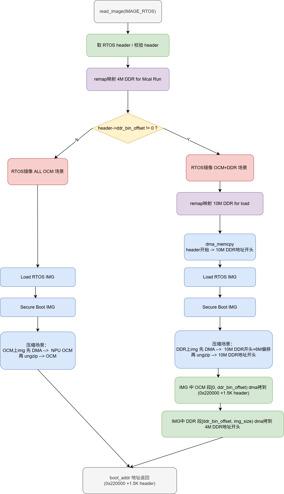
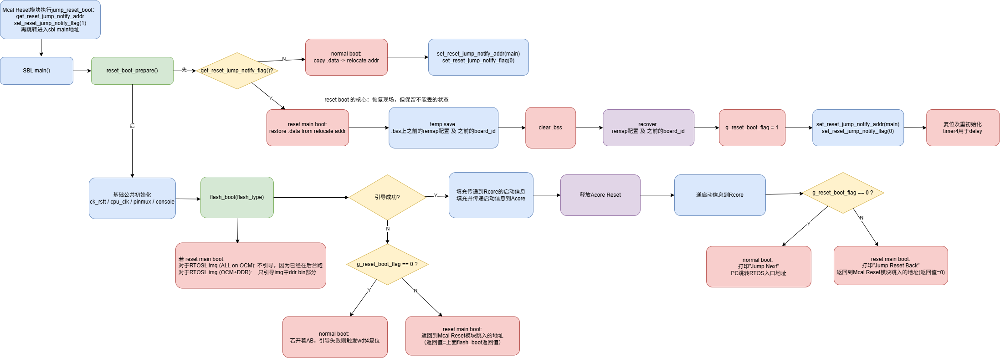

# M57 SBL启动特性介绍

> 来源：M57 SBL启动特性介绍

## 1. SBL中AB管理特性

### 1.1 介绍

本章节主要描述 SBL 中的 AB 管理逻辑，不涵盖 OTA 部分。

SBL AB 管理是启动链路里的 slot 状态桥接层。ROMCode 先按 reset-retained register 拿到 slot，选择第一级 boot 镜像；SBL 再读取 Android AB metadata，判断持久状态真正应启动哪个 slot。如果两者不一致，SBL 通过 `safety_abc_setup()` 更新 `SW_DATA0`（ROM slot 信息在这里），然后触发 WDT reboot，让下一轮 ROMCode 从正确 slot 起。

#### ROM 选 slot

1. 读取 `SW_DATA0`。
2. 如果 `BOOT_STAT=1`，说明上一轮启动没有被后级清零，认为上一轮未完成。
3. 切换到另一个 slot。
4. 递增 `BOOT_ERR_TIMES`。
5. 如果失败次数超过阈值（`>1`），停止继续自动切换，进入 download/sdboot 等恢复路径。
6. 如果仍可尝试，设置 `BOOT_STAT=1`。
7. 按当前 slot 读取第一级 boot 镜像并跳转。

#### SBL 读取介质中的 Android AB metadata 选 slot

1. 校验 AB metadata CRC。CRC 错误时重新初始化默认 AB metadata（这就是全擦烧写后，misc AB 信息首次赋值、初始化两 slot 初始次数为 7 的地方）。
2. 跳过 `verity_corrupted=1` 的 slot（目前 AX 没用）。
3. 跳过 `tries_remaining=0` 的 slot（即 unbootable slot）。
4. 优先选择 `priority` 更高的 slot（例如 OTA 标记的 active slot 的 `priority` 会高于对面 slot，优先选择 active slot）。
5. 同优先级下，选择 `successful_boot` 更高的 slot（当前 slot 启动到内核启动阶段打印 `Slot $slot marked as successful.` 后，slot 就 `successful_boot=1`）。
6. 再同等时，选择 `tries_remaining` 更高的 slot。
7. 如果选中的 slot 尚未 `successful_boot`，则递减 `tries_remaining`。

SBL 发现 ROM slot 和介质 Android AB metadata 的 slot 不一致时，行为见 [1.2 AB 各场景说明](#12-ab各场景说明-对应客户问题faq-log)。

### 1.2 AB 各场景说明（对应客户问题 FAQ log）

#### 槽状态定义

槽（自己当前槽/对面槽）状态定义如下：

1. **出厂态**：原始槽状态，非成功态、非 active 态、非失败态。
2. **成功态**：当前槽启动到过内核阶段，打印如下日志后，被标记为启动成功槽：

   ```text
   Slot $slot marked as successful.
   ```

3. **active 态**：表示某个槽位已被标记（通过 OTA 方式标记对面槽）为下次启动的优先选择，但尚未成功启动过。
4. **失败态**：不可启动槽，槽重试次数用完后会被标记为 unbootable slot。

#### AB 状态转换场景

| 设备生命阶段 | 状态转换标号 | 启动过程异常断电场景 | 启动过程异常软复位场景 |
| --- | --- | --- | --- |
| 出厂前 | S1 | 自己是出厂态、对面是出厂态：失败则变砖（AB 交叉启动）；成功到 S2。自己是 A，成功到 S2；失败 7 次（FAQ log0）后直接 AB 都不可用，变砖（FAQ log2）。自己是 B 时同理。 | 自己是出厂态、对面是出厂态：失败则变砖（AB 交叉启动）；成功到 S2。自己是 A，成功到 S2；失败 7 次 ROM 44 s 超时（FAQ log1）后直接 AB 都不可用，变砖（FAQ log2）。自己是 B 时同理。 |
| 出厂后、OTA 前 | S2 | 自己是成功、对面是出厂状态。自己是 A，成功还是 S2，失败一直在 A 复位；自己是 B，成功还是 S2，失败 1 次（FAQ log3）、无限次（因上下电，FAQ log4）一直在 B 复位。 | 自己是成功、对面是出厂状态。自己是 A，成功还是 S2，失败在 A 复位（上限 255 次，FAQ log4）；自己是 B，成功还是 S2，失败在 B 复位（1 次 FAQ log3，上限 255 次 FAQ log4）。 |
| OTA 后（3 种状态相互迁移出现） | S3.1 | 自己是 active、对面是成功。自己是 A，成功到 S3.3；失败 7 次槽次数用完，第 8 次用 FAQ log3 切 B 到 S3.2。自己是 B，成功到 S3.3；失败 1 次（FAQ log3）、6 次（FAQ log6）切 A 到 S3.2。 | 自己是 active、对面是成功。自己是 A，成功到 S3.3；失败 7 次（FAQ log6）切 B 到 S3.2。自己是 B，成功到 S3.3；失败 1 次（FAQ log3）、6 次（FAQ log6）切 A 到 S3.2。 |
| OTA 后 | S3.2 | 自己是成功、对面是失败。自己是 A，成功还是 S3.2，失败一直在 A 复位；自己是 B，成功还是 S3.2，失败 1 次（FAQ log3）、无限次（因上下电，FAQ log4）一直在 B 复位。 | 自己是成功、对面是失败。自己是 A，成功还是 S3.2，失败在 A 复位（上限 255 次，FAQ log4）；自己是 B，成功还是 S3.2，失败在 B 复位（1 次 FAQ log3，上限 255 次 FAQ4）。 |
| OTA 后 | S3.3 | 自己是成功、对面是成功。自己是 A，成功还是 S3.3，失败一直在 A 复位；自己是 B，成功还是 S3.3，失败 1 次（FAQ log3）、7 次（FAQ log5）切 A 到 S3.2。 | 自己是成功、对面是成功。自己是 A，成功还是 S3.3，失败 7 次（FAQ log5）切 B 到 S3.2；自己是 B，成功还是 S3.3，失败 1 次（FAQ log3）、7 次（FAQ log5）切 A 到 S3.2。 |

#### 客户问题 FAQ log

| 客户问题 FAQ log | 细化 log | 解释：为什么会出这日志 |
| --- | --- | --- |
| FAQ log0 | `Do not switch Safety abc. Rebooting...` | 1）出厂前，自己是出厂态、对面是出厂态，自己是 A/B，启动过程异常断电场景。 |
| FAQ log1 | `€€€€€€€€€€€€€€€€€€€€€€€€€€€€€€€€` | 1）出厂前，自己是出厂态、对面是出厂态，自己是 A/B，启动过程异常软复位场景。 |
| FAQ log2（最常见） | `unbootable slot 0 tries: 0, corrupt: 0 unbootable slot 1 tries: 0, corrupt: 0 Wrong slot (ret = -22) Boot Slot: Unknown android_ab_manage failed:-24 boot_process failed: ret -24, flash_type 0x0, slot 0x0` | 1）出厂前，自己是出厂态、对面是出厂态，自己是 A/B，启动过程异常断电场景（槽可用次数都耗光后会打印这个）。<br>2）出厂前，自己是出厂态、对面是出厂态，自己是 A/B，启动过程异常软复位场景（槽可用次数都耗光后会打印这个）。 |
| FAQ log3 | `Firstly try to switch safety abc from %d to %d. Rebooting...` | 1）出厂后、OTA 前，自己是成功、对面是出厂状态，自己是 B，启动过程异常断电场景。<br>2）出厂后、OTA 前，自己是成功、对面是出厂状态，自己是 B，启动过程异常软复位场景。<br>3）OTA 后，自己是 active、对面是成功，自己是 A，启动过程异常断电场景。<br>4）OTA 后，自己是 active、对面是成功，自己是 B，启动过程异常断电场景。<br>5）OTA 后，自己是 active、对面是成功，自己是 B，启动过程异常软复位场景。<br>6）OTA 后，自己是成功、对面是失败，自己是 B，启动过程异常断电场景。<br>7）OTA 后，自己是成功、对面是失败，自己是 B，启动过程异常软复位场景。<br>8）OTA 后，自己是成功、对面是成功，自己是 B，启动过程异常断电场景。<br>9）OTA 后，自己是成功、对面是成功，自己是 B，启动过程异常软复位场景。 |
| FAQ log4 | `Loop slot%d to limit %d, so stop boot and wait for troubleshooting Loop slot %d, current cnt %d Remaining tries for Slot %d: %d Decrement the remaining tries (%d --> %d) for Slot %d. Rebooting...` | 1）出厂后、OTA 前，自己是成功、对面是出厂状态，自己是 B，启动过程异常断电场景。<br>2）出厂后、OTA 前，自己是成功、对面是出厂状态，自己是 A，启动过程异常软复位场景。<br>3）出厂后、OTA 前，自己是成功、对面是出厂状态，自己是 B，启动过程异常软复位场景。<br>4）OTA 后，自己是成功、对面是失败，自己是 B，启动过程异常断电场景。<br>5）OTA 后，自己是成功、对面是失败，自己是 A，启动过程异常软复位场景。<br>6）OTA 后，自己是成功、对面是失败，自己是 B，启动过程异常软复位场景。 |
| FAQ log5 | `Remaining tries for Slot %d: %d Decrement the remaining tries (%d --> %d) for Slot %d. Rebooting...` | 1）OTA 后，自己是成功、对面是成功，自己是 B，启动过程异常断电场景。<br>2）OTA 后，自己是成功、对面是成功，自己是 A，启动过程异常软复位场景。<br>3）OTA 后，自己是成功、对面是成功，自己是 B，启动过程异常软复位场景。 |
| FAQ log6 | `Forcefully switch safety abc from %d to %d. Rebooting...` | 1）OTA 后，自己是 active、对面是成功，自己是 B，启动过程异常断电场景。<br>2）OTA 后，自己是 active、对面是成功，自己是 A，启动过程异常软复位场景。<br>3）OTA 后，自己是 active、对面是成功，自己是 B，启动过程异常软复位场景。 |

## 2. SBL中引导 RTOS 镜像（OCM+DDR）特性

### 2.1 介绍

RTOS 镜像默认加载到 OCM；当 RTOS 镜像 header 里的 `ddr_bin_offset` 非 0 时，RTOS 镜像被 offset 拆为 OCM 段和 DDR 段。

正常 boot 下，SBL 对不同类型 RTOS 镜像的 load 行为如下图：



| SBL load 行为差量 | RTOS img（ALL ON OCM） | RTOS img（ON OCM + DDR） |
| --- | --- | --- |
| 触发条件 | `header->ddr_bin_offset == 0` | `header->ddr_bin_offset != 0` |
| remap 映射 | 只映射 4M DDR | 除了映射 4M DDR，还映射 10M DDR 用于 load |
| ungzip 差量 | 先放 NPU OCM 再解到 OCM | 10M DDR 中 4M 用于 gzip，先放到该 4M DDR，再解到开头 6M DDR |
| DDR 段 | 无 | `[ddr_bin_offset, img_size]` 搬到 4M DDR 地址开头 |

### 2.2 客户集成 RTOS（OCM+DDR）引导失败常见原因

| 常见客户问题情况 | 细节说明 |
| --- | --- |
| 1、ddr bin 没成功打进 RTOS img；2、RTOS img `header->ddr_bin_offset = 0` | 客户使用的工具链不一定是 SDK 的 armclang，需要参考 SDK 的方案声明 section，生成带 ddr bin 的 img，最后更新 `header->ddr_bin_offset`。 |
| 支持放 DDR 上的 bin 默认只支持 4M，超出的跑不起来 | 若超过 4M，需要调整：1）在 SBL 中修改 `SDK/SafetyIsland/board/include/sbl/sbl_demo.h` 各 remap DDR 区域映射配置；2）按扩大需求进一步调整 AUTOSAR 链接脚本中的 DDR 内存布局；3）对于新预留出的 DDR 内存空间，Acore 启动过程中需要保证没有使用，且在 Linux DTS 中设置 `reserved`。 |

## 3. SBL中复位 main 域特性

### 3.1 介绍

本章节描述复位 main 方案中 SBL 的相关特性。

SBL 中的复位 main 域特性用于 Rcore 侧在复位 main 域后重新引导拉起 Acore。

MCAL Reset 模块完成复位 main 动作后，再调用 `jump_reset_boot`，从而跳转进入 SBL main，后续的关键流程如下图：



| SBL load 行为差量 | normal boot | reset main boot |
| --- | --- | --- |
| `.data`/.bss 处理 | 直接使用，另会备份 `.data -> relocate addr` | 从 relocate 地址恢复 `.data`，清 `.bss`（除了 remap cfg/board id） |
| AB 管理策略 | 正常走 AB 流程，并通过 wdt4 处理 slot 不一致情况 | 不走 AB 流程（因为作为任务若发现 slot 不一致，没有复位纠正的能力），直接使用 MCAL 跳转前正常的 slot |
| 对于 RTOS img（ALL on OCM）引导策略 | 正常引导 | 不引导，因为 RTOS 正在后台运行，不应产生冲突 |
| 对于 RTOS img（OCM + DDR）引导策略 | 正常引导 | 只引导 img 中 DDR bin 部分，因为 img OCM 部分正在后台运行，不应产生冲突 |
| SBL 最后跳转处理（引导成功） | 打印 `Jump Next`，PC 跳转 RTOS 入口地址 | 打印 `Jump Reset Back`，返回到 MCAL Reset 模块跳入的地址（返回值为 0） |
| SBL 最后跳转处理（引导失败） | 若开着 AB，引导失败则触发 wdt4 复位 | 返回到 MCAL Reset 模块跳入的地址（返回值为上面 `flash_boot` 返回值） |

### 3.2 客户复位 main 失败：SBL 侧常见原因

| 常见客户问题情况 | 细节说明 |
| --- | --- |
| timer4 冲突 | MCAL 客户 GPT 也使用了 timer4，与 SBL reset main 阶段也会使用的 timer4 冲突。 |
| SBL 128K 内存没预留 | OCM 开头 128K 必须给 SBL 预留，AUTOSAR 环境不得复用。 |
| Reset 模块任务留的栈不够 | reset main 场景下，SBL 的栈复用 AUTOSAR 环境的栈（无论任务栈在 OCM 上还是 TCM 上，需至少预留 4KB）。 |
| ADC | MCAL 在运行 ADC 时，SBL reset main 不能再运行 ADC（目前主线代码已兼容，SBL reset main 时不运行 ADC）。 |

## 随包附件

以下流程图来自原页面，随技能包提供，正文通过相对路径引用，无需连接内网：

- [RTOS OCM+DDR 引导流程](m57_sbl_assets/rtos_ocm_ddr_boot.png)：原附件 `21.png`，版本 `2`。
- [复位 main 引导流程](m57_sbl_assets/reset_main_boot.png)：原附件 `31.png`，版本 `1`。

原页面的 draw.io 源文件及其他截图未纳入本技能包。

