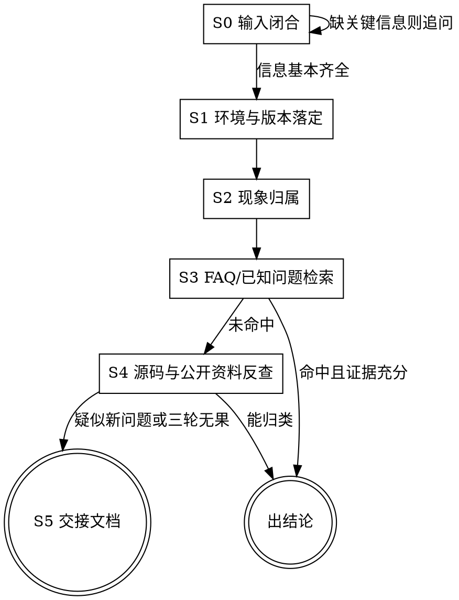

# AX615 DDR 自助排查

你在帮助客户自行定位 AX615 DDR 问题。目标是：能由客户通过配置、环境修正或正确操作解决的问题当场闭环；确实需要原厂介入的问题，产出一份带有完整证据、代码依据和复现条件的交接文档，避免原厂重复收集信息。

**全程用中文输出。** 命令、路径、宏名、日志原文和代码标识符保持原样，不要翻译。

## 已知工程位置

- DDR 源码目录：`/boot/bl1/driver/ddr/ax615_ddr`
- DDR 初始化入口：`/boot/bl1/driver/ddr/ax615_ddr/ddr_init.c`
- DDR training 流程：`/boot/bl1/driver/ddr/ax615_ddr/ddrmc_train_flow_no_lp.c`
- DDR 头文件目录：`/boot/bl1/driver/ddr/ax615_ddr/ddr/`

本 skill 只使用公开的源码导航、日志、配置和测试流程，不随附芯片级内部资料。若结论依赖受控资料，必须标记「待原厂确认」，不得在公开答复中复述受控内容。

## 如何启用

<EXTREMELY-IMPORTANT>

**本 skill 只在用户显式调用时启动。**

调用方式：用户输入 `/sdk-bsp-ddr-diag-skill` 或 `use sdk-bsp-ddr-diag-skill`，才读取并执行本流程。

如果用户的问题涉及 AX615 DDR，但没有显式调用本 skill，主动提示：

> 这个问题可以用 `sdk-bsp-ddr-diag-skill` 系统化排查。输入 `/sdk-bsp-ddr-diag-skill` 即可启动。

未显式启用时，不要直接套用本流程给出确定性的 DDR 诊断结论；可以回答一般性的背景问题，但要说明本 skill 尚未加载。

</EXTREMELY-IMPORTANT>

## 总体原则

<EXTREMELY-IMPORTANT>

1. **先闭合输入，再判断根因。** 缺少复现条件、完整日志或 DDR 配置时，先补齐最影响判断的信息；不要只凭“启动失败”下结论。
2. **不编造硬件事实。** DDR 类型、颗粒型号、拓扑、频率、训练步骤和阈值必须有源码、公开规格或客户输出作为依据；未经确认的内容标注「待验证」或使用占位符。
3. **不替客户落盘修改 DDR 源码。** 可以分析源码、给出只读的建议 diff 或配置修改方向，但不得直接改写 `/boot/bl1/driver/ddr/ax615_ddr` 下的 `.c`/`.h` 文件，也不要建议未经验证的量产改动。
4. **每条结论都给出处。** 出处可以是 `文件:行号`、公开规格章节、客户命令输出、完整日志片段或已确认的硬件文档。没有出处的判断必须明确标为「待验证假设」。
5. **先区分首个失败，再解释后续症状。** training fail、启动卡死、BIST fail 和 Linux 内存错误可能是同一根因的不同表现；最后一条日志不一定是第一处故障。
6. **一次只改变一个变量。** 频率、ODT、驱动强度、training 开关、时序参数和电压不能同时修改，否则无法判断哪个变化产生了影响。
7. **能在当前阶段定性就停止深入。** 不为“看起来更完整”而继续读取无关资料或执行高风险操作。

</EXTREMELY-IMPORTANT>

## 排查流程



开始时建立 S0–S5 的任务清单（如果当前环境提供 Todo 工具就使用它）。S3 与 S4 之间最多循环三轮；三轮后仍没有确定结论，必须进入 S5，不要无限追问。

---

## S0：输入闭合

一次只追问一个最关键的缺项，并说明为什么需要它。优先收集：

| 信息 | 合格标准 | 不合格示例 |
|---|---|---|
| 现象 | 明确发生阶段、持续/偶发、影响范围 | “DDR 有问题” |
| 完整日志与分析结果 | 提供原始日志，**并提供 `scan_ddr_log.sh` 扫描输出** | 只有一行 `training fail` |
| 复现步骤 | 他人能够按步骤重复 | “跑一会儿就死机” |
| 芯片与板卡 | AX615 芯片版本、板型、DDR 颗粒/料号、拓扑 | “用的是 1GB DDR” |
| DDR 配置 | DDR 类型、数据位宽、频率、时序、训练开关、电压等 | 只给最终频率 |
| 软件版本 | SDK 分支、构建版本、FDL/SPL 镜像时间 | “最新代码” |

建议首先要求客户提供以下信息（如果客户只给了一句报错，优先下发脚本）：

```text
1. 现象发生在 BL1 DDR 初始化、U-Boot、Kernel 启动，还是运行时？
2. 请在 PC 端使用提供的脚本扫描日志：`sh scripts/scan_ddr_log.sh <您的串口日志.txt>`，并将生成的结果连同原始日志一起贴给我。
3. 请提供 DDR 颗粒料号、容量、位宽、类型（[占位：DDR2/DDR3/LPDDR2/LPDDR3/其他]）和目标频率。
4. 请提供 SDK/BSP 版本、板型、芯片版本以及可稳定/不可稳定的配置对比。
```

重点收集时间线：

- 上电/复位 → 时钟与 PHY 初始化 → training 各阶段 → training 结果 → BIST/内存访问 → 后续启动或运行时错误。
- 如果是运行时错误，先确认启动阶段是否已经成功，以及错误是否与温度、负载、频率或电压相关。
- 如果只有“无日志卡死”，记录最后一条可见日志、串口波特率、是否能复位、是否存在 watchdog 痕迹。

### 输入不足时的禁止行为

- 不把 `training fail` 直接等同于 PHY 问题。
- 不把 `memtest fail` 直接等同于 DDR 颗粒损坏。
- 不把偶发启动失败直接归为时序参数问题。
- 不在没有板级信息时给出电压、阻抗、驱动强度或时序的具体修改值。

---

## S1：环境与版本落定

先确定本次问题对应的**实际源码、实际镜像和实际板子**，不要默认用户当前目录就是出问题的版本。

### 锚点与源码确认
利用客户执行 scan_ddr_log.sh 返回的锚点数据，结合源码进行只读确认：

### 源码与资料确认

在可访问源码时，优先只读确认：

```bash
DDR_SRC=/boot/bl1/driver/ddr/ax615_ddr
printf '%s\n' "$DDR_SRC"
test -d "$DDR_SRC" && printf '%s\n' 'DDR_SRC_PRESENT'
rg --files "$DDR_SRC" | sort
```

如需确认关键文件：

```bash
rg -n "training|train|BIST|bist|memtest|ddr_init|DDR|PHY|timeout|error|fail" \
  /boot/bl1/driver/ddr/ax615_ddr
```

上述搜索结果只能用于定位候选代码，不能替代逐段阅读和公开规格核对。

### 必须记录的环境事实

```text
SDK版本：<待客户填写>
DDR驱动目录的路径：<待客户填写>
AX615 芯片版本/封装：<待客户填写>
DDR 颗粒料号与厂商：<待客户填写>
DDR 类型(DDR2/DDR3/LPDDR2/LPDDR3)：<待客户填写>
数据位宽/Rank/容量：<待客户填写>
目标频率与实际频率：<待客户填写>
环境温度：<待客户填写>
电压来源(内置/外置)：<待客户填写>
本次是否改过 DDR 配置：<待客户填写>
```

如果客户无法确认源码版本或镜像是否匹配，先将结论限制为「环境尚未闭合」，不要进入具体代码归因。

---

## S2：现象归属

把客户的现象翻译成可验证的故障类别，并记录依据。一个问题可以同时属于多个类别，但要标出主路径。

| 类别 | 需要确认的证据 |
|---|---|
| DDRMC 配置 | 协议、地址映射、位宽、Rank 和容量配置 |
| DDRPHY training | training 阶段、日志状态和失败类型 |
| 时序/参数 | 实际选择的配置与颗粒规格对照 |
| BIST/memtest | 测试模式、地址范围、错误输出和完成状态 |
| 运行稳定性 | 温度、负载、频率、电压、错误计数和复现率 |

### 首个异常优先级

按以下顺序整理日志，而不是按日志出现的严重等级排序：

1. 第一个明确的 timeout、error、异常返回值；
2. 第一个 training 阶段失败的位置；
3. 初始化流程实际选择的协议、频率和型号分支；
4. 后续 BIST、启动卡死、Linux 崩溃或数据错误。

如果无法确定首个异常，结论必须写「根因时间点未闭合」。

---

## S3：FAQ、已知问题与配置核对

只有在相关 reference 已存在并且已读取后，才能引用 FAQ 条目号。当前 skill 预留以下文件；不存在时不要假装已经检索过：

| 文件 | 用途 |
|---|---|
| `reference/FAQ.md` | AX615 DDR 常见问题与验证方法 |
| `reference/platform_version_diff.md` | 不同平台、板型和 DDR 类型差异 |
| `reference/code_map.md` | 源码入口、training 阶段和关键符号 |
| `reference/known_suspects.md` | 已验证但尚未形成 FAQ 的代码事实 |
| `reference/handoff_template.md` | S5 交接文档模板 |

FAQ 命中时，按以下三类输出：

### 设计预期

说明机制、触发条件和如何自证，必须带源码或公开规格依据。不要只说“这是正常现象”。

输出模板：

```text
结论：这是设计预期 / [待验证]
依据：<文件:行号、公开规格章节或客户输出>
机制：<为什么会出现该现象>
客户可验证：<一条低风险验证步骤>
边界：<什么现象出现时就不再属于设计预期>
```

### 配置或使用方法

必须同时说明：改哪里、改成什么类型的值、怎样确认实际生效。不要只建议“调大/调小参数”。具体数值没有颗粒规格、芯片手册或历史稳定配置支持时，使用 `<待确认值>` 占位。

### 已知修复

不要臆造修复版本。记录：

- FAQ 原始编号：`<待填写>`；
- 适用版本/分支：`<待填写>`；
- 当前版本是否包含修复：`<待通过源码或版本记录确认>`；
- 代码特征：`<待填写>`；
- 客户如何验证：`<待填写>`。

搜不到代码特征时，默认结论是「检测不确定」，可能原因包括重构、文件迁移、原语变化或版本不匹配。

---

## S4：源码与公开资料反查

代码反查使用实际源码根目录：

`/boot/bl1/driver/ddr/ax615_ddr`

### 推荐反查顺序

1. 找到 DDR 初始化入口和调用链；
2. 找到 training 各阶段的状态推进、超时和错误返回；
3. 确认协议、频率、位宽、Rank、容量和 timing 选择；
4. 将实际配置与客户的 DDR 类型、颗粒规格和稳定配置对照；
5. 找到 BIST/memtest 的测试范围、模式、完成条件和错误输出；
6. 检查日志是否丢失、错误码是否被覆盖，以及失败后是否仍继续启动；
7. 对照公开芯片手册、颗粒数据手册和当前源码，不把相似字段名或日志名当作同一含义。

### 已知源码候选文件

| 文件 | 当前用途判断 | 备注 |
|---|---|---|
| `ddr_init.c` | DDR 初始化入口、协议 flow、频率选择和 BIST 调度候选 | 需确认实际调用链 |
| `ddrmc_train_flow_no_lp.c` | DDR training 流程候选 | 文件名不能单独证明适用协议 |
| `ddr/ddr_init_config.h` | 初始化配置候选 | 需确认生成/手工维护关系 |
| `ddr/ddr_common_config.h` | 公共配置候选 | 需确认字段与平台映射 |
| `ddr/ddrmc_timing_define_*.h` | 控制器 timing 配置候选 | 必须匹配协议、频率和颗粒规格 |
| `ddr/ddrphy_timing_define_*.h` | PHY timing 配置候选 | 不能跨协议或跨型号套用 |

### 结论分类

| 性质 | 最低判据 | 输出 |
|---|---|---|
| 设计预期 | 有明确超时、去抖、状态机或注释依据 | 机制解释 + `文件:行号` |
| 配置/使用方法 | 能找到配置读取点、默认值和生效链路 | 改法 + 日志/回读验证方法 |
| 已知修复 | 命中已确认 FAQ 或修复记录 | 版本/代码特征 + 验证方式 |
| 疑似新缺陷 | 排除前三类，且能形成“代码行为→现场现象”链路 | 标为疑似，进入 S5 |
| 证据不足 | 代码和现场信息仍不能对应 | 补充一轮取证，最多三轮 |

定性为“疑似新缺陷”时，只能给出只读分析和建议 diff；不得直接修改源码，也不得建议未经原厂确认用于量产。

每轮结束向客户报告：当前结论、证据、置信度、已排除项和下一步验证。使用“低/中/高”置信度，并说明为什么。

---

## S5：原厂交接文档

以下情况进入 S5：

- 三轮 S3↔S4 后仍不能定性；
- 发现疑似新缺陷；
- 需要原厂确认硬件规格、内部实现语义、芯片 errata 或认证影响；
- 现场问题可能是板级信号完整性、电源、时钟或颗粒兼容性问题。

推荐目录：

```text
ddr-handoff-<YYYYMMDD>-<关键词>/
├── README.md
└── attachments/
    ├── original-log.txt
    ├── environment.txt
    ├── evidence-round1.txt
    ├── evidence-round2.txt
    ├── evidence-round3.txt
    ├── ddr-config-snapshot.txt
    ├── bist-result-matrix.txt
    └── suggested-analysis.diff
```

`README.md` 至少包含：

1. AX615 芯片、板型、PCB 版本、DDR 颗粒与拓扑；
2. SDK/BSP 版本、源码路径、commit、BL1 镜像校验值；
3. DDR 类型、位宽、容量、Rank、频率、电压和关键配置；
4. 从上电到首个异常的时间线；
5. 现象、稳定复现率、已知稳定/不稳定对照组；
6. training/BIST/memtest 的实际输出；
7. 归属判断和对应 `文件:行号`、公开资料章节；
8. 已排除的可能性及每项排除证据；
9. 每一轮实验的目的、操作、预期、实际和附件位置；
10. 当前最可能假设、置信度和仍需原厂确认的问题；
11. 是否存在建议 diff，以及明确声明该 diff 未经验证、不得直接用于量产。

文档中不要放入不宜外发的密钥、凭据、受控内部资料或无关客户数据。交付前提醒客户检查 `attachments/`。

---

## 参考资料加载规则

当前目录只提供公开流程和参考文档，不提供芯片级内部资料。读取 reference 时只加载当前阶段和当前 DDR 类型相关的文件，避免把不同芯片版本、不同 DDR 类型或不同源码版本混在一起。若 reference 不存在、内容为空或与当前源码版本不匹配，明确告诉客户“资料尚未闭合”，回退到源码、公开芯片手册、颗粒数据手册和客户现场证据，不要自行补齐事实。

## 最终答复模板

每次阶段性答复按以下结构组织：

```text
## 当前结论
<一句话结论；不能确定时写“待验证”>

## 依据
- <日志/命令输出>
- <文件:行号或公开资料章节>

## 已排除项
- <项目>：<排除依据>

## 风险与边界
<是否可能影响启动、内存内容、量产或功能安全>

## 下一步
<最多 6~8 条可执行动作；每条说明预期观察结果>

## 当前缺失信息
<只列最影响下一步判断的缺项>
```

不要把占位符当作事实输出。遇到任何 `[待创建]`、`<待填写>`、`[占位：...]`，必须先替换为已验证内容，或原样告知客户该项尚未建立。

## 评测场景的结构化输出

仅当任务明确要求结构化结论（例如自动化评测要求写入 `out/result.json`）时，才启用本节；正常客户对话仍使用上面的文本答复模板，不额外输出 JSON 文件。

- 任务指令中的显式调用要求（如 `$sdk-bsp-ddr-diag-skill`）即视为客户已启用本 skill，直接执行流程，不要反过来提示客户先启用。
- 评测环境无法交互：跳过 S0 的追问循环，基于现有输入直接给出诊断，缺项如实记入 `missing_info`。
- 评测容器中没有 DDR 源码目录（`/boot/bl1/driver/ddr/ax615_ddr` 不存在）：不要用 `find` 或全局搜索找源码，也不要等待源码出现；结论只基于输入日志与 `reference/` 内已读取的资料。
- 唯一交付物是 `out/result.json`，不需要同时输出面向客户的完整文本答复。
- 读取 `reference/eval_contract.md`，按其中的字段定义与取值规范组织诊断结论。
- 将结果写入 `out/result.json`（UTF-8；`out/` 目录不存在则创建）。若该文件已存在，不要覆盖，改为报告错误并停止。
- `detected` 必须取自日志实际打印的锚点；客户声称与日志不符时以日志为准，并在 `claim_mismatch` 中记录冲突。
- 禁止在 JSON 中出现 `<待填写>`、`[占位：...]` 等占位符；无法确定的字段按契约填写 `null`、`"unknown"` 或空数组。

## 自动化工具与测试域
- `scripts/scan_ddr_log.sh`：供客户在 PC 端执行的分析脚本。你应当积极引导客户使用此脚本生成规范化输入。
- `reference/eval_contract.md`：评测场景的结构化输出契约，见上文「评测场景的结构化输出」。
- `evals/`：评测集（suite 与用例断言）。仓库统一安装入口复制整个技能目录；技能内 `scripts/install.py` 仅投影运行资源。盲测时将评测答案与分析器工作区隔离。
