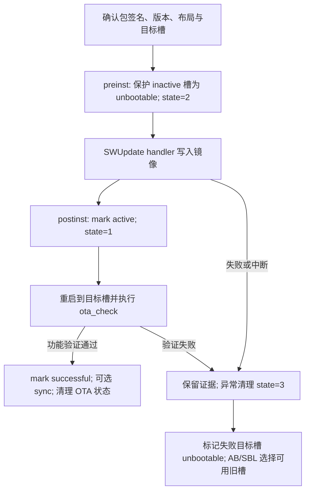

# M57 OTA 平台事实

本文件的公共部分供路由继承；Linux/QNX 共用 OTA 框架、状态机和排查方法，路径、工具、存储与部署实现按 OS 选择。历史客户案例只作为对应环境的取证线索。OS、PLAT 必须独立确认。文档代号通过选中平台的 reference 索引解析。

## 源码位置

以下为文档记录的 SDK 相对路径；当前目录不是 SDK 时，只提供定位入口，不声称已检查源码。实际 Git/repo 子仓库归属从目标工作区确定。

| 职责 | 入口 | 核对重点 |
|---|---|---|
| SWU 生成 | `build/scripts/ota/swu_make.sh`、`swugenerator/`、`ota_env.txt` | AXP artifact、变量替换、签名、差分旧基线 |
| 升级内容 | `build/scripts/ota/config/*/sw-description-source`、`custom_ota.sh` | A/B 对称、type/device、钩子顺序；目录名不一定等于 PLAT |
| 阶段脚本 | `build/scripts/ota/ota.sh` | preinst/postinst 与 BCB 状态推进 |
| QNX 部署 | `msp/sample/ota/Makefile`、`msp/sample/ota/swupdate/` | wrapper、cfg、handlers、utils、check、板端公钥部署 |
| Linux 部署 | Buildroot package、`build/scripts/init_scripts/`、platform overlay | 追踪覆盖顺序，检查最终 rootfs 内的有效脚本 |
| 存储抽象 | `get_part.sh`、`copy_part.sh`、`ota_erash`（Linux）/`ota_erase`（QNX） | `/dev/link`、layout、擦写复制返回值 |
| AB 依赖 | `abc`、`bcb`、`SafetyIsland/sbl/` | `misc/misc_bak`、slot 选择、tries；复杂启动问题交由可用的 `sdk-bsp-boot` |

## 核心知识

SWU 生成负责封包和签名；`swupdate.sh` 负责启动参数；SWUpdate core 负责验签、兼容性和调度；`swupdate_handlers.lua` 扩展 type；OTA 脚本推进阶段；AB/SBL 决定启动槽。新增镜像格式处理应放在 handler 层，不能塞入只负责状态推进的 `ota.sh`。



保护应覆盖所有会改写目标槽的 erase/write/copy 动作。文档示例中的 scripts 列表顺序不等于已证明实际执行时序；核对 core 调度和自定义 handler 是否在保护前擦除了目标槽。

| 状态 | 含义 | 判断边界 |
|---|---|---|
| BCB `stage=OTA` | OTA 流程有效 | 非 OTA 时检查脚本应退出 |
| `status=state:slot:sync:enable_resume:enable_sync` | OTA 阶段记录 | 不是 AB metadata |
| `state=2` | 写入或 copy 中 | 中断后目标内容不可信 |
| `state=1` | 已安装，等待首次启动验证 | 只能 active，尚非 successful |
| `state=3` | 失败清理路径 | 结合实际启动槽确定失败对象，保留旧 successful 槽 |
| `slot=0/1` | 目标槽 index | 调用 API 前区分 index 与 `A/B` 名称 |
| `sync=0/1/2` | 无复制/成功后同步/失败后恢复内容 | 不是 AB 选择或 rollback 标记 |
| `enable_resume` / `enable_sync` | 失败后恢复内容 / 成功后同步内容开关 | 不等于网络断点续传；默认值由目标生成脚本核实 |

AB metadata 的 active/successful/unbootable/tries、BCB OTA 状态和实际启动槽须分别读取。reset 不保证立即 rollback。失败恢复不能盲目把当前运行的旧成功槽标成 unbootable。

## 信息收集清单

按现象收集相关证据，不要求概念问答先回传整套日志。

- 环境：芯片/板型、SDK 分支/版本、Linux/QNX、`PLAT`、介质、AB 开关、当前/目标版本、定制 overlay。
- 包生成：AXP/SWU 的名称和 hash、`ota_env.txt`（脱敏）、`sw-description`、`OLD_AXP`/`rdiffbase`、签名和 compatibility 结果。
- 运行与启动：完整 SWUpdate 日志、BCB `stage/status`、AB metadata、实际 Main/Safety slot、从重启前到首次验证后的日志。
- 存储：`/dev/link` 映射、layout、擦除/写入/copy 输出；Linux 的 `/proc/mtd` 或 `/proc/ax_proc/emmc_partinfo`；QNX 的 `/proc/ax_proc/mtd`、`pted` 输出与 `slog2info`。
- 验证：最终 rootfs 的 `ota_check.lua` 与实际被调用的测试脚本、返回值、watchdog/reset 原因。只收公钥指纹与验证结果，不收私钥。

## 常见问题排查表

参考代号对应 来源代号表。FAQ 提供通用排查方法；具体根因、补丁与适用版本需结合目标 SDK 核实。

| 现象 | 可能根因 | 操作 | 环境与参考 |
|---|---|---|---|
| `SWUPDATE successful` 后认为可交付 | 混淆写入和验证完成 | 重启后查 ota_check 结果及 current slot successful | M57 Linux/QNX；F |
| 反复重启、reset 不切槽 | 目标标记、tries 或两域槽不一致 | 联查 BCB、AB metadata、实际槽和 SBL 日志 | M57 Linux/QNX；F |
| `state=1` 却业务失败 | 验证未执行或默认通过 | 检查最终验证脚本和返回值，不能提前 successful | M57 Linux/QNX；F、L、Q |
| 断电/断网后停在 `state=2` | 半写入或复制中断 | 保留日志，经实现的异常清理路径保护失败目标槽，再重新升级 | M57 Linux/QNX；F |
| `Partition check failed` | AXP/layout/语义映射不一致或混入可移动介质 | 对照旧 AXP、板端布局和 `/dev/link`，按匹配基线重新生成包 | M57 Linux；F |
| QNX mtdparts 不匹配 | 注册顺序或 ETFS/MTD 布局来源变化 | 查 `/proc/ax_proc/mtd`、pted、link；不用 Linux 编号推断 | QNX；F |
| `rdiff_image` 缺失/`RDIFF_BUFFER_SIZE` 断言 | handler 未启用、旧 artifact 不匹配或 buffer 限制 | 核对 rdiff feature、OLD_AXP、rdiffbase；不满足则重制或用完整包 | M57 Linux/QNX；F |
| UBI/ext4 差分不能还原 | 文件系统改写原始基线 | 按手册改用完整包，不对可写/UBI/ext4 做差分 | M57 Linux；M §11.3.6 |
| `0.3.10` 与 `0.13.0` 比较异常 | 字符串比较、后缀规则不一致 | 按数字段比较并明确 `_P1` 等规则；降级遵循项目策略 | M57 Linux/QNX；F |
| 换 key 后 SWU 验签失败 | 生成端、包签名、public.key、cfg 不配套 | 离线核对信任链，验签失败停止写入 | M57 Linux/QNX；F |
| SPL 损坏包无法启动 | 启动镜像校验失败，或失败标记不完整 | 查签名/checksum、失败槽 unbootable、旧槽 successful 和 tries | M57 Linux/QNX；F |
| Lua erase handler 参数错误 | 类型、scripts 顺序或平台工具混用 | 核对 erase/whitelist/blacklist 参数及非零错误传播 | M57 Linux/QNX；F |
| NAND 写失败、copy 失败 | 坏块、底层 erase/write 错误 | 查坏块扫描、返回值；Linux 下钻 MTD/UBI，QNX 下钻 ETFS/ax_mtd | M57 Linux/QNX；F |
| 同步空间不足 | 对侧容量或 copy 路径不匹配 | 查目标容量、link、copy_part.sh；与 AB fallback 分开定位 | M57 Linux/QNX；F |
| QNX ETFS 写入后损坏 | 512 字节通用写入破坏事务组织 | 使用匹配 ETFS data+spare/OOB 的镜像和 handler | QNX；F |
| 升级耗时长或外部 WDT 触发 | 擦除、IPC、copy、验证或 umount 阻塞 | 分阶段计时，结合 reset 原因定位，不直接关闭 watchdog | M57 Linux/QNX；F |

## 构建配置与验证

适用：M 的 Linux 使用说明 §11；QNX 共用生成架构来自 Q，但命令和构建目标须从 QNX 当前 SDK 核实。

## 基线与构建

先确定用户选择的 `PLAT`、OS、SDK revision、工具链、AB 配置、布局、当前/目标版本及安全策略。只在 SDK 具有这些 make 目标时使用以下 Linux 模板：

```sh
# 在 SDK 根目录执行；将 confirmed-plat 替换为已确认目标。
OTA_PLAT='confirmed-plat'
make -C build PLAT="$OTA_PLAT" all install axp
make -C build PLAT="$OTA_PLAT" swu
```

`swu` 消费 AXP 编译产物及信息，产物一般在 `build/out/<PLAT>/images/`。记录实际 AXP/SWU 路径和 hash；检查生成包的 sw-description 无未替换变量、artifact/哈希/签名齐全。不要根据文件时间自动挑“最新包”。签名通过需要验证输出，不是看到 `.sig` 就成立。

## 定制点

| 目标 | 文档入口/配置 | 验证点 |
|---|---|---|
| 选择分区 | `build/scripts/ota/config/*/sw-description-source` | 追踪 PLAT 到实际 config 的选择；A/B 对称，device 指向非活动槽 |
| 压缩 | `compressed = "zlib";` | 节省包体积但增加升级时间 |
| 写后回读 | `readback = "1";` | SDK 扩展行为，以 handler 支持为准；回读不代替首次启动验证 |
| 文件更新 | `type = "rawfile";` 与 `path` | 路径范围和共享文件的掉电一致性 |
| 差分 | `type = "rdiff_image";`、`rdiffbase`、`OLD_AXP` | 当前设备 artifact 与旧包一致，handler 已构建 |
| 成功后同步 | 构建 SWU 时 `SYNC=1` | 全量复制，覆盖旧槽且耗时；只在验证成功后进行 |
| 失败后内容恢复 | 构建 SWU 时 `RESUME=0` 关闭 | M 手册默认开启；Q 中 enable_resume 默认 1，enable_sync 默认 0；核对实际脚本 |
| 生命周期钩子 | `custom_ota.sh` 的 preinst/postinst/postfailure | 不替代基础保护与首次启动状态机，错误返回传播 |
| 首次业务验证 | 最终 rootfs 中 ota_check 调用的脚本 | M 为 custom_test.sh；L/Q 均为 axera_test.lua/sh；这是文档/版本差异，以调用链为准 |

差分包示例关系：目标 `/dev/link/ota_sbl_a` 的 `rdiffbase` 为当前 `/dev/link/ota_sbl_b`，反向块亦然。`OLD_AXP` 必须对应当前设备，不能只匹配版本字符串。M §11.3.6 明确可写、UBI、ext4 分区不可差分（包括只读挂载的相关文件系统镜像），改用全量更新。

仅在确认基线后的单次构建设置环境，避免污染后续任务：

```sh
OLD_AXP='/path/to/confirmed-old.axp' make -C build PLAT="$OTA_PLAT" swu
```

这是设置差分输入，不会自动把普通 type 改为 rdiff_image。

## 升级与验收

Linux 手册记录 `conf.d/10-mongoose-args` 的 `UPDATE_MODE`、`SWU_PATH`、`DEBUG_LEVEL`。核对最终 rootfs 的配置后，本地模式由 `/etc/init.d/S80swupdate start` 启动；web 模式访问板端 `:8080` 上传。这类操作会写板端镜像，只有任务包含实际升级且目标/包已确定时执行；概念问答或离线打包不自动执行。QNX 的 wrapper/cfg 另行核实，不能照搬 Linux init.d。

验收记录应包含：

1. 包输入、签名/兼容性、版本/layout 校验结果，当前槽和 inactive 目标槽。
2. 所有擦写前目标槽已受保护，错误可中止；安装完成只 active/state=1。
3. 重启后的实际槽、验证脚本及结果、AB successful、OTA 状态清理结果。
4. A→B 和 B→A 都可验证；开启 sync 时另查 copy 和对侧内容。文档称开启同步可能需要两次重启，不将一次重启作为通用成功标准。
5. 测试板负向场景：签名错误、布局不匹配、差分基线错配、断电中断、首次验证失败、copy 失败。检查保留旧可启动槽及恢复证据；故障注入需在用户授权的测试范围内进行。

新旧安全版本、签名链必须允许预期 fallback；不要为了让旧槽启动而关闭验签或防降级。OTA 版本检查与 Secure Boot 防回滚机制应分别核实。

## 与 U-Boot 升级的边界

M 的 U-Boot `axera_ota`、`ota_server_ip`、`ota_xml` 等 TFTP 升级是另一入口，不等同 Linux/QNX SWUpdate 生命周期。用户指定该入口时先读当前 U-Boot 实现和对应手册；`ota_repartition` 涉及分区改写，必须核对布局迁移及影响，不能因示例曾建议 enable 就自动设置。

来源代号及版本按选中平台的文档索引解析。

## Linux / QNX 环境差异
OS 从用户输入、构建配置、工具链和最终部署规则核实，不能从 SDK 路由单独判断。

### 环境矩阵

| 项目 | M57 Linux | M57 QNX |
|---|---|---|
| 依据 | 知识库 L + FAQ F + 使用说明 M | 知识库 Q + FAQ F |
| 生成入口 | `build/scripts/ota` | `build/scripts/ota` |
| 运行部署 | Buildroot + init_scripts + overlay | `msp/sample/ota/Makefile` 与 `swupdate/` |
| 擦除工具 | `ota_erash`，核对最终文件 | `ota_erase` |
| layout 证据 | `/proc/mtd`、`/proc/ax_proc/emmc_partinfo` | `/proc/ax_proc/mtd`、`pted`、`/dev/link` |
| 底层介质 | MTD/UBI/eMMC | ETFS/MTD、`/dev/emmc0.ms.N` |
| 取证 | 系统/SWUpdate 日志、SBL/Main/Safety | `slog2info`、SBL/Main/Safety |
| 首次验证入口 | L 为 `axera_test.lua/sh`；M 为 `custom_test.sh`，追踪最终调用 | Q 描述 `axera_test.lua` / `axera_test.sh` |

所有平台上层使用 `/dev/link/ota_*`。物理节点仅用于取证和适配层，不写死到业务升级逻辑。QNX ETFS 的 data+spare/OOB 与事务粒度不能用 Linux 裸 MTD 的写法替代。


### Linux 最终部署来源（L §3.3）

运行入口是 `rootfs/buildroot-2024.02.2/package/swupdate/swupdate.sh`，基础配置位于 board `fs-overlay/etc/swupdate.cfg`。这些是来源文档记录的路径，当前 SDK 仍须核对版本。

```text
Buildroot package + board fs-overlay
  -> build/scripts/init_scripts/initd
  -> build/scripts/init_scripts/rootfs_overlay
  -> build/scripts/init_scripts/platform/<PLATFORM>
  -> build/platforms/**/<PLATFORM>/rootfs_overlay
  -> final rootfs image
```

按 `build/scripts/package_rootfs.sh` 核对覆盖顺序：公共 `init_scripts/rootfs_overlay/usr/lib/swupdate/` 中的 `ota_utils.lua`、`get_part.sh`、`copy_part.sh` 会覆盖 board 同名文件；`init_scripts/initd/S79ota_check` 覆盖 board 启动脚本。L 记录 `ota_check.lua` 仍来自 board overlay，平台 overlay 可继续覆盖。wrapper、handler 和 binary 主要由 package 安装，最终也要检查覆盖源。

定位或修复板端行为前先确定最终有效文件，不能只修改随后被覆盖的 board 副本。上述顺序属于 Linux 部署差异；首次验证、BCB 状态和 fallback 的共用契约见核心知识。

## 开发落点

- 新增 sparse/格式解析等写入能力：在 `swupdate_handlers.lua` 注册适当 type，并验证 core 注册/调度及错误返回；必要时调用匹配的底层工具。
- 修改包内容：在选中配置的 `sw-description-source` 同步修改 A/B。新增分区同时核对 `_a/_b`、`/dev/link/ota_*_a/b`、layout、erase、copy、`misc/misc_bak` 访问。
- 修改生命周期：检查 `ota.sh`、`ota_utils.lua`、`ota_check.lua`，区分 AB 调用时机与 AB 内部算法。
- Linux 脚本修复：追踪 package → init_scripts → overlay → 最终 rootfs；不能只修改随后会被覆盖的源文件。
- QNX 部署修复：从 `msp/sample/ota/Makefile` 核实 `/usr/lib/swupdate`、handler、擦除工具和验签材料实际安装位置。

L/Q 均描述缺少测试脚本时默认验证通过；这是实现行为，不是业务验收。检查有效脚本是否存在、是否执行及返回值是否传播。L/Q 均说明 `postfailure()` 不承载核心恢复，应核对重启后的 `ota_check.lua` 异常清理，不能假定钩子自行完成回滚。

## 只读取证模板

先核对工具 `-h` 与 link 是否存在。以下源自 M §11.6；QNX 仅在当前版本接口匹配后使用。

```sh
ls -l /dev/link
abc -h
bcb -h
abc -d /dev/link/misc -d /dev/link/misc_bak -S -p
abc -d /dev/link/misc -d /dev/link/misc_bak -S -c
bcb -d /dev/link/misc -d /dev/link/misc_bak -p stage
bcb -d /dev/link/misc -d /dev/link/misc_bak -p status
```

保留原始输出，不为获得“干净状态”先清 BCB。恢复操作应通过当前平台已核实的状态脚本或 AB 工具进行，先确定失败 target index，避免把正在救援的旧 successful 槽禁用。

来源代号及版本按选中平台的文档索引解析。

## 限制与约束

- 本流程使用 A/B 系统方案；文档“不支持 recovery 方案”指独立 recovery 系统方案，不排斥 OTA 失败后的分区内容恢复。
- 单分区、文件升级、擦除名单可能涉及共享数据；先检查范围，不能把“有 AB”解释为任意文件操作均掉电安全。
- `RESUME` 表示失败后内容恢复；默认网络断点续传能力不能由该变量推断。`SYNC=1` 会覆盖旧槽内容，要在新槽真实验证通过后才同步。
- 手册的 `custom_test.sh` 与 Linux/QNX 知识库的 `axera_test.lua/axera_test.sh` 存在版本差异，先追踪实际调用链。缺少验证脚本而默认成功不能证明业务已验证。
- 涉及 Secure Boot/eFuse 的独立配置使用可用的 `sdk-bsp-secure-boot`；本 skill 核对 OTA 信任链，不把关闭验签当修复。


## Sources

按选中平台 reference 索引加载文档；M57 的入口为 [reference/m57/_index.md](../reference/m57/_index.md)。
