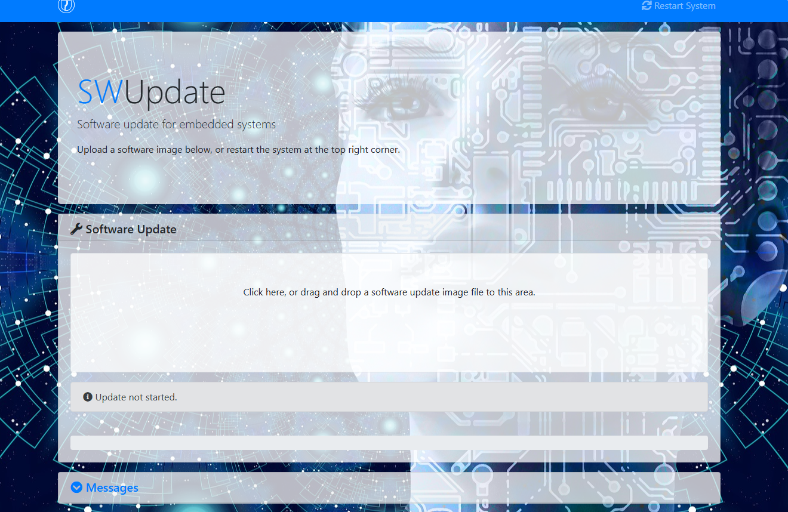

# M57 SDK OTA 使用说明（第 11 章摘录）

来源：对应平台《AX SDK 使用说明》的 OTA 章节，内容已随本技能独立提供；SDK 文档版本未明确。摘录日期：2026-10-08。两平台原手册独立，保留各自章节，不以一份替代另一份。

## 11. OTA升级使用说明

本章节主要介绍OTA升级功能的使用方法，以便用户在开发过程中了解升级的过程及注意事项。

### 11.1 概要说明

因为车载应用对系统可用性要求极高， OTA使用 A/B 系统方案，不支持 recovery 方案，爱芯 OTA

支持功能：

- RSA签名校验，默认使用和安全启动相同的密钥

- HASH校验

- 分区校验，分区不一致时阻止升级

- 软件版本校验

- 压缩

- 分区升级

- 文件升级

- 差分升级

- AB升级

- 升级失败回滚

- 镜像回读校验

- 升级前后执行用户自定义脚本

- 掉电安全

- 本地升级

- 网络升级

#### 11.1.1 AB 系统方案

AB 系统方案，是将原有的系统，增加一份。即flash 上总共有AB 两套系统。两套系统互相升级。OTA 时，若当前运行的是A 系统，则升级B 系统，更新完成后，设置标志，重启切换到B系统。OTA 时，若当前运行的是B 系统，则升级A 系统，升级完成后，设置标志，重启切换到A 系统。

若更新失败，正在运行的系统没有被破坏，系统还能正常运行。若更新完成，切换到新的系统，但更新的系统不可运行，RomCode 配合WDT切换回原来的系统。若更新完成，切换到新的系统，但更新的系统未通过测试，RomCode 配合OTA检查切换回原来的系统。

因为AB更新过程是在完整系统中进行的，更新期间可正常提供服务，用户无感知。最终做一次重启即可(开启同步需要两次)。系统的可用性高，停机时间短。

当前启动阶段的安卓AB管理有几个注意点，请留意：

1. 对于nor_emmc/only_emmc板级当前安卓AB管理还是在SPL，后续会保持一致也前移到SBL。

2. 对于nor_nand/only_nand板级，misc/misc_bak整个分区给SDK安卓AB管理使用。
对于其他板级，misc/misc_bak分区前256K给SDK安卓AB管理使用，用户自己若需要使用misc/misc_bak请从偏移256K开始使用。

#### 11.1.2 编译

在build目录下执行make PLAT=xxx all install axp生成axp文件，然后执行make PLAT=xxxx swu生成ota包，这一步会使用的axp的编译产物和信息。编译成功后会在build/ out/下生成 swu扩展名的升级包。

### 11.2 定制swupdate

### 11.3 定制升级包

build/scripts/ota/config/xxxx/sw-description-source文件描述了升级内容和动作，默认所有分区都进行完整升级，用户可修改此文件进行定制化升级。语法和行为源自开源swupdate，swupdate 将每个升级目标定义为一个工件，每个工件可以自由定义升级内容和类型，filename 是写入目标的文件，device是写入的目标。定制升级包后需要重新编译swu升级包。详细说明和用法见[swupdate 在线文档](https://sbabic.github.io/swupdate/swupdate.html)。默认 sw-description-source 如下：

```c
software =
{
version = "@@VERSION@@";
reboot = false;
hardware-compatibility: [ "1.0" ];
stable : {
A : {
```

## images: (

```c
{
filename = "sbl_signed.img";
device = "/dev/link/ota_sbl_a";
type = "raw";
compressed = "zlib";
#readback = "1";
properties: {
rdiffbase = ["/dev/link/ota_sbl_b"];
};
},
{
filename = "Mcal_Demo_signed.img";
device = "/dev/link/ota_rtos_a";
type = "raw";
compressed = "zlib";
#readback = "1";
properties: {
rdiffbase = ["/dev/link/ota_rtos_b"];
};
},
{
filename = "u-boot-spl_signed.img";
device = "/dev/link/ota_spl_a";
type = "raw";
#type = "rdiff_image";
compressed = "zlib";
#readback = "1";
properties: {
rdiffbase = ["/dev/link/ota_spl_b"];
};
},
{
filename = "u-boot.img";
device = "/dev/link/ota_uboot_a";
type = "raw";
compressed = "zlib";
#readback = "1";
properties: {
rdiffbase = ["/dev/link/ota_uboot_b"];
};
},
{
filename = "bl31.img";
device = "/dev/link/ota_atf_a";
type = "raw";
compressed = "zlib";
#readback = "1";
properties: {
rdiffbase = ["/dev/link/ota_atf_b"];
};
},
{
filename = "optee.img";
device = "/dev/link/ota_optee_a";
type = "raw";
compressed = "zlib";
#readback = "1";
properties: {
rdiffbase = ["/dev/link/ota_optee_b"];
};
},
{
filename = "kernel.img";
device = "/dev/link/ota_kernel_a";
type = "raw";
compressed = "zlib";
#readback = "1";
properties: {
rdiffbase = ["/dev/link/ota_kernel_b"];
};
},
{
filename = "rootfs.img";
device = "/dev/link/ota_rootfs_a";
type = "raw";
compressed = "zlib";
#readback = "1";
},
);
```

## scripts: (

```c
{
type = "erase";
properties: {
list = ["/dev/mmcblk0p4", "/dev/mmcblk0p6"];
skip = "1";
}
},
```

```bash
mkdir /whitelist_test;touch /whitelist_test/1 /whitelist_test/2 /whitelist_test/3 /whitelist_test/4
```

```c
{
type = "whitelist";
properties: {
path = "/whitelist_test";
list = ["/whitelist_test/1", "/whitelist_test/3"];
skip = "1";
}
},
```

```bash
mkdir /blacklist_test;touch /blacklist_test/1 /blacklist_test/2 /blacklist_test/3 /blacklist_test/4
```

```c
{
type = "blacklist";
properties: {
path = "/blacklist_test";
list = ["/blacklist_test/2", "/blacklist_test/4"];
skip = "1";
}
},
{
filename = "custom_ota.sh";
type = "shellscript";
},
{
filename = "ota.sh";
type = "lua";
},
);
};
B : {
```

## images: (

```c
{
filename = "sbl_signed.img";
device = "/dev/link/ota_sbl_b";
type = "raw";
compressed = "zlib";
#readback = "1";
properties: {
rdiffbase = ["/dev/link/ota_sbl_a"];
};
},
{
filename = "Mcal_Demo_signed.img";
device = "/dev/link/ota_rtos_b";
type = "raw";
compressed = "zlib";
#readback = "1";
properties: {
rdiffbase = ["/dev/link/ota_rtos_a"];
};
},
{
filename = "u-boot-spl_signed.img";
device = "/dev/link/ota_spl_b";
type = "raw";
#type = "rdiff_image";
compressed = "zlib";
#readback = "1";
properties: {
rdiffbase = ["/dev/link/ota_spl_a"];
};
},
{
filename = "u-boot.img";
device = "/dev/link/ota_uboot_b";
type = "raw";
compressed = "zlib";
#readback = "1";
properties: {
rdiffbase = ["/dev/link/ota_uboot_a"];
};
},
{
filename = "bl31.img";
device = "/dev/link/ota_atf_b";
type = "raw";
compressed = "zlib";
#readback = "1";
properties: {
rdiffbase = ["/dev/link/ota_atf_a"];
};
},
{
filename = "optee.img";
device = "/dev/link/ota_optee_b";
type = "raw";
compressed = "zlib";
#readback = "1";
properties: {
rdiffbase = ["/dev/link/ota_optee_a"];
};
},
{
filename = "kernel.img";
device = "/dev/link/ota_kernel_b";
type = "raw";
compressed = "zlib";
#readback = "1";
properties: {
rdiffbase = ["/dev/link/ota_kernel_a"];
};
},
{
filename = "rootfs.img";
device = "/dev/link/ota_rootfs_b";
type = "raw";
compressed = "zlib";
#readback = "1";
},
);
```

## scripts: (

```c
{
type = "erase";
properties: {
list = ["/dev/mmcblk0p4", "/dev/mmcblk0p6"];
skip = "1";
}
},
```

```bash
mkdir /whitelist_test;touch /whitelist_test/1 /whitelist_test/2 /whitelist_test/3 /whitelist_test/4
```

```c
{
type = "whitelist";
properties: {
path = "/whitelist_test";
list = ["/whitelist_test/1", "/whitelist_test/3"];
skip = "1";
}
},
```

```bash
mkdir /blacklist_test;touch /blacklist_test/1 /blacklist_test/2 /blacklist_test/3 /blacklist_test/4
```

```c
{
type = "blacklist";
properties: {
path = "/blacklist_test";
list = ["/blacklist_test/2", "/blacklist_test/4"];
skip = "1";
}
},
{
filename = "custom_ota.sh";
type = "shellscript";
},
{
filename = "ota.sh";
type = "lua";
},
);
};
};
}
```

### 11.3.1 AB升级

OTA默认开启AB升级，sw-description-source文件中分为两个大块，A块描述升级SLOT A内容，B块描述升级SLOT B内容，每次OTA只会使用其中一个块。用户修改sw-description-source文件时应该同步修改A和B。

#### 11.3.2 分区升级

sw-description-source默认升级所有系统分区，用户可以自行删减和添加分区来满足不同的升级需求。

#### 11.3.3 压缩

在升级工件描述节点添加compressed = "zlib";可以开启压缩功能，能够减小升级包大小，但会增加升级时间。

```c
{
filename = "sbl_signed.img";
device = "/dev/link/ota_sbl_a";
type = "raw";
compressed = "zlib";
},
```

#### 11.3.4 回读校验

在升级工件描述节点添加readback = "1";可以开启写入镜像后回读镜像校验写入镜像是否发生数据错误，但会增加升级时间。

```c
{
filename = "sbl_signed.img";
device = "/dev/link/ota_sbl_a";
type = "raw";
compressed = "zlib";
readback = "1";
},
```

#### 11.3.5 文件升级

把升级工件描述节点修改 type 为 rawfile，并添加path属性，可以将文件升级到path指定的路径。

```c
{
filename = "u-boot-spl_signed.img";
path = "/tmp/u-boot-spl_signed.img";
type = "rawfile";
compressed = "zlib";
},
```

#### 11.3.6 差分升级

执行export OLD_AXP="/path/xxx_1.0.0_20250318145237.axp"指定板级正在使用的镜像包，把升级工件描述节点修改 type 为 rdiff_image，添加 rdiffbase 属性指定镜像base，OLD_AXP和rdiffbase使用的镜像必须一致。

注意：可写分区、ubi、ext4分区不可差分，因为可写分区数据可能已经被改变，ubi、ext4分区会改变原始数据，添加文件系统管理数据（包括只读）。

```c
{
filename = "sbl_signed.img";
device = "/dev/link/ota_sbl_a";
type = "rdiff_image";
compressed = "zlib";
#readback = "1";
properties: {
rdiffbase = ["/dev/link/ota_sbl_b"];
};
```

## },

### 11.3.7 AB同步

执行export SYNC=1后重新编译swu，OTA升级成功后会将新分区的内容拷贝到老分区，同步是全量同步，时间较长，用户也可以再触发一次OTA来达到定制同步的效果。

#### 11.3.8 AB恢复

OTA升级失败后会将旧分区的内容拷贝到失败分区，恢复是全量同步，时间较长，用户也可以再触发一次OTA来重新升级。AB恢复默认开启，用户可以编译swu前执行export RESUME=0来关闭。

#### 11.3.9 升级前后执行自定义程序

修改 build/scripts/ota/config/xxx/custom_ota.sh脚本，preinst 函数在升级前调用，postinst函数在写镜像完成后调用，postfailure在写镜像失败后调用。

## #!/bin/bash

```bash
echo "custom ota"
```

```c
function preinst() {
```

```bash
echo "custom preinst"
```

```c
}
function postinst() {
```

```bash
echo "custom postinst"
```

```c
}
function postfailure() {
```

```bash
echo "custom postfailure"
```

```c
}
```

## case "$1" in

## "preinst")

## preinst

## ;;

## "postinst")

## postinst

## ;;

## "postfailure")

## postfailure

## ;;

## *)

```bash
echo "Error: Unknown parameter '$1', supports parameters: preinst/postinst/postfailure" >&2
```

## exit 1

## ;;

## esac

### 11.3.10 升级后执行自定义测试程序

支持升级后执行自定义测试程序验证升级镜像是否符合预期，测试不通过触发升级失败回滚。添加rootfs/buildroot-2024.02.2/board/axera/m57/fs-overlay/usr/lib/swupdate/custom_test.sh 脚本，脚本退出码为0表示测试通过，其他值表示测试失败。

#### 11.3.11 升级前擦除分区

在scripts节点中添加如下内容, list表示要擦除的分区，skip 表示是否跳过擦除

## scripts: (

```c
{
type = "erase";
properties: {
list = ["/dev/mtd1", "/dev/mtd3"];
skip = "1";
}
},
```

## )

### 11.3.12 升级前排除白名单删除

在scripts节点中添加如下内容, path表示要删除的目录，list表示要保留的文件，skip 表示是否跳过删除。

## scripts: (

```c
{
type = "erase";
properties: {
list = ["/dev/mmcblk0p4", "/dev/mmcblk0p6"];
skip = "1";
}
},
```

```bash
mkdir /whitelist_test;touch /whitelist_test/1 /whitelist_test/2 /whitelist_test/3 /whitelist_test/4
```

```c
{
type = "whitelist";
properties: {
path = "/whitelist_test";
list = ["/whitelist_test/1", "/whitelist_test/3"];
skip = "1";
}
},
```

```bash
mkdir /blacklist_test;touch /blacklist_test/1 /blacklist_test/2 /blacklist_test/3 /blacklist_test/4
```

```c
{
type = "blacklist";
properties: {
path = "/blacklist_test";
list = ["/blacklist_test/2", "/blacklist_test/4"];
skip = "1";
}
},
```

### 11.3.13 升级前按黑名单删除

在scripts节点中添加如下内容, path表示要删除的目录，list表示要删除的文件，skip 表示是否跳过删除

## scripts: (

```c
{
type = "erase";
properties: {
list = ["/dev/mmcblk0p4", "/dev/mmcblk0p6"];
skip = "1";
}
},
```

```bash
mkdir /whitelist_test;touch /whitelist_test/1 /whitelist_test/2 /whitelist_test/3 /whitelist_test/4
```

```c
{
type = "whitelist";
properties: {
path = "/whitelist_test";
list = ["/whitelist_test/1", "/whitelist_test/3"];
skip = "1";
}
},
```

```bash
mkdir /blacklist_test;touch /blacklist_test/1 /blacklist_test/2 /blacklist_test/3 /blacklist_test/4
```

```c
{
type = "blacklist";
properties: {
path = "/blacklist_test";
list = ["/blacklist_test/2", "/blacklist_test/4"];
skip = "1";
}
},
```

### 11.3.14 升级模式

rootfs/buildroot-2024.02.2/board/axera/m57/fs-overlay/usr/lib/swupdate/conf.d/10-mongoose-args 的UPDATE_MODE是升级模式配置，有本地和网络升级两种模式，SWU_PATH 是升级包路径。用户可根据需求进行修改。

#### 11.3.15 升级日志等级

rootfs/buildroot-2024.02.2/board/axera/m57/fs-overlay/usr/lib/swupdate/conf.d/10-mongoose-args 的DEBUG_LEVEL是升级日志等级配置，升级日志可以在/data/AXSyslog/`kernel/user.log`中查看。

### 11.4 升级方法

#### 11.4.1 本地升级

按上一节描述修改升级模块，执行/etc/init.d/S80swupdate start进行升级，升级完成后命令行执行reboot 重启系统。启动脚本会进行OTA检查等操作。

#### 11.4.2 web升级

开机自动执行/etc/init.d/S80swupdate start启动web升级界面，PC浏览器打开网页(板子IP:8080)，然后选择升级包上传，自动开始升级，升级完成后命令行执行reboot 重启系统。启动脚本会进行OTA检查等操作。



### 11.5 底层实现

swupdate负责获取镜像和更新镜像，爱芯将各种存储介质读写接口统一，生成了 /dev/link/ota_xxx 设备，swupdate 通过标准的 read/write 命令就可以读写存储介质。AB切换通过RomCode、WDT和安卓abc来控制，M57系统中的abc已经集成了RomCode控制部分，用户按照标准abc进行使用就能完成切换。M57 OTA通过安卓bcb在各级boot和AB系统间传递OTA信息。

#### 11.5.1 如何保证更新安全

1. 系统采用AB分区，永远只更新非活动分区，确保外部存储介质至少有一份能够正常运行的镜像。

2. AB切换

  1. RomCode 通过复位不丢失掉电丢失寄存器来选择分区，且具备启动失败自动切换分区功能。

  2. RomCode后级采用安卓abc/bcb方案，并添加备份机制，且充分预留坏块，确保更新abc时掉电安全和坏块安全。

3. 存储介质读写

  3. Nand flash 按照全生命周期2% 坏块率为每个分区充分预留坏块，降低因坏块导致镜像无法写入。

  4. Safety flash读写通过 virt mtd 设备进行读写，用户空间按照标准mtd设备使用，virt mtd 驱动通过RPMSG发送数据与safety flash驱动交互，实际读写操作由safety flash驱动进行。

4. OTA流程

  5. OTA不是原子操作，可能在任意阶段被打断，使用安卓bcb来标记OTA阶段，通过BCB标记检测OTA操作流程，被中断后可以进行处理或者恢复。

  6. 通过硬件WDT来检测镜像无法启动，配合RomCode自动进行AB切换。

  7. 通过OTA升级后检测来排查个别异常设备，确保更新镜像在具体设备上功能完好。

  8. 通过OTA检查来区分OTA状态，回滚更新失败设备。

#### 11.5.2 如何保证信息安全

将各个镜像的SHA256值写入 sw-description，对sw-description 进行RSA签名，然后把sw-description签名文件、sw-description、各个镜像传递给swupdate。

若RSA签名验证通过，说明 sw-description 文件是可信的，也没有被篡改，sw-description 文件中各个镜像的SHA256也是可信的，也没有被篡改。后续的镜像的完整性和可信性可以通过简单的SHA256来校验。

安全启动各级镜像也会进行校验，镜像签名和SHA校验不通过会阻止启动。

安全启动还会校验镜像版本，当前镜像版本小于安全存储版本时会阻止启动。

### 11.6 API

#### 11.6.1 读写存储介质

M57在/dev/link/目录下有ota_xxx_a和ota_xxx_b格式的设备，屏蔽了各种存储介质的细节，统一了读写接口，使用标准 open/write/read接口进行读写。

#### 11.6.2 AB控制

使用安卓abc 命令进行控制，详细信息见安卓abc -h，常用例子如下

打印abc信息

## abc -d /dev/link/misc -d /dev/link/misc_bak -S -p

设置slot b 不可启动

## abc -d /dev/link/misc -d /dev/link/misc_bak -S -u 1

设置slot b为下次启动分区

## abc -d /dev/link/misc -d /dev/link/misc_bak -S -a 1

标记slot b启动成功

## abc -d /dev/link/misc -d /dev/link/misc_bak -S -m 1

获取当前启动分区

## abc -d /dev/link/misc -d /dev/link/misc_bak -S -c

### 11.6.3 boot阶段信息传递

使用安卓bcb命令进行信息传递，详细信息见安卓bcb -h，常用例子如下

打印bcb所有信息

## bcb -d /dev/link/misc -d /dev/link/misc_bak -P

打印bcb status信息

## bcb -d /dev/link/misc -d /dev/link/misc_bak -p status

打印bcb stage信息

## bcb -d /dev/link/misc -d /dev/link/misc_bak -p stage

设置bcb status信息

## bcb -d /dev/link/misc -d /dev/link/misc_bak -s status 1:1:0:1:1

清除bcb status信息

## bcb -d /dev/link/misc -d /dev/link/misc_bak -c status

清除bcb所有信息

## bcb -d /dev/link/misc -d /dev/link/misc_bak -C stage

M57通过bcb的stage在各级boot间传递信息OTA信息，当stage值为OTA时，表示处于OTA中。 

