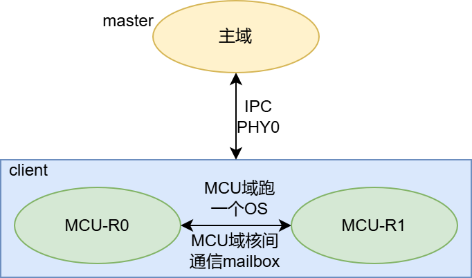
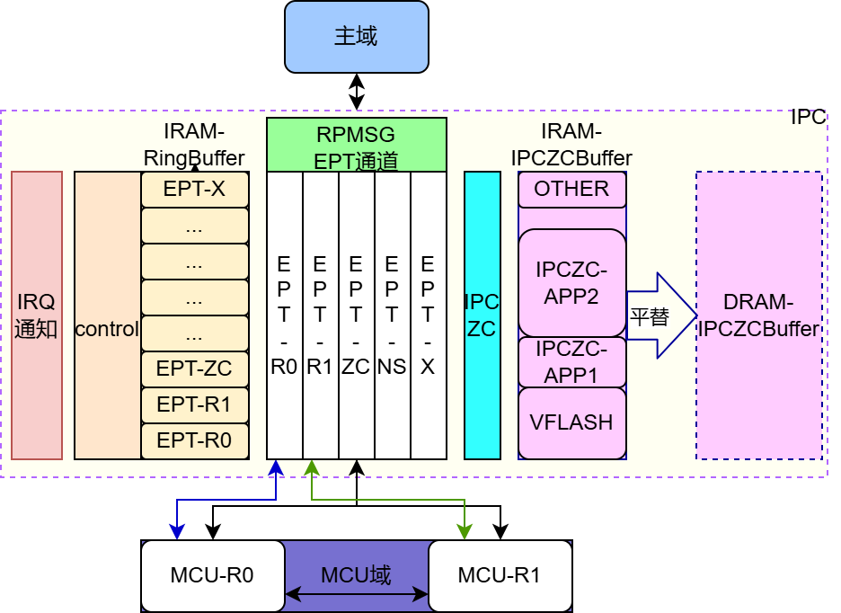
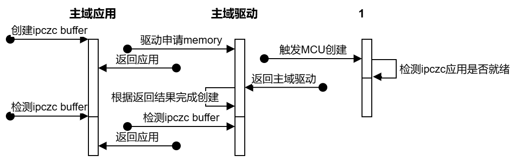
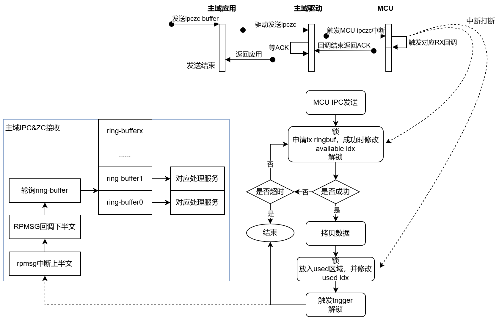
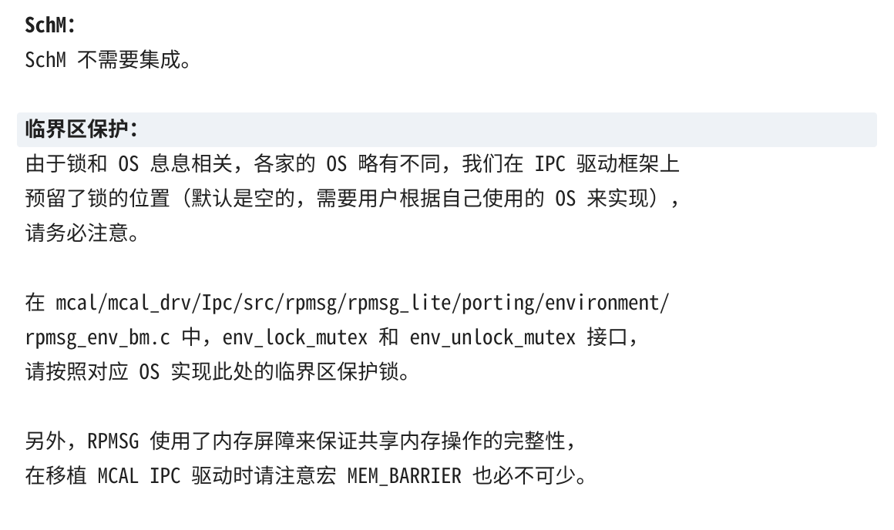
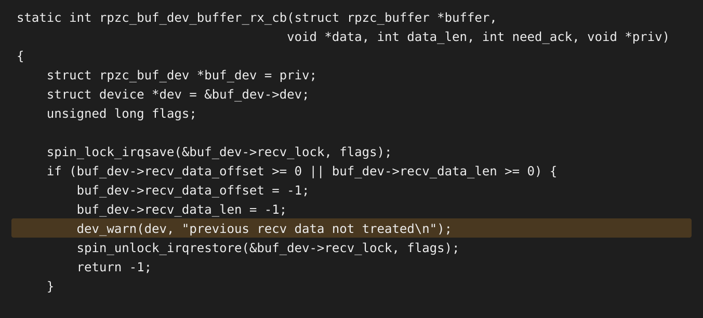
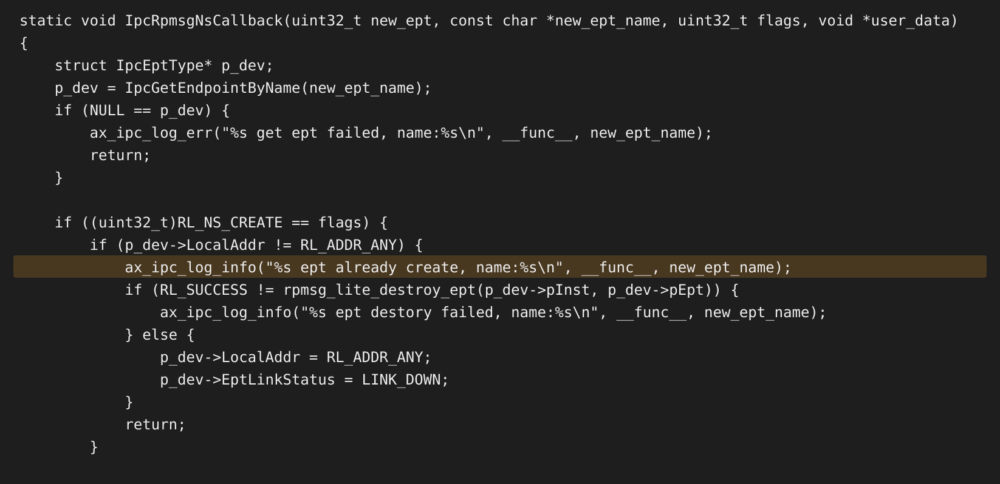
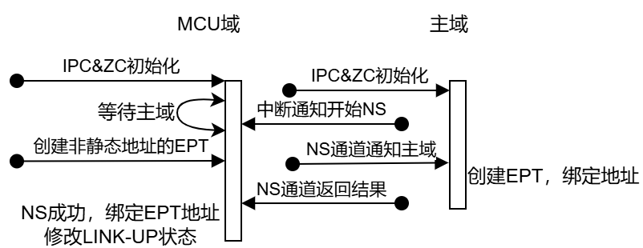
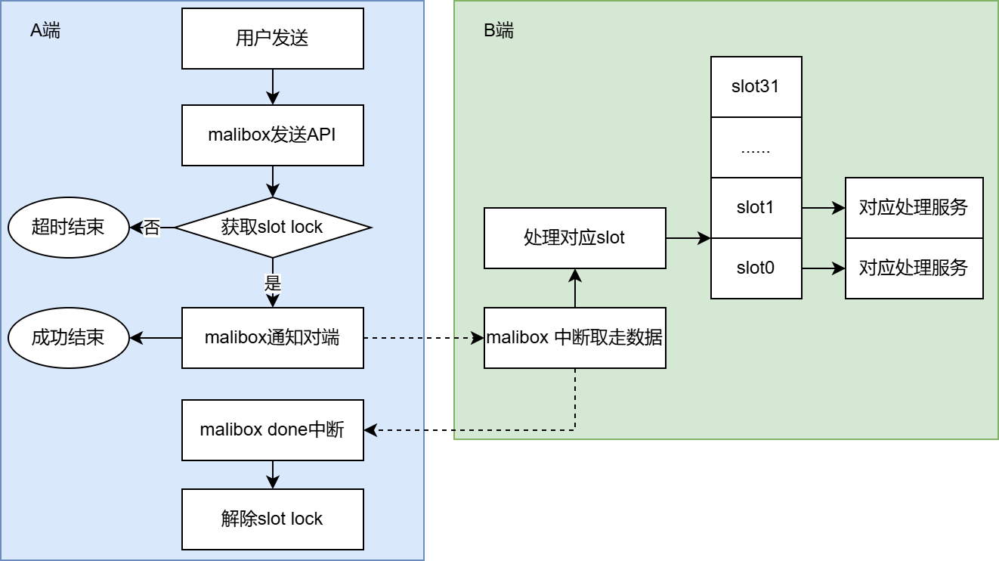

# M57 IPC&IPCZC问题复盘

来源：同名问题复盘文档 v18，更新日期 2026-08-12；本地整理日期 2026-10-29。正文引用的六张框架/时序图及三张截图均随包保存在 `assets/ax_ipc_FAQ/`，读取本文不依赖内网。重复日志已合并，来源标题、问题、现象和处理建议保留。

适用范围：本文记录 M57 Linux/QNX 与 MCU/MCAL 的历史问题和当时的资源配置，不代表所有 SDK 版本的现状。AX637 不支持 QNX；复用非 QNX 排查思路前，仍须核对目标平台的驱动、资源布局和两端配置。下述容量、地址、通道数和超时现象均不能直接作为其他平台的配置值；API 和当前行为以目标 SDK 源码及对应指南为准。

## 框架概述



1. 主域和 MCU 域创建一个 IPC 物理通道和多个 EPT 通道。
2. MCU 域 OS 运行 split 模式时，mailbox 中断源 3/4 用于 MCU OS 核间通信；主域通过 SoC 内部 GPIO 触发 MCU 域 SPI slave CS 中断，完成 IPC 通知。
3. MCU 域 OS 不需要核间通信时，主域可选择使用 mailbox 通知 MCU。
4. MCU 域使用 mailbox 完成 IPC 通知主域。
5. mailbox 触发中断不携带数据，可避免携带数据时的 slot 锁、done 中断解锁及相应限制和概率性超时。
6. 当时默认主域使用 GPIO，预留 mailbox 资源给 MCU OS。



采用开源 RPMsg 和 RPMsg-Lite 框架，RPMsg 基于 VirtIO 交换消息：

1. 消息头携带源/目的地址等路由信息，同一个通道上的消息按 FIFO 顺序传递。
2. 逻辑通道由文本名称标识，并关联 32 位源地址和目的地址。
3. 创建 endpoint 时，将接收回调与本地地址绑定。收到消息后，按消息头的目的地址查找 endpoint，再调用其接收回调。
4. 发送时调用 send API，将数据放入发送队列；没有可用 buffer 时可能阻塞至超时。成功放入队列后，通过 trigger 接口触发对端中断。
5. 接收端收到中断后，通过 control 信息轮询 ring buffer，并完成消息分发。
6. 接收处理处于回调上下文，不应执行阻塞操作，以免影响通信实时性。
7. 数据通过共享内存交换。大块数据采用 IPCZC/RPZC 时，RPMsg 作为信令通知对端读取共享内存；IPCZC buffer 支持 DDR。

## 资源配置（历史配置）

- 创建一个 RPMsg 物理通道，预留物理通道 1、2，暂未使用。
- 每个物理通道占用 8KB IRAM：4KB 用于 RPMsg control，4KB 用于 RPMsg data。
- 4KB data 分为 32 个 ring buffer，RX/TX 各 16 个。每个 buffer 为 128 字节，其中 RPMsg header 为 16 字节，单次 payload 最大为 112 字节。
- RPMsg 通道 0 配置十个 EPT 逻辑通道，共享 ring buffer：

| EPT | 用途 |
|---|---|
| `SampleEpt_R0Kernel_Test_ID` | Linux 用户空间与 MCU IPC 测试 |
| `SampleEpt_R0Kernel_Test_ID1` | Linux 内核空间与 MCU IPC 测试 |
| `SampleEpt_FCU_ID` | FCU |
| `SampleEpt_PMU_ID` | PMU |
| `SampleEpt_THM_ID` | ADC 温度监控 |
| `SampleEpt_LOG_ID` | MCU 日志传输 |
| `SampleEpt_DIAG_ID` | DIAG |
| `SampleEpt_TimesyncID` | Timesync |
| `SampleEpt_IPC_ZC_ID` | IPCZC |
| `SampleEpt_Axlookat_ID` | AX_IPCLOOKAT 读写 MCU 域寄存器 |

- IPCZC 创建一个物理通道，占用 20KB IRAM，各 IPCZC 应用共享并按需申请，也支持 DDR。
- 当时 IPCZC 应用包括 ipczc demo、虚拟 flash、ax_ipclookat；ax_ipclookat 的 IPCZC 路径默认关闭，改用 RPMsg。
- 虚拟 flash 的 TX/RX 各需要 4KB + 128B，受对齐影响，实际共占用 16KB。
- 来源的资源说明记载 IRAM 可扩大到 36KB，而问题1的处理建议记载可扩大到 32KB；两者不是可直接套用的统一上限，应核对目标 SDK 的 reserved-memory、MCU 配置及实际占用。
- CDD 和内核支持 E2E 库，用户可先做 E2E 数据保护，再通过 IPC 或 IPCZC 发送。

## 问题1：4KB对齐问题

**描述与现象**：Linux IPCZC 内存申请按 4KB 对齐，小 size 申请会产生碎片和内存浪费。历史配置的 20KB IRAM 被虚拟 flash 占用 16KB，其他 IPCZC 应用可能申请 buffer 失败。QNX 自管理共享内存，不受这里描述的 Linux 分配方式限制。

**处理建议**：

1. 扩大 reserved shared memory；来源在此处给出 IRAM 扩大到 32KB 或切换 DDR 的建议。变更前核对两端预留区域，不将该值当作所有版本的上限。
2. 来源还提出 genpool 自管理方案：初始化时通过 `memremap` 或 `dma_alloc` 一次性申请配置的 shared memory，再建 pool 并按需分配，减少 order 和 4KB 对齐限制。若使用 `dma_alloc`，来源要求配置容量满足相应的 2 的幂约束。
3. genpool 方案在来源版本中**未实现**，原因是避免对开源代码做大改动；不能把它当作现有 SDK 已提供的功能。

## 问题2：memory无法全部使用问题

**描述与现象**：Linux IPCZC 分配时先根据 size 计算 order，需要满足 `2^order * page_size` 的分配要求，并非空闲字节总量足够就一定成功。例如空闲池为 20KB，申请 17KB，在 4KB page 下需要 5 page，但 order 为 3，对应 8 page，即 32KB，因此仍会申请失败。QNX 自管理共享内存，不受这里描述的 Linux 分配方式限制。

**处理建议**：

1. 尽量按 4KB 倍数规划 buffer，并优先创建大 size buffer。
2. 必要时按问题1扩容或切换 DDR；genpool 仍只是来源中未实现的备选方案。

## 问题3：申请ringbuf阻塞超时

**描述与现象**：开机阶段 RPMsg 使用较多，一端处理不及时，会偶现申请 ring buffer 阻塞超时。通常出现在 MCU 端，某个 task 被阻塞，发送失败并返回 `-5001`：

```text
all channel of RPMSG is ready, NS times:6
IpcSendData rpmsg lite send failed, ret:-5001
```

**处理建议**：

1. 对来源描述的开机阶段拥塞，可增加发送的阻塞等待超时；同时核对实时性要求。
2. 增大 RPMsg shared memory 和 ring buffer 数量也是候选方案，但来源因 IRAM 限制与当时客户使用情况，认为暂不需要。

## 问题4：创建ipczc buffer问题

**现象1**：主域连续创建 IPCZC buffer 时，曾出现极低概率创建失败，并伴随重复警告：

```text
axera,rpzc-controller rpzc_ctrl@0: buffer "MetMcuToSocPacket": NULL -> local_dummy_buffers
axera,rpzc-controller rpzc_ctrl@0: buffer "MetMcuToSocPacket" (id:0): local_dummy_buffers -> buffers
axera,rpzc-controller rpzc_ctrl@0: buffer "MetSocToMcuPacket": NULL -> local_dummy_buffers
axera,rpzc-controller rpzc_ctrl@0: unexpected buffer ptr <ptr>, it should be <expected_ptr>
```

**现象2**：创建 buffer 时，MCU 对应应用尚未初始化、未注册回调，MCU 拒绝创建：

```text
ipczc buffer create failed: none match any app
```



主域申请内存并返回应用，与触发 MCU 创建和检查应用就绪属于不同阶段；本地创建返回不能代替对端就绪检查。

**处理建议**：

1. 来源对连续创建失败的规避措施是在两次创建之间增加延时；之后仍须检查 buffer 创建结果及对端可用性，不能把固定延时当作成功证据。
2. 核对初始化时序，先完成 MCU IPCZC 应用初始化与回调注册，再创建相应 buffer。

## 问题5：ACK问题

**现象1**：Linux 或 QNX 等 ACK 超时，迟到 ACK 随后触发状态不匹配，IPCZC 发送失败：

```text
rpzc_wait_for_remotebuffer_complete wait ACK failed
axera,rpzc-controller rpzc_ctrl@0: rpzc_wait_for_remotebuffer_complete BUFFER_ACK failed: -512
rpzc rpzc-MetSocToMcuPacket: transmit to remote failed
axera,rpzc-controller rpzc_ctrl@0: invalid buffer(1)(MetSocToMcuPacket) state
rpzc_service_rpmsg virtio0.axera,rpzerocopy.-1.1030: rpzc_service_command_handlers[4] error (-22)
```

**现象2**：没有等 ACK 超时日志，却出现 ACK 状态不匹配和丢包。来源将重复 ACK、RPMsg 并发保护失效列为重点排查方向，仍须结合两端日志确认，不能仅凭 `invalid buffer state` 判定唯一根因。



**排查建议**：

1. 主域：检查高负载、关中断时长、中断下半部优先级。
2. MCU：检查关总中断时长、IPCZC 回调是否过重、锁是否实现且生效。
3. 没有超时但出现重复 ACK 时，重点检查 RPMsg 锁是否实现和生效，尤其是 task 与中断之间的 ring buffer 竞争。



截图中的集成要求：锁与 OS 相关，IPC 驱动预留的锁默认可能为空实现。应按实际 OS 实现 `mcal/mcal_drv/Ipc/src/rpmsg/rpmsg_lite/porting/environment/rpmsg_env_bm.c` 的 `env_lock_mutex`、`env_unlock_mutex` 临界区保护；移植 MCAL IPC 驱动时也不能遗漏 `MEM_BARRIER`。这些路径和默认实现须以目标 SDK 为准。

## 问题6：主域端接收状态机异常

**描述与现象**：新数据到达时，上一包尚未处理、应用尚未等待接收，触发接收状态异常并丢包：

```text
previous recv data not treated
```



截图中的 `rpzc_buf_dev_buffer_rx_cb` 在持有 `recv_lock` 时检查 `recv_data_offset` 和 `recv_data_len`；上一包尚未处理时清理接收状态、打印上述警告并返回失败。

**处理建议与风险**：

- 对此场景使能 ACK，每次发送前检查上一笔 ACK，不能强制发送或提前复用发送 buffer。
- 仍须遵守“接收 → 消费 payload → 按需回复 ACK”的顺序。
- 来源明确提示残余窗口：主域回复 ACK 后，到应用发起下一次接收之间，如果 MCU 又发送一包，仍可能报错丢包。因此 ACK 不是接收应用已再次就绪的充分条件，需要核对应用接收时序。

## 问题7：MCAL等ACK问题

**描述与现象**：来源记录 MCAL IPCZC 的 ACK 阻塞等待会影响其他 task 的实时性。

**处理建议**：来源版本已增加轮询接口，可在 MCU OS 中创建 task 轮询 IPCZC ACK 状态。每次发送前都需检测上一笔 ACK 状态。具体接口名及是否已集成，须核对目标 SDK；不要将轮询模式理解为无需 ACK 或可提前复用 buffer。

## 问题8：QNX端NS服务问题

**适用范围**：仅 M57 QNX，AX637 不支持 QNX。

**描述与现象**：NS 握手异常时，警告日志频繁刷屏，某些 EPT 不可用，MCU 看不到 `all channel of RPMSG is ready`。



截图中的 `IpcRpmsgNsCallback` 在 `RL_NS_CREATE` 且 EPT 已有本地地址时销毁旧 EPT；销毁成功才将 `LocalAddr` 复位为 `RL_ADDR_ANY`、`EptLinkStatus` 设为 `LINK_DOWN`，等待后续 NS 服务重建。销毁失败不能直接当作已恢复。

**处理建议**：NS 异常时销毁异常 EPT，在下一次 NS 服务中重新创建。



图中顺序为：MCU 初始化 IPC/IPCZC 并等待主域 → 主域初始化并通知开始 NS → MCU 创建非静态地址 EPT，通过 NS 通道通知主域 → 主域创建 EPT、绑定地址并返回结果 → MCU 完成 EPT 地址绑定并更新 LINK-UP。

必须保持以下时序约束：

1. MCU 初始化早于主域。
2. EPT 未就绪前不能使用 IPC/IPCZC。
3. MCU 等待超时会标记主域启动异常，可据此判断主域状态并做相应处理。

## 问题9：mailbox slot锁问题

**范围说明**：来源记录的 RPMsg mailbox 只用于无数据通知，因此不存在此处描述的 slot 锁问题。以下为 mailbox 携带数据时的风险，不应直接作为当前 RPMsg 超时的根因。

**描述与现象**：mailbox 携带数据时，硬件 slot 锁用于保证对端正确取走数据；对端取走数据后，触发本端 mailbox done 中断解锁。slot 上锁期间，后续使用必须等待；若发生在中断内，影响更大，可能出现发送超时、丢包及 task 调度受影响。



图中顺序为：发送端取得 slot lock → 通知对端 → 对端中断取走数据并分派服务 → 触发发送端 done 中断 → 解除 slot lock。排查前先确认实际通知方式是否携带数据，不把 mailbox 通知字段当作 RPMsg/RPZC 业务 payload。
