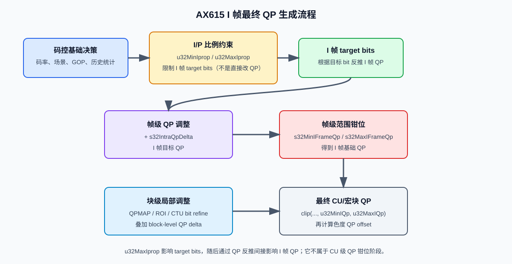
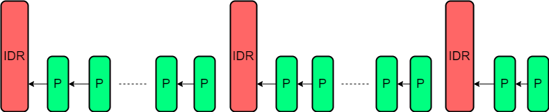
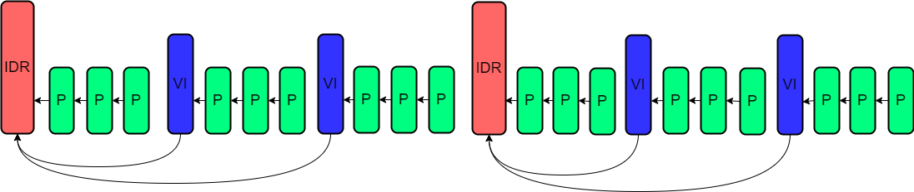
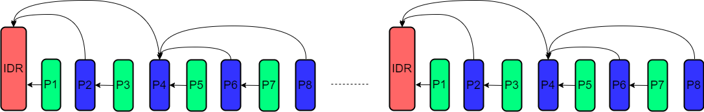
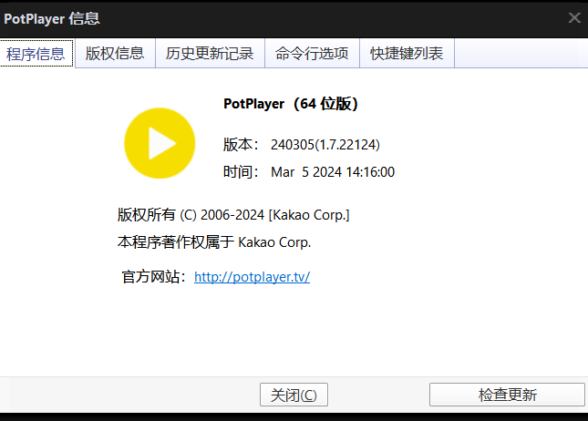

# AX 码率控制模式与参数使用指南

本文用于介绍 AX 码率控制模式的选择方法、通用参数含义、各模式额外参数、适用场景、常见问题和调参方向。阅读本文后，可以快速判断 CBR、VBR、AVBR、CVBR、QPMAP 分别适合什么场景，以及遇到码率、画质、运动、存储等问题时应优先调整哪些参数。

## 1. 阅读方式

AX 码率控制主要涉及 5 类模式：

| 模式 | 英文全称 | 主要目标 | 典型场景 |
| --- | --- | --- | --- |
| CBR | Constant Bitrate | 尽量围绕固定目标码率输出 | 实时预览、固定带宽传输、低延迟推流 |
| VBR | Variable Bitrate | 复杂场景接近最大码率，简单场景节省码率 | 本地录像、TF 卡/NVR 存储、静止时间较多的监控 |
| AVBR | Adaptive Variable Bitrate | 静止时主动省码率，运动时主动提高码率保障质量 | IPC 事件录像、人车经过、静止背景下的突发运动 |
| CVBR | Constrained Variable Bitrate | 同时约束短期码率和长期平均码率 | 云存储、全天录像、既要容量可控又要复杂场景质量 |
| QPMAP | Quantization Parameter Map | 按块或区域控制编码质量 | 人脸、车牌、ROI、智能分析结果参与编码 |

`ax_venc_rc.h` 在部分 SDK 版本还会暴露 `QVBR`、`FIXQP` 和 MJPEG 专用 `CBR/VBR/FIXQP`。这些模式的 proc 字段和审查规则以 skill 的 [RC 模式矩阵](rc-mode-matrix.md) 为准；本手册的 Wiki 主体覆盖上表五种模式。

另外还有 **SVC 智能编码**（第 9 章）。它不是一种独立的码控模式，而是叠加在 CBR/VBR/AVBR/CVBR 之上：上层只提供检测框坐标和前景/背景 QP 档位，SDK 据此自动生成 QPMAP，适合有矩形检测框但不想自己填 Map 的场景。注意它与 GOP 模式里的 SVC-T（时域分层）没有关系。

本文结构：

1. **通用参数**：先统一说明 CBR/VBR/AVBR/CVBR 中含义基本一致的公共参数。
2. **模式额外参数**：每种模式只列出相对通用参数还需要配置或重点理解的参数，避免重复。
3. **应用场景和调参示例**：每种模式都列出适合场景、常见问题和参数调整方向。
4. **块级 QP 干预**：QPMAP 和 SVC 智能编码都叠加在上述模式之上，单独成章说明。
5. **GOP 与问题专题**：补充参考帧结构、输入质量、拖尾、块效应、AOV 等专项排查。
6. **模式差异与参考配置**：最后给出模式选择、验证流程和常用起始配置。

## 2. 码率控制的基本取舍

码率控制不是单纯“把码率设成某个值”，而是在以下目标之间取舍：

| 目标 | 典型关注点 | 常见代价 |
| --- | --- | --- |
| 传输稳定 | 峰值码率不要超过链路能力 | 大运动时画质可能下降 |
| 存储可控 | 长时间文件大小可预估 | 局部复杂场景可能被压得更重 |
| 主观画质稳定 | I/P 帧、静止/运动之间不要忽清忽糊 | 平均码率可能上升 |
| 重点区域清晰 | 人脸、车牌、检测目标优先清楚 | 非重点区域质量下降或总码率上升 |
| 低功耗/低帧率 | AOV、低帧率唤醒时关键帧仍可用 | 需要重新匹配码率、帧率、GOP |

选择码控模式前，建议先判断：

1. **码率上限是否刚性？** 公网传输、4G/5G 回传、弱网实时预览更适合 CBR 或带短期约束的 CVBR。
2. **文件大小是否刚性？** 本地存储、云存储更适合 VBR、AVBR、CVBR。
3. **运动片段是否必须更清晰？** 静止背景下有人车经过，AVBR 或 CVBR 往往比单纯 VBR 更合适。
4. **是否有智能区域信息？** 如果有人脸、车牌、目标框等 ROI 信息，可考虑 QPMAP；若只有矩形检测框且不想自己填 Map，可直接用 SVC 智能编码。

## 3. 通用参数说明

### 3.1 通用参数范围

这里的“通用参数”指 **CBR、VBR、AVBR、CVBR 中反复出现且含义基本一致的参数**。QPMAP 的参数较少，且结构不同，单独在 QPMAP 章节说明。

| 参数 | 含义 | 取值/支持情况 | 应用场景和理解 |
| --- | --- | --- | --- |
| `u32Gop` | GOP 长度，即 IDR 帧间隔 | `[1, 65536]` | 通常设置为输出帧率的整数倍。GOP 越短，随机访问和异常恢复越快，但 I 帧更多、码率压力更大；GOP 越长，压缩效率更高，但恢复和拖动播放变慢。 |
| `u32StatTime` | 码率统计时间，单位秒 | `[1, 60]`；CBR 中备注为预留暂未支持，AVBR 中 AX615 不支持 | 统计窗口越短，码率控制响应越快；统计窗口越长，波动更平滑。实际是否生效需结合芯片支持情况。 |
| `u32MinQp` | P 帧 CU 块级最小 QP | `[0, 51]` | 限制 P 帧最好质量。QP 不会继续往下调；值越小，简单场景画质更好但更耗码率；值越大，更容易节省静止场景码率。 |
| `u32MaxQp` | P 帧 CU 块级最大 QP | `[max(u32MinQp, 1), 51]` | 限制 P 帧最差质量。值越大越容易压住码率，但复杂场景更容易块效应、拖尾；值越小画质更有保障，但码率可能压不住。 |
| `u32MinIQp` | I 帧 CU 块级最小 QP | `[0, 51]` | 限制 I 帧最好质量，影响 I 帧占比和 I/P 质量差异。值过低时 I 帧可能明显比 P 帧清楚，诱发呼吸效应。 |
| `u32MaxIQp` | I 帧 CU 块级最大 QP | `[max(u32MinIQp, 1), 51]` | 限制 I 帧最差质量。静止场景中 I 帧 QP 对主观质量影响明显，降低该值有利于保持 I 帧质量，但会增加瞬时码率。 |
| `s32IntraQpDelta` | I 帧实际帧级 QP 与目标 QP 的差值 | `[-10, 10]` | 用于直接调节 I 帧 QP，也常用于调节呼吸效应。优先级高于 I/P 比例，但一般不建议频繁改，优先调 I/P 比例相关参数。 |
| `u32DeBreathQpDelta` | 去呼吸效应参数，I 帧与参考帧的 QP 差值 | AX615 不支持 | 原文列出但 AX615 不支持。若平台支持，可用于缓解 I/P 帧静态区域质量差异。 |
| `u32IdrQpDeltaRange` | CU 级 QP 和 I 帧 QP 之间的差值范围 | `[2, 16]` | 控制 I 帧内部 CU 级 QP 浮动范围，影响 I 帧内部局部画质和码率分配。 |
| `stQpmapInfo` | Qpmap 相关信息 | AX615 不支持 | 旧 QPMAP 信息结构，原文标注 AX615 不支持。 |
| `stQpmapInfoV1` | Qpmap 相关信息 | 支持情况以 API 为准 | 用于智能分析和编码结合，按块设置 QP（绝对/相对由每个块自带的标志位决定）、Skip 倾向、Min QP 钳位和局部模式决策。结构、数据格式、大小计算和下发方式见 8.2 ~ 8.6。若不需要逐块控制，也可用第 9 章的 SVC 让 SDK 自动生成。 |
| `u32BlockRcSize` | 块级码率控制的最小处理单位 | H.265 支持 `1:32x32`、`2:16x16`；H.264 仅支持 `2:16x16` | 用于块级码控。画面局部复杂度差异大时，可改善 bit 分配。 |
| `s32MinFrameQp` | P 帧帧级最小 QP | `[0, 51]` | 帧级 P 帧 QP 下限，和 CU 级 QP 限制共同影响最终 QP。 |
| `s32MaxFrameQp` | P 帧帧级最大 QP | `[max(s32MinFrameQp, 1), 51]` | 帧级 P 帧 QP 上限。降低该值可保护 P 帧质量，但会增加码率压力。 |
| `s32MinIFrameQp` | I 帧帧级最小 QP | `[0, 51]` | 帧级 I 帧 QP 下限，影响 I 帧最好质量和 I 帧码率占比。 |
| `s32MaxIFrameQp` | I 帧帧级最大 QP | `[max(s32MinIFrameQp, 1), 51]` | 帧级 I 帧 QP 上限。降低该值可保护 I 帧质量，但 I 帧 size 可能变大。 |
| `s32CbQpOffset` | 色度 Cb 分量块级 QP 偏移 | `[-12, 12]` | 值越小，Cb 分量质量越好，色彩更稳定，但消耗更多 bit。适合处理肤色、彩色标识、拖色问题。 |
| `s32CrQpOffset` | 色度 Cr 分量块级 QP 偏移 | `[-12, 12]` | 值越小，Cr 分量质量越好。H.264 baseline/main/extended 下，`s32CbQpOffset` 和 `s32CrQpOffset` 应保持一致。 |
| `u32MotionSen` | 码控中的运动灵敏度 | `[0, 16]` | 值越大，越倾向于识别运动区域并分配更多码率；适合运动目标优先场景。噪声多时不宜盲目调大。 |
| `u32MotionAlpha` | 码控中的运动收敛速度 | `[0, 128]` | 控制运动相关码率调整的收敛速度。值越大，收敛越快，对运动变化响应越迅速，但码率/质量可能波动更明显；值越小，收敛越慢，码率过渡更平缓但响应偏滞后。运动场景变化明显时需要关注。 |
| `u32StillIBitPercent` | 静态场景下 I 帧在一个 GOP 总比特预算中所占的目标百分比 | `[0, 100]`，`0` 表示不干预 | 用于干预静态场景 I 帧 bit 占比。若 I 帧质量和 P 帧差异明显，可结合 I/P 关系一起观察。 |
| `bCtuBitsRefEn` | CTU/LCU 级 bit refine 使能 | `0/1` | 是否开启更细粒度的 CTB/LCU bit 控制。局部复杂度差异明显时可考虑。 |
| `s32CtuBitsRefQpDeltaRange` | LCU 级 QpDelta 增量范围限制 | `[0, 10]` | 限制块级 QP 相对帧级 QP 的变化范围。范围越大，局部调节能力越强，但局部质量差异也可能更明显。 |

### 3.2 帧级 QP 和宏块/CU 级 QP 同时配置时的最终 QP

下图展示了 I/P 比例参数、帧级 QP 参数和宏块/CU 级 QP 参数的参与阶段：



如需编辑流程图，可下载附件 `qp_control_flow.svg` 后使用 Draw.io 导入。

**码控基础帧率默认采用配置输出帧率，而不是实时输出帧率。** 以 `src/dst=30 fps`、实际输入约 `1 fps` 为例，H26x/JPEG 仍按 `30 fps` 计算每帧目标码量（目标码率/30）并据此确定帧级 QP，实际输出码率约为目标码率的 `1/30`。H26x 仅在启用 `AutoFpsAdjust` 时根据实测 Real YUV 输入帧率调整 RC；JPEG 不根据实测输出帧率调整。因此排查“码率远低于目标”时，先确认实际输入帧率与配置帧率是否一致，再看 QP 相关参数。

码控中同时存在两类 QP 限制：

| 类型 | P 帧参数 | I 帧参数 | 作用 |
| --- | --- | --- | --- |
| 帧级 QP 范围 | `s32MinFrameQp`、`s32MaxFrameQp` | `s32MinIFrameQp`、`s32MaxIFrameQp` | 限制整帧基础 QP 的上下限。 |
| 宏块/CU 级 QP 范围 | `u32MinQp`、`u32MaxQp` | `u32MinIQp`、`u32MaxIQp` | 限制最终落到宏块/CU 上的 QP 上下限。H.264 可理解为宏块级，H.265 可理解为 CU/CTU 级。 |

同时配置时，可以按“码控目标 bit/QP → I/P 比例约束 → 帧级偏移 → 帧级范围钳位 → 块级偏移 → 块级范围钳位 → 色度偏移”的流程理解。这里的 I/P 比例约束包括 `u32MinIprop/u32MaxIprop`（内部参数 `s32MinIPRation/s32MaxIPRation`）。当前适配代码中 CBR/CVBR 会透传用户配置；VBR/AVBR 通常将其初始化为 `1/100`，等价于不对 I/P 比例做额外限制。

1. 码控先根据目标码率、当前帧类型、场景复杂度、历史码率、GOP 位置等因素，计算一个原始目标 QP。
2. 在确定 I 帧目标 bit 时，I/P 比例控制器根据历史 I/P 大小（或 GOP bit 分配）计算本 I 帧允许使用的 target bits，并将结果限制在 `u32MinIprop` 和 `u32MaxIprop` 对应的范围内。该参数控制的是 **I 帧 size 相对 P 帧的比例/目标 bit**，不是直接给 QP 加一个固定数值；target bits 变小会间接使 I 帧 QP 增大，target bits 变大则间接使 I 帧 QP 减小。
3. 如果是 I 帧，再考虑 `s32IntraQpDelta` 这类帧级 QP 偏移。它会改变 I 帧相对目标 QP 的大小：值越小，I 帧 QP 越低、I 帧质量越好、I 帧 size 越大；值越大，I 帧 QP 越高、I 帧 size 越小。
4. 经过 I/P 比例目标 bit 和帧级偏移得到的 QP，再被帧级范围钳位：P 帧受 `s32MinFrameQp/s32MaxFrameQp` 限制，I 帧受 `s32MinIFrameQp/s32MaxIFrameQp` 限制。
5. 得到帧级基础 QP 后，块级码控、QPMAP、ROI、CTU bit refine 等机制会在此基础上为不同宏块/CU 叠加 QP delta。
6. 每个宏块/CU 的候选 QP 再被宏块/CU 级范围钳位：P 帧受 `u32MinQp/u32MaxQp` 限制，I 帧受 `u32MinIQp/u32MaxIQp` 限制。
7. 如果配置了色度 QP offset，最终还会在亮度 QP 的基础上计算 Cb/Cr 色度 QP。`s32CbQpOffset/s32CrQpOffset` 越小，色度质量越好，但会消耗更多 bit。
8. 因此，最终真正用于编码的 QP 不是单个参数决定的，而是目标 bit/QP、I/P 比例约束、QP delta、帧级限制、块级限制和色度偏移共同作用的结果。

常见 QP 相关偏移/差值参数可以这样理解：

| 参数 | 作用层级 | 影响对象 | 理解方式 |
| --- | --- | --- | --- |
| `s32IntraQpDelta` | 帧级偏移 | I 帧 | 调整 I 帧相对目标 QP 的差值。值越小，I 帧越清晰但码率越高；值越大，I 帧越省码率但可能发糊。 |
| `u32IdrQpDeltaRange` | 块级差值范围 | IDR/I 帧内部 CU | 限制 CU 级 QP 与 I 帧 QP 的差值范围，避免 I 帧内部局部 QP 波动过大。 |
| `s32IdrQpDeltaRange` | 块级差值范围 | CVBR 中的 IDR/I 帧内部 CU | 与 `u32IdrQpDeltaRange` 含义同类，调参时以 API 实际字段为准。 |
| `s32CtuBitsRefQpDeltaRange` | 块级差值范围 | CTU/LCU | 限制 CTU bit refine 带来的 QP delta 幅度，避免局部调节过强。 |
| `stQpmapInfoV1` | 块级偏移 | QPMAP 指定区域 | 根据智能分析结果给不同区域设置相对 QP，相对的基准就是本节的帧级基础 QP。重点区域通常使用负 delta 提高质量。也可逐块改用绝对 QP，见 8.2.1。 |
| `s32CbQpOffset/s32CrQpOffset` | 色度偏移 | Cb/Cr 色度分量 | 在亮度 QP 基础上调整色度 QP。值越小，色度越清晰，码率占用越高。 |

可用下面的简化公式理解。实际编码器内部实现可能还有更复杂的预测和修正，但调参时按这个顺序理解最直观：

```text
P 帧基础 QP = clip(码控计算出的 P 帧 QP, s32MinFrameQp, s32MaxFrameQp)
P 块亮度最终 QP = clip(P 帧基础 QP + 块级 QP delta, u32MinQp, u32MaxQp)

I 帧 target bits = 根据码率/GOP 统计计算，并受 u32MinIprop/u32MaxIprop 约束
I 帧目标 QP = 根据 I 帧 target bits 反推的 QP + s32IntraQpDelta
I 帧基础 QP = clip(I 帧目标 QP, s32MinIFrameQp, s32MaxIFrameQp)
I 块亮度最终 QP = clip(I 帧基础 QP + 块级 QP delta, u32MinIQp, u32MaxIQp)

Cb 最终 QP ≈ clip(亮度最终 QP + s32CbQpOffset, 编码标准允许范围)
Cr 最终 QP ≈ clip(亮度最终 QP + s32CrQpOffset, 编码标准允许范围)
```

其中 `clip(x, min, max)` 表示把 `x` 限制在 `[min, max]` 范围内：如果 `x < min`，结果取 `min`；如果 `x > max`，结果取 `max`；如果 `min <= x <= max`，结果保持 `x` 不变。例如 `clip(22, 28, 48) = 28`，`clip(55, 28, 48) = 48`，`clip(36, 28, 48) = 36`。`块级 QP delta` 可能来自块级码控、QPMAP、ROI、CTU bit refine，或编码器内部根据纹理复杂度做的局部调整。`u32IdrQpDeltaRange`、`s32CtuBitsRefQpDeltaRange` 这类参数会进一步限制局部 QP 相对帧级 QP 的变化幅度。

**示例 1：帧级范围更严格，先限制基础 QP**

```text
s32MinFrameQp = 20
s32MaxFrameQp = 40
u32MinQp = 10
u32MaxQp = 48
码控计算出的 P 帧 QP = 45
```

此时 P 帧基础 QP 会先被帧级范围限制为 40。后续块级码控再以 40 为基础做局部调整，最终宏块/CU QP 仍会被 `u32MinQp/u32MaxQp` 限制在 `[10, 48]` 内。

**示例 2：块级范围更严格，最终 QP 仍会被块级范围卡住**

```text
s32MinFrameQp = 10
s32MaxFrameQp = 51
u32MinQp = 28
u32MaxQp = 48
码控计算出的 P 帧 QP = 22
```

帧级基础 QP 可以是 22，但最终宏块/CU QP 不能低于 `u32MinQp=28`。因此即使帧级允许更好的质量，块级最小 QP 也会把最终 QP 抬到 28 及以上，从而节省码率，但画质会下降。

**示例 3：QPMAP/ROI 试图提高局部质量，但会被块级最小 QP 限制**

```text
P 帧基础 QP = 32
ROI 区域 QP delta = -8
u32MinQp = 28
u32MaxQp = 48
```

ROI 区域候选 QP 为 24，但最终会被 `u32MinQp=28` 钳位到 28。也就是说，如果希望 ROI 区域真正获得更高质量，不能只配置 QPMAP/ROI，还要确认 `u32MinQp/u32MinIQp` 没有把局部 QP 下限设置得过高。

**示例 4：`s32IntraQpDelta` 会先改变 I 帧目标 QP，再受 I 帧范围限制**

```text
码控计算出的 I 帧 QP = 32
s32IntraQpDelta = -4
s32MinIFrameQp = 20
s32MaxIFrameQp = 40
u32MinIQp = 24
u32MaxIQp = 48
```

I 帧目标 QP 先变成 28，然后帧级范围 `[20, 40]` 不再改变它。后续如果没有额外块级 delta，I 块最终 QP 约为 28。此时 I 帧会比 `s32IntraQpDelta=0` 时更清晰，但 I 帧 size 和瞬时码率也会变大。

如果把 `s32IntraQpDelta` 调成 `-10`，I 帧目标 QP 会变成 22，但如果 `u32MinIQp=24`，最终 I 块 QP 仍可能被块级最小 QP 钳位到 24。因此，`s32IntraQpDelta`、帧级 I QP 范围、块级 I QP 范围需要一起看。

**示例 5：色度 QP offset 只影响色度分量，不等同于整体亮度 QP**

```text
亮度最终 QP = 34
s32CbQpOffset = -6
s32CrQpOffset = -6
```

Cb/Cr 色度 QP 会在亮度 QP 基础上降低，色彩区域更容易保留细节，能缓解肤色、彩色标识、拖色问题。但它不会直接让亮度纹理变清晰，并且会增加色度 bit 占用。

**调参建议：**

- 如果想控制整帧平均质量和码率波动，优先看帧级 QP 范围。
- 如果想调整 I 帧相对 P 帧的清晰度，重点看 `s32IntraQpDelta`，并同时检查 `s32MinIFrameQp/s32MaxIFrameQp` 和 `u32MinIQp/u32MaxIQp` 是否把调整结果钳住。
- 如果想限制最终编码质量边界，尤其是防止局部区域过糊或过度耗码率，重点看宏块/CU 级 QP 范围。
- 如果配置了 QPMAP/ROI 但重点区域质量没有明显提升，检查 `u32MinQp/u32MinIQp` 是否过高，也要检查 `u32IdrQpDeltaRange/s32CtuBitsRefQpDeltaRange` 是否限制了局部 QP 变化幅度。
- 如果色彩区域拖色或肤色发脏，检查 `s32CbQpOffset/s32CrQpOffset`，但不要期望它改善亮度纹理细节。
- 如果码率压不住，检查 `u32MaxQp/u32MaxIQp`、`s32MaxFrameQp/s32MaxIFrameQp` 是否限制得过低，也检查 QPMAP/ROI 或色度 offset 是否消耗了过多 bit。
- 如果画质过差，检查最大 QP 是否过高，同时确认目标码率是否足够。

### 3.3 通用参数调参理解

| 现象 | 通用参数调参方向 | 注意事项 |
| --- | --- | --- |
| 大运动发糊 | 提高目标/最大码率；降低 `u32MaxQp`、`s32MaxFrameQp`；提高 `u32MotionSen` | 码率会上升；噪声多时先确认输入 YUV。 |
| 静止码率偏高 | 提高 `u32MinQp/u32MinIQp`；适当加大 `u32Gop` | 过度提高最小 QP 会让静止画质下降。 |
| I 帧过糊 | 降低 `u32MaxIQp`、`s32MaxIFrameQp`；必要时调小 `s32IntraQpDelta` | I 帧 size 和瞬时码率可能变大。 |
| P 帧块效应明显 | 降低 `u32MaxQp`、`s32MaxFrameQp`；提高码率 | 带宽固定时可能压不住码率。 |
| 色彩拖尾或色块 | 调小 `s32CbQpOffset/s32CrQpOffset`，例如 -3 或 -6 | 色度占用 bit 增加，低码率下需谨慎。 |
| 局部复杂区域发糊 | 关注 `u32BlockRcSize`、`bCtuBitsRefEn`、`s32CtuBitsRefQpDeltaRange` | 块级调节过强可能造成区域间质量差异明显。 |
| 夜晚噪声导致码率高 | 先调 ISP 降噪，再考虑降低运动灵敏度或调整检测阈值 | 不建议直接大幅降低码率，否则真实运动质量更差。 |

## 4. CBR 参数说明及使用方法

### 4.1 CBR 相对通用参数还需配置的参数

| 参数 | 含义 | 应用场景和调参方向 |
| --- | --- | --- |
| `u32BitRate` | 平均码率，单位 kbps | CBR 的核心目标码率。固定带宽场景按链路能力设置；大运动画质不足时提高；码率超预算时降低或放宽 QP。 |
| `u32MinIprop` | 最小 I/P 帧码率比值，`[1, 100]` | 限制 I 帧最小占比。值过大容易让 I 帧清晰、P 帧模糊，通常建议保持较小，例如 1。 |
| `u32MaxIprop` | 最大 I/P 帧码率比值，`[u32MinIprop, 100]` | 限制 I 帧最大占比。I 帧过清晰、瞬时码率尖峰大时调小；I 帧发糊时调大。 |

### 4.2 CBR 适合什么场景

| 场景 | 为什么适合 CBR | 示例配置理解 |
| --- | --- | --- |
| 实时预览 | 预览链路通常带宽固定，希望码率稳定 | 1080p H.265 25fps，可从 3072～4096 kbps 起步，GOP 25 或 50。 |
| 4G/5G 回传 | 无线链路上行带宽有限，峰值过高容易卡顿 | 按最差网络带宽设置 `u32BitRate`，复杂场景通过提高 QP 压住码率。 |
| 多路视频同时上传 | 每路码率需要可控，避免总带宽超限 | 按总带宽切分每路 `u32BitRate`，关键路可分配更高码率。 |
| 低延迟推流 | 推流端和平台通常按固定码率规划 | GOP 不宜过长，码率过低时优先保证运动主体可接受。 |
| 对接固定码率平台 | 平台按固定码率做容量和带宽计算 | 使用 CBR 更容易满足平台预期。 |

### 4.3 CBR 不太适合什么场景

| 场景 | 原因 | 替代建议 |
| --- | --- | --- |
| 长时间静止录像且强烈关注存储 | CBR 简单场景也不会主动大幅省码率 | 改用 VBR 或 AVBR。 |
| 希望复杂场景临时明显提高质量 | CBR 为压住固定码率，复杂场景会提高 QP | 改用 AVBR 或 CVBR。 |
| 日均容量要求严格但允许短时波动 | CBR 只控制固定目标，不擅长“复杂时借码率、简单时回收” | 改用 CVBR。 |

### 4.4 CBR 常见问题和参数调整

| 常见问题 | 可能原因 | 调整建议 |
| --- | --- | --- |
| 大运动时块效应明显 | `u32BitRate` 偏低，`u32MaxQp` 过大 | 提高 `u32BitRate`；降低 `u32MaxQp/s32MaxFrameQp`；若链路不允许提高码率，只能接受画质下降。 |
| 静止画面每个 GOP 周期突然变清晰 | I 帧占比过高，I/P 质量差异大 | 降低 `u32MaxIprop`；保持 `u32MinIprop = 1`；必要时调整 `s32IntraQpDelta`。 |
| I 帧发糊，场景切换后第一帧质量差 | I 帧 bit 被限制过强 | 增大 `u32MaxIprop`；降低 `u32MaxIQp/s32MaxIFrameQp`；注意瞬时码率升高。 |
| 瞬时码率尖峰明显 | I 帧 size 过大，GOP 或 Iprop 不合适 | 降低 `u32MaxIprop`；适当加大 GOP；检查 I 帧 QP 限制。 |
| 简单场景码率浪费 | CBR 模式本身不会主动省码率 | 如果业务允许码率变化，改用 VBR/AVBR；否则可提高 `u32MinQp` 但收益有限。 |

### 4.5 CBR 场景示例

**示例 1：固定带宽实时预览**

```text
场景：1080p，25fps，H.265，上行带宽约 4Mbps
模式：CBR
u32BitRate：3072 ~ 4096 kbps
u32Gop：25 或 50
u32MinQp/u32MinIQp：10 左右
u32MaxQp/u32MaxIQp：48 或 51
u32MinIprop：1
u32MaxIprop：根据呼吸效应和 I 帧 size 调整
```

**示例 2：多路 IPC 同时上传**

```text
场景：4 路 1080p 同时上传，总上行带宽有限
模式：CBR
调参重点：先分配每路 u32BitRate，再通过 u32MaxQp 保证复杂场景不超带宽
风险：单路大运动时画质会下降，但不会明显挤占其他通道带宽
```

**示例 3：走廊低码率预览**

```text
场景：走廊画面简单，但有人经过时运动较明显
模式：CBR
问题：码率低时人经过容易糊
调整：在带宽允许范围内提高 u32BitRate；降低 u32MaxQp；适当提高 u32MotionSen
```

## 5. VBR 参数说明及使用方法

### 5.1 VBR 相对通用参数还需配置的参数

| 参数 | 含义 | 应用场景和调参方向 |
| --- | --- | --- |
| `u32MaxBitRate` | 输出最大码率，单位 kbps | VBR 的码率上限，不等同于长期平均码率。运动场景太糊可提高；码率/文件过大可降低。 |
| `enVQ` | VBR 画质等级，`[0, 9]` | `0` 使用用户配置 QP 范围；`1~9` 值越大，码率越高、画质越好。若要手动调 QP，建议使用用户自定义 QP 范围。 |
| `u32SceneChgThr` | 静态场景检测阈值，`[1, 10]` | AX615 不支持，通常不作为调参项。 |
| `u32ChangePos` | VBR 调节平均码率目标的位置，`[1, 100]` | 调节平均码率目标，码控据此分配各帧 bit 并动态调整帧级 QP；值小更省码率，值大画质更好但文件更大。 |

### 5.2 VBR 适合什么场景

| 场景 | 为什么适合 VBR | 示例配置理解 |
| --- | --- | --- |
| 本地全天录像 | 简单场景自动降低码率，节省文件大小 | 1080p H.265 可设置 `u32MaxBitRate=3072/4096`，`u32ChangePos=60~80`。 |
| 仓库/办公室固定机位 | 大部分时间静止，偶尔有人经过 | 静止时省码率，运动时接近最大码率。 |
| TF 卡循环录像 | 存储空间有限，希望延长录像时间 | 调低 `u32ChangePos` 或提高最小 QP。 |
| 画面复杂度变化明显 | 不同时间段码率需求差异大 | VBR 可根据复杂度被动分配码率。 |
| 离线录像分析 | 不要求每秒码率稳定，更关注总体文件大小和画质 | 可用更高 `u32MaxBitRate`，让复杂场景质量更好。 |

### 5.3 VBR 不太适合什么场景

| 场景 | 原因 | 替代建议 |
| --- | --- | --- |
| 严格固定上行带宽实时预览 | 瞬时码率会随场景波动 | 使用 CBR。 |
| 运动目标出现时必须主动优先保证质量 | VBR 是根据复杂度被动变化，不如 AVBR 主动 | 使用 AVBR。 |
| 同时需要长期容量和短期质量平衡 | VBR 缺少长期统计约束 | 使用 CVBR。 |

### 5.4 VBR 常见问题和参数调整

| 常见问题 | 可能原因 | 调整建议 |
| --- | --- | --- |
| 文件仍然偏大 | `u32ChangePos` 偏高，`u32MinQp` 偏低，GOP 偏短 | 降低 `u32ChangePos`；提高 `u32MinQp/u32MinIQp`；适当加大 GOP。 |
| 有人经过时太糊 | `u32MaxBitRate` 偏低，`u32MaxQp` 偏大 | 提高 `u32MaxBitRate`；降低 `u32MaxQp`；若运动优先明显，改用 AVBR。 |
| 调 QP 不生效 | `enVQ` 使用了固定画质等级 | 检查 `enVQ`，切回用户自定义 QP 范围后再验证。 |
| 静止场景画质过低 | `u32MinQp/u32MinIQp` 偏高，`u32ChangePos` 偏低 | 降低最小 QP；提高 `u32ChangePos`。 |
| 码率接近最大值不下降 | 场景确实复杂，或输入噪声/微抖较多 | 抓 YUV 确认噪声；处理 ISP；必要时提高最大码率或降低画质要求。 |

### 5.5 VBR 场景示例

**示例 1：仓库长时间静止录像**

```text
场景：1080p，25fps，H.265，本地录像；大部分时间静止，偶尔有人经过
模式：VBR
u32MaxBitRate：3072 或 4096 kbps
u32ChangePos：60 ~ 75
u32Gop：50 或 100
enVQ：使用用户自定义 QP 范围
u32MinQp/u32MinIQp：28 左右
u32MaxQp/u32MaxIQp：48 左右
```

**示例 2：TF 卡循环录像，希望多录几天**

```text
场景：室内固定机位，存储空间有限
模式：VBR
调整：降低 u32ChangePos；提高 u32MinQp；适当加大 GOP
观察：静止画质是否还能接受，运动片段是否过糊
```

**示例 3：画面中树叶、水面频繁晃动**

```text
问题：VBR 码率长期接近 u32MaxBitRate，文件偏大
原因：画面复杂度持续较高，编码器难以省码率
调整：先确认是否为真实纹理或噪声；可降低 u32MaxBitRate、提高 u32MinQp，或接受更大文件
```

## 6. AVBR 参数说明及使用方法

### 6.1 AVBR 相对通用参数还需配置的参数

| 参数 | 含义 | 应用场景和调参方向 |
| --- | --- | --- |
| `u32MaxBitRate` | 输出最大码率，单位 kbps | AVBR 的最大码率基准。运动目标太糊时提高；码率压力大时降低。 |
| `u32SceneChgThr` | 静态场景检测阈值，`[1, 10]` | AX615 不支持，通常不作为调参项。 |
| `u32ChangePos` | 静态场景下调整目标码率的位置，`[1, 100]` | 检测静止场景后按该比例降低目标码率，通过减少帧 bit、提高 QP 来节省码率；值大则静止画质更好但更耗码率。 |
| `u32MinStillPercent` | 静止状态下目标码率的最小百分比，`[10, 100]` | 设为 100 时，判定静止后也不会主动调低目标码率。值越大静止画质越稳，省码率越少。 |
| `u32MaxStillQp` | 静止状态下 I 帧最大 QP | 范围为 `[s32MinIFrameQp, s32MaxIFrameQp]`。静止 I 帧太糊时调小；I 帧过大或码率偏高时调大。 |
| `s32Alpha` | 码率波动系数，`[0, 64]` | 值越大，码率波动越大，对运动区域质量更友好。运动目标太糊时调大，码率偏高时调小。 |
| `s32Beta` | 基准系数，`[0, 64]` | 值越大，基准码率越大，整体质量可能更稳但码率更高。 |
| `s32WeightSum` | 归一化系数，`[1, 128]` | 值越大，整体码率越小。整体码率偏高时调大，画质不足时谨慎调小。 |
| `u32MotionSen` | 码控中的运动灵敏度，`[0, 16]`（通用参数，定义见第 3 节） | 运动目标优先场景常配合使用。值越大越倾向识别运动区域并分配更多码率；运动目标发糊时适当调大，噪声多时不宜盲目调大。 |

#### 6.1.1 `u32ChangePos` 与 `u32MinStillPercent` 同时配置

静止场景下，`u32ChangePos` 决定目标码率的下调位置，`u32MinStillPercent` 限制目标码率的最低百分比。两者同时配置时，实际静止目标码率取两者约束中的较高值：`u32MinStillPercent` 越高，`u32ChangePos` 的降码率效果越弱。目标码率降低后，码控会通过提高 QP、减少帧 bit 来节省码率；将 `u32MinStillPercent` 设为 `100` 时，静止场景不会主动降低目标码率。

### 6.2 AVBR 适合什么场景

| 场景 | 为什么适合 AVBR | 示例配置理解 |
| --- | --- | --- |
| IPC 事件录像 | 静止时省码率，事件发生时提高运动质量 | 小区、门口、楼道、人车经过等。 |
| 静止背景下偶发运动 | AVBR 会更主动地区分运动和静止 | 背景墙面/地面多，目标偶尔进入画面。 |
| 既要省存储又要运动片段可用 | 比 VBR 更照顾运动区域 | `u32ChangePos` 控制静止节省，`s32Alpha` 控制运动倾斜。 |
| 人形/车辆检测录像 | 运动目标通常比背景更重要 | 可配合 `u32MotionSen` 优先保障运动目标。 |
| 门铃、低功耗摄像机常电录像段 | 平时静止，触发时有人靠近 | 静止省码率，触发运动时提升质量。 |

### 6.3 AVBR 不太适合什么场景

| 场景 | 原因 | 替代建议 |
| --- | --- | --- |
| 噪声很多且未做 ISP 降噪 | 噪声可能被当作运动，导致码率升高 | 先处理输入噪声，再使用 AVBR。 |
| 严格固定带宽实时传输 | 运动时码率会上升，波动比 CBR 大 | 使用 CBR。 |
| 只关注长期文件大小且不关心运动质量 | AVBR 参数比 VBR 更复杂 | 使用 VBR。 |
| 需要同时控制短期峰值和长期平均 | AVBR 长期统计约束不如 CVBR | 使用 CVBR。 |

### 6.4 AVBR 常见问题和参数调整

| 常见问题 | 可能原因 | 调整建议 |
| --- | --- | --- |
| 运动目标仍然发糊 | `u32MaxBitRate` 偏低，`s32Alpha` 偏小，`u32MotionSen` 偏低 | 提高 `u32MaxBitRate`；调大 `s32Alpha`；适当提高 `u32MotionSen`；降低 `u32MaxQp`。 |
| 静止画面太糊 | `u32ChangePos` 或 `u32MinStillPercent` 偏低，`u32MaxStillQp` 偏高 | 调大 `u32MinStillPercent`；调小 `u32MaxStillQp`；提高 `u32ChangePos`。 |
| 整体码率偏高 | 运动识别太敏感，`s32Alpha/s32Beta` 偏大，`s32WeightSum` 偏小 | 调小 `s32Alpha/s32Beta`；调大 `s32WeightSum`；检查噪声和微抖。 |
| 夜晚无目标也码率升高 | 噪声、雨雪、树叶、水面反光被识别为运动 | 先抓 YUV 看输入噪声；优化 ISP；降低运动灵敏度或提高微小运动过滤阈值。 |
| 静止时 I 帧过大 | `u32MaxStillQp` 太低或 I 帧限制不足 | 调大 `u32MaxStillQp`；结合通用 QP/I 帧参数观察。 |

### 6.5 AVBR 场景示例

**示例 1：小区门口人车经过**

```text
场景：2688x1520，15fps，H.265，本地录像；大部分时间静止，偶尔有人车经过
模式：AVBR
u32MaxBitRate：5120 或 7168 kbps
u32Gop：30 或 60
u32ChangePos：60 ~ 80
u32MinStillPercent：静止画质太糊时调大
s32Alpha：运动目标太糊时调大
s32Beta：整体质量偏低时调大
s32WeightSum：整体码率偏高时调大
```

**示例 2：楼道监控，夜晚低照噪声多**

```text
问题：夜晚没人经过，码率仍明显升高
原因：低照噪声被误判为运动
调整：先调 ISP 降噪；确认 YUV 正常后，再降低 u32MotionSen 或调小 s32Alpha
```

**示例 3：门口摄像机，快递员靠近时脸部发糊**

```text
问题：目标靠近画面时运动区域细节不足
调整：提高 u32MaxBitRate；调大 s32Alpha；提高 u32MotionSen；必要时结合 QPMAP/ROI 保护人脸区域
```

## 7. CVBR 参数说明及使用方法

### 7.1 CVBR 相对通用参数还需配置的参数

| 参数 | 含义 | 应用场景和调参方向 |
| --- | --- | --- |
| `u32MinQpDelta` | 帧级 QP 与最小 QP 的差值 | AX615 不支持。 |
| `u32MaxQpDelta` | 帧级 QP 与最大 QP 的差值 | AX615 不支持。 |
| `s32IdrQpDeltaRange` | CU 级 QP 和 I 帧 QP 差值范围，`[2, 16]` | 与通用参数 `u32IdrQpDeltaRange` 含义同类；调参时以 API 实际字段为准。 |
| `u32MinIprop` | 最小 I/P 帧码率比值，`[1, 100]` | CVBR 也支持 I/P 比例控制。呼吸效应或 I 帧问题时关注。 |
| `u32MaxIprop` | 最大 I/P 帧码率比值，`[u32MinIprop, 100]` | I 帧过大时调小；I 帧发糊时调大。 |
| `u32MaxBitRate` | 输出最大码率，单位 kbps | 短期最大码率基准。增加该值可改善大运动场景质量。 |
| `u32ShortTermStatTime` | 短期码率统计时间，单位秒，`[1, 120]` | 较小值让图像质量对码率反应更快；较大值让质量变化更平稳。 |
| `u32LongTermStatTime` | 长期码率统计时间，以 `u32LongTermStatTimeUnit` 为单位，`[1, 1440]` | 用于控制长期平均码率统计窗口。 |
| `u32LongTermMaxBitrate` | 长期统计时间内最大平均码率，单位 kbps | 决定长期平均码率上限，影响存储容量。 |
| `u32LongTermMinBitrate` | 长期统计时间内最小平均码率，单位 kbps | 尽量省码率可设为 0；要固定平均码率可和最大值设为相同。 |
| `u32ExtraBitPercent` | 大运动场景下可超出最大码率的百分比，`[0, 100]` | 允许大运动临时使用更多 bit，改善复杂场景质量。 |
| `u32OverDraftBitPercent` | CVBR 可提前透支 bit 百分比，`[0, 1000]` | 复杂场景可提前透支 bit，后续简单场景再回收。 |
| `u32LongTermStatTimeUnit` | 长期统计时间单位，单位秒，`[1, 6000]` | 与 `u32LongTermStatTime` 共同决定长期统计周期。 |
| `s32Alpha` | 码率波动系数，`[0, 64]` | 与 AVBR 类似，值越大对复杂/运动场景更友好，但码率波动更大。 |
| `s32Beta` | 基准系数，`[0, 64]` | 值越大，基准码率越大。 |
| `s32WeightSum` | 归一化系数，`[1, 128]` | 值越大，整体码率越小。 |

### 7.2 CVBR 适合什么场景

| 场景 | 为什么适合 CVBR | 示例配置理解 |
| --- | --- | --- |
| 云存储 | 既要控制长期容量，又希望复杂片段不要太糊 | 用长期码率限制容量，用短期/透支参数保障复杂场景。 |
| 商铺全天录像 | 白天人流多、夜晚静止，码率需求差异大 | 白天可短时多用 bit，夜晚低码率回收。 |
| 小区/园区多时段复杂度变化 | 白天车流人流多，夜晚静止 | 通过长期统计让全天平均码率受控。 |
| 对画质稳定性要求高的录像 | 不希望 CBR 那样复杂场景明显变糊 | 允许复杂场景临时提高码率。 |
| 同时考虑传输和存储 | 既有短期带宽上限，又有长期容量约束 | `u32MaxBitRate` 管短期，`u32LongTermMaxBitrate` 管长期。 |

### 7.3 CVBR 不太适合什么场景

| 场景 | 原因 | 替代建议 |
| --- | --- | --- |
| 参数希望尽量简单 | CVBR 参数较多，验证周期较长 | 简单实时传输用 CBR，简单存储用 VBR。 |
| 严格每秒固定码率 | CVBR 允许短期波动 | 使用 CBR。 |
| 只需要静止省码率和运动增强 | CVBR 能做但比 AVBR 复杂 | 使用 AVBR。 |
| 没有长期码率统计验证条件 | CVBR 效果需要较长时间观察 | 先用 VBR/AVBR。 |

### 7.4 CVBR 常见问题和参数调整

| 常见问题 | 可能原因 | 调整建议 |
| --- | --- | --- |
| 长期文件大小超过目标 | `u32LongTermMaxBitrate` 偏高，透支参数过大 | 降低 `u32LongTermMaxBitrate`；降低 `u32ExtraBitPercent/u32OverDraftBitPercent`。 |
| 大运动仍然发糊 | `u32MaxBitRate` 偏低，额外 bit 不足 | 提高 `u32MaxBitRate`；调大 `u32ExtraBitPercent`；适当提高 `u32OverDraftBitPercent`。 |
| 画质变化响应太慢 | `u32ShortTermStatTime` 过大 | 调小 `u32ShortTermStatTime`。 |
| 画质忽高忽低 | 短期窗口太小或波动参数过激 | 调大 `u32ShortTermStatTime`；降低 `s32Alpha`；检查透支参数。 |
| 静止场景码率不够省 | `u32LongTermMinBitrate` 设置过高 | 若允许省码率，将 `u32LongTermMinBitrate` 设为 0 或降低。 |
| 平均码率不够固定 | 长期上下限范围太宽 | 将 `u32LongTermMaxBitrate` 和 `u32LongTermMinBitrate` 设为相同或接近。 |

### 7.5 CVBR 场景示例

**示例 1：商铺全天云存储**

```text
场景：1080p，25fps，H.265，白天人流多、夜晚静止
模式：CVBR
u32MaxBitRate：4096 或 6144 kbps
u32LongTermMaxBitrate：按存储目标设置，例如 3072 或 4096 kbps
u32LongTermMinBitrate：尽量省码率时设为 0
u32ShortTermStatTime：2 ~ 5 秒响应较快，更大则更平稳
u32ExtraBitPercent：允许大运动临时多用 bit
u32OverDraftBitPercent：允许复杂片段提前透支 bit
```

**示例 2：要求最终平均码率尽量固定**

```text
场景：云端按固定平均码率计费
模式：CVBR
u32LongTermMaxBitrate = 目标平均码率
u32LongTermMinBitrate = 目标平均码率
效果：长期平均更接近固定值，但简单场景省码率能力下降
```

**示例 3：白天复杂、夜晚简单，希望能省就省**

```text
场景：园区道路监控，白天车多人多，夜晚基本静止
模式：CVBR
u32LongTermMaxBitrate = 存储允许上限
u32LongTermMinBitrate = 0
效果：复杂时允许更多 bit，简单时尽量回收码率
```

## 8. QPMAP 参数说明及使用方法

QPMAP 的定位与其他四种模式不同：它不是一种独立的“码率分配策略”，而是**在已有码控之上叠加的块级 QP 干预手段**。因此使用时有一个容易被忽略的前提，建议先阅读：

> **重要前提**：在 AX615 上，通过 `AX_VENC_SetRcParam`/`AX_VENC_SetChnAttr` 下发的 `stQpmapInfoV1` **只在 RC 模式为 CBR、VBR、AVBR、CVBR 时生效**。如果把 RC 模式设成 `H264QPMAP/H265QPMAP`（或 FIXQP、QVBR），通道级下发的 QPMAP 配置会被**静默忽略**——接口返回成功，但 QPMAP 不起作用。这三种模式下如需使用 QPMAP，必须改走帧级接口 `AX_VENC_SendFrameEx`。实际推荐组合是「CBR/VBR/AVBR/CVBR + stQpmapInfoV1」。

### 8.1 QPMAP 需要配置的参数

QPMAP 不完全复用 CBR/VBR/AVBR/CVBR 的通用参数体系，参数较少，重点如下：

| 参数 | 含义 | 应用场景和调参方向 |
| --- | --- | --- |
| `u32Gop` | GOP 长度，IDR 帧间隔，`[1, 65536]` | 一般设置为输出帧率整数倍。 |
| `u32StatTime` | QPMAP 码率统计时间，单位秒；预留暂未支持 | 与 CBR 类似，但原文标注预留暂未支持。 |
| `u32TargetBitRate` | 目标码率 | QPMAP 的整体码率约束。ROI 质量提升后如果整体码率不足，需要提高目标码率或减弱 QPMAP 强度。 |
| `stQpmapInfo` | Qpmap 相关信息 | AX615 不支持。 |
| `stQpmapInfoV1` | Qpmap 相关信息 | 按块设置 QP（绝对/相对由每个块自带的标志位决定）、Skip 倾向、Min QP 钳位和局部模式决策。重点区域设置更小相对 QP，背景可保持默认或更大 QP。结构和填法见 8.2 ~ 8.6。 |
| `bQpMapFinely` | QPMAP 块粒度开关，位于 `stQpmapInfoV1` 内 | `0`：32x32 块粒度；`1`：16x16 块粒度。H.264 固定按 16x16 处理，填 0 也不生效。该值直接决定 Map 数据格式和 Map 大小，必须和实际填充的数据严格一致。 |

### 8.2 stQpmapInfoV1 结构和三张 Map 的分工

QPMAP 通过 `stQpmapInfoV1` 下发，内部包含三张互相独立的 Map 和一个块粒度开关。三张 Map 各有独立的使能位，**可以单独开启，也可以任意组合，互不影响**。

| Map | 内容 | 作用 | 块粒度 | 是否必需 |
| --- | --- | --- | --- | --- |
| `stQpMap1` | 每块的 QP 值（绝对或相对）+ Skip 倾向 | 直接决定该块的量化强度，是 QPMAP 的主表 | 由 `bQpMapFinely` 决定 | **必需**，不开这张 QPMAP 就没有意义 |
| `stQpMap2` | 每块的 Min QP | 对 `stQpMap1` 的相对 QP 结果做下限钳位 | 由 `bQpMapFinely` 决定 | 可选，多数场景不需要 |
| `stUseLocalMap` | 局部模式决策选择位，含强制 Intra | 控制该块 RDO 是否使用局部参数 | 固定 32x32 | 可选，与 QP 分配无关 |

最常见的用法是**只开 stQpMap1**，另两张保持 `bUseMap=0`。三张 Map 各自的作用边界、相互关系和「不填会怎样」分别见 8.2.1 ~ 8.2.3。

三张 Map 各自的字段完全一致：

| 字段 | 含义 | 应用场景和调参方向 |
| --- | --- | --- |
| `bUseMap` | 该张 Map 是否生效 | 三张 Map 相互独立。只做质量分配时通常只开 `stQpMap1`。 |
| `u32MbWidth` | Map 每行的块数 | 必须精确等于按 8.4 公式计算的理论值，否则接口返回参数错误。 |
| `u32MapSize` | Map 总字节数 | 同上，必须精确等于理论值。 |
| `u64QpMapPhyAddr` | Map 物理地址 | 必须位于 CMM 分区内。建议用 `AX_POOL` 申请后通过 `AX_POOL_Handle2PhysAddr` 获取，可自然满足该约束。 |
| `pu8QpMapVirAddr` | Map 虚拟地址 | 与物理地址二者至少提供一个；仅提供虚拟地址时会额外拷贝一份。 |
| `bUseMbuf` | 是否使用带引用计数的 MBuf 块 | `1`：需同时提供合法物理地址和 `s32BlkId`，编码期间自动持有引用，无额外拷贝，推荐使用；`0`：每帧会额外拷贝一份数据。 |
| `s32BlkId` | MBuf 块 ID | `bUseMbuf=1` 时必须填写有效值。 |

块粒度和帧类型开关：

| 字段 | 含义 | 应用场景和调参方向 |
| --- | --- | --- |
| `bQpMapFinely` | `stQpMap1/stQpMap2` 的块粒度 | `0`：32x32；`1`：16x16。16x16 粒度控制更精细但 Map 体积明显增大，H.265 4K 下 `stQpMap1` 从 17 KB 增至 128 KB，逐帧更新时需要考虑拷贝和带宽开销。H.264 固定按 16x16 处理。 |
| `bActOnIFrm` | 是否仅在 I 帧生效 | AX615 不支持。填 1 不会产生“仅 I 帧生效”的效果，建议保持 0。 |

#### 8.2.1 stQpMap1：绝对 QP 和相对 QP 是块级的，相对谁计算

这一节先把两个容易混在一起的维度分开：

- **粒度**：QP 作用在谁身上。QPMAP 永远是**块级**的，Map 里每个格子对应一个 32x32 或 16x16 块，每个格子各自得到一个 QP，一帧内可以有几千个不同的 QP。这一点和 `AbsQpFlag` 填什么无关。
- **基准**：这个块级 QP 从哪个数字起算。这才是 `AbsQpFlag` 区分的东西。

所以下文说到「相对 QP 参考帧级 QP」，不是指 QP 变回了帧级，而是指它需要一个起算点，而这个起算点恰好是帧级的那个值。类比报海拔：可以说「这里 1200 米」（绝对），也可以说「比基准点高 200 米」（相对），后者提到了基准点，但描述的仍然是这一个点的高度，不是整片区域共用一个高度。

回到基准这个维度：**绝对/相对不是一个帧级开关，而是每个块各自携带的标志位。** 判断依据是 `stQpMap1` 位域里的 `AbsQpFlag`，它和 `QpValue` 成对出现在每一个块的数据里（见 8.3 的位域表）。因此同一帧内可以混用：一部分块写绝对 QP，另一部分块写相对 QP，互不影响。H.265 且 `bQpMapFinely=1` 时粒度更细，一个 32x32 块内的 4 个 16x16 子块各自带一个 `AbsQpFlag`，可以逐子块混用。

两种模式的语义如下：

| `AbsQpFlag` | 语义 | `QpValue` 取值 | 该块最终 QP 的来源 |
| --- | --- | --- | --- |
| `1` | 绝对 QP | `[0, 51]` | 直接使用 `QpValue`，不再参考帧级 QP，也不受同帧其他块影响 |
| `0` | 相对 QP | `[-31, 32]` | 在**该帧的帧级基础 QP**上叠加这个 delta |

相对 QP 相对的基准是 **3.2 节里那个「帧级基础 QP」**，也就是码控算完目标 bit、过完 I/P 比例约束、加完 `s32IntraQpDelta` 这类帧级偏移、再被 `s32MinFrameQp/s32MaxFrameQp`（I 帧是 `s32MinIFrameQp/s32MaxIFrameQp`）钳位之后得到的那个值。它不是固定不变的：码控每帧都会重新计算，所以同一份相对 QP 的 Map 在不同帧上得到的绝对 QP 也不同。

用 3.2 节的公式表达，QPMAP 就是其中「块级 QP delta」的一个来源：

```text
帧级基础 QP = clip(码控计算出的帧 QP, 帧级 QP 范围)
AbsQpFlag = 0（相对）：该块 QP = clip(帧级基础 QP + QpValue, 块级 QP 范围)
AbsQpFlag = 1（绝对）：该块 QP = clip(QpValue, 块级 QP 范围)
```

这里的块级 QP 范围就是 P 帧的 `u32MinQp/u32MaxQp`、I 帧的 `u32MinIQp/u32MaxIQp`。**两种模式都要过这道钳位**，绝对 QP 也不能绕过它。例如写入绝对 QP 20 但 `u32MinQp=28`，实际生效的仍是 28。这是 QPMAP 配了却看不到效果的最常见原因之一，和 3.2 节示例 3 是同一件事。

举个例子看结果会更直观。假设某帧的帧级基础 QP 算出来是 30，Map 里有 4 个块（假设块级 QP 范围足够宽，没有触发钳位）：

| 块 | `AbsQpFlag` | `QpValue` | 该块最终 QP |
| --- | --- | --- | --- |
| A | `0`（相对） | `-6` | 24 |
| B | `0`（相对） | `+8` | 38 |
| C | `1`（绝对） | `20` | 20 |
| D | `1`（绝对） | `45` | 45 |

四个块得到四个不同的 QP，全部是块级的。其中 A、B 用帧级的 30 做起算点，C、D 没有用到它。下一帧码控把帧级基础 QP 调到 34 时，A 变成 28、B 变成 42，而 C、D 仍然是 20 和 45——这就是上面说的「同一份相对 Map 在不同帧上得到的绝对 QP 不同」。

顺带澄清一个词：本文里的**「帧级 QP」指的是码控给整帧算出的那个基准值**。没开 QPMAP 时它就是全帧实际使用的 QP；开了 QPMAP 之后，它退化为相对模式的起算点，除了 delta 填 0 的块之外，不再有块直接照它编码。

两种模式的选择建议：

| 需求 | 建议 | 原因 |
| --- | --- | --- |
| 跟随码控整体质量，只做区域间相对倾斜 | 相对 QP | 码率紧张时整帧一起变差，区域间的质量差距保持不变，主观更自然。 |
| 某区域必须锁定在指定质量档位 | 绝对 QP | 不随码控波动，但码率紧张时这块会持续抢占 bit，可能挤压其他区域。 |
| 大部分区域不干预 | 相对 QP 填 0 | delta 为 0 等价于完全交给码控，无需为背景单独算绝对值。 |

注意相对 QP 写入 Map 时符号是反向的，见 8.3 结尾的说明。

#### 8.2.2 stQpMap2：逐块 Min QP 钳位，不填会怎样

`stQpMap2` 只做一件事：给每个块单独指定一个 **QP 下限**，取值 `[0, 51]`。它和 `stQpMap1` 共用同一套块粒度和坐标体系，一一对应。

它的生效条件很窄，两点必须同时满足：

- **仅对相对 QP 的块生效。** 对 `AbsQpFlag=1` 的块，`MinQpValue` 不起作用——绝对 QP 已经是确定值，不需要下限保护。
- **只抬高、不压低。** 相对 QP 算出的结果如果低于该块的 `MinQpValue`，会被抬到 `MinQpValue`；如果本来就高于它，不受影响。可以理解为 `max(帧级基础 QP + delta, MinQpValue)`。

所以它的定位是「防止相对 QP 把某些块压得过低而过度消耗码率」，是一个逐块的、比 `u32MinQp` 更精细的下限。

**不填（`bUseMap=0`）的后果**：块级 QP 下限退回到通道级的 `u32MinQp`（I 帧 `u32MinIQp`），也就是全画面统一一个下限，无法做到「A 区域允许压到很低的 QP、B 区域只允许压到中等 QP」。功能上不会报错，也不影响 `stQpMap1` 正常工作。

因此大多数场景**不需要开 stQpMap2**：如果只是想给不同区域分配不同质量，`stQpMap1` 的 delta 已经够了；只有当相对 delta 是由上层算法动态算出、幅度不完全可控，需要给不同区域设置不同的「兜底下限」时，开它才有意义。SVC 智能编码也只作用于 `stQpMap1` 这一层，不提供 `stQpMap2` 的能力（见第 9 章）。

#### 8.2.3 stUseLocalMap：局部 RDO 参数选择和强制 Intra，不填会怎样

`stUseLocalMap`（也叫 QpMap3）**完全不涉及 QP**，它控制的是编码器的**模式决策（RDO）**：对每个 32x32 块，逐位指定「这一块的 RDO 用全局参数，还是用 Local 参数」，另外提供一个强制 Intra 的开关。块粒度固定 32x32，与 `bQpMapFinely` 无关。

各 bit 的作用（位域排列见 8.3）：

| bit | 名称 | 置 0 | 置 1 |
| --- | --- | --- | --- |
| 5 | `Force_Intra` | 按正常模式决策 | 该 32x32 块**强制编为 I 块**，不参与 Inter 模式决策 |
| 7 | `Use_Local_IntraModeWeight` | 用全局的 Intra 模式代价权重 | 用 Local 的 Intra 模式代价权重 |
| 6 | `Use_Local_InterModeWeight` | 用全局的 Inter 模式代价权重 | 用 Local 的 Inter 模式代价权重 |
| 3 | `Use_Local_IntraCuSizeWeight` | 用全局的 Intra PU 尺寸权重 | 用 Local 的 Intra PU 尺寸权重 |
| 2 | `Use_Local_InterCuSizeWeight` | 用全局的 Inter PU 尺寸权重 | 用 Local 的 Inter PU 尺寸权重 |
| 1 | `Use_Local_CuSizeBias` | 用全局的 CU/PU 尺寸代价偏置 | 用 Local 的 CU/PU 尺寸代价偏置 |

这里的「Local 参数」指通过 `AX_VENC_SetLocalMapParam` 下发的 `AX_VENC_LOCAL_PARAM_T`，包含 `u32IntraWeight/u32InterWeight`、各尺寸的 `u32IntraPu*Weight/u32InterPu*Weight`、各级 `u32Intra*Penalty/u32Inter*Penalty`，以及 H.265 的 `u32RegionRefine0/1`。**这两者是配套使用的**：`AX_VENC_SetLocalMapParam` 负责「Local 参数是什么」，`stUseLocalMap` 负责「哪些块用它」。

所以典型用法是两步：

1. 先用 `AX_VENC_SetLocalMapParam` 设一套区别于全局的 RDO 参数，例如让重点区域更倾向小尺寸 PU、保留更多细节；
2. 再用 `stUseLocalMap` 把重点区域覆盖的 32x32 块对应的选择位置 1。

**不填（`bUseMap=0`）的后果**：

- 全画面统一使用全局 RDO 参数。通过 `AX_VENC_SetLocalMapParam` 设置的 Local 参数**一个块都用不上**——参数下发成功，但因为没有任何块选中它，等于完全空转。这是 Local 参数「配了没反应」的典型原因。
- `Force_Intra` 无从表达，无法做局部强制 I 块刷新。如果只是想做整体的周期性刷新，用 CIR/GDR 这类帧内刷新机制更合适，不必为此开 `stUseLocalMap`。
- 对 `stQpMap1/stQpMap2` 没有任何影响，QP 分配照常工作。

因此如果只做质量分配、不打算调 RDO，`stUseLocalMap` 保持关闭即可，这也是最常见的用法。它的额外开销不大（1 字节/32x32 块，1080p 约 2 KB），但填错会直接改变模式决策行为，比 QP 偏移更难定位问题，建议在质量分配调稳之后再考虑。

### 8.3 Map 数据格式

Map 是一块与画面空间对齐的二维数据，按行优先排列，每行块数为 `u32MbWidth`。填充某个块时的偏移**按块索引计算，不是按字节偏移**：

```text
偏移（以块为单位） = 行号 * u32MbWidth + 列号
```

每块占用的字节数随编码格式和 `bQpMapFinely` 变化：

| 编码格式 | `bQpMapFinely` | 块粒度 | `stQpMap1` 每块字节 | `stQpMap2` 每块字节 |
| --- | --- | --- | --- | --- |
| H.265 | `0` | 32x32 | 2 | 1 |
| H.265 | `1` | 16x16 | 4 | 4 |
| H.264 | 固定按 16x16 | 16x16 | 2 | 1 |

**stQpMap1 位域：2 字节格式**，用于 H.265 的 32x32 粒度和全部 H.264 场景：

```text
| 15:11 |     10     |  9:4    |      3       |       2:0       |
| 保留  | AbsQpFlag  | QpValue | SkipWeightEn | SkipWeightValue |
```

| 字段 | 含义 | 取值 |
| --- | --- | --- |
| `AbsQpFlag` | `QpValue` 的类型 | `1`：绝对 QP；`0`：相对 QP |
| `QpValue` | QP 值，6 bit | 绝对 QP 时 `[0, 51]`；相对 QP 时 `[-31, 32]`，按有符号解释 |
| `SkipWeightEn` | 是否强制该块为 Skip | `1`：强制 Skip |
| `SkipWeightValue` | Skip 倾向权重 | `0`：不影响；`1 ~ 7` 值越大越不倾向 Skip |

**stQpMap1 位域：4 字节格式**，仅用于 H.265 且 `bQpMapFinely=1`。一个 32x32 块内的 4 个 16x16 子块各自携带 QP 和类型标志：

| bit 区间 | 含义 |
| --- | --- |
| `2:0` | `SkipWeightValue` |
| `3` | `SkipWeightEn` |
| `9:4` / `10` | 子块 0 的 `QpValue` / `AbsQpFlag` |
| `16:11` / `17` | 子块 1 的 `QpValue` / `AbsQpFlag` |
| `23:18` / `24` | 子块 2 的 `QpValue` / `AbsQpFlag` |
| `30:25` / `31` | 子块 3 的 `QpValue` / `AbsQpFlag` |

**stQpMap2 位域**：

```text
1 字节格式，用于 H.265 的 32x32 粒度和全部 H.264 场景：
| 7:6  |    5:0     |
| 保留 | MinQpValue |

4 字节格式，仅用于 H.265 且 bQpMapFinely=1：
| 31:24 |    23:18    |    17:12    |    11:6     |     5:0     |
| 保留  | MinQp 子块3 | MinQp 子块2 | MinQp 子块1 | MinQp 子块0 |
```

`MinQpValue` 取值 `[0, 51]`。它**仅在 stQpMap1 使用相对 QP 时生效**，绝对 QP 模式下不起作用。

**stUseLocalMap 位域**：固定 1 字节 / 32x32 块。

```text
|              7             |              6             |      5      |  4   |
| Use_Local_IntraModeWeight  | Use_Local_InterModeWeight  | Force_Intra | 保留 |
|              3             |              2             |      1      |  0   |
| Use_Local_IntraCuSizeWeight| Use_Local_InterCuSizeWeight| Use_Local_CuSizeBias | 保留 |
```

`Force_Intra` 置 1 时该 32x32 块强制编为 I 块，可用于需要强制局部刷新的区域。

> **注意：相对 QP 的符号是反向写入的。** 上层期望“降低 QP 提升质量”时，写入 `QpValue` 字段的应是取反后的值。即字段值越大，实际 QP 越低、质量越好；字段值越小，实际 QP 越高、越省码率。绝对 QP 模式没有这个反转。填好 Map 后如果发现重点区域反而更糊，优先检查这里。

### 8.4 Map 大小计算：u32MbWidth 与 u32MapSize

`u32MbWidth` 和 `u32MapSize` 必须**精确等于**理论值，误差 1 也会导致接口返回参数错误。其中 `Align(a, b)` 表示 a 向上取整到 b 的倍数，`Div(a, b)` 表示向下取整除法：

```text
H.264：BlockSize = 16，CtbSize = 16
H.265：BlockSize = 32，CtbSize = 64

u32MbWidth = Align(Div(Align(宽度, CtbSize), BlockSize), WidthAlign)
MbHeight   = Div(Align(高度, CtbSize), BlockSize)
u32MapSize = u32MbWidth * MbHeight * MbByte
```

`WidthAlign` 的作用是让每行字节数满足总线 16 字节对齐要求，因此它随每块字节数变化：

| Map | 编码格式和粒度 | `MbByte` | `WidthAlign` |
| --- | --- | --- | --- |
| `stQpMap1` | H.264，或 H.265 且 `bQpMapFinely=0` | 2 | 8 |
| `stQpMap1` | H.265 且 `bQpMapFinely=1` | 4 | 4 |
| `stQpMap2` | H.264，或 H.265 且 `bQpMapFinely=0` | 1 | 16 |
| `stQpMap2` | H.265 且 `bQpMapFinely=1` | 4 | 4 |
| `stUseLocalMap` | 全部 | 1 | 16 |

常见分辨率对照，只开 `stQpMap1`：

| 编码格式和粒度 | 分辨率 | `u32MbWidth` | `MbHeight` | `u32MapSize`（字节） |
| --- | --- | --- | --- | --- |
| H.265，`bQpMapFinely=0`（32x32） | 1920x1080 | 64 | 34 | 4352 |
| H.265，`bQpMapFinely=0`（32x32） | 3840x2160 | 128 | 68 | 17408 |
| H.265，`bQpMapFinely=1`（16x16） | 1920x1080 | 120 | 68 | 32640 |
| H.265，`bQpMapFinely=1`（16x16） | 3840x2160 | 240 | 136 | 130560 |
| H.264（16x16） | 1920x1080 | 120 | 68 | 16320 |
| H.264（16x16） | 3840x2160 | 240 | 136 | 65280 |

以 H.265、`bQpMapFinely=0`、1920x1080 为例：

```text
Align(1920, 64) = 1920，Div(1920, 32) = 60，Align(60, 8) = 64 → u32MbWidth = 64
Align(1080, 64) = 1088，Div(1088, 32) = 34                   → MbHeight = 34
64 * 34 * 2 = 4352                                           → u32MapSize = 4352
每行 64 块 * 2 字节 = 128 字节，满足 16 字节对齐
```

### 8.5 两种下发方式和 Buffer 管理

| 方式 | 接口 | 生效范围 | 说明 |
| --- | --- | --- | --- |
| 通道级 | `AX_VENC_SetChnAttr` / `AX_VENC_SetRcParam` | 从设置后持续生效，直到再次修改 | 填入 RC 结构体的 `stQpmapInfoV1`。仅 CBR/VBR/AVBR/CVBR 生效，见本章开头的重要前提和 8.6。 |
| 帧级 | `AX_VENC_SendFrameEx` | 仅当前送入的这一帧 | 填入 `AX_USER_FRAME_INFO_T` 的 `stUserRcInfoV1`。适合逐帧跟随智能分析结果更新 ROI，也是纯 QPMAP/FIXQP/QVBR 模式下唯一可用的方式。 |

| Buffer 方式 | 配置 | 特点 |
| --- | --- | --- |
| MBuf 引用（推荐） | `bUseMbuf=1`，同时提供 `u64QpMapPhyAddr` 和 `s32BlkId` | 编码期间自动持有引用计数，编码完成后释放，无额外拷贝开销。 |
| 直传地址 | `bUseMbuf=0`，提供 `u64QpMapPhyAddr` 或 `pu8QpMapVirAddr` | 每帧会额外拷贝一份数据，多一次拷贝开销。 |

逐帧更新 ROI 时建议使用帧级下发配合 MBuf 引用，并准备多块 Map buffer 轮转，避免下一帧的填充覆盖仍在编码中的 Map 数据。

### 8.6 QPMAP 使用约束

| 约束 | 说明 | 影响 |
| --- | --- | --- |
| RC 模式限制 | 通道级下发仅在 CBR、VBR、AVBR、CVBR 生效 | FIXQP、QVBR、`H264QPMAP/H265QPMAP` 下通过 `AX_VENC_SetRcParam` 设置的 `stQpmapInfoV1` 会被忽略，接口不报错也不生效。这三种模式下必须走帧级 `AX_VENC_SendFrameEx`。 |
| 与 SVC 互斥 | 通道已使能 SVC 时设置 QPMAP 返回不允许操作 | 需先关闭 SVC。 |
| 与 SkipBias 互斥 | 通道已使能 SkipBias 时设置 QPMAP 返回不允许操作 | 需先关闭 SkipBias。 |
| 地址必须在 CMM 分区 | Map 物理地址不在 CMM 分区内会被拒绝 | 使用 `AX_POOL` 申请可自然满足。 |
| `u32MbWidth/u32MapSize` 必须精确 | 与 8.4 理论值不一致即返回参数错误 | 最常见的失败原因，优先检查 `MbByte` 和 `WidthAlign` 是否按编码格式取对。 |
| H.264 忽略 `bQpMapFinely` | H.264 固定按 16x16 处理 | H.264 下必须按 16x16 公式计算 Map 大小，填 0 无效。 |
| 16x16 粒度子块合并方式固定 | 4 个 16x16 子块的 QP 按平均值合并 | 用户层 QpMap 模式中的取最大/取最小选项在 AX615 上不生效。 |
| `bActOnIFrm` 不生效 | AX615 不支持 | 无法通过该字段实现“仅 I 帧生效”。 |
| 块级 QP 范围仍然生效 | QPMAP 产生的 QP 最终仍受 `u32MinQp/u32MaxQp`、`u32MinIQp/u32MaxIQp` 钳位 | 与 3.2 节示例 3 一致。重点区域质量提升不明显时，先确认最小 QP 没有设得过高。 |

### 8.7 QPMAP 适合什么场景

| 场景 | 为什么适合 QPMAP | 示例理解 |
| --- | --- | --- |
| 车牌识别 | 车牌区域小但清晰度要求高 | 车牌区域降低相对 QP，背景保持默认。 |
| 人脸抓拍 | 人脸区域比背景重要 | 人脸框内提高质量，背景少分配 bit。 |
| 智能检测 ROI | 算法已经输出目标框或分割区域 | 根据算法结果动态生成 QP map。 |
| 低码率下保关键区域 | 整帧提码率成本太高 | 局部提高质量，整体码率变化较小。 |
| 画面中背景面积大 | 墙面、地面、天空不需要高质量 | 背景可适当增大相对 QP，把 bit 留给目标。 |
| 局部需要强制刷新 | 某区域画面损坏或需要立即重建 | 用 `stUseLocalMap` 的 `Force_Intra` 把该区域强制编为 I 块。 |

### 8.8 QPMAP 不太适合什么场景

| 场景 | 原因 | 替代建议 |
| --- | --- | --- |
| 没有稳定智能分析结果 | QPMAP 依赖上层输出，误检会导致画质分配错误 | 使用普通码控模式。 |
| ROI 面积过大 | 大面积低 QP 会挤压背景质量，也可能码率超标 | 缩小 ROI 或提高总码率。 |
| 检测框抖动明显 | 画质重点区域随框抖动，主观上可能闪烁 | 先稳定算法输出。 |
| 只需要整帧码率控制 | QPMAP 复杂度更高 | 使用 CBR/VBR/AVBR/CVBR。 |
| 上层无法保证 Map buffer 生命周期 | Map 在编码过程中被覆盖会产生随机块状异常 | 改用 `bUseMbuf=1` 由 SDK 持有引用，或准备多块 buffer 轮转。 |

### 8.9 QPMAP 常见问题和参数调整

| 常见问题 | 可能原因 | 调整建议 |
| --- | --- | --- |
| ROI 清楚但背景很差 | ROI 面积过大或相对 QP 过低 | 减小 ROI 面积；减弱 QPMAP 强度；提高 `u32TargetBitRate`。 |
| 码率超标 | 大面积高质量区域消耗 bit 过多 | 提高 ROI QP，缩小 ROI，或提高整体码率预算。 |
| 重点区域仍然不清楚 | `u32TargetBitRate` 偏低，ROI 相对 QP 不够低 | 提高目标码率；降低 ROI 相对 QP；检查输入 YUV。 |
| 画质区域抖动 | 检测框不稳定 | 对检测结果做平滑或扩大稳定 ROI。 |
| 非 ROI 区域块效应明显 | bit 被重点区域抢占 | 减弱 ROI 保护力度或提高整体码率。 |
| 接口返回参数错误 | `u32MbWidth/u32MapSize` 与理论值不符，或物理地址不在 CMM 分区 | 按 8.4 公式重算，注意 H.264 固定 16x16、H.265 随 `bQpMapFinely` 变化；用 `AX_POOL` 申请 buffer。 |
| 接口返回成功但完全没有效果 | RC 模式为 FIXQP/QVBR/`H264QPMAP/H265QPMAP`，通道级配置被静默忽略 | 改用 CBR/VBR/AVBR/CVBR，或走帧级 `AX_VENC_SendFrameEx`。 |
| 重点区域反而更糊 | 相对 QP 符号写反 | 相对 QP 写入时是反向的，见 8.3 结尾；或改用绝对 QP 排除符号问题。 |
| 设置返回不允许操作 | 通道已使能 SVC 或 SkipBias | 先关闭 SVC/SkipBias，见 8.6。 |
| 逐帧更新时出现随机异常块 | 下一帧的 Map 填充覆盖了仍在编码的 Map | 使用 `bUseMbuf=1`，或准备多块 Map buffer 轮转。 |
| Local 参数设了没反应 | `stUseLocalMap` 未使能，没有块选中 Local 参数 | 见 8.2.3，需同时开 `stUseLocalMap` 并置对应块的选择位。 |

### 8.10 QPMAP 场景示例

**示例 1：停车场入口车牌优先**

```text
场景：车牌只占画面小区域，背景是地面和墙面
模式：CBR + stQpmapInfoV1
u32TargetBitRate：按整体带宽或存储目标设置
stQpmapInfoV1：车牌区域设置更小相对 QP
背景区域：保持默认或设置更大相对 QP
```

**示例 2：人脸区域优先**

```text
场景：门禁摄像头，人脸清晰度比背景重要
模式：CBR + stQpmapInfoV1
调整：人脸框内降低相对 QP；背景保持默认
注意：检测框需要稳定，否则人脸附近画质会抖动
```

**示例 3：低码率下保护目标框**

```text
场景：上行带宽有限，但需要保证检测目标可辨认
模式：CBR + stQpmapInfoV1
调整：目标框内降低相对 QP；非目标区域不要过度保护
风险：ROI 面积过大时，背景会明显变差或码率超标
```

**示例 4：1080p H.265 只开 stQpMap1**

```text
场景：1080p H.265，只需要区域间质量倾斜，不需要逐块 Min QP
模式：CBR + stQpmapInfoV1
bQpMapFinely：0（32x32 粒度，Map 体积小）
stQpMap1：bUseMap=1，u32MbWidth=64，u32MapSize=4352
stQpMap2/stUseLocalMap：bUseMap=0
Buffer：AX_POOL 申请后 bUseMbuf=1，填 u64QpMapPhyAddr 和 s32BlkId
```

**示例 5：4K H.265 需要更精细的区域控制**

```text
场景：4K H.265，目标较小，32x32 粒度不足以贴合目标边界
模式：CBR + stQpmapInfoV1
bQpMapFinely：1（16x16 粒度）
stQpMap1：bUseMap=1，u32MbWidth=240，u32MapSize=130560（每块 4 字节）
注意：Map 从 17 KB 增至 128 KB，逐帧更新时需评估拷贝和带宽开销
```

## 9. SVC 智能编码参数说明及使用方法

> SVC（Scalable Video Coding）在 AX615 上指的是**空域智能编码**：上层给出检测框坐标和前景/背景 QP 档位，SDK 据此自动生成 QPMAP 并送给编码器。它与 GOP 模式里的 **SVC-T 时域分层编码**（第 10 章）没有任何关系，两者的参数和规则不可混用。SVC 仅支持 H.264/H.265，且与用户 QPMAP、FIXQP、SkipBias 互斥。

### 9.1 SVC 和 QPMAP 的关系

理解 SVC 最快的方式是把它看成 **QPMAP 的一层封装**：需要按区域分配质量时，QPMAP 要求上层自己算 Map 大小、自己填位域、自己管 buffer；SVC 则只要求上层提供矩形坐标和几档 QP，Map 由 SDK 生成。

| 对比项 | 用户 QPMAP | SVC 智能编码 |
| --- | --- | --- |
| 上层提供什么 | 完整的块级 Map 数据 | 矩形坐标 + 前景/背景 QP 档位 |
| Map 由谁生成 | 上层自己填 | SDK 自动生成 |
| Buffer 由谁管理 | 上层申请、对齐、轮转 | 由 SDK 按 `u32MaxPicWidth/u32MaxPicHeight` 分配 |
| 使用的 Map | 可用 `stQpMap1/stQpMap2/stUseLocalMap` | 只用 `stQpMap1` |
| 控制粒度 | 任意块级，可逐块不同 | 矩形级，同一类型的矩形共用一档 QP |
| 块粒度控制 | `bQpMapFinely` 由上层指定 | 不可配置，见 9.6 |
| 绝对/相对 QP | 逐块自由选择 | 由 `bAbsQp` 统一指定；AX615 上区域 QP 按相对 QP 处理 |
| 是否结合运动信息 | 不结合 | 结合，见 9.5 |
| 适合谁 | 需要精细控制、有自研算法的场景 | 只有检测框、希望快速接入的场景 |

因此 SVC 的能力上限不会超过 QPMAP，但接入成本低得多。两者互斥：使能 SVC 后再设置用户 QPMAP 会返回不允许操作，反之亦然。

### 9.2 两层参数：SVC PARAM 和 SVC REGION

SVC 的配置分成两层，分别对应两个接口，**必须成对配置**，缺一层不会生效：

| 层 | 接口 | 内容 | 更新频率 |
| --- | --- | --- | --- |
| 策略层 | `AX_VENC_SetSvcParam` | 各类型区域和背景的 QP 档位、是否绝对 QP、是否同步 | 静态，通常只配一次 |
| 区域层 | `AX_VENC_SetSvcRegion` | 本批矩形的坐标、类型、数量、PTS | 动态，通常每帧下发 |

配好两层后用 `AX_VENC_EnableSvc(VeChn, AX_TRUE)` 使能，关闭时传 `AX_FALSE`。使能顺序有强制要求：**先 `AX_VENC_SetSvcParam`，再 `AX_VENC_SetSvcRegion`，最后 `AX_VENC_EnableSvc`**，顺序颠倒会返回失败。

`AX_VENC_SVC_PARAM_T` 主要字段：

| 字段 | 含义 | 应用场景和调参方向 |
| --- | --- | --- |
| `bAbsQp` | QP 是绝对值还是相对 deltaQp | `AX_TRUE`：绝对 QP，范围 `[0, 51]`；`AX_FALSE`：相对 deltaQp，范围 `[-51, 51]`。AX615 上区域 QP 按相对 QP 处理，判断配置合理性时必须先读这个字段，否则会把合法的负 delta 误判成越界。 |
| `bSync` | 区域信息与帧的匹配方式 | `AX_FALSE`：使用最新一组区域；`AX_TRUE`：按 PTS 匹配。见 9.4。 |
| `u32RectTypeNum` | 使用的矩形类型档数 | 范围 `[1, AX_VENC_SVC_RECT_TYPE_BUTT]`，即 `[1, 5]`，对应 `TYPE0 ~ TYPE4`。只有一类目标时填 1 即可。 |
| `stQpCfg[]` | 各类型矩形的前景 QP 配置，数组下标即 TYPE 编号 | 每档是一个 `AX_VENC_SVC_MAP_PARAM_T`，包含 `iQp/pQp`，分别用于 I 帧和 P 帧。需要提升质量时给负 delta，数值越负该类型区域越清晰、码率越高。 |
| `stBgQpCfg` | 背景区域的 QP 配置 | 同样包含 `iQp/pQp`。头文件标注建议取非负值：给背景负 delta 等于给背景加码率，与智能编码省码率的目的相反。**AX615 上 `stBgQpCfg.iQp` 不生效**，背景 I 帧和 P 帧都使用 `pQp`。 |
| `bBgQpAdapt` | 背景 QP 是否按复杂度自适应 | AX615 不支持，填 1 无效果。 |

`TYPE0 ~ TYPE4` 是**五档并列的类型标签**，本身没有优先级高低，语义完全由上层约定。典型用法是按目标类别分档，例如 TYPE0 给人脸、TYPE1 给车牌、TYPE2 给人体，各档配不同的 QP 强度。同一档内的所有矩形共用同一组 `iQp/pQp`。

`AX_VENC_SVC_REGION_T` 主要字段：

| 字段 | 含义 | 应用场景和调参方向 |
| --- | --- | --- |
| `u32RectNum` | 本批矩形数量 | 上限 32（`AX_VENC_SVC_MAX_RECT_NUM`）。超过会被拒绝，表现为整批区域不生效。 |
| `stRect[]` | 各矩形的归一化坐标，元素为 `AX_VENC_RECT_F_T` | 每个元素含 `fX/fY/fWidth/fHeight`。坐标规则见 9.3。 |
| `enRectType[]` | 各矩形的类型，与 `stRect[]` **按下标一一对应** | 这是与坐标并列的另一个数组，不是矩形结构体的成员，填充时两个数组的下标必须对齐。取值须落在 `TYPE0 ~ TYPE4` 且小于 `u32RectTypeNum`，越界的矩形会被丢弃，表现为“部分框没效果”。 |
| `u64Pts` | 本批区域对应的帧时间戳 | `bSync=AX_TRUE` 时用于和帧匹配；`bSync=AX_FALSE` 时仅作参考。排查区域位置对不上画面时，用它和码流帧时间戳对齐。 |

### 9.3 归一化坐标和生效区域

矩形坐标使用**归一化浮点值**，相对于画面宽高：起点 `fX/fY` 取值 `[0.0, 1.0)`，宽高 `fWidth/fHeight` 取值 `(0.0, 1.0]`。用归一化坐标的好处是同一套区域信息可以直接用于不同分辨率的通道，不需要上层按通道换算。

填入的矩形和实际生效的区域并不完全相同，换算规则如下：

1. **像素域裁剪**：归一化坐标按画面宽高换算成像素坐标，超出画面的部分被裁掉。宽或高换算后为 0 的矩形会被丢弃。
2. **块对齐**：像素坐标对齐到 QPMAP 的块网格——**起点向下取整，宽高向上取整**。

块对齐的直接后果是：**实际生效的区域总是不小于填入的矩形**，最多在每个方向上各外扩一个块。以 32x32 块粒度、1080p 为例，一个起点在 (40, 40)、大小 20x20 的矩形，实际生效范围会扩展到 (32, 32) 起、64x64 大小。目标较小或相邻目标较密时，这种外扩会让区域相互粘连，此时只能在上层适当收缩矩形——SVC 的块粒度不可配置，见 9.6。

矩形之间**允许重叠**，重叠部分按**下发顺序**决定，靠后的矩形覆盖靠前的。因此需要让某一类目标优先时，把它放在数组靠后的位置，而不是依赖 TYPE 编号的大小。

### 9.4 区域信息的缓存、bSync 和一帧滞后

SDK 只保留最近下发的两组区域信息，`AX_VENC_SetSvcRegion` 每调用一次写入一组，写满后覆盖最旧的一组。proc 的 `RIdx/WIdx/IsFull` 反映的就是这两个槽位的使用情况。

编码某一帧时如何挑选区域信息，由 `bSync` 决定：

| `bSync` | 行为 | 适用场景 |
| --- | --- | --- |
| `AX_FALSE` | 取**最新**的一组区域，不管它对应哪一帧 | 检测和编码不严格同步，或帧率较低、目标移动慢。实现简单，是常用配置。 |
| `AX_TRUE` | 按 `u64Pts` 与待编码帧的时间戳**匹配**，匹配不上则不施加区域 QP | 检测结果和帧严格一一对应，且上层能保证 PTS 一致。目标运动快时区域贴合更准。 |

另外有一个固有延迟需要注意：**区域 QP 滞后一帧生效**，本帧下发的区域实际作用在下一帧上。目标高速运动时，区域会略微“落后”于目标位置；用 `bSync=AX_TRUE` 也无法消除这一帧延迟，它不是 PTS 匹配能解决的问题。排查区域位置偏移时，先确认偏移量是否恰好等于一帧的目标位移。

### 9.5 静止区域的行为

SVC 分配 QP 时不只看矩形，还会结合运动情况调整，因此静止区域的表现和预期不同：

| 情况 | 实际行为 | 影响 |
| --- | --- | --- |
| 背景且静止 | 提高该区域的 Skip 倾向 | 静止背景更容易被编成 Skip，进一步省码率。 |
| 前景但静止 | **不再施加**该区域的 QP 加强 | 静止的 ROI 不会被持续加强质量。 |

第二条经常引起困惑：框住一个静止的目标（例如停着的车、站着不动的人），观察一段时间后会发现它并没有比背景明显更清晰。这是预期行为——静止区域在前几帧已经编好，参考帧里已有高质量内容，继续投入码率收益很低。判断 SVC 是否生效时，应该观察**运动中的目标**，而不是静止目标。

### 9.6 块粒度不可配置

用户 QPMAP 可以通过 `bQpMapFinely` 选择 32x32 或 16x16 块粒度，**SVC 没有对应的 API**：块粒度由 SDK 固定，上层既不能按通道设置，也不能在运行时切换。

因此下面两种情况不要指望通过调 SVC 参数解决，只能改用用户 QPMAP 并自行指定 `bQpMapFinely`：

- 目标较小，区域块对齐后外扩明显（见 9.3）；
- 相邻目标较密，区域之间相互粘连。

### 9.7 SVC 使用约束

| 约束 | 说明 | 影响 |
| --- | --- | --- |
| 仅支持 H.264/H.265 | MJPEG 通道不支持 | MJPEG 上使能会返回失败。 |
| 与用户 QPMAP 互斥 | 已设置用户 QPMAP 时使能 SVC 返回不允许操作 | 需先清除用户 QPMAP。 |
| 与 FIXQP 互斥 | FIXQP 模式下 QP 固定，无 QP 调节空间 | 需改为 CBR/VBR/AVBR/CVBR。 |
| 与 SkipBias 互斥 | 两者都会改写 Skip 相关配置 | 需先关闭 SkipBias。 |
| 使能顺序固定 | 必须 `SetSvcParam` → `SetSvcRegion` → `EnableSvc` | 顺序颠倒返回失败。 |
| 只作用于 `stQpMap1` 这一层 | SVC 不产生 `stQpMap2/stUseLocalMap` 的效果 | 无法通过 SVC 做逐块 Min QP 钳位或局部 RDO 控制。 |
| Map 尺寸由通道属性决定 | 按创建通道时的 `u32MaxPicWidth/u32MaxPicHeight` 确定 | 通道创建时这两个值必须覆盖实际分辨率。 |
| 块粒度不可配置 | SVC 没有对应的 API | 见 9.6。 |
| 区域数上限 32 | 超过 `AX_VENC_SVC_MAX_RECT_NUM` 被拒绝 | 上层需自行按优先级截断。 |
| `stBgQpCfg.iQp` 不生效 | 背景 I 帧和 P 帧都使用 `pQp` | 无法单独控制背景 I 帧质量。 |
| `bBgQpAdapt` 不生效 | AX615 不支持 | 背景 QP 不会按复杂度自适应。 |
| 块级 QP 范围仍然生效 | SVC 产生的 QP 最终仍受 `u32MinQp/u32MaxQp`、`u32MinIQp/u32MaxIQp` 钳位 | 与 3.2 节示例 3 一致。QP 边界卡得过死时，SVC 的 QP 偏移会被截断而看不出效果。 |

### 9.8 SVC 适合什么场景

| 场景 | 为什么适合 SVC | 示例理解 |
| --- | --- | --- |
| 已有检测框但不想自己填 Map | 只需提供坐标和 QP 档位 | 把算法输出的框直接归一化后下发。 |
| 多类目标需要不同质量 | `TYPE0 ~ TYPE4` 五档并列 | 人脸一档、车牌一档、人体一档，各配不同 delta。 |
| 背景大面积静止 | 结合运动信息自动提高 Skip 倾向 | 走廊、停车场等固定机位场景省码率明显。 |
| 快速验证区域编码收益 | 接入成本远低于用户 QPMAP | 先用 SVC 评估效果，确有精细需求再换 QPMAP。 |
| 目标运动为主 | 前景加强对运动目标最有效 | 人车流动场景收益最明显。 |

### 9.9 SVC 不太适合什么场景

| 场景 | 原因 | 替代建议 |
| --- | --- | --- |
| 需要逐块不同的 QP | SVC 只能按矩形分档 | 使用用户 QPMAP。 |
| 需要非矩形区域 | 只支持矩形 | 用多个矩形近似，或使用用户 QPMAP。 |
| 需要逐块 Min QP 或局部 RDO | SVC 只生成 `stQpMap1` | 使用用户 QPMAP 的 `stQpMap2/stUseLocalMap`。 |
| 需要指定块粒度 | SVC 不提供块粒度接口 | 使用用户 QPMAP 自行指定 `bQpMapFinely`。 |
| 目标长期静止 | 静止前景不再施加 QP 加强 | 改用用户 QPMAP 强制维持质量。 |
| 已在使用 FIXQP/SkipBias/用户 QPMAP | 互斥 | 先调整现有配置。 |

### 9.10 SVC 常见问题和参数调整

| 常见问题 | 可能原因 | 调整建议 |
| --- | --- | --- |
| 使能返回失败 | 顺序不对，或未先配置 PARAM/REGION | 按 `SetSvcParam` → `SetSvcRegion` → `EnableSvc` 顺序调用。 |
| 使能返回不允许操作 | 已使能用户 QPMAP 或 SkipBias | 先关闭对应功能，见 9.7。 |
| 框住的区域没变清晰 | `bAbsQp` 与 QP 值语义用反 | 相对模式下负值才提升质量；先确认 `bAbsQp`，再确认符号方向。 |
| 区域越框越糊 | 相对/绝对用反，把绝对 QP 当 delta 填 | 见 9.2 的 `bAbsQp` 说明。 |
| 背景糊得过头 | `stBgQpCfg.pQp` 相对偏移给得过大 | 先把背景偏移收敛到较小值复测，再逐档放大。 |
| 部分框没有效果 | `enType` 越界或 `u32RectNum` 超过 32 | 核对类型编号小于 `u32RectTypeNum`，数量不超过 32。 |
| 静止目标不清晰 | 静止前景不再施加 QP 加强 | 预期行为，见 9.5；需要强制保质量改用用户 QPMAP。 |
| 区域位置比目标滞后 | 区域 QP 滞后一帧生效 | 见 9.4；确认偏移量是否等于一帧位移，必要时上层预测目标位置。 |
| 区域范围比框大一圈 | 块对齐向外取整 | 见 9.3；可适当收缩矩形，或改用用户 QPMAP 指定更细的块粒度。 |
| 开关 SVC 码率没变化 | 底层 `RcMode` 没有 QP 调节空间 | 检查 `MaxQp/MinQp` 是否卡得过死，或是否处于 FIXQP。 |
| 背景 I 帧质量无法单独控制 | `stBgQpCfg.iQp` 不生效 | 已知限制，只能通过 `pQp` 和帧级 I QP 偏移间接调整。 |
| 块粒度不够细 | SVC 块粒度不可配置 | 改用用户 QPMAP 并指定 `bQpMapFinely`。 |
| 整体码率没降下来 | SVC 只做 QP 分配，不改变目标码率 | 仍需调整目标/最大码率或 QP 边界；单靠加大背景偏移只会先牺牲背景画质。 |

### 9.11 SVC 场景示例

**示例 1：人脸优先的门禁摄像头**

```text
场景：1080p H.265，人脸区域清晰度优先，背景为固定墙面
模式：CBR + SVC
bAbsQp：AX_FALSE（相对 deltaQp）
u32RectTypeNum：1
stQpCfg[TYPE0]：iQp/pQp = -4/-4（人脸加强）
stBgQpCfg：pQp = +3（背景省码率，iQp 不生效）
bSync：AX_FALSE
每帧调用 AX_VENC_SetSvcRegion 下发人脸框
```

**示例 2：多类目标分档**

```text
场景：路口监控，需要同时保证人脸、车牌和人体
模式：CBR + SVC
u32RectTypeNum：3
stQpCfg[TYPE0]：pQp = -5（人脸，最强）
stQpCfg[TYPE1]：pQp = -4（车牌）
stQpCfg[TYPE2]：pQp = -2（人体，较弱）
stBgQpCfg：pQp = +2
注意：重叠区域按下发顺序覆盖，需要人脸优先则把人脸框放数组靠后
```

**示例 3：低码率下保目标**

```text
场景：上行带宽有限，只要求目标可辨认
模式：CBR + SVC
stQpCfg[TYPE0]：pQp = -6
stBgQpCfg：pQp = +5
风险：背景偏移过大时背景块效应明显；先确认 u32MinQp/u32MaxQp 留有调节空间
```

**示例 4：目标运动快，区域需要贴合**

```text
场景：高速通道，目标位移大
模式：CBR + SVC
bSync：AX_TRUE，并保证下发的 u64Pts 与帧 PTS 一致
注意：PTS 匹配只解决“区域配错帧”，无法消除 Map 滞后一帧的固有延迟
      仍有偏移时在上层按运动方向预测目标位置后再下发
```

## 10. GOP结构参数的意义和使用方法

### 10.1 GOP结构

| GOP模式 | P帧同时可参考的参考帧帧数 | 说明 |
| --- | --- | --- |
| NormalP | 1 | P帧只参考一个参考帧 |
| OneLTR | 1 | P帧只参考一个参考帧，可以编码特殊P帧，该帧只参考IDR帧，且Qp值推荐小于其他P帧QP值 |
| SVC-T | 1 | 根据不同的分层模式来决定参考依赖关系 |

#### 10.1.1 NormalP

- NormalP参考关系较为简单，每个P帧参考一个前向参考帧。

- NormalP对使用场景没有要求，任何场景都可以使用。

NormalP模式的GOP结构，如下图所示：



        1. NormalIP模式GOP结构

#### 10.1.2 OneLTR

- OneLTR模式下，普通P帧只参考前向参考帧。

- OneLTR模式下，蓝色帧编码为VI帧（虚拟I帧，本质是一个普通P帧，该帧只参考IDR帧，且QP值推荐小于其他P帧的QP值）。

OneLTR模式的GOP结构，如下图所示：



        2. OneLTR模式GOP结构

#### 10.1.3 SVC-T

- SVC-T意为时间域分层编码，所谓的分层就是在时间上进行划分，输出多层码流（包括基本层和增强层）。

- 其中基本层的数据可以使解码器完全正常的解码出基本视频内容，但是只从基本层数据获取视频图像会导致帧率降低。在信道受限或信道环境复杂时，可以保证解码端能够接收到可以观看的流畅视频图像。当信道环境良好或信道资源丰富时，可以传递增强层数据，以提高帧率。

SVC-T模式的GOP结构，举例参考关系如下图所示：



        3. SVC-T模式GOP结构

### 10.2 NormalP GOP结构属性说明及使用方法

<table>
  <tbody>
    <tr>
      <th>成员名称</th>
      <th>描述</th>
    </tr>
    <tr>
      <td>s32QpOffset</td>
      <td>QP偏移量，会叠加在QP值上，用于配置最终作用的QP<br>保留，目前暂未支持</td>
    </tr>
    <tr>
      <td>f32QpFactor</td>
      <td>QP影响因子，对码控有一定的优化，建议取值[0.3, 1]</td>
    </tr>
    <tr>
      <td>s32IntraQpOffset</td>
      <td>预留</td>
    </tr>
    <tr>
      <td>f32IntraQpFactor</td>
      <td>预留</td>
    </tr>
  </tbody>
</table>

### 10.3 OneLTR GOP结构属性说明及使用方法

配置一般的P帧的属性

<table>
  <tbody>
    <tr>
      <th>成员名称</th>
      <th>描述</th>
    </tr>
    <tr>
      <td>s32QpOffset</td>
      <td>QP偏移量，会叠加在QP值上，用于配置最终作用的QP<br>保留，目前暂未支持</td>
    </tr>
    <tr>
      <td>f32QpFactor</td>
      <td>QP影响因子，对码控有一定的优化，建议取值[0.3, 1]</td>
    </tr>
    <tr>
      <td>s32IntraQpOffset</td>
      <td>预留</td>
    </tr>
    <tr>
      <td>f32IntraQpFactor</td>
      <td>预留</td>
    </tr>
  </tbody>
</table>

配置长期参考帧的属性

<table>
  <tbody>
    <tr>
      <th>成员名称</th>
      <th>描述</th>
    </tr>
    <tr>
      <td>s32QpOffset</td>
      <td>QP偏移量，会叠加在QP值上，用于配置最终作用的QP<br>保留，目前暂未支持</td>
    </tr>
    <tr>
      <td>f32QpFactor</td>
      <td>QP影响因子，对码控有一定的优化，建议取值[0.3, 1]</td>
    </tr>
    <tr>
      <td>s32Interval</td>
      <td>设置长期参考帧的间隔</td>
    </tr>
    <tr>
      <td>enRefType</td>
      <td></td>
    </tr>
  </tbody>
</table>

### 10.4 SVC-T GOP结构属性说明及使用方法

配置一般的P帧的属性

<table>
  <tbody>
    <tr>
      <th>成员名称</th>
      <th>描述</th>
    </tr>
    <tr>
      <td>s32QpOffset</td>
      <td>QP偏移量，会叠加在QP值上，用于配置最终作用的QP<br>保留，目前暂未支持</td>
    </tr>
    <tr>
      <td>f32QpFactor</td>
      <td>QP影响因子，对码控有一定的优化，建议取值[0.3, 1]</td>
    </tr>
    <tr>
      <td>s32IntraQpOffset</td>
      <td>预留</td>
    </tr>
    <tr>
      <td>f32IntraQpFactor</td>
      <td>预留</td>
    </tr>
  </tbody>
</table>

配置长期参考帧的属性

<table>
  <tbody>
    <tr>
      <th>成员名称</th>
      <th>描述</th>
    </tr>
    <tr>
      <td>s32QpOffset</td>
      <td>QP偏移量，会叠加在QP值上，用于配置最终作用的QP<br>保留，目前暂未支持</td>
    </tr>
    <tr>
      <td>f32QpFactor</td>
      <td>QP影响因子，对码控有一定的优化，建议取值[0.3, 1]</td>
    </tr>
    <tr>
      <td>s32Interval</td>
      <td>设置长期参考帧的间隔</td>
    </tr>
    <tr>
      <td>enRefType</td>
      <td></td>
    </tr>
  </tbody>
</table>

配置短期参考帧的属性

<table>
  <tbody>
    <tr>
      <th>成员名称</th>
      <th>描述</th>
    </tr>
    <tr>
      <td>s32QpOffset</td>
      <td>QP偏移量，会叠加在QP值上，用于配置最终作用的QP<br>保留，目前暂未支持</td>
    </tr>
    <tr>
      <td>f32QpFactor</td>
      <td>QP影响因子，对码控有一定的优化，建议取值[0.3, 1]</td>
    </tr>
    <tr>
      <td>s32Interval</td>
      <td>设置短期参考帧的间隔</td>
    </tr>
    <tr>
      <td>enRefType</td>
      <td></td>
    </tr>
  </tbody>
</table>

## 11. 各模式额外参数差异总览

通用参数已在第 3 章统一说明，下表只看各模式相对通用参数还额外需要关注的参数：

| 模式 | 额外参数 | 重点理解 |
| --- | --- | --- |
| CBR | `u32BitRate`、`u32MinIprop`、`u32MaxIprop` | 固定目标码率；I/P 比例用于处理 I 帧 size、瞬时码率和呼吸效应。 |
| VBR | `u32MaxBitRate`、`enVQ`、`u32SceneChgThr`、`u32ChangePos` | 最大码率 + 文件大小控制；`u32ChangePos` 影响最终平均码率位置。 |
| AVBR | `u32MaxBitRate`、`u32SceneChgThr`、`u32ChangePos`、`u32MinStillPercent`、`u32MaxStillQp`、`s32Alpha`、`s32Beta`、`s32WeightSum` | 静止省码率、运动保质量；Alpha/Beta/WeightSum 控制码率倾斜和整体码率。 |
| CVBR | `u32MinQpDelta`、`u32MaxQpDelta`、`s32IdrQpDeltaRange`、`u32MinIprop`、`u32MaxIprop`、`u32MaxBitRate`、`u32ShortTermStatTime`、`u32LongTermStatTime`、`u32LongTermMaxBitrate`、`u32LongTermMinBitrate`、`u32ExtraBitPercent`、`u32OverDraftBitPercent`、`u32LongTermStatTimeUnit`、`s32Alpha`、`s32Beta`、`s32WeightSum` | 短期质量 + 长期容量；复杂场景可临时多用 bit，简单场景回收。 |
| QPMAP | `u32TargetBitRate`、`stQpmapInfoV1`（含 `bQpMapFinely` 和 `stQpMap1/stQpMap2/stUseLocalMap` 三张 Map），以及 QPMAP 自身的 `u32Gop/u32StatTime/stQpmapInfo` | 按块分配质量；绝对/相对 QP 是块级标志位。通道级下发仅在 CBR/VBR/AVBR/CVBR 生效，纯 QPMAP/FIXQP/QVBR 下需走帧级接口。 |
| SVC 智能编码 | `AX_VENC_SetSvcParam` 的 `bAbsQp/bSync/u32RectTypeNum/stQpCfg[]/stBgQpCfg`、`AX_VENC_SetSvcRegion` 的矩形坐标 | 叠加在 CBR/VBR/AVBR/CVBR 之上，由 SDK 自动生成 QPMAP；只需提供检测框和 QP 档位。与用户 QPMAP、FIXQP、SkipBias 互斥。 |

## 12. 模式选择速查

| 需求 | 推荐模式 | 原因 |
| --- | --- | --- |
| 上行带宽固定，不能明显超码率 | CBR | 输出更接近固定目标码率。 |
| 长时间录像，希望静止时省空间 | VBR | 简单场景会降低码率。 |
| 静止时间长，但人车出现时要清晰 | AVBR | 主动区分静止和运动，运动时更愿意给码率。 |
| 既要日均容量可控，又要复杂片段质量 | CVBR | 同时控制短期和长期码率。 |
| 人脸、车牌、检测目标优先 | QPMAP 或 SVC | 能按块或区域分配质量。 |
| 有检测框，但不想自己填 Map | SVC 智能编码 | 只提供矩形坐标和 QP 档位，Map 由 SDK 生成。 |
| 需要逐块控制、绝对 QP 或局部 RDO | 用户 QPMAP | SVC 只能按矩形分档，且只用 `stQpMap1`。 |
| 参数希望最简单 | CBR 或 VBR | CBR 适合传输，VBR 适合存储。 |
| 复杂场景允许短时码率升高 | AVBR 或 CVBR | AVBR 偏运动检测，CVBR 偏统计约束。 |

## 13. 常见问题专题

本章只保留 Wiki 模式章节未覆盖的专项处理；呼吸效应、I/P 比、码率策略等通用问题统一参见第 3、4、7、11 章，避免重复给出相互矛盾的调参顺序。

### 拖色或拖尾

- 理论上拖色拖尾不能完全消除。当码流出现拖色或拖尾时，首先确认VENC的输入YUV是否已经存在。若YUV上有拖色拖尾，需要先调整ISP相关参数，确保VENC输入画质正常。

- 若拖尾仍较严重，可先确认bDeBlurEn是否已打开，调整u32DeBlurLevel进行拖尾优化，值越大拖尾改善越明显，但会消耗更多的码率，在码率较为不足时谨慎调整。

- 若拖色仍较严重，可调整s32CbQPOffset和s32CrQPOffset，值越小，对色彩的编码越好，色度占用的bit会更多，一般建议配置-3或-6。

- CBR模式，调小IP帧size比值的参数u32MaxIprop，此时只要在码流清晰度和拖尾拖色减轻的程度之间找到主观平衡；也可以调大IP帧size比例参数u32MinIprop,此时I帧的size会变大，缓解拖尾和脱色，客户可以根据实际情况进行调整。

- AVBR/VBR模式，减小IP帧的最大QP和最小QP，提升编码质量缓解拖尾和拖色带来的视觉影响。

### 编码块效应

编码块常出现于低照环境中的静态场景，比如夜晚的天空、实验室低照环境等。如果客户出现编码块，可按如下方法进行尝试修改：

- 首先抓取YUV，使用yuvplayer进行播放YUV观察是否有块效应。

- 如果YUV有块效应，可以通过ISPTuning工具调参，减轻块效应至最低。

- 如果YUV没有块效应，CBR模式调整IP比，VBR、AVBR模式调小最小QP和最大QP。

- 分析码流观察IP是否合理，如果IP比不合理，可以通过调节u32MinIprop和u32MaxIprop适当调整IP的比例。

- 在IP比合理范围的情况下，观察I帧是否有块效应，如果I帧有块效应，说明YUV本身有块效应，需要通过ISPTuning工具调试；如果I帧没有块效应，说明P帧的质量差，适当调节P帧的QP缓解块效应。

- 可以适当提升码率，观察块效应是否有缓解。

- 调节IP比，使IP的质量均衡，平滑质量。

### 码率超标

如果遇到码率超标，按照如下步骤进行分析：

- 确认VENC输入是否有许多跳动噪点，因为跳动噪声相关性差，不易压缩。

- 确认QP范围是否做了限制，可以尝试调正I帧和P帧的最小QP和最大QP。

- 确认配置的码率配置是否合理。

- 确认使用的码控方式，对应配置的参数是否合理。

- 通过proc信息查看其他编码相关的配置是否合理。

- 如果设置都是合理的，但是码率仍然超标，可以通过调用重编接口进行码流重编，降低码率(low latency模式下不支持重编)。

### VBR的VQ设置

- 默认使用`AX_VENC_VBR_QUALITY_LEVEL_INV`，即客户自己自定义QP范围。

- `AX_VENC_VBR_QUALITY_LEVEL_0`最低等级，编码质量最差，码率最低。

- `AX_VENC_VBR_QUALITY_LEVEL_8`最高等级，编码质量最好，码率相应的会更高。

- 客户可以参照图像质量和码率的具体需求重新自定义QP范围。

- 设置了除`AX_VENC_VBR_QUALITY_LEVEL_INV`外的其他VQ等级后，QP由该等级对应的预设范围决定，外部qp钳位设置都不再生效。

### AVBR下码率与画质的平衡

- AVBR模式下若选择以码率为优先，可调整参数节省码率

u32MaxStillQp：可调大以解决I帧size太大导致码率过大 

s32Alpha：可调小以减少运动编码占用的码率

s32Beta：可调小以节省静态区域的码率

s32WeightSum：可调大节省整体的码率

- AVBR模式下若选择以画面质量为优先，可调整参数偏向画面质量

u32MinStillPercent：可调大保证简单场景下的最低质量

u32MaxStillQp：可调小保证静态区域画面质量下限

s32Alpha：可调大优先保证运动区域的画面质量

s32Beta：可调大优先保证静止区域的画面质量

- 码率较为紧张时需视情况调整s32Alpha和s32Beta，同时调大会导致码率上升较多。对于运动区域的画面质量优化可结合运动灵敏度进行调整。

### 运动优先调整

- 以运动区域的画面质量为主，则可以调大u32MotionSen来优先编码运动区域。

- 以静止区域的画面质量为主，可以调小u32MotionSen以优先保证静止区域的画面质量。

- 遇到噪声较多或画面微抖动较多的情况，为了避免此类运动导致的运动区域误判，可使用接口`AX_VENC_SetSceneDetectAttr`调大u32HorzStatThr 和u32VertStatThr以排除微小运动对码率分配的影响。

### 运动后快速恢复

- 遇到运动后区域恢复速度问题，可调大主观调优接口`AX_VENC_SetSubjQualRecAttr`的参数u32SubjQualRecThr2

- 如果恢复质量要求较高可调大u32QualityLevel2，但会消耗较多的码率，在码率紧张时需谨慎调整。

### 人脸肤色调整

1. 需要特殊调整肤色区域的质量，可使用接口`AX_VENC_SetSkinDetectAttr` 的u32SkinCb和u32SkinCr 调整肤色的中心值，使用u32SkinLevel调整肤色的保护力度。

### 正常显示full range码流

在实际测试过程中发现，如果码流格式为full range，发现VLC对full range显示不太友好，推荐使用potplayer播放器，实际测试potplayer播放器可以正确显示full range的效果，使用默认配置即可，测试还发现不同的版本显示效果可能也会有差异，因此推荐版本如下：



### AOV模式下码控配置

AOV开启，目的是降低功耗，在没有检测到目标时，每隔1秒唤醒一次出1帧图像，编码帧率实际是1fps，实际的码率比常电状态下码率降低很多，编码画质随之下降，为解决画质问题，以该配置为例：比如2688x1520 CBR 264 15fps GOP 30，码率4Mbps ，提供如下两种解决方案：

方案一：在AOV模式下，不通过接口更新编码输出帧率和GOP，直接配置较大码率，AOV模式降低帧率至1fps后，通过`AX_VENC_SetRcParam`接口，设置码率为常电的码率的3倍，即3*4Mbps=12Mbps，具体倍数客户可以根据实际情况调整；

方案二：在AOV模式下，通过`AX_VENC_SetRcParam`接口及时更新编码输出帧率和GOP长度，比如：stFrameRatef::DstFrameRatefps=1，GOP=10。

## 14. 建议调参验证流程

1. **确认输入质量**：抓取 VENC 输入 YUV，确认块效应、噪声、拖尾是否已经存在。若输入已有问题，优先调 ISP。
2. **选择码控模式**：带宽固定选 CBR；存储节省选 VBR；静止省码率且运动优先选 AVBR；长期容量和短期质量都要选 CVBR；重点区域优先选 QPMAP，若只有矩形检测框且不想自己填 Map 则选 SVC。
3. **确定码率、帧率、GOP**：先确定分辨率、编码格式、帧率、目标码率和 GOP。
4. **调整通用 QP 范围**：用 `MinQp/MaxQp` 控制 P 帧质量边界，用 `MinIQp/MaxIQp` 控制 I 帧质量边界。
5. **处理 I/P 质量差异**：CBR/CVBR 关注 `u32MinIprop/u32MaxIprop`；其他模式可结合 I 帧 QP 和 `s32IntraQpDelta`。
6. **调整模式额外参数**：VBR 看 `u32ChangePos/enVQ`；AVBR 看 `u32MinStillPercent/s32Alpha/s32Beta/s32WeightSum`；CVBR 看长期/短期统计和透支参数；QPMAP 看 ROI 面积、相对 QP 以及 `bQpMapFinely` 粒度选择；SVC 看前景/背景 QP 档位和区域面积。
7. **用码流和主观同时验证**：观察平均码率、瞬时码率、I/P 帧 size、QP 曲线和实际画质。

## 15. 码控参数参考配置

<table>
  <thead>
    <tr>
      <th><span style="color:#000000">分辨率</span></th>
      <th><span style="color:#000000">编码格式</span></th>
      <th><span style="color:#000000">码率模式</span></th>
      <th><span style="color:#000000">码率（kbps）</span></th>
      <th><span style="color:#000000">I帧QP值（min/max)</span></th>
      <th><span style="color:#000000">P帧QP（min/max)</span></th>
      <th><span style="color:#000000">Iprop值（min/max)</span></th>
      <th><span style="color:#000000">GOP（N=2*fps或4*fps）</span></th>
    </tr>
  </thead>
  <tbody>
    <tr>
      <td rowspan="24"><span style="color:#000000">2688x1520</span></td>
      <td rowspan="12"><span style="color:#000000">264</span></td>
      <td rowspan="3"><span style="color:#000000">VBR</span></td>
      <td><span style="color:#000000">4096</span></td>
      <td rowspan="3"><span style="color:#000000">28/48</span></td>
      <td rowspan="3"><span style="color:#000000">28/48</span></td>
      <td rowspan="3"><span style="color:#000000">-</span></td>
      <td rowspan="3"><span style="color:#000000">N</span></td>
    </tr>
    <tr>
      <td><span style="color:#000000">6144</span></td>
    </tr>
    <tr>
      <td><span style="color:#000000">8192</span></td>
    </tr>
    <tr>
      <td rowspan="3"><span style="color:#000000">CBR</span></td>
      <td><span style="color:#000000">4096</span></td>
      <td rowspan="3"><span style="color:#000000">10/51</span></td>
      <td rowspan="3"><span style="color:#000000">10/51</span></td>
      <td rowspan="3"><span style="color:#000000">1/100</span></td>
      <td rowspan="3"><span style="color:#000000">N</span></td>
    </tr>
    <tr>
      <td><span style="color:#000000">6144</span></td>
    </tr>
    <tr>
      <td><span style="color:#000000">8192</span></td>
    </tr>
    <tr>
      <td rowspan="3"><span style="color:#000000">AVBR</span></td>
      <td><span style="color:#000000">4096</span></td>
      <td rowspan="3"><span style="color:#000000">28/48</span></td>
      <td rowspan="3"><span style="color:#000000">30/48</span></td>
      <td rowspan="3"><span style="color:#000000">-</span></td>
      <td rowspan="3"><span style="color:#000000">N</span></td>
    </tr>
    <tr>
      <td><span style="color:#000000">6144</span></td>
    </tr>
    <tr>
      <td><span style="color:#000000">8192</span></td>
    </tr>
    <tr>
      <td rowspan="3"><span style="color:#000000">CVBR</span></td>
      <td><span style="color:#000000">4096</span></td>
      <td rowspan="3"><span style="color:#000000">10/51</span></td>
      <td rowspan="3"><span style="color:#000000">10/51</span></td>
      <td rowspan="3"><span style="color:#000000">1/100</span></td>
      <td rowspan="3"><span style="color:#000000">N</span></td>
    </tr>
    <tr>
      <td><span style="color:#000000">6144</span></td>
    </tr>
    <tr>
      <td><span style="color:#000000">8192</span></td>
    </tr>
    <tr>
      <td rowspan="12"><span style="color:#000000">265</span></td>
      <td rowspan="3"><span style="color:#000000">VBR</span></td>
      <td><span style="color:#000000">3072</span></td>
      <td rowspan="3"><span style="color:#000000">28/48</span></td>
      <td rowspan="3"><span style="color:#000000">30/48</span></td>
      <td rowspan="3"><span style="color:#000000">-</span></td>
      <td rowspan="3"><span style="color:#000000">N</span></td>
    </tr>
    <tr>
      <td><span style="color:#000000">5120</span></td>
    </tr>
    <tr>
      <td><span style="color:#000000">7168</span></td>
    </tr>
    <tr>
      <td rowspan="3"><span style="color:#000000">CBR</span></td>
      <td><span style="color:#000000">3072</span></td>
      <td rowspan="3"><span style="color:#000000">10/51</span></td>
      <td rowspan="3"><span style="color:#000000">10/51</span></td>
      <td rowspan="3"><span style="color:#000000">1/100</span></td>
      <td rowspan="3"><span style="color:#000000">N</span></td>
    </tr>
    <tr>
      <td><span style="color:#000000">5120</span></td>
    </tr>
    <tr>
      <td><span style="color:#000000">7168</span></td>
    </tr>
    <tr>
      <td rowspan="3"><span style="color:#000000">AVBR</span></td>
      <td><span style="color:#000000">3072</span></td>
      <td rowspan="3"><span style="color:#000000">28/48</span></td>
      <td rowspan="3"><span style="color:#000000">30/48</span></td>
      <td rowspan="3"><span style="color:#000000">-</span></td>
      <td rowspan="3"><span style="color:#000000">N</span></td>
    </tr>
    <tr>
      <td><span style="color:#000000">5120</span></td>
    </tr>
    <tr>
      <td><span style="color:#000000">7168</span></td>
    </tr>
    <tr>
      <td rowspan="3"><span style="color:#000000">CVBR</span></td>
      <td><span style="color:#000000">3072</span></td>
      <td rowspan="3"><span style="color:#000000">10/51</span></td>
      <td rowspan="3"><span style="color:#000000">10/51</span></td>
      <td rowspan="3"><span style="color:#000000">1/100</span></td>
      <td rowspan="3"><span style="color:#000000">N</span></td>
    </tr>
    <tr>
      <td><span style="color:#000000">5120</span></td>
    </tr>
    <tr>
      <td><span style="color:#000000">7168</span></td>
    </tr>
    <tr>
      <td rowspan="24"><span style="color:#000000">1920x1080</span></td>
      <td rowspan="12"><span style="color:#000000">264</span></td>
      <td rowspan="3"><span style="color:#000000">VBR</span></td>
      <td><span style="color:#000000">3072</span></td>
      <td rowspan="3"><span style="color:#000000">28/48</span></td>
      <td rowspan="3"><span style="color:#000000">28/48</span></td>
      <td rowspan="3"><span style="color:#000000">-</span></td>
      <td rowspan="3"><span style="color:#000000">N</span></td>
    </tr>
    <tr>
      <td><span style="color:#000000">4096</span></td>
    </tr>
    <tr>
      <td><span style="color:#000000">6144</span></td>
    </tr>
    <tr>
      <td rowspan="3"><span style="color:#000000">CBR</span></td>
      <td><span style="color:#000000">3072</span></td>
      <td rowspan="3"><span style="color:#000000">10/51</span></td>
      <td rowspan="3"><span style="color:#000000">10/51</span></td>
      <td rowspan="3"><span style="color:#000000">10/40</span></td>
      <td rowspan="3"><span style="color:#000000">N</span></td>
    </tr>
    <tr>
      <td><span style="color:#000000">4096</span></td>
    </tr>
    <tr>
      <td><span style="color:#000000">6144</span></td>
    </tr>
    <tr>
      <td rowspan="3"><span style="color:#000000">AVBR</span></td>
      <td><span style="color:#000000">3072</span></td>
      <td rowspan="3"><span style="color:#000000">28/48</span></td>
      <td rowspan="3"><span style="color:#000000">30/48</span></td>
      <td rowspan="3"><span style="color:#000000">-</span></td>
      <td rowspan="3"><span style="color:#000000">N</span></td>
    </tr>
    <tr>
      <td><span style="color:#000000">4096</span></td>
    </tr>
    <tr>
      <td><span style="color:#000000">6144</span></td>
    </tr>
    <tr>
      <td rowspan="3"><span style="color:#000000">CVBR</span></td>
      <td><span style="color:#000000">3072</span></td>
      <td rowspan="3"><span style="color:#000000">10/51</span></td>
      <td rowspan="3"><span style="color:#000000">10/51</span></td>
      <td rowspan="3"><span style="color:#000000">1/100</span></td>
      <td rowspan="3"><span style="color:#000000">N</span></td>
    </tr>
    <tr>
      <td><span style="color:#000000">4096</span></td>
    </tr>
    <tr>
      <td><span style="color:#000000">6144</span></td>
    </tr>
    <tr>
      <td rowspan="12"><span style="color:#000000">265</span></td>
      <td rowspan="3"><span style="color:#000000">VBR</span></td>
      <td><span style="color:#000000">1536</span></td>
      <td rowspan="3"><span style="color:#000000">28/48</span></td>
      <td rowspan="3"><span style="color:#000000">30/48</span></td>
      <td rowspan="3"><span style="color:#000000">-</span></td>
      <td rowspan="3"><span style="color:#000000">N</span></td>
    </tr>
    <tr>
      <td><span style="color:#000000">3072</span></td>
    </tr>
    <tr>
      <td><span style="color:#000000">4096</span></td>
    </tr>
    <tr>
      <td rowspan="3"><span style="color:#000000">CBR</span></td>
      <td><span style="color:#000000">1536</span></td>
      <td rowspan="3"><span style="color:#000000">10/51</span></td>
      <td rowspan="3"><span style="color:#000000">10/51</span></td>
      <td rowspan="3"><span style="color:#000000">10/40</span></td>
      <td rowspan="3"><span style="color:#000000">N</span></td>
    </tr>
    <tr>
      <td><span style="color:#000000">3072</span></td>
    </tr>
    <tr>
      <td><span style="color:#000000">4096</span></td>
    </tr>
    <tr>
      <td rowspan="3"><span style="color:#000000">AVBR</span></td>
      <td><span style="color:#000000">1536</span></td>
      <td rowspan="3"><span style="color:#000000">28/48</span></td>
      <td rowspan="3"><span style="color:#000000">30/48</span></td>
      <td rowspan="3"><span style="color:#000000">-</span></td>
      <td rowspan="3"><span style="color:#000000">N</span></td>
    </tr>
    <tr>
      <td><span style="color:#000000">3072</span></td>
    </tr>
    <tr>
      <td><span style="color:#000000">4096</span></td>
    </tr>
    <tr>
      <td rowspan="3"><span style="color:#000000">CVBR</span></td>
      <td><span style="color:#000000">1536</span></td>
      <td rowspan="3"><span style="color:#000000">10/51</span></td>
      <td rowspan="3"><span style="color:#000000">10/51</span></td>
      <td rowspan="3"><span style="color:#000000">1/100</span></td>
      <td rowspan="3"><span style="color:#000000">N</span></td>
    </tr>
    <tr>
      <td><span style="color:#000000">3072</span></td>
    </tr>
    <tr>
      <td><span style="color:#000000">4096</span></td>
    </tr>
    <tr>
      <td rowspan="18"><span style="color:#000000">1280x720</span></td>
      <td rowspan="9"><span style="color:#000000">264</span></td>
      <td rowspan="3"><span style="color:#000000">VBR</span></td>
      <td><span style="color:#000000">1536</span></td>
      <td rowspan="3"><span style="color:#000000">28/48</span></td>
      <td rowspan="3"><span style="color:#000000">28/48</span></td>
      <td rowspan="3"><span style="color:#000000">-</span></td>
      <td rowspan="3"><span style="color:#000000">N</span></td>
    </tr>
    <tr>
      <td><span style="color:#000000">2048</span></td>
    </tr>
    <tr>
      <td><span style="color:#000000">4096</span></td>
    </tr>
    <tr>
      <td rowspan="3"><span style="color:#000000">CBR</span></td>
      <td><span style="color:#000000">1536</span></td>
      <td rowspan="3"><span style="color:#000000">10/51</span></td>
      <td rowspan="3"><span style="color:#000000">10/51</span></td>
      <td rowspan="3"><span style="color:#000000">1/100</span></td>
      <td rowspan="3"><span style="color:#000000">N</span></td>
    </tr>
    <tr>
      <td><span style="color:#000000">2048</span></td>
    </tr>
    <tr>
      <td><span style="color:#000000">4096</span></td>
    </tr>
    <tr>
      <td rowspan="3"><span style="color:#000000">AVBR</span></td>
      <td><span style="color:#000000">1536</span></td>
      <td rowspan="3"><span style="color:#000000">28/48</span></td>
      <td rowspan="3"><span style="color:#000000">30/48</span></td>
      <td rowspan="3"><span style="color:#000000">-</span></td>
      <td rowspan="3"><span style="color:#000000">N</span></td>
    </tr>
    <tr>
      <td><span style="color:#000000">2048</span></td>
    </tr>
    <tr>
      <td><span style="color:#000000">4096</span></td>
    </tr>
    <tr>
      <td rowspan="9"><span style="color:#000000">265</span></td>
      <td rowspan="3"><span style="color:#000000">VBR</span></td>
      <td><span style="color:#000000">1024</span></td>
      <td rowspan="3"><span style="color:#000000">28/48</span></td>
      <td rowspan="3"><span style="color:#000000">30/48</span></td>
      <td rowspan="3"><span style="color:#000000">-</span></td>
      <td rowspan="3"><span style="color:#000000">N</span></td>
    </tr>
    <tr>
      <td><span style="color:#000000">1536</span></td>
    </tr>
    <tr>
      <td><span style="color:#000000">2048</span></td>
    </tr>
    <tr>
      <td rowspan="3"><span style="color:#000000">CBR</span></td>
      <td><span style="color:#000000">1024</span></td>
      <td rowspan="3"><span style="color:#000000">10/51</span></td>
      <td rowspan="3"><span style="color:#000000">10/51</span></td>
      <td rowspan="3"><span style="color:#000000">1/100</span></td>
      <td rowspan="3"><span style="color:#000000">N</span></td>
    </tr>
    <tr>
      <td><span style="color:#000000">1536</span></td>
    </tr>
    <tr>
      <td><span style="color:#000000">2048</span></td>
    </tr>
    <tr>
      <td rowspan="3"><span style="color:#000000">AVBR</span></td>
      <td><span style="color:#000000">1024</span></td>
      <td rowspan="3"><span style="color:#000000">28/48</span></td>
      <td rowspan="3"><span style="color:#000000">30/48</span></td>
      <td rowspan="3"><span style="color:#000000">-</span></td>
      <td rowspan="3"><span style="color:#000000">N</span></td>
    </tr>
    <tr>
      <td><span style="color:#000000">1536</span></td>
    </tr>
    <tr>
      <td><span style="color:#000000">2048</span></td>
    </tr>
    <tr>
      <td rowspan="18"><span style="color:#000000">704x576</span></td>
      <td rowspan="9"><span style="color:#000000">264</span></td>
      <td rowspan="3"><span style="color:#000000">VBR</span></td>
      <td><span style="color:#000000">1536</span></td>
      <td rowspan="3"><span style="color:#000000">28/48</span></td>
      <td rowspan="3"><span style="color:#000000">28/48</span></td>
      <td rowspan="3"><span style="color:#000000">-</span></td>
      <td rowspan="3"><span style="color:#000000">N</span></td>
    </tr>
    <tr>
      <td><span style="color:#000000">2048</span></td>
    </tr>
    <tr>
      <td><span style="color:#000000">4096</span></td>
    </tr>
    <tr>
      <td rowspan="3"><span style="color:#000000">CBR</span></td>
      <td><span style="color:#000000">1536</span></td>
      <td rowspan="3"><span style="color:#000000">10/51</span></td>
      <td rowspan="3"><span style="color:#000000">10/51</span></td>
      <td rowspan="3"><span style="color:#000000">1/100</span></td>
      <td rowspan="3"><span style="color:#000000">N</span></td>
    </tr>
    <tr>
      <td><span style="color:#000000">2048</span></td>
    </tr>
    <tr>
      <td><span style="color:#000000">4096</span></td>
    </tr>
    <tr>
      <td rowspan="3"><span style="color:#000000">AVBR</span></td>
      <td><span style="color:#000000">1536</span></td>
      <td rowspan="3"><span style="color:#000000">28/48</span></td>
      <td rowspan="3"><span style="color:#000000">30/48</span></td>
      <td rowspan="3"><span style="color:#000000">-</span></td>
      <td rowspan="3"><span style="color:#000000">N</span></td>
    </tr>
    <tr>
      <td><span style="color:#000000">2048</span></td>
    </tr>
    <tr>
      <td><span style="color:#000000">4096</span></td>
    </tr>
    <tr>
      <td rowspan="9"><span style="color:#000000">265</span></td>
      <td rowspan="3"><span style="color:#000000">VBR</span></td>
      <td><span style="color:#000000">1024</span></td>
      <td rowspan="3"><span style="color:#000000">28/48</span></td>
      <td rowspan="3"><span style="color:#000000">30/48</span></td>
      <td rowspan="3"><span style="color:#000000">-</span></td>
      <td rowspan="3"><span style="color:#000000">N</span></td>
    </tr>
    <tr>
      <td><span style="color:#000000">1536</span></td>
    </tr>
    <tr>
      <td><span style="color:#000000">2048</span></td>
    </tr>
    <tr>
      <td rowspan="3"><span style="color:#000000">CBR</span></td>
      <td><span style="color:#000000">1024</span></td>
      <td rowspan="3"><span style="color:#000000">10/51</span></td>
      <td rowspan="3"><span style="color:#000000">10/51</span></td>
      <td rowspan="3"><span style="color:#000000">1/100</span></td>
      <td rowspan="3"><span style="color:#000000">N</span></td>
    </tr>
    <tr>
      <td><span style="color:#000000">1536</span></td>
    </tr>
    <tr>
      <td><span style="color:#000000">2048</span></td>
    </tr>
    <tr>
      <td rowspan="3"><span style="color:#000000">AVBR</span></td>
      <td><span style="color:#000000">1024</span></td>
      <td rowspan="3"><span style="color:#000000">28/48</span></td>
      <td rowspan="3"><span style="color:#000000">30/48</span></td>
      <td rowspan="3"><span style="color:#000000">-</span></td>
      <td rowspan="3"><span style="color:#000000">N</span></td>
    </tr>
    <tr>
      <td><span style="color:#000000">1536</span></td>
    </tr>
    <tr>
      <td><span style="color:#000000">2048</span></td>
    </tr>
  </tbody>
</table>

fps：帧率

注：上面表格是常规情况下的IPC码控参数设置，实际使用可在建议配置上微调；比如VBR模式，GOP可设置300；CBR 在设置为高码率（如20Mbps）时，QpMinI = QpMinP = 1。

另外，编码H264通道及H265通道中，针对不同RC模式，给出一组推荐参数。在不同分辨率及应用场景下，可在此基础上进行调整。

- H264通道

```c
s32FirstFrameStartQp = -1
```

1. CBR

```c
u32Gop = 50
u32StatTime = 2
u32BitRate = 6144
u32MaxQp = 48
u32MinQp = 10
u32MaxIQp = 48
u32MinIQp = 10
u32MaxIprop = 100
u32MinIprop = 1
s32IntraQpDelta = 0
u32IdrQpDeltaRange = 10
u32BlockRcSize = 2
s32MinFrameQp = 10
s32MaxFrameQp = 51
s32MinIFrameQp = 10
s32MaxIFrameQp = 51
s32CbQpOffset = -6
s32CrQpOffset = -6
u32MotionSen = 8
u32MotionAlpha = 128
u32StillIBitPercent = 0
bCtuBitsRefEn = 0
s32CtuBitsRefQpDeltaRange = 3
```

2. VBR

```c
u32Gop = 50
u32StatTime = 1
u32MaxBitRate = 4096
enVQ = 0
u32MaxQp = 48
u32MinQp = 28
u32MaxIQp = 48
u32MinIQp = 28
s32IntraQpDelta = 0
u32IdrQpDeltaRange = 10
u32ChangePos = 75
u32BlockRcSize = 2
s32MinFrameQp = 28
s32MaxFrameQp = 51
s32MinIFrameQp = 28
s32MaxIFrameQp = 51
s32CbQpOffset = -6
s32CrQpOffset = -6
u32MotionSen = 15
u32MotionAlpha = 32
u32StillIBitPercent = 0
bCtuBitsRefEn = 0
s32CtuBitsRefQpDeltaRange = 3
```

3. AVBR

```c
u32Gop = 50
u32StatTime = 1
u32MaxBitRate = 4096
u32MaxQp = 48
u32MinQp = 23
u32MaxIQp = 48
u32MinIQp = 23
s32IntraQpDelta = 0
u32IdrQpDeltaRange = 10
u32ChangePos = 85
u32MinStillPercent = 25
u32MaxStillQp = 48
u32BlockRcSize = 2
s32MinFrameQp = 30
s32MaxFrameQp = 51
s32MinIFrameQp = 28
s32MaxIFrameQp = 51
s32CbQpOffset = -6
s32CrQpOffset = -6
u32MotionSen = 15
u32MotionAlpha = 32
u32StillIBitPercent = 0
bCtuBitsRefEn = 0
s32CtuBitsRefQpDeltaRange = 3
s32Alpha = 35
s32Beta = 20
s32WeightSum = 30
```

4. CVBR

```c
u32Gop = 50
u32StatTime = 1
u32MaxQp = 51
u32MinQp = 10
u32MaxIQp = 51
u32MinIQp = 10
u32IdrQpDeltaRange = 10
u32MaxIprop = 100
u32MinIprop = 1
u32MaxBitRate = 4096
u32ShortTermStatTime = 1
u32LongTermStatTime = 1
u32LongTermMaxBitrate = 3072
u32LongTermMinBitrate = 1024
u32ExtraBitPercent = 10
u32LongTermStatTimeUnit = 60
s32IntraQpDelta = 0
u32BlockRcSize = 2
s32MinFrameQp = 10
s32MaxFrameQp = 51
s32MinIFrameQp = 10
s32MaxIFrameQp = 51
s32CbQpOffset = -6
s32CrQpOffset = -6
u32MotionSen = 8
u32MotionAlpha = 32
u32StillIBitPercent = 25
bCtuBitsRefEn = 0
s32CtuBitsRefQpDeltaRange = 3
s32Alpha = 35
s32Beta = 13
s32WeightSum = 18
```

- H265通道

```c
s32FirstFrameStartQp = -1
```

1. CBR

```c
u32Gop = 50
u32StatTime = 2
u32BitRate = 4096
u32MaxQp = 48
u32MinQp = 10
u32MaxIQp = 48
u32MinIQp = 10
u32MaxIprop = 100
u32MinIprop = 1
s32IntraQpDelta = 0
u32IdrQpDeltaRange = 10
u32BlockRcSize = 2
s32MinFrameQp = 10
s32MaxFrameQp = 51
s32MinIFrameQp = 10
s32MaxIFrameQp = 51
s32CbQpOffset = 0
s32CrQpOffset = 0
u32MotionSen = 8
u32MotionAlpha = 128
u32StillIBitPercent = 0
bCtuBitsRefEn = 0
s32CtuBitsRefQpDeltaRange = 3
```

2. VBR

```c
u32Gop = 50
u32StatTime = 1
u32MaxBitRate = 2048
enVQ = 0
u32MaxQp = 48
u32MinQp = 26
u32MaxIQp = 48
u32MinIQp = 26
s32IntraQpDelta = 0
u32IdrQpDeltaRange = 10
u32ChangePos = 75
u32BlockRcSize = 2
s32MinFrameQp = 28
s32MaxFrameQp = 51
s32MinIFrameQp = 28
s32MaxIFrameQp = 51
s32CbQpOffset = 0
s32CrQpOffset = 0
u32MotionSen = 10
u32MotionAlpha = 32
u32StillIBitPercent = 0
bCtuBitsRefEn = 0
s32CtuBitsRefQpDeltaRange = 3
```

3. AVBR

```c
u32Gop = 50
u32StatTime = 1
u32MaxBitRate = 4096
u32MaxQp = 48
u32MinQp = 23
u32MaxIQp = 48
u32MinIQp = 23
s32IntraQpDelta = 0
u32IdrQpDeltaRange = 10
u32ChangePos = 85
u32MinStillPercent = 40
u32MaxStillQp = 48
u32BlockRcSize = 2
s32MinFrameQp = 30
s32MaxFrameQp = 51
s32MinIFrameQp = 28
s32MaxIFrameQp = 51
s32CbQpOffset = 0
s32CrQpOffset = 0
u32MotionSen = 10
u32MotionAlpha = 32
u32StillIBitPercent = 0
bCtuBitsRefEn = 0
s32CtuBitsRefQpDeltaRange = 3
s32Alpha = 35
s32Beta = 25
s32WeightSum = 30
```

4. CVBR

```c
u32Gop = 50
u32StatTime = 1
u32MaxQp = 51
u32MinQp = 10
u32MaxIQp = 51
u32MinIQp = 10
u32IdrQpDeltaRange = 10
u32MaxIprop = 100
u32MinIprop = 1
u32MaxBitRate = 3072
u32ShortTermStatTime = 1
u32LongTermStatTime = 1
u32LongTermMaxBitrate = 2048
u32LongTermMinBitrate = 1024
u32ExtraBitPercent = 10
u32LongTermStatTimeUnit = 60
s32IntraQpDelta = 0
u32BlockRcSize = 2
s32MinFrameQp = 10
s32MaxFrameQp = 51
s32MinIFrameQp = 10
s32MaxIFrameQp = 51
s32CbQpOffset = 0
s32CrQpOffset = 0
u32MotionSen = 8
u32MotionAlpha = 32
u32StillIBitPercent = 25
bCtuBitsRefEn = 0
s32CtuBitsRefQpDeltaRange = 3
s32Alpha = 35
s32Beta = 13
s32WeightSum = 18
```
## 16. 小结

码控参数可以按“通用参数 + 模式额外参数”理解：

- 通用参数负责基本画质边界、GOP、QP、色度、运动和块级码控。
- CBR 的额外核心是 `u32BitRate` 和 I/P 比例控制。
- VBR 的额外核心是 `u32MaxBitRate`、`enVQ`、`u32ChangePos`。
- AVBR 的额外核心是静止/运动自适应参数：`u32MinStillPercent`、`u32MaxStillQp`、`s32Alpha`、`s32Beta`、`s32WeightSum`。
- CVBR 的额外核心是短期/长期统计和可透支码率：`u32ShortTermStatTime`、`u32LongTermMaxBitrate`、`u32ExtraBitPercent`、`u32OverDraftBitPercent` 等。
- QPMAP 的额外核心是 `u32TargetBitRate` 和 `stQpmapInfoV1`，用于按块分配质量。绝对/相对 QP 是块级标志位，相对 QP 的基准是帧级基础 QP；`stQpMap1` 必需，`stQpMap2`（逐块 Min QP）和 `stUseLocalMap`（局部 RDO 和强制 Intra）可选；`u32MbWidth/u32MapSize` 必须精确匹配；通道级下发只在 CBR/VBR/AVBR/CVBR 生效。
- SVC 智能编码是 QPMAP 的一层封装，上层只提供矩形坐标和前景/背景 QP 档位，Map 由 SDK 生成。需要 `AX_VENC_SetSvcParam` 和 `AX_VENC_SetSvcRegion` 成对配置后再 `AX_VENC_EnableSvc`；与用户 QPMAP、FIXQP、SkipBias 互斥。

实际调参时，不要孤立看单个参数，应结合输入 YUV、码流统计、QP 曲线、I/P 帧 size 和主观画质一起判断。
